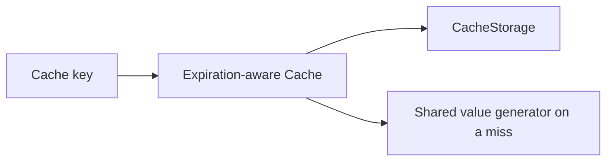

# vyuh_cache

Cache&lt;V&gt; wraps CacheStorage&lt;V&gt; with a configured TTL. Use get for expiration-aware reads, build to retrieve or generate, set to store, remove to invalidate a key, and clear to remove stored entries. Concurrent build misses for a key share generation in the audited source.



[Package source](https://github.com/vyuh-tech/vyuh/tree/main/packages/system/vyuh_cache) · [Released API](https://pub.dev/documentation/vyuh_cache/latest/)

## Choose a declaration

[Cache](#cache) · [CacheConfig](#cacheconfig) · [CacheEntry](#cacheentry) · [CacheStorage](#cachestorage) · [CacheValueBuilder](#cachevaluebuilder) · [MemoryCacheStorage](#memorycachestorage)

## Cache {#cache}

[Source](https://github.com/vyuh-tech/vyuh/blob/main/packages/system/vyuh_cache/lib/vyuh_cache.dart#L52)

A generic cache implementation that manages data of type `V`. Provides comprehensive cache management functionality including configuration, storage operations (get, set, remove),and cache maintenance (build, clear).

```dart
final class Cache<V>
```

Directly declared public members:

```dart
final CacheConfig<V> config;
```

The cache configuration.

```dart
Cache(this.config);
```

The cache implementation.

```dart
Future<V?> build(String key, {CacheValueBuilder<V>? generateValue});
```

Build a value for the cache.

```dart
Future<V?> get(String key);
```

Get a value from the cache.

```dart
Future<bool> has(String key);
```

Check if a value is in the cache.

```dart
Future<void> set(String key, V value);
```

Set a value in the cache.

```dart
Future<void> remove(String key);
```

Remove a value from the cache.

```dart
Future<void> clear();
```

Clear the cache.

## CacheConfig {#cacheconfig}

[Source](https://github.com/vyuh-tech/vyuh/blob/main/packages/system/vyuh_cache/lib/vyuh_cache.dart#L34)

A configuration object for the cache.

```dart
class CacheConfig<V>
```

Directly declared public members:

```dart
final CacheStorage<V> storage;
```

The cache storage to use.

```dart
final Duration ttl;
```

The time to live for the cache.

```dart
CacheConfig({required this.storage, required this.ttl});
```

The cache config.

## CacheEntry {#cacheentry}

[Source](https://github.com/vyuh-tech/vyuh/blob/main/packages/system/vyuh_cache/lib/vyuh_cache.dart#L209)

A cache entry that encapsulates a value with time-based expiration.

```dart
final class CacheEntry<V>
```

Directly declared public members:

```dart
final V value;
```

The value of the cache entry.

```dart
final Duration ttl;
```

The time to live for the cache entry.

```dart
CacheEntry(this.value, this.ttl);
```

The cache entry.

```dart
bool get isExpired;
```

Check if the cache entry is expired.

## CacheStorage {#cachestorage}

[Source](https://github.com/vyuh-tech/vyuh/blob/main/packages/system/vyuh_cache/lib/vyuh_cache.dart#L8)

A cache storage interface that defines the methods for a cache storage.

```dart
abstract interface class CacheStorage<T>
```

Directly declared public members:

```dart
Future<CacheEntry<T>?> get(String key);
```

Get a cache entry by its key.

```dart
Future<void> set(String key, CacheEntry<T> value);
```

Set a cache entry by its key.

```dart
Future<void> delete(String key);
```

Delete a cache entry by its key.

```dart
Future<void> clear();
```

Clear the cache.

```dart
Future<List<String>> keys();
```

Get all keys in the cache.

## CacheValueBuilder {#cachevaluebuilder}

[Source](https://github.com/vyuh-tech/vyuh/blob/main/packages/system/vyuh_cache/lib/vyuh_cache.dart#L48)

A function that builds a value for the cache.

```dart
typedef CacheValueBuilder<T> = Future<T> Function();
```

## MemoryCacheStorage {#memorycachestorage}

[Source](https://github.com/vyuh-tech/vyuh/blob/main/packages/system/vyuh_cache/lib/memory_cache_storage.dart#L5)

A simple in-memory cache storage implementation

```dart
final class MemoryCacheStorage<T> implements CacheStorage<T>
```

Directly declared public members:

```dart
final int? maxEntries;
```

Optional maximum entry count, evicting the least recently used entry.

```dart
MemoryCacheStorage({this.maxEntries});
```


```dart
Future<void> clear();
```


```dart
Future<void> delete(String key);
```


```dart
Future<CacheEntry<T>?> get(String key);
```


```dart
Future<List<String>> keys();
```


```dart
Future<void> set(String key, CacheEntry<T> value);
```
