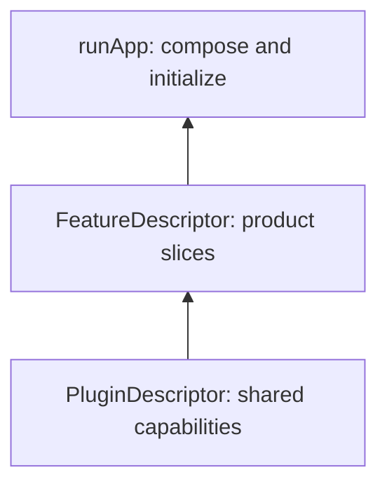

# vyuh_core

Compose features with FeatureDescriptor, choose shared capabilities with PluginDescriptor, and launch through runApp. This package owns platform lifecycle, base plugin contracts, navigation integration, dependency injection, events, analytics, and telemetry.



[Package source](https://github.com/vyuh-tech/vyuh/tree/main/packages/system/vyuh_core) · [Released API](https://pub.dev/documentation/vyuh_core/latest/)

## Choose a declaration

[AnalyticsPlugin](#analyticsplugin) · [AnalyticsProvider](#analyticsprovider) · [AppBuilder](#appbuilder) · [AppRunner](#apprunner) · [AsyncLazyDI](#asynclazydi) · [AuthException](#authexception) · [AuthPlugin](#authplugin) · [BuildFailureView](#buildfailureview) · [CreateUserFailure](#createuserfailure) · [DIPlugin](#diplugin) · [DefaultEnvPlugin](#defaultenvplugin) · [DefaultEventPlugin](#defaulteventplugin) · [DefaultNavigationPlugin](#defaultnavigationplugin) · [DeferredFeatureLoader](#deferredfeatureloader) · [DeleteAccountFailure](#deleteaccountfailure) · [DisposeFunction](#disposefunction) · [EnvPlugin](#envplugin) · [ErrorViewBuilder](#errorviewbuilder) · [EventHandler](#eventhandler) · [EventPlugin](#eventplugin) · [ExtensionBuilder](#extensionbuilder) · [ExtensionDescriptor](#extensiondescriptor) · [FailureActions](#failureactions) · [FailureCard](#failurecard) · [FailureKind](#failurekind) · [FailurePage](#failurepage) · [FeatureDescriptor](#featuredescriptor) · [FeatureFlagPlugin](#featureflagplugin) · [FeatureLoadFailedEvent](#featureloadfailedevent) · [FeatureLoadedEvent](#featureloadedevent) · [FeatureRedirect](#featureredirect) · [FeaturesBuilder](#featuresbuilder) · [GetItDIPlugin](#getitdiplugin) · [HttpNetworkConfig](#httpnetworkconfig) · [HttpNetworkPlugin](#httpnetworkplugin) · [ImagePlaceholderBuilder](#imageplaceholderbuilder) · [InitOncePlugin](#initonceplugin) · [InitState](#initstate) · [LazyFeatureDescriptor](#lazyfeaturedescriptor) · [LazyFeaturesBuilder](#lazyfeaturesbuilder) · [Loader](#loader) · [LocaleConfiguration](#localeconfiguration) · [LocalePlugin](#localeplugin) · [LogLevel](#loglevel) · [Logger](#logger) · [LoggerInterface](#loggerinterface) · [LoginMethod](#loginmethod) · [LoginMethodCanceled](#loginmethodcanceled) · [LoginMethodFailure](#loginmethodfailure) · [LogoutFailure](#logoutfailure) · [NamedBindings](#namedbindings) · [NamedPlugins](#namedplugins) · [NavigationPlugin](#navigationplugin) · [NetworkPlugin](#networkplugin) · [NoOpAnalyticsProvider](#noopanalyticsprovider) · [NoOpTelemetryProvider](#nooptelemetryprovider) · [NoOpTrace](#nooptrace) · [OAuthType](#oauthtype) · [PlatformLoggerInterface](#platformloggerinterface) · [PlatformWidgetBuilder](#platformwidgetbuilder) · [Plugin](#plugin) · [PluginDescriptor](#plugindescriptor) · [PreloadedPlugin](#preloadedplugin) · [RedirectRegistry](#redirectregistry) · [Restartable](#restartable) · [RouteBuilderFunction](#routebuilderfunction) · [RouteErrorViewBuilder](#routeerrorviewbuilder) · [RouteFailureEvent](#routefailureevent) · [RouteFailureView](#routefailureview) · [RouteLoader](#routeloader) · [RouteObservers](#routeobservers) · [RouterUrlStyle](#routerurlstyle) · [RoutingConfigNotifier](#routingconfignotifier) · [SecureStoragePlugin](#securestorageplugin) · [SendEmailLinkFailure](#sendemaillinkfailure) · [SendPasswordResetEmailFailure](#sendpasswordresetemailfailure) · [StoragePlugin](#storageplugin) · [SystemEvent](#systemevent) · [SystemInitFailedEvent](#systeminitfailedevent) · [SystemInitStartedEvent](#systeminitstartedevent) · [SystemInitTracker](#systeminittracker) · [SystemReadyEvent](#systemreadyevent) · [TelemetryPlugin](#telemetryplugin) · [TelemetryProvider](#telemetryprovider) · [Trace](#trace) · [TranslationRegistration](#translationregistration) · [User](#user) · [VoidFutureFunction](#voidfuturefunction) · [VyuhBinding](#vyuhbinding) · [VyuhBranding](#vyuhbranding) · [VyuhEvent](#vyuhevent) · [VyuhEventListener](#vyuheventlistener) · [VyuhFailure](#vyuhfailure) · [VyuhFailureScope](#vyuhfailurescope) · [VyuhPlatform](#vyuhplatform) · [VyuhStrings](#vyuhstrings) · [VyuhTheme](#vyuhtheme) · [VyuhThemeExtension](#vyuhthemeextension) · [debugAssertOneOfPathOrRouteId](#debugassertoneofpathorrouteid) · [defaultAppRunner](#defaultapprunner) · [reportFailure](#reportfailure) · [runApp](#runapp) · [vyuh](#vyuh)

## AnalyticsPlugin {#analyticsplugin}

[Source](https://github.com/vyuh-tech/vyuh/blob/main/packages/system/vyuh_core/lib/plugin/analytics/analytics_plugin.dart#L6)

The default implementation of analytics tracking in Vyuh applications.

```dart
final class AnalyticsPlugin extends Plugin with PreloadedPlugin, InitOncePlugin, RouteObservers implements AnalyticsProvider
```

Directly declared public members:

```dart
final List<AnalyticsProvider> providers;
```

The list of analytics providers managed by this plugin.

```dart
String get description;
```


```dart
List<NavigatorObserver> get observers;
```

Navigation observers for automatic route tracking.

```dart
AnalyticsPlugin({required this.providers});
```

Creates a new AnalyticsPlugin with the given providers.

```dart
Future<void> initOnce();
```

Initializes all analytics providers.

```dart
Future<void> disposeOnce();
```

Disposes all analytics providers.

```dart
Future<void> reportEvent(String name, {Map<String, dynamic>? params});
```

Reports an analytics event to all providers.

```dart
Future<void> identifyUser(String userId, {Map<String, dynamic>? traits});
```

Identifies a user across all analytics providers.

```dart
Future<void> resetUser();
```

Resets the user identity across all analytics providers.

## AnalyticsProvider {#analyticsprovider}

[Source](https://github.com/vyuh-tech/vyuh/blob/main/packages/system/vyuh_core/lib/plugin/analytics/analytics_provider.dart#L5)

The base interface for an Analytics Provider. The provider is responsible for reporting analytics events, errors, and messages.

```dart
abstract interface class AnalyticsProvider
```

Directly declared public members:

```dart
List<NavigatorObserver> get observers;
```

The list of observers for the provider. These are added to the navigator, as part of the router setup.

```dart
String get name;
```

The name of the provider.

```dart
String get title;
```

The title of the provider.

```dart
String get description;
```

The description of the provider.

```dart
Future<void> init();
```

Initializes the provider.

```dart
Future<void> dispose();
```

Disposes the provider.

```dart
Future<void> reportEvent(String name, {Map<String, dynamic>? params});
```

Reports an event with a specific name and optional parameters.

```dart
Future<void> identifyUser(String userId, {Map<String, dynamic>? traits});
```

Identifies a user with the given ID and optional traits. The traits can include any user properties like email, name, etc.

```dart
Future<void> resetUser();
```

Clears the current user identification and associated traits. This should be called when the user logs out.

## AppBuilder {#appbuilder}

[Source](https://github.com/vyuh-tech/vyuh/blob/main/packages/system/vyuh_core/lib/runtime/platform_widget_builder.dart#L9)

A builder for root Widget of the application. Typically this would be a MaterialApp or CupertinoApp.

```dart
typedef AppBuilder = Widget Function(BuildContext context, VyuhPlatform platform);
```

## AppRunner {#apprunner}

[Source](https://github.com/vyuh-tech/vyuh/blob/main/packages/system/vyuh_core/lib/runtime/run_app.dart#L24)

A function that takes a `Widget` and runs the application.

```dart
typedef AppRunner = void Function(Widget app);
```

## AsyncLazyDI {#asynclazydi}

[Source](https://github.com/vyuh-tech/vyuh/blob/main/packages/system/vyuh_core/lib/plugin/di/di_plugin.dart#L52)

An extension on the `DIPlugin` class to provide asynchronous lazy dependency injection.

```dart
extension AsyncLazyDI on DIPlugin
```

Directly declared public members:

```dart
void registerAsync<T extends Object>(Future<T> Function() fn, {String? name});
```

Registers a lazily initialized asynchronous dependency in the dependency injection container.

```dart
Future<T> getAsync<T extends Object>({String? name});
```

Retrieves an asynchronously initialized dependency from the dependency injection container.

## AuthException {#authexception}

[Source](https://github.com/vyuh-tech/vyuh/blob/main/packages/system/vyuh_core/lib/plugin/auth/exceptions.dart#L3)

Base type for all Authentication related exceptions.

```dart
abstract class AuthException implements Exception
```

Directly declared public members:

```dart
const AuthException(this.error);
```

Create an exception with the given error.

```dart
final Object error;
```

The error that caused this exception.

```dart
String toString();
```


## AuthPlugin {#authplugin}

[Source](https://github.com/vyuh-tech/vyuh/blob/main/packages/system/vyuh_core/lib/plugin/auth/auth_plugin.dart#L6)

An authentication plugin that supports various authentication methods.

```dart
abstract class AuthPlugin extends Plugin
```

Directly declared public members:

```dart
var dynamic controller;
```

The controller for the user changes stream.

```dart
String get token;
```


```dart
String get refreshToken;
```


```dart
AuthPlugin({required super.name, required super.title});
```

Creates an instance of `AuthPlugin`.

```dart
User get currentUser;
```

The current user that is signed in.

```dart
Stream<User> get userChanges;
```

A stream of user changes.

```dart
void setCurrentUser(User user);
```


```dart
Future<void> dispose();
```


```dart
Future<void> init();
```


```dart
Future<void> loginAnonymously();
```


```dart
Future<void> sendOtp({required String phoneNumber});
```


```dart
Future<void> loginWithPhoneOtp({required String phoneNumber, required String otp});
```


```dart
Future<void> loginWithEmailPassword({required String email, required String password});
```


```dart
Future<void> registerWithEmailPassword({required String email, required String password});
```


```dart
Future<void> sendEmailLink({required String email, required String clientId});
```


```dart
Future<void> sendPasswordResetEmail({required String email});
```


```dart
Future<void> loginWithEmailLink({required String email, required String link});
```


```dart
Future<void> loginWithOAuth(OAuthType type);
```


```dart
Future<void> logout();
```

Logs out the current user.

```dart
Future<bool> refreshSession();
```

Attempts to refresh the current session token.

```dart
Future<void> deleteAccount();
```

Deletes the current user account.

## BuildFailureView {#buildfailureview}

[Source](https://github.com/vyuh-tech/vyuh/blob/main/packages/system/vyuh_core/lib/runtime/failure_view.dart#L334)

Shown in release builds in place of a widget that failed to build. Small, quiet and themed, so one broken widget does not break the page.

```dart
class BuildFailureView extends StatelessWidget
```

Directly declared public members:

```dart
final FlutterErrorDetails details;
```


```dart
const BuildFailureView({super.key, required this.details});
```


```dart
Widget build(BuildContext context);
```


## CreateUserFailure {#createuserfailure}

[Source](https://github.com/vyuh-tech/vyuh/blob/main/packages/system/vyuh_core/lib/plugin/auth/exceptions.dart#L26)

Exception thrown when creating a user fails.

```dart
final class CreateUserFailure extends AuthException
```

Directly declared public members:

```dart
const CreateUserFailure(super.error);
```


## DIPlugin {#diplugin}

[Source](https://github.com/vyuh-tech/vyuh/blob/main/packages/system/vyuh_core/lib/plugin/di/di_plugin.dart#L3)

`DIPlugin` is an abstract class that extends the `Plugin` class.

```dart
abstract class DIPlugin extends Plugin
```

Directly declared public members:

```dart
DIPlugin({required super.name, required super.title});
```

Constructs a `DIPlugin` instance with the given `name` and `title`.

```dart
void register<T extends Object>(T instance, {String? name});
```

Registers an instance of any Object type with the DI container.

```dart
void registerLazy<T extends Object>(T Function() fn, {String? name});
```

Registers a function that produces an instance of any Object type.

```dart
void registerFactory<T extends Object>(T Function() fn, {String? name});
```

Registers a factory function that produces a new instance each time it is called.

```dart
void unregister<T extends Object>({String? name});
```

Removes the instance of the specified type from the DI container.

```dart
T get<T extends Object>({String? name});
```

Retrieves the registered instance of type `T` from the DI container.

```dart
bool has<T extends Object>({String? name});
```

Checks if an instance of the specified type is registered in the DI container.

```dart
Future<void> reset();
```

Clears all instances registered in the DI container.

## DefaultEnvPlugin {#defaultenvplugin}

[Source](https://github.com/vyuh-tech/vyuh/blob/main/packages/system/vyuh_core/lib/plugin/env/default_env_plugin.dart#L4)

Public declaration in this package.

```dart
final class DefaultEnvPlugin extends EnvPlugin
```

Directly declared public members:

```dart
final String fileName;
```


```dart
final Map<String, String> defaults;
```


```dart
DefaultEnvPlugin({this.fileName = '.env', this.defaults = const {}});
```


```dart
Future<void> init();
```


```dart
Map<String, String> all();
```


```dart
dynamic clear();
```


```dart
Future<void> dispose();
```


```dart
String get(String key, {String? fallback});
```


```dart
String? maybeGet(String key, {String? fallback});
```


## DefaultEventPlugin {#defaulteventplugin}

[Source](https://github.com/vyuh-tech/vyuh/blob/main/packages/system/vyuh_core/lib/plugin/event_plugin.dart#L107)

Default implementation of `EventPlugin` using the event_bus package.

```dart
final class DefaultEventPlugin extends EventPlugin
```

Directly declared public members:

```dart
DefaultEventPlugin();
```


```dart
void emit<T extends VyuhEvent>(T event);
```


```dart
DisposeFunction on<T extends VyuhEvent>(VyuhEventListener<T> listener);
```


```dart
void once<T extends VyuhEvent>(VyuhEventListener<T> listener);
```


```dart
Future<void> dispose();
```


```dart
Future<void> init();
```


## DefaultNavigationPlugin {#defaultnavigationplugin}

[Source](https://github.com/vyuh-tech/vyuh/blob/main/packages/system/vyuh_core/lib/plugin/navigation/default_navigation_plugin.dart#L17)

Public declaration in this package.

```dart
final class DefaultNavigationPlugin extends NavigationPlugin
```

Directly declared public members:

```dart
final g.GoRouterRedirect? redirect;
```

The global redirect for this router, run before every feature redirect.

```dart
DefaultNavigationPlugin({final bool urlReflectsImperativeAPIs = false, this.redirect, RouterUrlStyle? urlStyle});
```

Creates the GoRouter-based navigation plugin.

```dart
GoRouter get instance;
```


```dart
static void enableURLReflectsImperativeAPIs();
```


```dart
static void usePathStrategy();
```


```dart
static void useHashStrategy();
```


```dart
static void setRouterRedirect(g.GoRouterRedirect redirect);
```


```dart
void initRouter({String? initialLocation, required List<g.RouteBase> routes, required GlobalKey<NavigatorState> rootNavigatorKey});
```


```dart
dynamic replaceRoutes(List<g.RouteBase> routes);
```


```dart
void appendInitialRoutes(List<g.RouteBase> routes);
```


```dart
dynamic appendRoutes(List<g.RouteBase> routes);
```


```dart
Future<void> init();
```


```dart
Future<void> dispose();
```


```dart
void go(String location, {Object? extra});
```


```dart
void goNamed(String name, {Map<String, String> pathParameters = const <String, String>{}, Map<String, dynamic> queryParameters = const <String, dynamic>{}, Object? extra});
```


```dart
void pop<T extends Object?>([T? result]);
```


```dart
Future<T?> push<T extends Object?>(String location, {Object? extra});
```


```dart
Future<T?> pushNamed<T extends Object?>(String name, {Map<String, String> pathParameters = const <String, String>{}, Map<String, dynamic> queryParameters = const <String, dynamic>{}, Object? extra});
```


```dart
Future<T?> pushReplacement<T extends Object?>(String location, {Object? extra});
```


```dart
Future<T?> pushReplacementNamed<T extends Object?>(String name, {Map<String, String> pathParameters = const <String, String>{}, Map<String, dynamic> queryParameters = const <String, dynamic>{}, Object? extra});
```


```dart
Future<T?> replace<T extends Object?>(String location, {Object? extra});
```


```dart
Future<T?> replaceNamed<T extends Object?>(String name, {Map<String, String> pathParameters = const <String, String>{}, Map<String, dynamic> queryParameters = const <String, dynamic>{}, Object? extra});
```


## DeferredFeatureLoader {#deferredfeatureloader}

[Source](https://github.com/vyuh-tech/vyuh/blob/main/packages/system/vyuh_core/lib/lazy_feature_descriptor.dart#L4)

A callback that loads a `FeatureDescriptor`, potentially using Dart's deferred import mechanism for web code splitting.

```dart
typedef DeferredFeatureLoader = Future<FeatureDescriptor> Function();
```

## DeleteAccountFailure {#deleteaccountfailure}

[Source](https://github.com/vyuh-tech/vyuh/blob/main/packages/system/vyuh_core/lib/plugin/auth/exceptions.dart#L40)

Exception thrown when the account deletion fails.

```dart
final class DeleteAccountFailure extends AuthException
```

Directly declared public members:

```dart
const DeleteAccountFailure(super.error);
```

Create a new DeleteAccountFailure with the given error.

## DisposeFunction {#disposefunction}

[Source](https://github.com/vyuh-tech/vyuh/blob/main/packages/system/vyuh_core/lib/plugin/event_plugin.dart#L101)

A function that can be called to dispose of (cancel) an event subscription.

```dart
typedef DisposeFunction = void Function();
```

## EnvPlugin {#envplugin}

[Source](https://github.com/vyuh-tech/vyuh/blob/main/packages/system/vyuh_core/lib/plugin/env/env_plugin.dart#L3)

An abstract class representing an environment plugin. It provides methods to interact with environment variables.

```dart
abstract class EnvPlugin extends Plugin
```

Directly declared public members:

```dart
EnvPlugin({required super.name, required super.title});
```

Constructs an `EnvPlugin` with the given name and title.

```dart
Map<String, String?> all();
```

Returns a map of all environment variables.

```dart
String get(String key, {String? fallback});
```

Returns the value of the environment variable specified by `key`, or the `fallback` value if not found.

```dart
String? maybeGet(String key, {String? fallback});
```

Returns the value of the environment variable specified by `key`, or the `fallback` value if not found, or null if neither is found.

```dart
void clear();
```

Clears all the environment variables.

## ErrorViewBuilder {#errorviewbuilder}

[Source](https://github.com/vyuh-tech/vyuh/blob/main/packages/system/vyuh_core/lib/runtime/platform_widget_builder.dart#L102)

A builder for an error view widget.

```dart
typedef ErrorViewBuilder = Widget Function( BuildContext context,
```

## EventHandler {#eventhandler}

[Source](https://github.com/vyuh-tech/vyuh/blob/main/packages/system/vyuh_core/lib/feature_hooks.dart#L7)

A typed event listener that a feature declares in `FeatureDescriptor.events`.

```dart
final class EventHandler<T extends VyuhEvent>
```

Directly declared public members:

```dart
final VyuhEventListener<T> listener;
```

Called for every event of type `T`.

```dart
const EventHandler(this.listener);
```

Creates a handler for events of type `T`.

```dart
Type get eventType;
```

The event type this handler listens to.

```dart
DisposeFunction subscribe(EventPlugin events);
```

Subscribes `listener` on `events`, keeping the generic type `T`. Used by the platform; features do not call this.

## EventPlugin {#eventplugin}

[Source](https://github.com/vyuh-tech/vyuh/blob/main/packages/system/vyuh_core/lib/plugin/event_plugin.dart#L6)

Base class for implementing event handling in Vyuh applications.

```dart
abstract class EventPlugin extends Plugin with PreloadedPlugin
```

Directly declared public members:

```dart
EventPlugin({required super.name, required super.title});
```


```dart
DisposeFunction on<T extends VyuhEvent>(VyuhEventListener<T> listener);
```

Subscribe to events of type `T`.

```dart
void once<T extends VyuhEvent>(VyuhEventListener<T> listener);
```

Subscribe to a single occurrence of an event of type `T`.

```dart
void emit<T extends VyuhEvent>(T event);
```

Emit an event to all subscribers.

## ExtensionBuilder {#extensionbuilder}

[Source](https://github.com/vyuh-tech/vyuh/blob/main/packages/system/vyuh_core/lib/extension.dart#L29)

The base type for all extension builders. An extension builder is responsible for building an extension, by assembling all of the extension descriptors.

```dart
abstract class ExtensionBuilder<T extends ExtensionDescriptor>
```

Directly declared public members:

```dart
final String title;
```

The title of the extension.

```dart
final Type extensionType;
```

The runtime Type of the extension.

```dart
String? get sourceFeature;
```

The name of the feature which this extension belongs to. This is set by the bootstrapping process of Vyuh.

```dart
void setSourceFeature(String featureName);
```

Sets the source feature for this extension builder. This is called by the Vyuh bootstrapping process.

```dart
ExtensionBuilder({required this.extensionType, required this.title});
```

Creates a new ExtensionBuilder.

```dart
bool get isInitialized;
```

Whether the extension is currently initialized.

```dart
bool get isDisposed;
```

Whether the extension has been disposed.

```dart
Future<void> onInit(List<T> extensions);
```

Protected method for subclasses to implement initialization logic.

```dart
Future<void> onDispose();
```

Protected method for subclasses to implement disposal logic.

```dart
void registerLazy(ExtensionDescriptor descriptor);
```

Registers extensions from a lazily-loaded feature. Override in subclasses that support incremental registration. By default this is a no-op.

```dart
VoidCallback captureLazyState(ExtensionDescriptor descriptor);
```

Captures state before lazy registration and returns a synchronous rollback. Builders supporting `registerLazy` must include all mutated registries. Unsupported builders fail before any contribution is published.

```dart
Future<void> init(List<ExtensionDescriptor> extensions);
```

Initializes the extension.

```dart
Future<void> dispose();
```

Disposes the extension.

## ExtensionDescriptor {#extensiondescriptor}

[Source](https://github.com/vyuh-tech/vyuh/blob/main/packages/system/vyuh_core/lib/extension.dart#L3)

The base type for all extension descriptors. An ExtensionDescriptor provides configurability for an extension.

```dart
abstract class ExtensionDescriptor
```

Directly declared public members:

```dart
final String title;
```

The title of the extension.

```dart
String? get sourceFeature;
```

The name of the feature which this extension belongs to. This is set by the Vyuh bootstrapping process

```dart
void setSourceFeature(String featureName);
```

Sets the source feature for this extension. This is called by the Vyuh bootstrapping process.

```dart
ExtensionDescriptor({required this.title});
```

Creates a new ExtensionDescriptor.

```dart
void onSourceFeatureUpdated();
```


## FailureActions {#failureactions}

[Source](https://github.com/vyuh-tech/vyuh/blob/main/packages/system/vyuh_core/lib/runtime/failure_view.dart#L31)

The recovery actions that apply in a given context. Every error view offers the same choices in the same order: Retry, Go home, Back, Restart.

```dart
abstract final class FailureActions
```

Directly declared public members:

```dart
static bool canGoBack(BuildContext context);
```

Whether there is a page to go back to.

```dart
static bool canGoHome(BuildContext context, [VyuhFailure? failure]);
```

Whether "Go home" can help: the router exists, the failure allows it, and the failure is not on the home route itself.

```dart
static bool needsRestart(BuildContext context, [VyuhFailure? failure]);
```

Whether only a restart can help: there is no router yet, or the platform failed to initialize.

```dart
static void goBack(BuildContext context);
```

Goes back one page.

```dart
static void goHome();
```

Goes to the home route.

```dart
static void restart();
```

Restarts the platform. This rebuilds the whole app, so it is the last resort.

## FailureCard {#failurecard}

[Source](https://github.com/vyuh-tech/vyuh/blob/main/packages/system/vyuh_core/lib/runtime/failure_view.dart#L228)

The default inline failure, used inside a page for a part that failed.

```dart
class FailureCard extends StatelessWidget
```

Directly declared public members:

```dart
final String title;
```


```dart
final String? message;
```


```dart
final Object? error;
```


```dart
final StackTrace? stackTrace;
```


```dart
final VoidCallback? onRetry;
```


```dart
final String? retryLabel;
```


```dart
final bool showRestart;
```


```dart
const FailureCard({super.key, required this.title, this.message, this.error, this.stackTrace, this.onRetry, this.retryLabel, this.showRestart = false});
```


```dart
Widget build(BuildContext context);
```


## FailureKind {#failurekind}

[Source](https://github.com/vyuh-tech/vyuh/blob/main/packages/system/vyuh_core/lib/runtime/failure.dart#L3)

What went wrong, used to pick the message and the recovery actions.

```dart
enum FailureKind { init, notFound, route, featureLoad, featureDisabled, content, unexpected }
```

## FailurePage {#failurepage}

[Source](https://github.com/vyuh-tech/vyuh/blob/main/packages/system/vyuh_core/lib/runtime/failure_view.dart#L117)

The default full-page failure: a themed page with a clear message and the recovery actions that apply. Error details appear only in debug builds.

```dart
class FailurePage extends StatelessWidget
```

Directly declared public members:

```dart
final String title;
```


```dart
final String? message;
```


```dart
final Object? error;
```


```dart
final StackTrace? stackTrace;
```


```dart
final VoidCallback? onRetry;
```


```dart
final String? retryLabel;
```


```dart
final bool showRestart;
```

Shows Restart even when other actions are available.

```dart
const FailurePage({super.key, required this.title, this.message, this.error, this.stackTrace, this.onRetry, this.retryLabel, this.showRestart = false});
```


```dart
Widget build(BuildContext context);
```


## FeatureDescriptor {#featuredescriptor}

[Source](https://github.com/vyuh-tech/vyuh/blob/main/packages/system/vyuh_core/lib/feature_descriptor.dart#L13)

The essential descriptor for a feature. A feature descriptor provides the necessary information to register a feature within the framework.

```dart
final class FeatureDescriptor
```

Directly declared public members:

```dart
final String name;
```

The name of the feature.

```dart
final String title;
```

The title of the feature.

```dart
final String? description;
```

The description of the feature.

```dart
final IconData? icon;
```

The icon of the feature.

```dart
final VoidFutureFunction? init;
```

The function to initialize the feature.

```dart
final VoidFutureFunction? dispose;
```

The function to dispose the feature.

```dart
final List<ExtensionDescriptor>? extensions;
```

The list of extensions for the feature.

```dart
final List<ExtensionBuilder>? extensionBuilders;
```

The list of extension builders exposed by this feature.

```dart
final List<String> dependencies;
```

Optional list of feature names that must be initialized before this feature. Used for ordering during initialization. If empty (the default), no ordering constraint is applied.

```dart
final List<EventHandler> events;
```

App-level event listeners. The platform subscribes them before the feature's `init` runs and cancels them on dispose, restart, or a failed lazy activation. See `EventHandler` and `SystemEvent`.

```dart
final List<FeatureRedirect> redirects;
```

Redirects this feature adds to the app's router, evaluated in feature order after the global redirect. See `FeatureRedirect`.

```dart
RouteBuilderFunction? get routes;
```

The routes for the feature, or null when it contributes none. Features that only add event handlers, redirects, extensions or services can leave this out.

```dart
FeatureDescriptor({required this.name, required this.title, this.description, this.icon, this.init, this.dispose, RouteBuilderFunction? routes, this.extensions, this.extensionBuilders, this.dependencies = const [], this.events = const [], this.redirects = const []});
```

Creates a new FeatureDescriptor.

## FeatureFlagPlugin {#featureflagplugin}

[Source](https://github.com/vyuh-tech/vyuh/blob/main/packages/system/vyuh_core/lib/plugin/feature_flag.dart#L3)

The base class for a Feature Flag plugin. Feature Flags are useful to control the visibility of features in an application. They are setup on the server side and can be controlled by the server to enable/disable features for different users.

```dart
abstract class FeatureFlagPlugin<TSettings, TContext> extends Plugin
```

Directly declared public members:

```dart
final TSettings settings;
```

The settings for the feature flag plugin.

```dart
FeatureFlagPlugin({required this.settings, required super.name, required super.title});
```


```dart
Future<bool> getBool(String featureName, {bool defaultValue = false});
```

Returns the value of the feature flag as a boolean.

```dart
Future<String> getString(String featureName, {String defaultValue = ''});
```

Returns the value of the feature flag as a string.

```dart
Future<int> getInt(String featureName, {int defaultValue = 0});
```

Returns the value of the feature flag as an integer.

```dart
Future<double> getDouble(String featureName, {double defaultValue = 0.0});
```

Returns the value of the feature flag as a double.

```dart
Future<Map<String, dynamic>> getJson(String featureName, {Map<String, dynamic> defaultValue = const {}});
```

Returns the value of the feature flag as a JSON object represented by a Map.

```dart
Future<void> setDefaults(Map<String, dynamic> defaults);
```

Sets the default values for the feature flags. This is useful when the plugin is first initialized and want to set defaults before fetching the actual values.

```dart
Future<void> updateContext(TContext context);
```

Updates the context of the feature flag plugin. This could include setting the user id, user attributes, locale, etc.

```dart
Future<void> refresh();
```

Refreshes the feature flags. This is useful to force an update on the feature flag values.

## FeatureLoadFailedEvent {#featureloadfailedevent}

[Source](https://github.com/vyuh-tech/vyuh/blob/main/packages/system/vyuh_core/lib/runtime/platform/events.dart#L62)

Emitted when a lazy feature fails to load, or is disabled by its flag.

```dart
final class FeatureLoadFailedEvent extends SystemEvent<VyuhFailure>
```

Directly declared public members:

```dart
final String featureName;
```

The name of the feature.

```dart
final VyuhFailure failure;
```

The failure. Its kind is `FailureKind.featureDisabled` for a disabled feature and `FailureKind.featureLoad` otherwise.

```dart
FeatureLoadFailedEvent({required this.featureName, required this.failure});
```


## FeatureLoadedEvent {#featureloadedevent}

[Source](https://github.com/vyuh-tech/vyuh/blob/main/packages/system/vyuh_core/lib/runtime/platform/events.dart#L49)

Emitted after a feature is ready: an eager feature finished its `init`, or a lazy feature finished loading and activating.

```dart
final class FeatureLoadedEvent extends SystemEvent<String>
```

Directly declared public members:

```dart
final String featureName;
```

The name of the feature.

```dart
final bool isLazy;
```

Whether the feature was loaded lazily.

```dart
FeatureLoadedEvent({required this.featureName, required this.isLazy});
```


## FeatureRedirect {#featureredirect}

[Source](https://github.com/vyuh-tech/vyuh/blob/main/packages/system/vyuh_core/lib/feature_hooks.dart#L41)

A redirect that a feature contributes to the app's router.

```dart
final class FeatureRedirect
```

Directly declared public members:

```dart
final String name;
```

A short name used in logs and error reports.

```dart
final GoRouterRedirect redirect;
```

Returns a new location to redirect to, or `null` to continue.

```dart
final List<Type> refreshOn;
```

Event types that make the router re-run its redirects. Matching is by exact runtime type.

```dart
final Listenable? listenable;
```

An optional listenable (a `ValueNotifier`, a `ChangeNotifier`, or a MobX store bridged to a listenable) that makes the router re-run its redirects when it notifies.

```dart
const FeatureRedirect({required this.name, required this.redirect, this.refreshOn = const [], this.listenable});
```

Creates a feature redirect.

## FeaturesBuilder {#featuresbuilder}

[Source](https://github.com/vyuh-tech/vyuh/blob/main/packages/system/vyuh_core/lib/runtime/platform/vyuh_platform.dart#L12)

The builder function that creates a set of features.

```dart
typedef FeaturesBuilder = FutureOr<List<FeatureDescriptor>> Function();
```

## GetItDIPlugin {#getitdiplugin}

[Source](https://github.com/vyuh-tech/vyuh/blob/main/packages/system/vyuh_core/lib/plugin/di/plugin_di_get_it.dart#L4)

GetItDIPlugin is a class that is final and it extends the `DIPlugin`. It uses the 'GetIt' package to manage dependency injection in the project.

```dart
final class GetItDIPlugin extends DIPlugin
```

Directly declared public members:

```dart
final String? debugLabel;
```


```dart
GetItDIPlugin({this.debugLabel});
```


```dart
Future<void> init();
```


```dart
Future<void> dispose();
```


```dart
T get<T extends Object>({String? name});
```


```dart
bool has<T extends Object>({String? name});
```


```dart
void register<T extends Object>(T instance, {String? name});
```


```dart
void registerFactory<T extends Object>(T Function() fn, {String? name});
```


```dart
void registerLazy<T extends Object>(T Function() fn, {String? name});
```


```dart
Future<void> reset();
```


```dart
void unregister<T extends Object>({String? name});
```


## HttpNetworkConfig {#httpnetworkconfig}

[Source](https://github.com/vyuh-tech/vyuh/blob/main/packages/system/vyuh_core/lib/plugin/network/http_network_plugin.dart#L13)

Public declaration in this package.

```dart
final class HttpNetworkConfig
```

Directly declared public members:

```dart
final Duration timeout;
```


```dart
final int maxRetryAttempts;
```


```dart
final Duration maxRetryDelay;
```


```dart
const HttpNetworkConfig({required this.timeout, required this.maxRetryAttempts, required this.maxRetryDelay});
```


```dart
static const dynamic standard;
```


## HttpNetworkPlugin {#httpnetworkplugin}

[Source](https://github.com/vyuh-tech/vyuh/blob/main/packages/system/vyuh_core/lib/plugin/network/http_network_plugin.dart#L30)

Public declaration in this package.

```dart
final class HttpNetworkPlugin extends NetworkPlugin
```

Directly declared public members:

```dart
HttpNetworkPlugin({Client? client, RetryOptions? retryOptions, Duration? timeout, this._webIncludeCredentials = true});
```

Creates an HTTP network plugin.

```dart
Future<void> init();
```


```dart
Future<void> dispose();
```


```dart
Future<Response> get(Uri url, {Map<String, String>? headers});
```


```dart
Future<Response> head(Uri url, {Map<String, String>? headers});
```


```dart
Future<Response> post(Uri url, {Map<String, String>? headers, Object? body, Encoding? encoding});
```


```dart
Future<Response> put(Uri url, {Map<String, String>? headers, Object? body, Encoding? encoding});
```


```dart
Future<Response> delete(Uri url, {Map<String, String>? headers, Object? body, Encoding? encoding});
```


```dart
Future<Response> patch(Uri url, {Map<String, String>? headers, Object? body, Encoding? encoding});
```


```dart
void close();
```


```dart
Future<String> read(Uri url, {Map<String, String>? headers});
```


```dart
Future<Uint8List> readBytes(Uri url, {Map<String, String>? headers});
```


```dart
Future<StreamedResponse> send(BaseRequest request);
```


## ImagePlaceholderBuilder {#imageplaceholderbuilder}

[Source](https://github.com/vyuh-tech/vyuh/blob/main/packages/system/vyuh_core/lib/runtime/platform_widget_builder.dart#L53)

A builder for an image placeholder widget.

```dart
typedef ImagePlaceholderBuilder = Widget Function(BuildContext context,
```

## InitOncePlugin {#initonceplugin}

[Source](https://github.com/vyuh-tech/vyuh/blob/main/packages/system/vyuh_core/lib/plugin/plugin.dart#L28)

Initializes a plugin once per active lifecycle, sharing concurrent calls.

```dart
mixin InitOncePlugin on Plugin
```

Directly declared public members:

```dart
bool get initialized;
```


```dart
Future<void> init();
```


```dart
Future<void> dispose();
```


```dart
Future<void> initOnce();
```


```dart
Future<void> disposeOnce();
```


## InitState {#initstate}

[Source](https://github.com/vyuh-tech/vyuh/blob/main/packages/system/vyuh_core/lib/runtime/init_tracker.dart#L4)

The possible states of the system initialization.

```dart
enum InitState { notStarted, plugins, features, ready, error }
```

## LazyFeatureDescriptor {#lazyfeaturedescriptor}

[Source](https://github.com/vyuh-tech/vyuh/blob/main/packages/system/vyuh_core/lib/lazy_feature_descriptor.dart#L18)

Describes a feature that should be loaded lazily — only when one of its route prefixes is first navigated to.

```dart
final class LazyFeatureDescriptor
```

Directly declared public members:

```dart
final String name;
```

Unique name for this feature. Must match the inner `FeatureDescriptor.name` returned by `loader`.

```dart
final String title;
```

Human-readable title shown in the loading UI while the feature is being downloaded and initialized.

```dart
final String? description;
```

Optional description of what this feature does.

```dart
final IconData? icon;
```

Optional icon for the loading indicator.

```dart
final List<String> routePrefixes;
```

Route path prefixes that belong to this feature. When any URL matching these prefixes is navigated to, the feature is loaded.

```dart
final DeferredFeatureLoader loader;
```

The function that loads the actual `FeatureDescriptor`. This is where `deferred as` loading happens.

```dart
final List<String> dependencies;
```

Optional list of feature names this feature depends on. If a dependency is also lazy, it will be loaded first. If a dependency is already loaded (eager or previously loaded lazy), it is skipped.

```dart
final String? featureFlag;
```

Optional feature flag name. If provided and a `FeatureFlagPlugin` is registered, the feature is only loaded when the flag evaluates to true.

```dart
LazyFeatureDescriptor({required this.name, required this.title, required this.routePrefixes, required this.loader, this.description, this.icon, this.dependencies = const [], this.featureFlag});
```


## LazyFeaturesBuilder {#lazyfeaturesbuilder}

[Source](https://github.com/vyuh-tech/vyuh/blob/main/packages/system/vyuh_core/lib/runtime/run_app.dart#L21)

A builder that returns lazy feature descriptors.

```dart
typedef LazyFeaturesBuilder = List<LazyFeatureDescriptor> Function();
```

## Loader {#loader}

[Source](https://github.com/vyuh-tech/vyuh/blob/main/packages/system/vyuh_core/lib/runtime/platform_widget_builder.dart#L24)

A builder for a widget that is shown when the app is loading.

```dart
typedef Loader = Widget Function(BuildContext context);
```

## LocaleConfiguration {#localeconfiguration}

[Source](https://github.com/vyuh-tech/vyuh/blob/main/packages/system/vyuh_core/lib/plugin/i18n/locale_configuration.dart#L3)

Configuration for a single locale including its code, native name, and icon

```dart
class LocaleConfiguration
```

Directly declared public members:

```dart
final Locale locale;
```

The Flutter locale

```dart
final String nativeName;
```

Native name of the language (e.g., "हिन्दी" for Hindi)

```dart
final String icon;
```

Icon/emoji representing the locale (e.g., "🇮🇳" for Hindi)

```dart
const LocaleConfiguration({required this.locale, required this.nativeName, required this.icon});
```


```dart
String get languageCode;
```

Get the language code from the locale

```dart
factory LocaleConfiguration.fromCode(String code, {required String nativeName, required String icon});
```

Create from language code with explicit name and icon

## LocalePlugin {#localeplugin}

[Source](https://github.com/vyuh-tech/vyuh/blob/main/packages/system/vyuh_core/lib/plugin/i18n/locale_plugin.dart#L11)

Plugin for managing internationalization across features

```dart
class LocalePlugin extends Plugin
```

Directly declared public members:

```dart
final List<LocaleConfiguration> locales;
```

List of supported locale configurations

```dart
final Observable<Locale> currentLocale;
```

Raw observable for the current locale (no codegen)

```dart
final Observable<bool> isLoadingLocale;
```

Raw observable to track locale loading state (no codegen)

```dart
LocaleConfiguration get defaultLocale;
```

Get the default locale configuration

```dart
List<Locale> get supportedLocales;
```

Available locales in the application

```dart
LocalePlugin({required this.locales, this._defaultLocale});
```


```dart
void registerTranslations(TranslationRegistration registration);
```

Register a feature's translation configuration

```dart
Future<bool> setLocale(Locale locale);
```

Set the application locale

```dart
Future<void> useDeviceLocale();
```

Use the device's locale if supported, otherwise default to configured default

```dart
bool isLocaleActive(Locale locale);
```

Check if a specific locale is currently active

```dart
String getLocaleName(String localeCode);
```

Get the native name for a locale code

```dart
String getLocaleIcon(String localeCode);
```

Get the icon/emoji for a locale code

```dart
String get currentLocaleCode;
```

Get the current locale code

```dart
int get registrationCount;
```

Number of registered translations

```dart
Future<void> init();
```


```dart
Future<void> dispose();
```


## LogLevel {#loglevel}

[Source](https://github.com/vyuh-tech/vyuh/blob/main/packages/system/vyuh_core/lib/plugin/telemetry/telemetry_plugin.dart#L7)

Public declaration in this package.

```dart
enum LogLevel { debug, info, trace, warning, error, fatal }
```

## Logger {#logger}

[Source](https://github.com/vyuh-tech/vyuh/blob/main/packages/system/vyuh_core/lib/plugin/telemetry/logger.dart#L3)

Public declaration in this package.

```dart
abstract interface class Logger
```

Directly declared public members:

```dart
void trace(dynamic message);
```


```dart
void debug(dynamic message);
```


```dart
void info(dynamic message);
```


```dart
void warn(dynamic message);
```


```dart
void error(dynamic message, {Object? error});
```


```dart
void fatal(dynamic message, {Object? error, StackTrace? stackTrace});
```


## LoggerInterface {#loggerinterface}

[Source](https://github.com/vyuh-tech/vyuh/blob/main/packages/system/vyuh_core/lib/plugin/telemetry/logger.dart#L54)

A convenience wrapper to provide a Logger interface to the Telemetry reportMessage() calls.

```dart
extension LoggerInterface on VyuhBinding
```

Directly declared public members:

```dart
Logger get log;
```


## LoginMethod {#loginmethod}

[Source](https://github.com/vyuh-tech/vyuh/blob/main/packages/system/vyuh_core/lib/plugin/auth/user.dart#L52)

Represents the method used to login.

```dart
enum LoginMethod { unknown, anonymous, emailPassword, phoneOtp, emailLink, google, facebook, apple, twitter, github, linkedin, microsoft, custom }
```

Directly declared public members:

```dart
IconData icon();
```

Returns the icon for this login method. This is useful only in the developer tools or UI.

```dart
String label();
```

Returns the label for this login method. This is useful only in the developer tools or UI.

## LoginMethodCanceled {#loginmethodcanceled}

[Source](https://github.com/vyuh-tech/vyuh/blob/main/packages/system/vyuh_core/lib/plugin/auth/exceptions.dart#L31)

Exception thrown when a login method is canceled.

```dart
final class LoginMethodCanceled extends AuthException
```

Directly declared public members:

```dart
final LoginMethod method;
```

The login method that was canceled.

```dart
const LoginMethodCanceled(this.method, super.error);
```

Create a new LoginMethodCanceled with the given method and error.

## LoginMethodFailure {#loginmethodfailure}

[Source](https://github.com/vyuh-tech/vyuh/blob/main/packages/system/vyuh_core/lib/plugin/auth/exceptions.dart#L17)

Exception thrown when a login method fails.

```dart
final class LoginMethodFailure extends AuthException
```

Directly declared public members:

```dart
final LoginMethod method;
```

The login method that failed.

```dart
const LoginMethodFailure(this.method, super.error);
```

Create a new LoginMethodFailure with the given method and error.

## LogoutFailure {#logoutfailure}

[Source](https://github.com/vyuh-tech/vyuh/blob/main/packages/system/vyuh_core/lib/plugin/auth/exceptions.dart#L46)

Exception thrown when the logout fails.

```dart
final class LogoutFailure extends AuthException
```

Directly declared public members:

```dart
const LogoutFailure(super.error);
```

Create a new LogoutFailure with the given error.

## NamedBindings {#namedbindings}

[Source](https://github.com/vyuh-tech/vyuh/blob/main/packages/system/vyuh_core/lib/runtime/vyuh_binding.dart#L120)

The same named accessors as `vyuh.*`, for code that must also run in widget mode, where `runApp` (and so `vyuh`) is not used.

```dart
extension NamedBindings on VyuhBinding
```

Directly declared public members:

```dart
DIPlugin get di;
```

The dependency injection plugin, providing dependency injection services.

```dart
AnalyticsPlugin get analytics;
```

The analytics plugin, for tracking and reporting analytics data.

```dart
TelemetryPlugin get telemetry;
```

The telemetry plugin, used for monitoring and logging telemetry information.

```dart
NetworkPlugin get network;
```

The network plugin, for handling network requests and communication.

```dart
FeatureFlagPlugin? get featureFlag;
```

The feature flag plugin, used for managing and toggling feature flags. Can be null if the plugin is not registered.

```dart
EnvPlugin get env;
```

The environment plugin, providing access to platform-specific environment settings.

```dart
EventPlugin get event;
```

The event plugin, for managing and emitting events within the platform.

```dart
AuthPlugin get auth;
```

The authentication plugin.

```dart
NavigationPlugin get router;
```

The navigation plugin.

```dart
LocalePlugin? get locale;
```

The locale plugin, or null when it is not registered.

```dart
StoragePlugin get storage;
```

The storage plugin, for general key-value persistence.

```dart
SecureStoragePlugin get secureStorage;
```

The secure storage plugin, for secrets such as tokens.

## NamedPlugins {#namedplugins}

[Source](https://github.com/vyuh-tech/vyuh/blob/main/packages/system/vyuh_core/lib/runtime/platform/vyuh_platform.dart#L86)

Named accessors for the system plugins: `vyuh.router`, `vyuh.auth`, ...

```dart
extension NamedPlugins on VyuhPlatform
```

Directly declared public members:

```dart
DIPlugin get di;
```

The dependency injection plugin, providing dependency injection services.

```dart
AnalyticsPlugin get analytics;
```

The analytics plugin, for tracking and reporting analytics data.

```dart
TelemetryPlugin get telemetry;
```

The telemetry plugin, used for monitoring and logging telemetry information.

```dart
NetworkPlugin get network;
```

The network plugin, for handling network requests and communication.

```dart
AuthPlugin get auth;
```

The authentication plugin, responsible for user authentication and authorization.

```dart
NavigationPlugin get router;
```

The navigation/router plugin, managing navigation within the application.

```dart
FeatureFlagPlugin? get featureFlag;
```

The feature flag plugin, used for managing and toggling feature flags. Can be null if the plugin is not registered.

```dart
EnvPlugin get env;
```

The environment plugin, providing access to platform-specific environment settings.

```dart
EventPlugin get event;
```

The event plugin, for managing and emitting events within the platform.

```dart
LocalePlugin? get locale;
```

The locale plugin, providing access to locale settings. Can be null if the plugin is not registered.

```dart
StoragePlugin get storage;
```

The storage plugin, for general key-value persistence.

```dart
SecureStoragePlugin get secureStorage;
```

The secure storage plugin, for secrets such as tokens.

## NavigationPlugin {#navigationplugin}

[Source](https://github.com/vyuh-tech/vyuh/blob/main/packages/system/vyuh_core/lib/plugin/navigation/navigation.dart#L6)

Public declaration in this package.

```dart
abstract class NavigationPlugin extends Plugin
```

Directly declared public members:

```dart
GoRouter get instance;
```


```dart
static const dynamic catchAllPath;
```

The path of a catch-all route. A feature can contribute one `GoRoute` with this path to handle every location no other route matches; the router always places it last. Without one, unmatched locations show the not-found `RouteFailureView`.

```dart
NavigationPlugin({required super.name, required super.title});
```


```dart
final RedirectRegistry featureRedirects;
```

Redirects contributed by features through `FeatureDescriptor.redirects`.

```dart
VoidCallback watchRedirectTriggers(VoidCallback refresh);
```

Calls `refresh` whenever a feature redirect's trigger fires: one of its `refreshOn` events is emitted, or its `listenable` notifies. Also calls `refresh` when the set of redirects changes. Returns a function that stops watching.

```dart
String homeLocation;
```

The location of the home route, used by error views to offer a way back. Set by the platform from `runApp(homeLocation: ...)`.

```dart
void goHome();
```

Navigates to `homeLocation`.

```dart
void initRouter({String? initialLocation, required List<g.RouteBase> routes, required GlobalKey<NavigatorState> rootNavigatorKey});
```


```dart
void replaceRoutes(List<g.RouteBase> routes);
```


```dart
void appendRoutes(List<g.RouteBase> routes);
```


```dart
void appendInitialRoutes(List<g.RouteBase> routes);
```


```dart
void pop<T extends Object?>([T? result]);
```


```dart
void go(String location, {Object? extra});
```


```dart
void goNamed(String name, {Map<String, String> pathParameters = const <String, String>{}, Map<String, dynamic> queryParameters = const <String, dynamic>{}, Object? extra});
```


```dart
Future<T?> push<T extends Object?>(String location, {Object? extra});
```


```dart
Future<T?> pushNamed<T extends Object?>(String name, {Map<String, String> pathParameters = const <String, String>{}, Map<String, dynamic> queryParameters = const <String, dynamic>{}, Object? extra});
```


```dart
Future<T?> pushReplacement<T extends Object?>(String location, {Object? extra});
```


```dart
Future<T?> pushReplacementNamed<T extends Object?>(String name, {Map<String, String> pathParameters = const <String, String>{}, Map<String, dynamic> queryParameters = const <String, dynamic>{}, Object? extra});
```


```dart
Future<T?> replace<T extends Object?>(String location, {Object? extra});
```


```dart
Future<T?> replaceNamed<T extends Object?>(String name, {Map<String, String> pathParameters = const <String, String>{}, Map<String, dynamic> queryParameters = const <String, dynamic>{}, Object? extra});
```


## NetworkPlugin {#networkplugin}

[Source](https://github.com/vyuh-tech/vyuh/blob/main/packages/system/vyuh_core/lib/plugin/network/network_plugin.dart#L6)

Base class for implementing network communication in Vyuh applications.

```dart
abstract class NetworkPlugin extends Plugin with PreloadedPlugin implements Client
```

Directly declared public members:

```dart
NetworkPlugin({required super.name, required super.title});
```


```dart
Future<Response> get(Uri url, {Map<String, String>? headers});
```

Sends an HTTP GET request to the given URL.

```dart
Future<Response> head(Uri url, {Map<String, String>? headers});
```

Sends an HTTP HEAD request to the given URL.

```dart
Future<Response> post(Uri url, {Map<String, String>? headers, Object? body, Encoding? encoding});
```

Sends an HTTP POST request to the given URL.

```dart
Future<Response> put(Uri url, {Map<String, String>? headers, Object? body, Encoding? encoding});
```

Sends an HTTP PUT request to the given URL.

```dart
Future<Response> delete(Uri url, {Map<String, String>? headers, Object? body, Encoding? encoding});
```

Sends an HTTP DELETE request to the given URL.

```dart
Future<Response> patch(Uri url, {Map<String, String>? headers, Object? body, Encoding? encoding});
```

Sends an HTTP PATCH request to the given URL.

## NoOpAnalyticsProvider {#noopanalyticsprovider}

[Source](https://github.com/vyuh-tech/vyuh/blob/main/packages/system/vyuh_core/lib/plugin/analytics/noop_analytics_provider.dart#L4)

A no-op implementation of `AnalyticsProvider`.

```dart
final class NoOpAnalyticsProvider implements AnalyticsProvider
```

Directly declared public members:

```dart
String get name;
```


```dart
String get title;
```


```dart
String get description;
```


```dart
Future<void> dispose();
```


```dart
Future<void> init();
```


```dart
Future<void> reportEvent(String name, {Map<String, dynamic>? params});
```


```dart
Future<void> identifyUser(String userId, {Map<String, dynamic>? traits});
```


```dart
Future<void> resetUser();
```


```dart
List<NavigatorObserver> get observers;
```


## NoOpTelemetryProvider {#nooptelemetryprovider}

[Source](https://github.com/vyuh-tech/vyuh/blob/main/packages/system/vyuh_core/lib/plugin/telemetry/noop_telemetry_provider.dart#L4)

A no-op implementation of `TelemetryProvider` that can be used for development or testing purposes.

```dart
final class NoOpTelemetryProvider implements TelemetryProvider
```

Directly declared public members:

```dart
Future<Trace> startTrace(String name, String operation, {LogLevel? level = LogLevel.info});
```


```dart
String get name;
```


```dart
String get title;
```


```dart
String get description;
```


```dart
Future<void> dispose();
```


```dart
Future<void> init();
```


```dart
Future<void> reportError(exception, {StackTrace? stackTrace, Map<String, dynamic>? params, bool fatal = false});
```


```dart
Future<void> reportFlutterError(FlutterErrorDetails details, {bool fatal = false});
```


```dart
Future<void> reportMessage(String message, {Map<String, dynamic>? params, LogLevel? level = LogLevel.info});
```


## NoOpTrace {#nooptrace}

[Source](https://github.com/vyuh-tech/vyuh/blob/main/packages/system/vyuh_core/lib/plugin/telemetry/noop_telemetry_provider.dart#L72)

A no-op implementation of `Trace` that can be used for development or testing.

```dart
final class NoOpTrace extends Trace
```

Directly declared public members:

```dart
Map<String, String> getAttributes();
```


```dart
int getMetric(String name);
```


```dart
void setAttributes(Map<String, String> attributes);
```


```dart
void setMetric(String name, int value);
```


```dart
Future<void> stop();
```


```dart
Future<Trace> startChild(String name, String operation, {LogLevel? level = LogLevel.info});
```


## OAuthType {#oauthtype}

[Source](https://github.com/vyuh-tech/vyuh/blob/main/packages/system/vyuh_core/lib/plugin/auth/auth_plugin.dart#L115)

Public declaration in this package.

```dart
enum OAuthType { google, apple, meta, github, twitter, linkedin, microsoft, custom }
```

Directly declared public members:

```dart
LoginMethod get loginMethod;
```


## PlatformLoggerInterface {#platformloggerinterface}

[Source](https://github.com/vyuh-tech/vyuh/blob/main/packages/system/vyuh_core/lib/plugin/telemetry/logger.dart#L60)

Public declaration in this package.

```dart
extension PlatformLoggerInterface on VyuhPlatform
```

Directly declared public members:

```dart
Logger get log;
```


## PlatformWidgetBuilder {#platformwidgetbuilder}

[Source](https://github.com/vyuh-tech/vyuh/blob/main/packages/system/vyuh_core/lib/runtime/platform_widget_builder.dart#L137)

A builder for platform-specific widgets used throughout the Vyuh application.

```dart
class PlatformWidgetBuilder
```

Directly declared public members:

```dart
final AppBuilder appBuilder;
```

A builder for the app widget. This becomes the root of the widget tree. Typically this would return a `MaterialApp` or `CupertinoApp`.

```dart
final Loader appLoader;
```

A loader widget that is shown when the app is loading.

```dart
final Loader contentLoader;
```

An inline loader, shown while a part of a page (a section, a list, an image) loads. Unlike `routeLoader` it does not take over the page.

```dart
final RouteLoader routeLoader;
```

A loader widget that is shown when a route is loading.

```dart
final ImagePlaceholderBuilder imagePlaceholder;
```

A builder for the image placeholder widget.

```dart
final RouteErrorViewBuilder routeErrorView;
```

A builder for the route error view widget.

```dart
final ErrorViewBuilder errorView;
```

A builder for the error view widget.

```dart
final VyuhTheme theme;
```

The app's themes. Used by the default `appBuilder`, and by the loading and failure screens shown before the app itself is built, so the very first frame already matches the app. See `VyuhTheme`.

```dart
final VyuhStrings strings;
```

Every user-facing string the framework shows. See `VyuhStrings`.

```dart
PlatformWidgetBuilder({required this.appBuilder, required this.appLoader, required this.contentLoader, required this.routeLoader, required this.errorView, required this.routeErrorView, required this.imagePlaceholder, VyuhTheme? theme, this.strings = const VyuhStrings()});
```

Creates a new `PlatformWidgetBuilder` instance.

```dart
PlatformWidgetBuilder copyWith({AppBuilder? appBuilder, Loader? appLoader, Loader? contentLoader, RouteLoader? routeLoader, ImagePlaceholderBuilder? imagePlaceholder, RouteErrorViewBuilder? routeErrorView, ErrorViewBuilder? errorView, VyuhTheme? theme, VyuhStrings? strings});
```

Creates a copy of this `PlatformWidgetBuilder` but with the given fields

```dart
static final dynamic system;
```

The framework defaults: a Material app root using `theme`, themed loaders, and error views that always offer a way back.

## Plugin {#plugin}

[Source](https://github.com/vyuh-tech/vyuh/blob/main/packages/system/vyuh_core/lib/plugin/plugin.dart#L6)

Public declaration in this package.

```dart
abstract class Plugin
```

Directly declared public members:

```dart
final String name;
```


```dart
final String title;
```


```dart
Plugin({required this.name, required this.title});
```


```dart
Future<void> init();
```


```dart
Future<void> dispose();
```


## PluginDescriptor {#plugindescriptor}

[Source](https://github.com/vyuh-tech/vyuh/blob/main/packages/system/vyuh_core/lib/plugin/plugin_descriptor.dart#L8)

A descriptor for configuring the plugin system in a Vyuh application.

```dart
final class PluginDescriptor
```

Directly declared public members:

```dart
List<Plugin> get plugins;
```


```dart
PluginDescriptor({final DIPlugin? di, final AnalyticsPlugin? analytics, final TelemetryPlugin? telemetry, final NetworkPlugin? network, final AuthPlugin? auth, final NavigationPlugin? navigation, final EnvPlugin? env, final EventPlugin? event, final StoragePlugin? storage, final SecureStoragePlugin? secureStorage, final List<Plugin>? others});
```


```dart
static final dynamic systemPluginTypes;
```


```dart
static final dynamic system;
```


```dart
T? get<T extends Plugin>();
```


## PreloadedPlugin {#preloadedplugin}

[Source](https://github.com/vyuh-tech/vyuh/blob/main/packages/system/vyuh_core/lib/plugin/plugin.dart#L17)

A mixin to mark any plugin to be loaded before the Platform.

```dart
mixin PreloadedPlugin on Plugin
```

## RedirectRegistry {#redirectregistry}

[Source](https://github.com/vyuh-tech/vyuh/blob/main/packages/system/vyuh_core/lib/feature_hooks.dart#L88)

The redirects and refresh triggers currently contributed by features.

```dart
final class RedirectRegistry
```

Directly declared public members:

```dart
List<FeatureRedirect> get redirects;
```

The redirects in evaluation order.

```dart
void add(String feature, List<FeatureRedirect> redirects);
```

Adds the redirects of `feature` at the end of the chain.

```dart
void remove(String feature);
```

Removes every redirect contributed by `feature`.

```dart
void clear();
```

Removes all redirects.

```dart
bool refreshesOn(Type type);
```

Whether any redirect asks to refresh on events of `type`.

```dart
List<Listenable> get listenables;
```

All listenables that should refresh the router.

```dart
void addListener(VoidCallback listener);
```

Notified whenever the set of redirects changes.

```dart
void removeListener(VoidCallback listener);
```

Removes a listener added with `addListener`.

```dart
Future<String?> evaluate(BuildContext context, GoRouterState state, {GoRouterRedirect? base});
```

Runs `base` then each feature redirect, returning the first location.

## Restartable {#restartable}

[Source](https://github.com/vyuh-tech/vyuh/blob/main/packages/system/vyuh_core/lib/runtime/platform/vyuh_platform.dart#L131)

Restart the platform, re-running the initialization process.

```dart
extension Restartable on VyuhPlatform
```

Directly declared public members:

```dart
Future<void> restart();
```


## RouteBuilderFunction {#routebuilderfunction}

[Source](https://github.com/vyuh-tech/vyuh/blob/main/packages/system/vyuh_core/lib/feature_descriptor.dart#L10)

A function that returns a list of routes.

```dart
typedef RouteBuilderFunction = FutureOr<List<g.RouteBase>?> Function();
```

## RouteErrorViewBuilder {#routeerrorviewbuilder}

[Source](https://github.com/vyuh-tech/vyuh/blob/main/packages/system/vyuh_core/lib/runtime/platform_widget_builder.dart#L70)

A builder for a route error view widget.

```dart
typedef RouteErrorViewBuilder = Widget Function( BuildContext context,
```

## RouteFailureEvent {#routefailureevent}

[Source](https://github.com/vyuh-tech/vyuh/blob/main/packages/system/vyuh_core/lib/runtime/platform/events.dart#L75)

Emitted once each time a route cannot be shown: no match, a page that failed to load or a failed lazy feature.

```dart
final class RouteFailureEvent extends SystemEvent<VyuhFailure>
```

Directly declared public members:

```dart
final VyuhFailure failure;
```

The failure, including the location that failed.

```dart
RouteFailureEvent(this.failure);
```


## RouteFailureView {#routefailureview}

[Source](https://github.com/vyuh-tech/vyuh/blob/main/packages/system/vyuh_core/lib/runtime/failure_view.dart#L65)

Shows a route-level failure through `PlatformWidgetBuilder.routeErrorView` and reports it once, to telemetry and as a `RouteFailureEvent`.

```dart
class RouteFailureView extends StatefulWidget
```

Directly declared public members:

```dart
final VyuhFailure failure;
```

The failure to show.

```dart
final VoidCallback? onRetry;
```

Re-runs only the failed operation. Hidden when null.

```dart
final String? retryLabel;
```

The label of the retry button.

```dart
const RouteFailureView({super.key, required this.failure, this.onRetry, this.retryLabel});
```


```dart
State<RouteFailureView> createState();
```


## RouteLoader {#routeloader}

[Source](https://github.com/vyuh-tech/vyuh/blob/main/packages/system/vyuh_core/lib/runtime/platform_widget_builder.dart#L38)

A builder for a widget that is shown when a route is loading.

```dart
typedef RouteLoader = Widget Function(BuildContext context, [Uri? url, String? routeId]);
```

## RouteObservers {#routeobservers}

[Source](https://github.com/vyuh-tech/vyuh/blob/main/packages/system/vyuh_core/lib/plugin/plugin.dart#L24)

Public declaration in this package.

```dart
mixin RouteObservers on Plugin
```

Directly declared public members:

```dart
List<NavigatorObserver> get observers;
```


## RouterUrlStyle {#routerurlstyle}

[Source](https://github.com/vyuh-tech/vyuh/blob/main/packages/system/vyuh_core/lib/plugin/navigation/default_navigation_plugin.dart#L8)

How URLs look on the web. Has no effect on other platforms.

```dart
enum RouterUrlStyle { hash, path }
```

## RoutingConfigNotifier {#routingconfignotifier}

[Source](https://github.com/vyuh-tech/vyuh/blob/main/packages/system/vyuh_core/lib/plugin/navigation/default_navigation_plugin.dart#L301)

Public declaration in this package.

```dart
final class RoutingConfigNotifier extends ValueNotifier<g.RoutingConfig>
```

Directly declared public members:

```dart
final g.GoRouterRedirect? redirect;
```


```dart
RoutingConfigNotifier(List<g.RouteBase> routes, {this.redirect});
```


```dart
void setRoutes(List<g.RouteBase> routes);
```


## SecureStoragePlugin {#securestorageplugin}

[Source](https://github.com/vyuh-tech/vyuh/blob/main/packages/system/vyuh_core/lib/plugin/storage/storage_plugin.dart#L36)

A storage contract for app-selected secure storage implementations.

```dart
abstract class SecureStoragePlugin extends Plugin
```

Directly declared public members:

```dart
SecureStoragePlugin({required super.name, required super.title});
```


```dart
Future<dynamic> read(String key);
```

Reads a value from secure storage by its key.

```dart
Future<dynamic> write(String key, dynamic value);
```

Writes a value to secure storage with the given key.

```dart
Future<bool> has(String key);
```

Checks if a key exists in secure storage.

```dart
Future<bool> delete(String key);
```

Deletes a value from secure storage by its key.

## SendEmailLinkFailure {#sendemaillinkfailure}

[Source](https://github.com/vyuh-tech/vyuh/blob/main/packages/system/vyuh_core/lib/plugin/auth/exceptions.dart#L52)

Exception thrown when sending an email-link for logging in.

```dart
final class SendEmailLinkFailure extends AuthException
```

Directly declared public members:

```dart
const SendEmailLinkFailure(super.error);
```

Create a new SendEmailLinkFailure with the given error.

## SendPasswordResetEmailFailure {#sendpasswordresetemailfailure}

[Source](https://github.com/vyuh-tech/vyuh/blob/main/packages/system/vyuh_core/lib/plugin/auth/exceptions.dart#L58)

Exception thrown when sending a password reset email.

```dart
final class SendPasswordResetEmailFailure extends AuthException
```

Directly declared public members:

```dart
const SendPasswordResetEmailFailure(super.error);
```

Create a new SendPasswordResetEmailFailure with the given error.

## StoragePlugin {#storageplugin}

[Source](https://github.com/vyuh-tech/vyuh/blob/main/packages/system/vyuh_core/lib/plugin/storage/storage_plugin.dart#L3)

A key-value storage capability shared by features.

```dart
abstract class StoragePlugin extends Plugin
```

Directly declared public members:

```dart
StoragePlugin({required super.name, required super.title});
```


```dart
Future<dynamic> read(String key);
```

Reads a value from storage by its key.

```dart
Future<dynamic> write(String key, dynamic value);
```

Writes a value to storage with the given key.

```dart
Future<bool> has(String key);
```

Checks if a key exists in storage.

```dart
Future<bool> delete(String key);
```

Deletes a value from storage by its key.

## SystemEvent {#systemevent}

[Source](https://github.com/vyuh-tech/vyuh/blob/main/packages/system/vyuh_core/lib/runtime/platform/events.dart#L4)

The base type for every event the platform emits about its own lifecycle.

```dart
abstract class SystemEvent<T> extends VyuhEvent<T>
```

Directly declared public members:

```dart
SystemEvent({required super.name, super.data});
```


## SystemInitFailedEvent {#systeminitfailedevent}

[Source](https://github.com/vyuh-tech/vyuh/blob/main/packages/system/vyuh_core/lib/runtime/platform/events.dart#L40)

Emitted when platform initialization fails.

```dart
final class SystemInitFailedEvent extends SystemEvent<VyuhFailure>
```

Directly declared public members:

```dart
final VyuhFailure failure;
```

The failure that stopped initialization.

```dart
SystemInitFailedEvent(this.failure);
```


## SystemInitStartedEvent {#systeminitstartedevent}

[Source](https://github.com/vyuh-tech/vyuh/blob/main/packages/system/vyuh_core/lib/runtime/platform/events.dart#L21)

Emitted when platform initialization starts, including on restart.

```dart
final class SystemInitStartedEvent extends SystemEvent<void>
```

Directly declared public members:

```dart
final bool isRestart;
```

Whether this init is a restart of an already-initialized platform.

```dart
SystemInitStartedEvent({required this.isRestart});
```


## SystemInitTracker {#systeminittracker}

[Source](https://github.com/vyuh-tech/vyuh/blob/main/packages/system/vyuh_core/lib/runtime/init_tracker.dart#L23)

A tracker for the system initialization process.

```dart
abstract interface class SystemInitTracker
```

Directly declared public members:

```dart
VyuhPlatform get platform;
```

The platform that is being initialized.

```dart
Observable<InitState> get currentState;
```

The current state of the initialization process.

```dart
FutureStatus? get status;
```

The status of the future that is being awaited.

```dart
dynamic get error;
```

The error that occurred during initialization.

```dart
Future<void> init([InitState initialState]);
```

Initializes the system.

## SystemReadyEvent {#systemreadyevent}

[Source](https://github.com/vyuh-tech/vyuh/blob/main/packages/system/vyuh_core/lib/runtime/platform/events.dart#L30)

An event indicating that the system is ready.

```dart
final class SystemReadyEvent extends SystemEvent<void>
```

Directly declared public members:

```dart
SystemReadyEvent();
```

Creates a new `SystemReadyEvent`.

## TelemetryPlugin {#telemetryplugin}

[Source](https://github.com/vyuh-tech/vyuh/blob/main/packages/system/vyuh_core/lib/plugin/telemetry/telemetry_plugin.dart#L30)

The default implementation for a Telemetry Plugin.

```dart
final class TelemetryPlugin extends Plugin with PreloadedPlugin, InitOncePlugin implements TelemetryProvider
```

Directly declared public members:

```dart
final List<TelemetryProvider> providers;
```

The list of providers for the plugin.

```dart
String get description;
```


```dart
TelemetryPlugin({required this.providers});
```

Creates a new `TelemetryPlugin`.

```dart
Future<void> initOnce();
```


```dart
Future<void> disposeOnce();
```


```dart
Future<Trace> startTrace(String name, String operation, {LogLevel? level = LogLevel.info});
```


```dart
Future<void> reportError(exception, {StackTrace? stackTrace, Map<String, dynamic>? params, bool fatal = false});
```


```dart
Future<void> reportFlutterError(FlutterErrorDetails details, {bool fatal = false});
```


```dart
Future<void> reportMessage(String message, {Map<String, dynamic>? params, LogLevel? level = LogLevel.info});
```


```dart
Future<T?> trace<T>({required String name, required String operation, required FutureOr<T?> Function(Trace? parentTrace) fn, Trace? parentTrace, LogLevel? level = LogLevel.info});
```

Runs a function with a trace. This is useful for wrapping functions that need to be traced. It can also be part of a nested trace, using the `parentTrace` parameter.

## TelemetryProvider {#telemetryprovider}

[Source](https://github.com/vyuh-tech/vyuh/blob/main/packages/system/vyuh_core/lib/plugin/telemetry/telemetry_provider.dart#L6)

The base interface for an Telemetry Provider. The provider is responsible for reporting telemetry events, errors, and messages.

```dart
abstract interface class TelemetryProvider
```

Directly declared public members:

```dart
String get name;
```

The name of the provider.

```dart
String get title;
```

The title of the provider.

```dart
String get description;
```

The description of the provider.

```dart
Future<void> init();
```

Initializes the provider.

```dart
Future<void> dispose();
```

Disposes the provider.

```dart
Future<void> reportError(dynamic exception, {StackTrace? stackTrace, Map<String, dynamic>? params, bool fatal = false});
```

Reports an error with an optional stack trace and parameters.

```dart
Future<void> reportFlutterError(FlutterErrorDetails details, {bool fatal = false});
```

Reports a Flutter error with optional parameters.

```dart
Future<void> reportMessage(String message, {Map<String, dynamic>? params, LogLevel? level = LogLevel.info});
```

Reports a message with optional parameters.

```dart
Future<Trace> startTrace(String name, String operation, {LogLevel? level = LogLevel.info});
```

Starts a trace with a specific name and operation.

## Trace {#trace}

[Source](https://github.com/vyuh-tech/vyuh/blob/main/packages/system/vyuh_core/lib/plugin/telemetry/telemetry_provider.dart#L53)

The base interface for a Telemetry Trace. The trace is responsible for tracking the duration of an operation, and reporting metrics and attributes.

```dart
abstract class Trace
```

Directly declared public members:

```dart
Future<void> stop();
```

Stops or finalizes the trace.

```dart
void setMetric(String name, int value);
```

Sets a metric with a specific name and value.

```dart
int getMetric(String name);
```

Gets a metric with a specific name.

```dart
void setAttributes(Map<String, String> attributes);
```

Sets an attribute with a specific name and value.

```dart
Map<String, String> getAttributes();
```

Gets all attributes set so far in the trace.

```dart
Future<Trace> startChild(String name, String operation, {LogLevel? level = LogLevel.info});
```

Starts a child trace with a specific name and operation.

## TranslationRegistration {#translationregistration}

[Source](https://github.com/vyuh-tech/vyuh/blob/main/packages/system/vyuh_core/lib/plugin/i18n/translation_registration.dart#L3)

Registration for feature-specific translations

```dart
class TranslationRegistration
```

Directly declared public members:

```dart
final String name;
```

Name of the translation system (for debugging)

```dart
final Future<void> Function(Locale locale) onLocaleChange;
```

Callback when locale changes (async to support deferred loading)

```dart
const TranslationRegistration({required this.name, required this.onLocaleChange});
```


## User {#user}

[Source](https://github.com/vyuh-tech/vyuh/blob/main/packages/system/vyuh_core/lib/plugin/auth/user.dart#L3)

Represents a user of the application.

```dart
class User
```

Directly declared public members:

```dart
final String id;
```

The unique identifier of the user.

```dart
final String? name;
```

The name of the user. This could include the first name, last name or display name.

```dart
final String? email;
```

The email of the user.

```dart
final String? phoneNumber;
```

The phone number of the user.

```dart
final String? photoUrl;
```

The URL of the user's photo.

```dart
final LoginMethod loginMethod;
```

The method used to login.

```dart
final DateTime? lastSignInTime;
```

The last sign-in time of the user.

```dart
final DateTime? creationTime;
```

The creation time of the user.

```dart
const User({required this.loginMethod, required this.id, this.name, this.email, this.phoneNumber, this.photoUrl, this.lastSignInTime, this.creationTime});
```

Create a new user with the given parameters.

```dart
bool get isUnknown;
```

Returns true if this user is the unknown user.

```dart
static const dynamic unknown;
```

A constant unknown user.

## VoidFutureFunction {#voidfuturefunction}

[Source](https://github.com/vyuh-tech/vyuh/blob/main/packages/system/vyuh_core/lib/feature_descriptor.dart#L7)

A function that returns a void Future.

```dart
typedef VoidFutureFunction = Future<void> Function();
```

## VyuhBinding {#vyuhbinding}

[Source](https://github.com/vyuh-tech/vyuh/blob/main/packages/system/vyuh_core/lib/runtime/vyuh_binding.dart#L5)

Public declaration in this package.

```dart
final class VyuhBinding
```

Directly declared public members:

```dart
static VyuhBinding get instance;
```


```dart
List<Plugin> get plugins;
```


```dart
final PlatformWidgetBuilder widgetBuilder;
```


```dart
final Future<void> widgetReady;
```


```dart
bool get initInvoked;
```


```dart
bool get initialized;
```


```dart
void widgetInit({PluginDescriptor? plugins, PlatformWidgetBuilder? widgetBuilder, required ExtensionBuilder extensionBuilder, required List<ExtensionDescriptor> extensionDescriptors, Future<void> Function(VyuhBinding)? onReady});
```

Runs Vyuh in widget mode: plugins and one extension builder, without `runApp`, features or a router. Packages that embed Vyuh widgets in a non-Vyuh app wrap this in their own binding API.

```dart
Future<void> dispose();
```


```dart
T? get<T extends Plugin>();
```


## VyuhBranding {#vyuhbranding}

[Source](https://github.com/vyuh-tech/vyuh/blob/main/packages/system/vyuh_core/lib/runtime/failure_view.dart#L444)

"Powered by Vyuh", shown when the theme allows it.

```dart
class VyuhBranding extends StatelessWidget
```

Directly declared public members:

```dart
const VyuhBranding({super.key});
```


```dart
Widget build(BuildContext context);
```


## VyuhEvent {#vyuhevent}

[Source](https://github.com/vyuh-tech/vyuh/blob/main/packages/system/vyuh_core/lib/plugin/event_plugin.dart#L72)

Base class for all events in a Vyuh application.

```dart
class VyuhEvent<T>
```

Directly declared public members:

```dart
final String name;
```

The name of the event, used for identification and logging.

```dart
final DateTime timestamp;
```

When the event was created.

```dart
final T? data;
```

Optional data associated with the event.

```dart
VyuhEvent({required this.name, this.data});
```


## VyuhEventListener {#vyuheventlistener}

[Source](https://github.com/vyuh-tech/vyuh/blob/main/packages/system/vyuh_core/lib/plugin/event_plugin.dart#L104)

A function that handles events of type `T`.

```dart
typedef VyuhEventListener<T extends VyuhEvent> = void Function(T event);
```

## VyuhFailure {#vyuhfailure}

[Source](https://github.com/vyuh-tech/vyuh/blob/main/packages/system/vyuh_core/lib/runtime/failure.dart#L27)

A failure the framework shows to the user and reports to telemetry.

```dart
final class VyuhFailure
```

Directly declared public members:

```dart
final FailureKind kind;
```

The category of the failure.

```dart
final String title;
```

A short, user-facing title.

```dart
final String? message;
```

An optional user-facing explanation.

```dart
final Object? error;
```

The underlying error, shown only in debug builds.

```dart
final StackTrace? stackTrace;
```

The stack trace of `error`, shown only in debug builds.

```dart
final Uri? location;
```

The location that failed, when the failure belongs to a route.

```dart
final String? featureName;
```

The feature involved, when known.

```dart
const VyuhFailure({required this.kind, required this.title, this.message, this.error, this.stackTrace, this.location, this.featureName});
```


```dart
bool get canGoHome;
```

Whether going to the home route can recover from this failure. Init failures happen before the router exists, so only restart helps.

```dart
String toString();
```


## VyuhFailureScope {#vyuhfailurescope}

[Source](https://github.com/vyuh-tech/vyuh/blob/main/packages/system/vyuh_core/lib/runtime/failure_view.dart#L7)

Makes the current `VyuhFailure` available to error views below it.

```dart
class VyuhFailureScope extends InheritedWidget
```

Directly declared public members:

```dart
final VyuhFailure failure;
```

The failure being shown.

```dart
const VyuhFailureScope({super.key, required this.failure, required super.child});
```


```dart
static VyuhFailure? maybeOf(BuildContext context);
```

The nearest failure, or null when the view was built outside one.

```dart
bool updateShouldNotify(VyuhFailureScope oldWidget);
```


## VyuhPlatform {#vyuhplatform}

[Source](https://github.com/vyuh-tech/vyuh/blob/main/packages/system/vyuh_core/lib/runtime/platform/vyuh_platform.dart#L15)

The base class for the Vyuh Platform. This class is responsible for initializing the platform and managing the lifecycle of the platform.

```dart
abstract class VyuhPlatform
```

Directly declared public members:

```dart
List<FeatureDescriptor> get features;
```

A list of features currently registered and available on the platform.

```dart
List<Plugin> get plugins;
```

A list of plugins available to the platform. Plugins provide extended functionalities and services to the platform.

```dart
PlatformWidgetBuilder get widgetBuilder;
```

A builder function that creates platform-specific widgets. This allows for flexible UI customization based on the platform.

```dart
GlobalKey<NavigatorState> get rootNavigatorKey;
```

The root navigator key. Used by the router plugin for navigation management within the application.

```dart
SystemInitTracker get tracker;
```

Tracks the initialization status of the platform, including its features and plugins.

```dart
Future<void>? featureReady(String featureName);
```

Verifies or waits for the specified feature to become ready.

```dart
Future<void> run();
```

Initializes and runs the platform. This method is internally managed and should not be called directly.

```dart
Future<void> initPlugins(Trace parentTrace);
```

Initializes the registered plugins for the platform. This method is internally managed and should not be called directly.

```dart
Future<void> initFeatures(Trace parentTrace);
```

Initializes the features for the platform. This method is internally managed and should not be called directly.

```dart
T? getPlugin<T extends Plugin>();
```

Retrieves a specific plugin instance based on the requested type `T`. Returns null if no plugin of the specified type is registered. There are named extensions already available for all the standard plugins. You use this method when writing a custom plugin which needs to be exposed with a named extension. Refer to the `NamedPlugins` extension for a practical example of exposing a named reference to a plugin.

```dart
ExtensionBuilder? extensionBuilder<T extends ExtensionDescriptor>();
```

Gets the ExtensionBuilder given an extensionType

```dart
bool isFeatureLoaded(String featureName);
```

Whether a feature (eager or lazy) has been loaded and is ready.

```dart
Future<void> loadFeature(String featureName);
```

Programmatically load a lazy feature by name. If the feature is already loaded (eager or lazy), this is a no-op. Throws `StateError` if no feature with the given name is registered.

```dart
Future<void> dispose();
```


## VyuhStrings {#vyuhstrings}

[Source](https://github.com/vyuh-tech/vyuh/blob/main/packages/system/vyuh_core/lib/runtime/strings.dart#L4)

Every user-facing string the framework shows: failure titles and messages, recovery actions and accessibility labels.

```dart
final class VyuhStrings
```

Directly declared public members:

```dart
final String tryAgain;
```

Retry button.

```dart
final String goHome;
```

Go-home button.

```dart
final String restartApp;
```

Restart button, the last-resort recovery.

```dart
final String details;
```

Heading of the debug-only details panel.

```dart
final String loading;
```

Accessibility label of loaders.

```dart
final String contentUnavailable;
```

Accessibility label of the placeholder for a widget that failed to build.

```dart
final String appStartFailedTitle;
```

Title when the app fails to start.

```dart
final String appStartFailedMessage;
```

Message when the app fails to start.

```dart
final String pageNotFoundTitle;
```

Title when no route matches, or a page does not exist.

```dart
final String Function(Uri location) noRouteMessage;
```

Message when no route matches `location`.

```dart
final String pageLoadFailedTitle;
```

Title when a page could not be loaded.

```dart
final String contentNotFoundTitle;
```

Title when a part of a page does not exist.

```dart
final String contentLoadFailedTitle;
```

Title when a part of a page could not be loaded.

```dart
final String checkConnectionMessage;
```

Message for failures that a retry may fix.

```dart
final String missingMessage;
```

Message for something that is missing.

```dart
final String Function(String featureTitle) featureLoadFailedTitle;
```

Title when the lazy feature titled `featureTitle` fails to load.

```dart
final String Function(String featureTitle) featureDisabledTitle;
```

Title when the lazy feature titled `featureTitle` is turned off.

```dart
final String featureDisabledMessage;
```

Message when a lazy feature is turned off.

```dart
const VyuhStrings({this.tryAgain = 'Try again', this.goHome = 'Go home', this.restartApp = 'Restart app', this.details = 'Details (debug only)', this.loading = 'Loading', this.contentUnavailable = 'Content unavailable', this.appStartFailedTitle = 'The app could not start', this.appStartFailedMessage = 'Something went wrong while starting up.', this.pageNotFoundTitle = 'Page not found', this.noRouteMessage = _noRouteMessage, this.pageLoadFailedTitle = 'This page could not be loaded', this.contentNotFoundTitle = 'Content not found', this.contentLoadFailedTitle = 'This content could not be loaded', this.checkConnectionMessage = 'Check your connection and try again.', this.missingMessage = 'It may have been moved or removed.', this.featureLoadFailedTitle = _featureLoadFailedTitle, this.featureDisabledTitle = _featureDisabledTitle, this.featureDisabledMessage = 'This part of the app is turned off right now.'});
```


```dart
static VyuhStrings get current;
```

The strings of the running app, or the defaults when none is running.

## VyuhTheme {#vyuhtheme}

[Source](https://github.com/vyuh-tech/vyuh/blob/main/packages/system/vyuh_core/lib/runtime/theme.dart#L5)

The app's themes, given once to `PlatformWidgetBuilder.theme`.

```dart
final class VyuhTheme
```

Directly declared public members:

```dart
final ThemeData light;
```

The light theme. Also used when `dark` is not given.

```dart
final ThemeData? dark;
```

The dark theme.

```dart
final ThemeMode mode;
```

Which theme to use. Defaults to following the platform.

```dart
const VyuhTheme({required this.light, this.dark, this.mode = ThemeMode.system});
```


```dart
factory VyuhTheme.fromSeed(Color seed, {ThemeMode mode = ThemeMode.system});
```

Material 3 light and dark themes generated from one seed color.

```dart
static final VyuhTheme system;
```

The framework default: Material 3 from a neutral indigo seed.

```dart
VyuhTheme copyWith({ThemeData? light, ThemeData? dark, ThemeMode? mode});
```

A copy with the given fields replaced.

## VyuhThemeExtension {#vyuhthemeextension}

[Source](https://github.com/vyuh-tech/vyuh/blob/main/packages/system/vyuh_core/lib/runtime/theme.dart#L57)

Design tokens for the UI the framework draws itself.

```dart
final class VyuhThemeExtension extends ThemeExtension<VyuhThemeExtension>
```

Directly declared public members:

```dart
final Color? appLoaderBackground;
```

Background of the full-screen app loader.

```dart
final Color? loaderColor;
```

Progress color of loaders.

```dart
final Color? routeLoaderBackground;
```

Background behind a route that is loading.

```dart
final Color? placeholderBackground;
```

Background of image and content placeholders.

```dart
final Color? placeholderForeground;
```

Icon color of placeholders.

```dart
final Color? failureBackground;
```

Background of the badge behind failure icons and of inline failures.

```dart
final Color? failureForeground;
```

Icon and text color on `failureBackground`.

```dart
final Color? debugBackground;
```

Background of debug-only diagnostics.

```dart
final Color? debugForeground;
```

Text color of debug-only diagnostics.

```dart
final Color? debugBorder;
```

Border color of debug-only diagnostics.

```dart
final double? radius;
```

Corner radius of inline failures, placeholders and diagnostics.

```dart
final Duration? loaderDelay;
```

How long a route or content loader waits before it appears, so fast loads don't flash.

```dart
final bool? showPoweredBy;
```

Whether the app loader shows "Powered by Vyuh".

```dart
const VyuhThemeExtension({this.appLoaderBackground, this.loaderColor, this.routeLoaderBackground, this.placeholderBackground, this.placeholderForeground, this.failureBackground, this.failureForeground, this.debugBackground, this.debugForeground, this.debugBorder, this.radius, this.loaderDelay, this.showPoweredBy});
```


```dart
factory VyuhThemeExtension.fallback(ColorScheme scheme);
```

Fully resolved tokens for `scheme`.

```dart
static VyuhThemeExtension of(BuildContext context);
```

The tokens for `context`: the theme's extension, with every missing token filled from its color scheme.

```dart
VyuhThemeExtension copyWith({Color? appLoaderBackground, Color? loaderColor, Color? routeLoaderBackground, Color? placeholderBackground, Color? placeholderForeground, Color? failureBackground, Color? failureForeground, Color? debugBackground, Color? debugForeground, Color? debugBorder, double? radius, Duration? loaderDelay, bool? showPoweredBy});
```


```dart
VyuhThemeExtension lerp(VyuhThemeExtension? other, double t);
```


## debugAssertOneOfPathOrRouteId {#debugassertoneofpathorrouteid}

[Source](https://github.com/vyuh-tech/vyuh/blob/main/packages/system/vyuh_core/lib/asserts.dart#L1)

Asserts only one of `path` or `routeId` is provided and not both. Asserts that only one of `path` or `routeId` is provided.

```dart
void debugAssertOneOfPathOrRouteId(String? path, String? routeId)
```

## defaultAppRunner {#defaultapprunner}

[Source](https://github.com/vyuh-tech/vyuh/blob/main/packages/system/vyuh_core/lib/runtime/run_app.dart#L33)

The default app runner that initializes Flutter bindings and runs the app using `flutter.runApp`.

```dart
void defaultAppRunner(Widget app)
```

## reportFailure {#reportfailure}

[Source](https://github.com/vyuh-tech/vyuh/blob/main/packages/system/vyuh_core/lib/runtime/failure.dart#L75)

Reports a failure in one consistent way: to telemetry and, for route-level failures, as a `RouteFailureEvent`.

```dart
void reportFailure(VyuhFailure failure, {bool emitRouteEvent = true})
```

## runApp {#runapp}

[Source](https://github.com/vyuh-tech/vyuh/blob/main/packages/system/vyuh_core/lib/runtime/run_app.dart#L40)

The main entry point to kick off the Vyuh Application. This function should be called from the main function of the application. It initializes the Vyuh Platform and runs the application with given features and plugins.

```dart
void runApp({required FeaturesBuilder features, LazyFeaturesBuilder? lazyFeatures, PluginDescriptor? plugins, PlatformWidgetBuilder? platformWidgetBuilder, String? initialLocation, String? homeLocation, bool captureErrors = true, AppRunner? appRunner})
```

## vyuh {#vyuh}

[Source](https://github.com/vyuh-tech/vyuh/blob/main/packages/system/vyuh_core/lib/runtime/platform/vyuh_platform.dart#L8)

The platform interface for Vyuh. This tracks the instance of the platform and can be used to access various aspects of the framework.

```dart
VyuhPlatform vyuh = _UninitializedPlatform();
```
