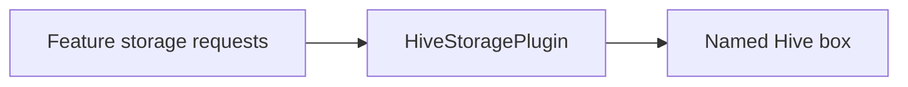

# vyuh_plugin_storage_hive

HiveStoragePlugin persists general values in a Hive box. The boxName selects the store. This is general storage, not the SecureStoragePlugin contract.



[Package source](https://github.com/vyuh-tech/vyuh/tree/main/packages/plugins/vyuh_plugin_storage_hive) · [Released API](https://pub.dev/documentation/vyuh_plugin_storage_hive/latest/)

## Choose a declaration

[HiveStoragePlugin](#hivestorageplugin)

## HiveStoragePlugin {#hivestorageplugin}

[Source](https://github.com/vyuh-tech/vyuh/blob/main/packages/plugins/vyuh_plugin_storage_hive/lib/hive_storage_plugin.dart#L4)

Public declaration in this package.

```dart
final class HiveStoragePlugin extends StoragePlugin with InitOncePlugin
```

Directly declared public members:

```dart
final String boxName;
```


```dart
HiveStoragePlugin({this.boxName = 'vyuh_storage'});
```

Creates a new `HiveStoragePlugin` instance.

```dart
Future<void> initOnce();
```


```dart
Future<void> disposeOnce();
```


```dart
Future<dynamic> read(String key);
```

Reads a value from the box with the given `key`.

```dart
Future<dynamic> write(String key, dynamic value);
```


```dart
Future<bool> has(String key);
```


```dart
Future<bool> delete(String key);
```

Returns false when `key` did not exist, as `StoragePlugin.delete` says.
