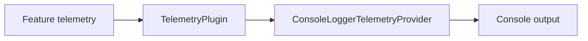

# vyuh_plugin_telemetry_provider_console

ConsoleLoggerTelemetryProvider is a telemetry provider used inside TelemetryPlugin.providers. It logs messages and errors; startTrace returns a NoOpTrace and does not record trace metrics.



[Package source](https://github.com/vyuh-tech/vyuh/tree/main/packages/plugins/vyuh_plugin_telemetry_provider_console) · [Released API](https://pub.dev/documentation/vyuh_plugin_telemetry_provider_console/latest/)

## Choose a declaration

[ConsoleLoggerTelemetryProvider](#consoleloggertelemetryprovider)

## ConsoleLoggerTelemetryProvider {#consoleloggertelemetryprovider}

[Source](https://github.com/vyuh-tech/vyuh/blob/main/packages/plugins/vyuh_plugin_telemetry_provider_console/lib/vyuh_plugin_telemetry_provider_console.dart#L7)

A telemetry provider that logs to the console using the logger package.

```dart
final class ConsoleLoggerTelemetryProvider implements TelemetryProvider
```

Directly declared public members:

```dart
String get name;
```


```dart
String get title;
```


```dart
String get description;
```


```dart
ConsoleLoggerTelemetryProvider();
```


```dart
Future<void> dispose();
```


```dart
Future<void> init();
```


```dart
Future<void> reportError(exception, {StackTrace? stackTrace, Map<String, dynamic>? params, bool fatal = false});
```


```dart
Future<void> reportFlutterError(FlutterErrorDetails details, {bool fatal = false});
```


```dart
Future<void> reportMessage(String message, {Map<String, dynamic>? params, LogLevel? level = LogLevel.info});
```


```dart
Future<Trace> startTrace(String name, String operation, {LogLevel? level = LogLevel.info});
```
