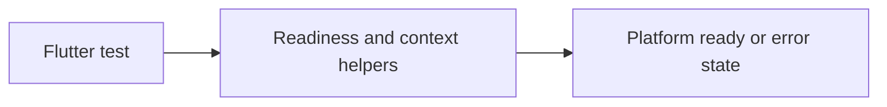

# vyuh_test

Test utilities help wait for the platform to reach ready/error and provide a mocked BuildContext. Use them with flutter_test and await disposal between independently initialized platforms.



[Package source](https://github.com/vyuh-tech/vyuh/tree/main/packages/system/vyuh_test) · [Released API](https://pub.dev/documentation/vyuh_test/latest/)

## Choose a declaration

[ReadyCheck](#readycheck) · [TestBuildContext](#testbuildcontext)

## ReadyCheck {#readycheck}

[Source](https://github.com/vyuh-tech/vyuh/blob/main/packages/system/vyuh_test/lib/ready_check.dart#L7)

Extension to help with testing platform readiness

```dart
extension ReadyCheck on VyuhPlatform
```

Directly declared public members:

```dart
Future<void> getReady(WidgetTester tester);
```

Waits for the platform to be ready or in error state

## TestBuildContext {#testbuildcontext}

[Source](https://github.com/vyuh-tech/vyuh/blob/main/packages/system/vyuh_test/lib/test_utils.dart#L4)

Public declaration in this package.

```dart
class TestBuildContext extends Mock implements BuildContext
```
