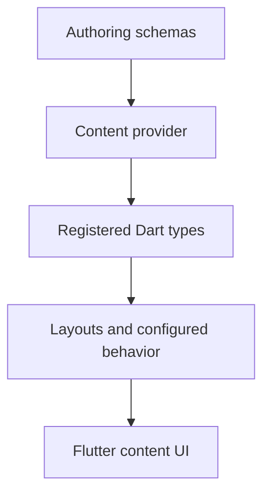

# Content and CMS APIs

These packages support the optional content capability. Use their declarations to keep provider data, registered types, layout selection, and authoring schemas aligned.

| Package | Contract |
| --- | --- |
| [Content extension](/cms/api/vyuh-extension-content) | Descriptors, builders, layouts, actions, and conditions |
| [System content feature](/cms/api/vyuh-feature-system) | Built-in content types and configurations |
| [Sanity provider](/cms/api/vyuh-plugin-content-provider-sanity) | Fetching, local cache policy, media URLs, and live content |
| [Sanity client](/cms/api/sanity-client) | GROQ queries and transport configuration |
| [Portable Text](/cms/api/flutter-sanity-portable-text) | Structured text models and render builders |
| [Embedded content](/cms/api/vyuh-content-widget) | Content binding and widgets inside an existing app |
| [Authentication content](/cms/api/vyuh-feature-auth) | Forms and configurations using the auth capability |
| [Onboarding content](/cms/api/vyuh-feature-onboarding) | Steps and their default layout |
| [Developer tools](/cms/api/vyuh-feature-developer) | Registry inspection and previews |
| [Widgetbook](/cms/api/vyuh-widgetbook) | Preview adapters |
| [Schema packages](/cms/api/schemas) | TypeScript authoring contracts |
