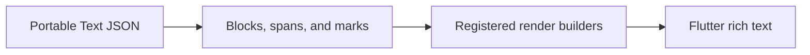

# flutter_sanity_portable_text

Deserialize Portable Text blocks and spans, then render with registered block and mark builders. Configuration determines styling and the supported inline or embedded content.



[Package source](https://github.com/vyuh-tech/vyuh/tree/main/packages/sanity/flutter_sanity_portable_text) · [Released API](https://pub.dev/documentation/flutter_sanity_portable_text/latest/)

## Choose a declaration

[BlockContainerBuilder](#blockcontainerbuilder) · [BlockListBuilder](#blocklistbuilder) · [BlockWidgetBuilder](#blockwidgetbuilder) · [BulletRenderer](#bulletrenderer) · [ErrorView](#errorview) · [ListItemType](#listitemtype) · [MarkDef](#markdef) · [MarkDefDescriptor](#markdefdescriptor) · [MarkDefFromJson](#markdeffromjson) · [MarkDefSpanBuilder](#markdefspanbuilder) · [MarkDefTextStyleBuilder](#markdeftextstylebuilder) · [PortableBlockIndex](#portableblockindex) · [PortableBlockItem](#portableblockitem) · [PortableText](#portabletext) · [PortableTextBlock](#portabletextblock) · [PortableTextConfig](#portabletextconfig) · [PortableTextStyleOverride](#portabletextstyleoverride) · [PortableTextTheme](#portabletexttheme) · [Span](#span) · [TextBlockItem](#textblockitem) · [TextStyleBuilder](#textstylebuilder) · [defaultListBuilder](#defaultlistbuilder)

## BlockContainerBuilder {#blockcontainerbuilder}

[Source](https://github.com/vyuh-tech/vyuh/blob/main/packages/sanity/flutter_sanity_portable_text/lib/ui/portable_text_config.dart#L11)

A function that builds a widget for a Portable block container.

```dart
typedef BlockContainerBuilder = Widget Function(BuildContext, Widget);
```

## BlockListBuilder {#blocklistbuilder}

[Source](https://github.com/vyuh-tech/vyuh/blob/main/packages/sanity/flutter_sanity_portable_text/lib/ui/portable_text_widget.dart#L5)

Public declaration in this package.

```dart
typedef BlockListBuilder = Widget Function( BuildContext, List<PortableBlockItem>, );
```

## BlockWidgetBuilder {#blockwidgetbuilder}

[Source](https://github.com/vyuh-tech/vyuh/blob/main/packages/sanity/flutter_sanity_portable_text/lib/ui/portable_text_config.dart#L14)

A function that builds a widget for a Portable block item.

```dart
typedef BlockWidgetBuilder = Widget Function( BuildContext context, PortableBlockItem item, );
```

## BulletRenderer {#bulletrenderer}

[Source](https://github.com/vyuh-tech/vyuh/blob/main/packages/sanity/flutter_sanity_portable_text/lib/ui/portable_text_config.dart#L20)

A function that builds an InlineSpan for a single bullet mark. Using the `TextBlockItem`'s listItem, listItemIndex and level, the bullet can be customized as needed.

```dart
typedef BulletRenderer = InlineSpan Function(BuildContext, TextBlockItem);
```

## ErrorView {#errorview}

[Source](https://github.com/vyuh-tech/vyuh/blob/main/packages/sanity/flutter_sanity_portable_text/lib/ui/portable_text_config.dart#L314)

Renders an error message when a block type is missing a builder or when a mark is misconfigured.

```dart
class ErrorView extends StatelessWidget
```

Directly declared public members:

```dart
final String message;
```


```dart
final bool asBlock;
```


```dart
const ErrorView({super.key, required this.message, this.asBlock = true});
```


```dart
Widget build(BuildContext context);
```


## ListItemType {#listitemtype}

[Source](https://github.com/vyuh-tech/vyuh/blob/main/packages/sanity/flutter_sanity_portable_text/lib/model/text_block.dart#L16)

Identifies the type of list-item within the block.

```dart
enum ListItemType { bullet, square, number }
```

## MarkDef {#markdef}

[Source](https://github.com/vyuh-tech/vyuh/blob/main/packages/sanity/flutter_sanity_portable_text/lib/model/markdef_descriptor.dart#L49)

A single mark definition.

```dart
abstract class MarkDef
```

Directly declared public members:

```dart
final String key;
```

The key of the mark definition.

```dart
final String type;
```

The type of the mark definition.

```dart
MarkDef({required this.key, required this.type});
```


```dart
factory MarkDef.fromJson(Map<String, dynamic> json);
```

Converts a `MarkDef` to a JSON map. Should be implemented by subclasses.

## MarkDefDescriptor {#markdefdescriptor}

[Source](https://github.com/vyuh-tech/vyuh/blob/main/packages/sanity/flutter_sanity_portable_text/lib/model/markdef_descriptor.dart#L23)

Describes a `MarkDef` and its associated builders.

```dart
final class MarkDefDescriptor
```

Directly declared public members:

```dart
final String schemaType;
```

The schema type of the mark.

```dart
final MarkDefFromJson fromJson;
```

Deserializes a `MarkDef` from a JSON map.

```dart
final MarkDefTextStyleBuilder styleBuilder;
```

Builds a `TextStyle` for a given `MarkDef`.

```dart
final MarkDefSpanBuilder? spanBuilder;
```

Builds a `GestureRecognizer` for a given `MarkDef`.

```dart
MarkDefDescriptor({required this.schemaType, required this.fromJson, required this.styleBuilder, this.spanBuilder});
```


## MarkDefFromJson {#markdeffromjson}

[Source](https://github.com/vyuh-tech/vyuh/blob/main/packages/sanity/flutter_sanity_portable_text/lib/model/markdef_descriptor.dart#L12)

Deserializes a `MarkDef` from a JSON map.

```dart
typedef MarkDefFromJson = MarkDef Function(Map<String, dynamic> json);
```

## MarkDefSpanBuilder {#markdefspanbuilder}

[Source](https://github.com/vyuh-tech/vyuh/blob/main/packages/sanity/flutter_sanity_portable_text/lib/model/markdef_descriptor.dart#L15)

Builds an `InlineSpan` for a given `MarkDef`.

```dart
typedef MarkDefSpanBuilder = InlineSpan Function( BuildContext context, MarkDef mark, String text, TextStyle style, );
```

## MarkDefTextStyleBuilder {#markdeftextstylebuilder}

[Source](https://github.com/vyuh-tech/vyuh/blob/main/packages/sanity/flutter_sanity_portable_text/lib/model/markdef_descriptor.dart#L5)

Builds a `TextStyle` for a given `MarkDef`.

```dart
typedef MarkDefTextStyleBuilder = TextStyle Function( BuildContext context, MarkDef mark, TextStyle base, );
```

## PortableBlockIndex {#portableblockindex}

[Source](https://github.com/vyuh-tech/vyuh/blob/main/packages/sanity/flutter_sanity_portable_text/lib/ui/portable_block_index.dart#L5)

Gives a block built by `PortableTextConfig.buildBlock` its position in the parent list (0-based), so block and container builders can vary by position, e.g. drop the leading space of the first block.

```dart
class PortableBlockIndex extends InheritedWidget
```

Directly declared public members:

```dart
final int index;
```

The position of the block in its parent list (0-based).

```dart
const PortableBlockIndex({super.key, required this.index, required super.child});
```


```dart
static int? maybeOf(BuildContext context);
```

The index of the enclosing block, or `null` when the block was built without an index.

```dart
bool updateShouldNotify(PortableBlockIndex oldWidget);
```


## PortableBlockItem {#portableblockitem}

[Source](https://github.com/vyuh-tech/vyuh/blob/main/packages/sanity/flutter_sanity_portable_text/lib/model/text_block.dart#L8)

The PortableBlockItem interface provides a way to handle different types of 'Block Items' within the Portable Text. Every such block item is identified by the `blockType` property.

```dart
abstract interface class PortableBlockItem
```

Directly declared public members:

```dart
String get blockType;
```

A unique string-name for the block type.

## PortableText {#portabletext}

[Source](https://github.com/vyuh-tech/vyuh/blob/main/packages/sanity/flutter_sanity_portable_text/lib/ui/portable_text_widget.dart#L10)

A widget that renders a list of PortableBlockItems. This widget is the main entry point for rendering Portable Text content. It is responsible for rendering the entire content of a Portable Text document, including all blocks and marks. It relies on the `PortableTextConfig` to determine the visual representation of each block.

```dart
class PortableText extends StatelessWidget
```

Directly declared public members:

```dart
final List<PortableBlockItem> blocks;
```

The list of block items to render.

```dart
final BlockListBuilder listBuilder;
```


```dart
const PortableText({super.key, required this.blocks, BlockListBuilder? listBuilder});
```


```dart
Widget build(BuildContext context);
```


## PortableTextBlock {#portabletextblock}

[Source](https://github.com/vyuh-tech/vyuh/blob/main/packages/sanity/flutter_sanity_portable_text/lib/ui/portable_text_block.dart#L6)

Renders a single block of Portable Text. This widget is used internally by the `PortableText` widget. It is not meant to be used directly for most common scenarios. If you need to render a single block of Portable Text, consider using the `PortableText` widget.

```dart
class PortableTextBlock extends StatelessWidget
```

Directly declared public members:

```dart
final TextBlockItem model;
```

The model representing the block of Portable Text.

```dart
const PortableTextBlock({super.key, required this.model});
```


```dart
Widget build(BuildContext context);
```


## PortableTextConfig {#portabletextconfig}

[Source](https://github.com/vyuh-tech/vyuh/blob/main/packages/sanity/flutter_sanity_portable_text/lib/ui/portable_text_config.dart#L24)

The configuration used for rendering Portable Text. This class is used to define the visual representation of the Portable Text blocks, spans, and marks. It is used by the `PortableText` widget to render the Portable Text content. The configuration can be customized to match the visual design of the app. The default configuration is based on the Material Design guidelines.

```dart
final class PortableTextConfig
```

Directly declared public members:

```dart
final Map<String, TextStyleBuilder> styles;
```

The styles used to render the Portable Text content. The keys are the style names used in the Portable Text content, such as "h1", "h2", "blockquote", etc. The default styles are based on the Material Design typography guidelines. You can customize the styles by providing a custom style builder for each style.

```dart
final Map<String, BlockWidgetBuilder> blocks;
```

The block widgets used to render the Portable Text content. The keys are the block type names used in the Portable Text content. The default block is a single `PortableTextBlock`, named as "block". You can customize the rendering of each block type by providing a custom block widget builder.

```dart
final Map<String, BlockContainerBuilder> blockContainers;
```

The block containers used to wrap the block widgets. The keys are the block container type names used in the Portable Text content. The default block container is a simple container, named as "default". You can customize the rendering of each block container type by providing a custom block container builder.

```dart
final Map<String, MarkDefDescriptor> markDefs;
```

The mark definitions used to render the Portable Text content. The keys are the mark type names used in the Portable Text content. The default mark definitions are based on the Material Design typography guidelines. You can customize the rendering of each mark type by providing a custom mark definition descriptor. The mark definitions are used to apply styles and gestures to the text spans. Make sure to keep the mark names in sync with the ones used in the schema for the Portable Text.

```dart
double listIndent;
```

The indentation used for list items. The default value is 16.

```dart
EdgeInsets itemPadding;
```

The padding used for list items. The default value is 8.

```dart
TextStyle? Function(BuildContext) baseStyle;
```

The base style used for rendering the Portable Text content. The default value is the bodyMedium style from the theme.

```dart
static final PortableTextConfig shared;
```

The default/root configuration, used by `PortableText` widgets when no `PortableTextTheme` ancestor provides one (see `of`). It is also the context-free registry consulted at JSON-parse time for custom mark deserializers (see `_markDefsFromJson`). You can customize it by calling the `apply` method.

```dart
BulletRenderer bulletRenderer;
```

The bullet renderer used to render the bullet for list items. The default value is a simple bullet renderer that handles the default bullet types: number, square, and circle.

```dart
PortableTextConfig();
```


```dart
static PortableTextConfig of(BuildContext context);
```

Returns the nearest `PortableTextConfig` supplied by a `PortableTextTheme` ancestor, falling back to `shared` when none is present. Mirrors `Theme.of`.

```dart
PortableTextConfig copyWith({Map<String, TextStyleBuilder>? styles, Map<String, BlockWidgetBuilder>? blocks, Map<String, BlockContainerBuilder>? blockContainers, Map<String, MarkDefDescriptor>? markDefs, double? listIndent, EdgeInsets? itemPadding, TextStyle? Function(BuildContext)? baseStyle, BulletRenderer? bulletRenderer});
```

Returns a copy of this config with the given fields overridden.

```dart
void apply({double listIndent = defaultListIndent, EdgeInsets itemPadding = defaultItemPadding, BulletRenderer? bulletRenderer, Map<String, TextStyleBuilder>? styles, Map<String, BlockContainerBuilder>? blockContainers, Map<String, BlockWidgetBuilder>? blocks, Map<String, MarkDefDescriptor>? markDefs, TextStyle? Function(BuildContext)? baseStyle});
```

Applies the custom configuration to the shared instance of the `PortableTextConfig`.

```dart
Widget buildBlock(BuildContext context, PortableBlockItem item, [int? index]);
```

Builds a block widget for the given Portable block item. The block widget is determined by the block type of the item. If the block type is not found in the block widgets, an error view is rendered with a message indicating the missing block type.

```dart
void reset();
```

Resets the shared instance of the `PortableTextConfig` to the default configuration.

```dart
static const dynamic defaultListIndent;
```


```dart
static const dynamic defaultItemPadding;
```


```dart
static BulletRenderer defaultBulletRenderer;
```


```dart
static TextStyle? defaultBaseStyle(BuildContext context);
```


```dart
static BlockContainerBuilder defaultBlockContainerBuilder;
```


```dart
static final Map<String, TextStyleBuilder> defaultStyles;
```

The default text styles used by the shared instance of `PortableTextConfig`.

```dart
static final Map<String, BlockContainerBuilder> defaultBlockContainers;
```

The default block containers used by the shared instance of `PortableTextConfig`.

```dart
static final Map<String, BlockWidgetBuilder> defaultBlocks;
```

The default block widgets used by the shared instance of `PortableTextConfig`. The default block is a single `PortableTextBlock`, named as "block".

## PortableTextStyleOverride {#portabletextstyleoverride}

[Source](https://github.com/vyuh-tech/vyuh/blob/main/packages/sanity/flutter_sanity_portable_text/lib/ui/portable_text_theme.dart#L30)

Restyles descendant Portable Text by transforming the *inherited* text style for each named style (e.g. `'normal'`, `'h2'`).

```dart
class PortableTextStyleOverride extends StatefulWidget
```

Directly declared public members:

```dart
final Map<String, TextStyle Function(TextStyle)> styles;
```

Per-style transforms applied on top of the inherited resolved style. Keys are style names (`'normal'`, `'h2'`, …); a key that the ambient config does not define is ignored.

```dart
final Widget child;
```

The subtree whose Portable Text should be restyled.

```dart
const PortableTextStyleOverride({super.key, required this.styles, required this.child});
```


```dart
State<PortableTextStyleOverride> createState();
```


## PortableTextTheme {#portabletexttheme}

[Source](https://github.com/vyuh-tech/vyuh/blob/main/packages/sanity/flutter_sanity_portable_text/lib/ui/portable_text_theme.dart#L5)

An `InheritedWidget` that supplies a `PortableTextConfig` to its subtree.

```dart
class PortableTextTheme extends InheritedWidget
```

Directly declared public members:

```dart
final PortableTextConfig config;
```

The configuration applied to descendant Portable Text widgets.

```dart
const PortableTextTheme({super.key, required this.config, required super.child});
```


```dart
static PortableTextConfig? maybeOf(BuildContext context);
```

The `PortableTextConfig` of the nearest `PortableTextTheme` ancestor, or `null` if none.

```dart
bool updateShouldNotify(PortableTextTheme oldWidget);
```


## Span {#span}

[Source](https://github.com/vyuh-tech/vyuh/blob/main/packages/sanity/flutter_sanity_portable_text/lib/model/text_block.dart#L72)

A Span is the standard way to express inline text within a block

```dart
class Span
```

Directly declared public members:

```dart
static const dynamic schemaName;
```


```dart
final String type;
```


```dart
final String text;
```

Contains the text content of the span

```dart
final List<String> marks;
```

Set of annotations and decorations to apply to this span of text. Custom annotations are also allowed.

```dart
Span({this.type = Span.schemaName, this.text = '', this.marks = const <String>[]});
```


```dart
factory Span.fromJson(Map<String, dynamic> json);
```


## TextBlockItem {#textblockitem}

[Source](https://github.com/vyuh-tech/vyuh/blob/main/packages/sanity/flutter_sanity_portable_text/lib/model/text_block.dart#L19)

A block of text within the Portable Text document. This is the most common and popular block item within the Portable Text instance. Most of the fields are based on the specification for Portable Text, which can be seen here: https://www.portabletext.org/

```dart
class TextBlockItem implements PortableBlockItem
```

Directly declared public members:

```dart
static const dynamic schemaName;
```


```dart
String get blockType;
```


```dart
final String key;
```


```dart
final List<Span> children;
```

Children is an array of spans or custom inline types that is contained within a block.

```dart
final List<MarkDef> markDefs;
```

Mark definitions is an array of objects with a key, type and some data. Mark definitions are tied to spans by adding the referring _key in the marks array.

```dart
final String style;
```

Style typically describes a visual property for the whole block. Typical values are "h1", "h2", "h3", "normal", "blockquote", etc.

```dart
final ListItemType? listItem;
```

A block can be given the property listItem with a value that describes which kind of list it is. Typically bullet, number, square and so on. The list position is derived from the position the block has in the array and surrounding list items on the same level.

```dart
final int? level;
```

This specifies the visual nesting level of the block. Nested blocks are indented on the left.

```dart
int? listItemIndex;
```

To explicitly track the index of the list item. This is a derived field and usually set by a higher level component.

```dart
TextBlockItem({String? key, this.children = const <Span>[], this.style = 'normal', this.markDefs = const <MarkDef>[], this.listItem, this.level, this.listItemIndex});
```


```dart
factory TextBlockItem.fromJson(Map<String, dynamic> json);
```


## TextStyleBuilder {#textstylebuilder}

[Source](https://github.com/vyuh-tech/vyuh/blob/main/packages/sanity/flutter_sanity_portable_text/lib/ui/portable_text_config.dart#L5)

A function that builds a text style for a Portable Text block or span.

```dart
typedef TextStyleBuilder = TextStyle Function( BuildContext context, TextStyle base, );
```

## defaultListBuilder {#defaultlistbuilder}

[Source](https://github.com/vyuh-tech/vyuh/blob/main/packages/sanity/flutter_sanity_portable_text/lib/ui/portable_text_widget.dart#L35)

Default container-builder for PortableText blocks. It uses a ListView.builder to render the blocks.

```dart
Widget defaultListBuilder(BuildContext context, {required List<PortableBlockItem> blocks, bool isPrimary = false, bool shrinkwrap = true, ScrollPhysics scrollPhysics = const NeverScrollableScrollPhysics()})
```
