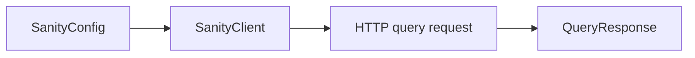

# sanity_client

SanityClient runs GROQ queries using an injected or default HTTP client. SanityConfig selects project, dataset, API version, perspective, and CDN behavior. The client also builds image/file URLs and provides a live query stream.



[Package source](https://github.com/vyuh-tech/vyuh/tree/main/packages/sanity/sanity_client) · [Released API](https://pub.dev/documentation/sanity_client/latest/)

## Choose a declaration

[BadRequestException](#badrequestexception) · [FetchDataException](#fetchdataexception) · [ImageOptions](#imageoptions) · [InvalidReferenceException](#invalidreferenceexception) · [LiveConfig](#liveconfig) · [LiveConnect](#liveconnect) · [LiveConnectException](#liveconnectexception) · [PerformanceInfo](#performanceinfo) · [Perspective](#perspective) · [SanityClient](#sanityclient) · [SanityConfig](#sanityconfig) · [SanityDataset](#sanitydataset) · [SanityException](#sanityexception) · [SanityQueryResponse](#sanityqueryresponse) · [SanityRequest](#sanityrequest) · [SanityUrlBuilder](#sanityurlbuilder) · [ServerResponse](#serverresponse) · [UnauthorizedException](#unauthorizedexception) · [UrlBuilder](#urlbuilder)

## BadRequestException {#badrequestexception}

[Source](https://github.com/vyuh-tech/vyuh/blob/main/packages/sanity/sanity_client/lib/exceptions.dart#L20)

Exception when the request is invalid.

```dart
final class BadRequestException extends SanityException
```

Directly declared public members:

```dart
BadRequestException([String? message]);
```

Creates a new bad request exception.

## FetchDataException {#fetchdataexception}

[Source](https://github.com/vyuh-tech/vyuh/blob/main/packages/sanity/sanity_client/lib/exceptions.dart#L13)

Exception thrown when a document is not found.

```dart
final class FetchDataException extends SanityException
```

Directly declared public members:

```dart
FetchDataException([String? message]);
```

Creates a new fetch data exception.

## ImageOptions {#imageoptions}

[Source](https://github.com/vyuh-tech/vyuh/blob/main/packages/sanity/sanity_client/lib/types.dart#L1)

Options to customize the image URL.

```dart
class ImageOptions
```

Directly declared public members:

```dart
final int? width;
```

The width of the image in pixels.

```dart
final int? height;
```

The height of the image in pixels.

```dart
final int? devicePixelRatio;
```

The device pixel ratio of the image.

```dart
final int? quality;
```

The quality of the image, expressed as value between 0-100

```dart
final String? format;
```

The format of the image. Can be either `jpg`, `png`, `webp`, or `auto`.

```dart
ImageOptions({this.width, this.height, this.devicePixelRatio, this.quality, this.format});
```

Creates a new image options object with the provided parameters. This handles width, height, device pixel ratio, quality, and format.

## InvalidReferenceException {#invalidreferenceexception}

[Source](https://github.com/vyuh-tech/vyuh/blob/main/packages/sanity/sanity_client/lib/exceptions.dart#L33)

Exception when the request is forbidden.

```dart
final class InvalidReferenceException extends SanityException
```

Directly declared public members:

```dart
InvalidReferenceException([String? message]);
```

Creates a new invalid reference exception.

## LiveConfig {#liveconfig}

[Source](https://github.com/vyuh-tech/vyuh/blob/main/packages/sanity/sanity_client/lib/types.dart#L33)

Configuration for live queries

```dart
class LiveConfig
```

Directly declared public members:

```dart
final bool includeDrafts;
```

Whether to include drafts in the query

```dart
LiveConfig({this.includeDrafts = false});
```

Creates a new LiveConfig object with the provided includeDrafts parameter.

```dart
LiveConfig.withDrafts();
```

Creates a new LiveConfig object with the includeDrafts parameter set to true.

## LiveConnect {#liveconnect}

[Source](https://github.com/vyuh-tech/vyuh/blob/main/packages/sanity/sanity_client/lib/live.dart#L20)

Public declaration in this package.

```dart
extension LiveConnect on SanityClient
```

Directly declared public members:

```dart
Stream<SanityQueryResponse> fetchLive(String query, {Map<String, String>? params, bool includeDrafts = false});
```

Fetches live query results. Requests are serialized and bursts coalesced. Errors are delivered through the returned stream; cancelling disconnects SSE.

## LiveConnectException {#liveconnectexception}

[Source](https://github.com/vyuh-tech/vyuh/blob/main/packages/sanity/sanity_client/lib/exceptions.dart#L40)

Exception when connecting to the live subscription.

```dart
final class LiveConnectException extends SanityException
```

Directly declared public members:

```dart
LiveConnectException([String? message]);
```

Creates a new live connect exception.

## PerformanceInfo {#performanceinfo}

[Source](https://github.com/vyuh-tech/vyuh/blob/main/packages/sanity/sanity_client/lib/response_types.dart#L57)

A class that extracts various performance information from a Sanity response.

```dart
final class PerformanceInfo
```

Directly declared public members:

```dart
final String query;
```

The query that was sent to the server.

```dart
final int serverTimeMs;
```

The time it took for the server to respond to the query.

```dart
final int clientTimeMs;
```

Elapsed client time for the HTTP request through receipt of the full body. Includes transport latency; excludes subsequent JSON deserialization.

```dart
final String shard;
```

The shard that the query was sent to.

```dart
final int age;
```

The age of the data that was returned in the response.

```dart
PerformanceInfo({required this.query, required this.serverTimeMs, required this.clientTimeMs, required this.shard, required this.age});
```

Creates a new performance information object with the given query, server timing, client timing, shard and age.

## Perspective {#perspective}

[Source](https://github.com/vyuh-tech/vyuh/blob/main/packages/sanity/sanity_client/lib/config.dart#L1)

The various perspectives that can be used to fetch data from Sanity

```dart
enum Perspective { raw, drafts, published }
```

## SanityClient {#sanityclient}

[Source](https://github.com/vyuh-tech/vyuh/blob/main/packages/sanity/sanity_client/lib/client.dart#L12)

The client for fetching data from Sanity

```dart
final class SanityClient
```

Directly declared public members:

```dart
final SanityConfig config;
```

The configuration for the client

```dart
http.Client httpClient;
```

The HTTP client to use. Generally not needed to be provided. It can be set during testing or when used in the context of a framework that has its own `http.Client` instance.

```dart
final UrlBuilder urlBuilder;
```

The URL builder to use. When not provided it uses the default Sanity URL builder

```dart
SanityClient(this.config, {http.Client? httpClient, UrlBuilder? urlBuilder});
```

Creates a new Sanity client with the provided configuration. Use the optional parameters to provide a custom HTTP client or URL builder.

```dart
void setHttpClient(http.Client client);
```

Set the HTTP client to use for fetching data

```dart
Future<SanityQueryResponse> fetch(String query, {Map<String, String>? params});
```

Fetches data from Sanity by running the GROQ Query with the passed in parameters

```dart
Uri imageUrl(String imageRefId, {int? width, int? height, int? devicePixelRatio, int? quality, String? format});
```

Return the associated image url

```dart
Uri fileUrl(String fileRefId);
```

Return the associated object url

```dart
Future<List<SanityDataset>> datasets();
```

Fetches the associated datasets with this project

## SanityConfig {#sanityconfig}

[Source](https://github.com/vyuh-tech/vyuh/blob/main/packages/sanity/sanity_client/lib/config.dart#L17)

Configuration for the Sanity client

```dart
final class SanityConfig
```

Directly declared public members:

```dart
final String dataset;
```

The dataset to fetch data from

```dart
final String projectId;
```

The project id

```dart
final String? token;
```

The token to use for authentication

```dart
final bool useCdn;
```

Whether to use the CDN or not

```dart
final String apiVersion;
```

The API version to use. It follows the format `vYYYY-MM-DD`

```dart
final Perspective perspective;
```

The perspective to use

```dart
final bool explainQuery;
```

Whether to explain the query or not

```dart
static final String defaultApiVersion;
```

The default API version to use

```dart
SanityConfig({required this.projectId, required this.dataset, this.token, String? apiVersion, bool? useCdn, Perspective? perspective, bool? explainQuery});
```

Creates a new Sanity configuration for fetching documents from a project and dataset

## SanityDataset {#sanitydataset}

[Source](https://github.com/vyuh-tech/vyuh/blob/main/packages/sanity/sanity_client/lib/response_types.dart#L5)

A class to represent a Sanity dataset.

```dart
class SanityDataset
```

Directly declared public members:

```dart
final String name;
```

The name of the dataset.

```dart
final String aclMode;
```

The ACL mode of the dataset.

```dart
SanityDataset({required this.name, required this.aclMode});
```

Creates a new Sanity dataset with the given name and ACL mode.

```dart
factory SanityDataset.fromJson(Map<String, dynamic> json);
```

Creates a new Sanity dataset from a JSON map.

```dart
bool ==(Object other);
```


```dart
int get hashCode;
```


## SanityException {#sanityexception}

[Source](https://github.com/vyuh-tech/vyuh/blob/main/packages/sanity/sanity_client/lib/exceptions.dart#L1)

Base type for exceptions thrown by the Sanity client.

```dart
abstract base class SanityException implements Exception
```

Directly declared public members:

```dart
SanityException([this._message, this._prefix]);
```

Creates a new Sanity exception.

```dart
String toString();
```


## SanityQueryResponse {#sanityqueryresponse}

[Source](https://github.com/vyuh-tech/vyuh/blob/main/packages/sanity/sanity_client/lib/response_types.dart#L86)

A class that represents a Sanity query response.

```dart
final class SanityQueryResponse
```

Directly declared public members:

```dart
final dynamic result;
```

The result of the query, which can be a null, object or array.

```dart
final List<String> syncTags;
```

Sync Tags of the query, which will be used in case of a Live Fetch Query

```dart
final PerformanceInfo info;
```

The performance information of the query.

```dart
SanityQueryResponse({required this.result, required this.info, this.syncTags = const []});
```

Creates a new Sanity query response with the given result and performance information.

## SanityRequest {#sanityrequest}

[Source](https://github.com/vyuh-tech/vyuh/blob/main/packages/sanity/sanity_client/lib/sanity_request.dart#L5)

Public declaration in this package.

```dart
class SanityRequest
```

Directly declared public members:

```dart
final UrlBuilder urlBuilder;
```


```dart
final String query;
```


```dart
final Map<String, String>? params;
```


```dart
final LiveConfig? live;
```


```dart
SanityRequest({required this.urlBuilder, required this.query, this.params, this.live});
```


```dart
bool get requiresPost;
```

Queries longer than 11kB can’t be submitted using the GET method, so they must be POSTed. See https://www.sanity.io/docs/http-query

```dart
Uri get getUri;
```


```dart
Uri get postUri;
```


```dart
Map<String, dynamic> toPostBody();
```

Strips the $-prefixes when submitting as json params via POST

## SanityUrlBuilder {#sanityurlbuilder}

[Source](https://github.com/vyuh-tech/vyuh/blob/main/packages/sanity/sanity_client/lib/sanity_url_builder.dart#L5)

A URL builder implementation for Sanity.

```dart
final class SanityUrlBuilder extends UrlBuilder<SanityConfig>
```

Directly declared public members:

```dart
SanityUrlBuilder(super.config);
```

Creates a new Sanity URL builder with the provided configuration.

```dart
Uri fileUrl(String fileRefId);
```


```dart
static String fileName(String fileRefId);
```

Generates the file name from the file reference ID.

```dart
Uri imageUrl(String imageRefId, {ImageOptions? options});
```


```dart
static String imageFileName(String imageRefId);
```

Generates the image file name from the image reference ID.

```dart
Uri queryUrl(String query, {Map<String, dynamic>? params, LiveConfig? live});
```


## ServerResponse {#serverresponse}

[Source](https://github.com/vyuh-tech/vyuh/blob/main/packages/sanity/sanity_client/lib/response_types.dart#L30)

A class to represent a Sanity response to a query.

```dart
class ServerResponse
```

Directly declared public members:

```dart
final dynamic result;
```

The result of the query, which can be a null, object or array.

```dart
final int ms;
```

The time it took for the server to respond to the query.

```dart
final String query;
```

The query that was sent to the server.

```dart
final List<String> syncTags;
```


```dart
ServerResponse({required this.result, required this.ms, required this.query, this.syncTags = const []});
```

Creates a new server response with the given result, time and query.

```dart
factory ServerResponse.fromJson(Map<String, dynamic> json);
```

Creates a new server response from a JSON map.

## UnauthorizedException {#unauthorizedexception}

[Source](https://github.com/vyuh-tech/vyuh/blob/main/packages/sanity/sanity_client/lib/exceptions.dart#L26)

Exception when the request is unauthorized and does not include a valid token in the Authorization header.

```dart
final class UnauthorizedException extends SanityException
```

Directly declared public members:

```dart
UnauthorizedException([String? message]);
```

Creates a new unauthorized exception.

## UrlBuilder {#urlbuilder}

[Source](https://github.com/vyuh-tech/vyuh/blob/main/packages/sanity/sanity_client/lib/types.dart#L45)

Provides the main interface for building URLs for Sanity assets.

```dart
abstract class UrlBuilder<TConfig>
```

Directly declared public members:

```dart
final TConfig config;
```

The configuration object for the client, which is specific to the URL builder implementation.

```dart
UrlBuilder(this.config);
```

Creates a new URL builder with the provided configuration.

```dart
Uri fileUrl(String fileRefId);
```

Builds a URL for a file asset.

```dart
Uri imageUrl(String imageRefId, {ImageOptions? options});
```

Builds a URL for an image asset.

```dart
Uri queryUrl(String query, {Map<String, String>? params, LiveConfig? live});
```

Builds a URL for a GROQ query.
