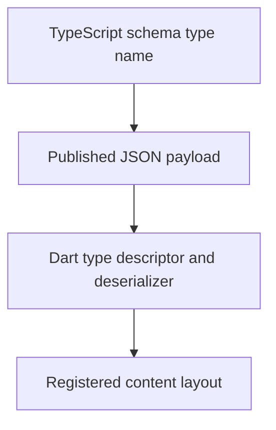

# Schema package APIs

CMS schemas describe the payload that the Dart content registry will receive. Keep the schema type name, deserializer, content descriptor, and default layout together when adding a content type.

## Shared schema primitives

`@vyuh/sanity-schema-core`, `@vyuh/sanity-schema-system`, and `@vyuh/sanity-schema-forms` are published packages consumed by this repository. Their implementation is owned outside the checked-out framework. The framework’s schema packages use their feature descriptors and configuration descriptors to contribute types to Sanity Studio.

Consult the [schema design guide](/cms/guides/designing-content-schemas) and the documentation published with each npm package for its release-specific exports. The Dart API catalog does not claim to document external TypeScript implementations.

## Authentication

The local `@vyuh/sanity-schema-auth` package exports its feature descriptor and configuration descriptors for authentication content. Its source is in [schemas/vyuh-sanity-schema-auth](https://github.com/vyuh-tech/vyuh/tree/main/schemas/vyuh-sanity-schema-auth/src).

Pair the Studio schemas with the [authentication feature API](/cms/api/vyuh-feature-auth) and an app-selected authentication plugin. Register only the sign-in capabilities your provider supports.

## Onboarding

The local `@vyuh/sanity-schema-onboarding` package exports its onboarding feature descriptor from [schemas/vyuh-sanity-schema-onboarding](https://github.com/vyuh-tech/vyuh/tree/main/schemas/vyuh-sanity-schema-onboarding/src). It describes onboarding steps and their content and actions.

Pair these schemas with the [onboarding feature API](/cms/api/vyuh-feature-onboarding).

## Authentication exports

| Export | Contract |
| --- | --- |
| `auth` | Feature descriptor registering authentication forms, route regions, card layouts, and schema builders |
| `EmailPasswordFormDescriptor` | Configures email/password form layouts |
| `ForgotPasswordFormDescriptor` | Configures password recovery form layouts |
| `PhoneOtpFormDescriptor` | Configures phone verification form layouts |
| `OAuthSignInDescriptor` | Configures OAuth sign-in layouts |

Each descriptor constructor accepts a partial descriptor configuration. The package root exports descriptors; its internal schema builder classes are implementation details.

```typescript
import { auth, EmailPasswordFormDescriptor } from '@vyuh/sanity-schema-auth';

const emailForm = new EmailPasswordFormDescriptor({ layouts: [] });
```

Register the exported feature with the Studio’s feature collection. Align supported sign-in methods with the Dart app’s authentication provider.

## Onboarding exports

The package root exports `onboarding`, a feature descriptor with route region contributions and a built content schema builder. Its underlying schema is not separately exported from the root.

```typescript
import { onboarding } from '@vyuh/sanity-schema-onboarding';
```

## Example schemas

The repository also contains schema packages for example features, alongside their Dart implementations. Use them to trace a complete type from authoring to rendering. The [integration examples](/cms/#explore-content-routing-and-examples-last) explain the relevant feature boundaries and source locations.

## Contract alignment


