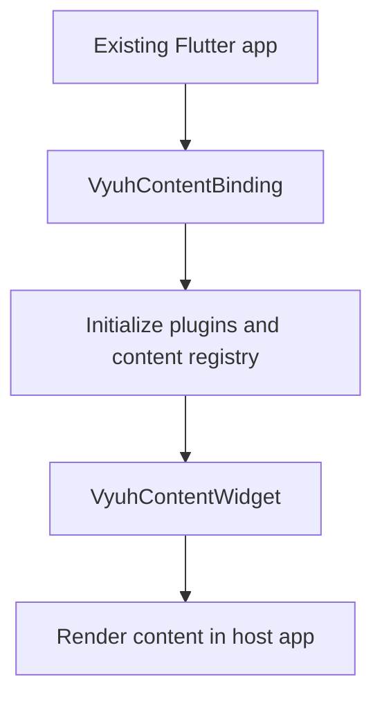

# vyuh_content_widget

Embed framework content in an existing Flutter app using VyuhContentBinding and VyuhContentWidget. Initialize the binding before Flutter runApp, await widgetReady for service access, and use your host app for navigation ownership.



[Package source](https://github.com/vyuh-tech/vyuh/tree/main/packages/system/vyuh_content_widget) · [Released API](https://pub.dev/documentation/vyuh_content_widget/latest/)

## Choose a declaration

[Document](#document) · [DocumentBuilder](#documentbuilder) · [DocumentDefaultLayout](#documentdefaultlayout) · [DocumentListBuilder](#documentlistbuilder) · [DocumentRenderMode](#documentrendermode) · [VyuhContentBinding](#vyuhcontentbinding) · [VyuhContentWidget](#vyuhcontentwidget)

## Document {#document}

[Source](https://github.com/vyuh-tech/vyuh/blob/main/packages/system/vyuh_content_widget/lib/document.dart#L10)

A document is a content item that represents a structured document. It contains a set of fields like title, description, and content that are defined by the document's schema. The document is used to display structured content in the app.

```dart
final class Document extends ContentItem
```

Directly declared public members:

```dart
static const dynamic schemaName;
```


```dart
static final dynamic typeDescriptor;
```

The default type descriptor for documents. Used for deserialization.

```dart
static final dynamic descriptor;
```

Used for extending the layouts of documents

```dart
static final dynamic contentBuilder;
```

The default content builder for documents, which assembles all the descriptors and constructs the final document representation.

```dart
final String? title;
```

The title of the document. This is used to display the title of the document in the app. The title is typically displayed in the app's top navigation bar or in the document's header.

```dart
final String? description;
```

The description of the document. This is an optional field and is used to provide additional information about the document.

```dart
final List<ContentItem>? items;
```

The content of the document. This is the actual content of the document. The content is typically displayed in the document's body.

```dart
static List<ContentItem>? itemsList(dynamic json);
```


```dart
Document({this.title, this.description, this.items, super.layout, super.modifiers});
```

Creates a new document with the given title, description, and content.

```dart
factory Document.fromJson(Map<String, dynamic> json);
```


## DocumentBuilder {#documentbuilder}

[Source](https://github.com/vyuh-tech/vyuh/blob/main/packages/system/vyuh_content_widget/lib/widget.dart#L11)

A widget that renders a `Document` from the CMS.

```dart
typedef DocumentBuilder<T extends ContentItem> = Widget Function(BuildContext, T);
```

## DocumentDefaultLayout {#documentdefaultlayout}

[Source](https://github.com/vyuh-tech/vyuh/blob/main/packages/system/vyuh_content_widget/lib/document.dart#L73)

The default layout for documents. It shows a column view of title, description, and content.

```dart
final class DocumentDefaultLayout extends LayoutConfiguration<Document>
```

Directly declared public members:

```dart
static const dynamic schemaName;
```


```dart
static final dynamic typeDescriptor;
```


```dart
final DocumentRenderMode mode;
```


```dart
DocumentDefaultLayout({this.mode = DocumentRenderMode.single});
```


```dart
factory DocumentDefaultLayout.fromJson(Map<String, dynamic> json);
```


```dart
Widget build(BuildContext context, Document content);
```


## DocumentListBuilder {#documentlistbuilder}

[Source](https://github.com/vyuh-tech/vyuh/blob/main/packages/system/vyuh_content_widget/lib/widget.dart#L20)

A widget that renders a list of `Document`s from the CMS.

```dart
typedef DocumentListBuilder<T extends ContentItem> = Widget Function(BuildContext, List<T>);
```

## DocumentRenderMode {#documentrendermode}

[Source](https://github.com/vyuh-tech/vyuh/blob/main/packages/system/vyuh_content_widget/lib/document.dart#L71)

Public declaration in this package.

```dart
enum DocumentRenderMode { single, list }
```

## VyuhContentBinding {#vyuhcontentbinding}

[Source](https://github.com/vyuh-tech/vyuh/blob/main/packages/system/vyuh_content_widget/lib/vyuh_content_binding.dart#L5)

The binding layer for the `VyuhContentWidget`. It provides access to various plugins, including the content plugin. You can also customize the default widget builders for showing loaders and errors.

```dart
final class VyuhContentBinding
```

Directly declared public members:

```dart
static void init({required PluginDescriptor plugins, List<ContentExtensionDescriptor>? descriptors, PlatformWidgetBuilder? widgetBuilder, Future<void> Function(VyuhBinding)? onReady});
```

Initializes the binding layer for the `VyuhContentWidget`. This is a required call before using the widget. It takes in a `PluginDescriptor` and optional parameters for customizing the widget builders. The descriptors are used for extending the default content types and content builders. You can also be notified once the binding layer is completely ready by providing an `onReady` callback.

```dart
static ContentPlugin get content;
```

The default content plugin used by the `VyuhContentWidget`.

```dart
static PlatformWidgetBuilder get widgetBuilder;
```

The default widget builder used by the `VyuhContentWidget`.

```dart
static final dynamic standardDescriptors;
```

The default descriptors used by the `VyuhContentWidget`. It includes the Document type and several content-types from the vyuh_feature_system package.

```dart
static Future<void> dispose();
```


## VyuhContentWidget {#vyuhcontentwidget}

[Source](https://github.com/vyuh-tech/vyuh/blob/main/packages/system/vyuh_content_widget/lib/widget.dart#L24)

A versatile content widget that handles both single and list content items. It interacts with the `ContentPlugin` (either directly or via `VyuhBinding`) to fetch content from the CMS.

```dart
class VyuhContentWidget<T extends ContentItem> extends StatefulWidget
```

Directly declared public members:

```dart
final String query;
```

The query to fetch content from the CMS.

```dart
final Map<String, String>? queryParams;
```

The query parameters to pass to the CMS.

```dart
final FromJsonConverter<T> fromJson;
```

The converter to use when converting the raw JSON data from the CMS into a `ContentItem`.

```dart
final DocumentBuilder<T>? builder;
```

The builder to use when the widget is displaying a single content item.

```dart
final DocumentListBuilder<T>? listBuilder;
```

The builder to use when the widget is displaying a list of content items.

```dart
const VyuhContentWidget({super.key, this.query = _defaultSanityQuery, required this.fromJson, this.queryParams, this.builder, this.listBuilder});
```

Creates a `VyuhContentWidget` with the given parameters.

```dart
factory VyuhContentWidget.fromDocument({Key? key, required String identifier, String? query, Map<String, String>? queryParams, Widget Function(BuildContext, Document)? builder});
```

Creates a `VyuhContentWidget` that loads a single `Document` from the CMS. If a query is not provided, it will default to a Sanity GROQ query. This assumes that you have setup a SanityContentProvider for the `ContentPlugin`.

```dart
State<VyuhContentWidget<T>> createState();
```
