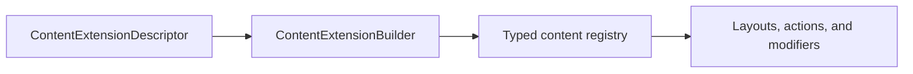

# vyuh_extension_content

Register content and configuration types through ContentExtensionDescriptor and ContentExtensionBuilder. DefaultContentPlugin deserializes registered types, selects layouts, applies modifiers, and builds routes. Actions execute configurations; conditions produce string values for case matching.



[Package source](https://github.com/vyuh-tech/vyuh/tree/main/packages/system/vyuh_extension_content) · [Released API](https://pub.dev/documentation/vyuh_extension_content/latest/)

## Choose a declaration

[Action](#action) · [ActionConfiguration](#actionconfiguration) · [ActionFailure](#actionfailure) · [CMSPathResolver](#cmspathresolver) · [CMSRoute](#cmsroute) · [Category](#category) · [Condition](#condition) · [ConditionConfiguration](#conditionconfiguration) · [ConditionFailure](#conditionfailure) · [ContainerItem](#containeritem) · [ContentBindingAccessor](#contentbindingaccessor) · [ContentBuilder](#contentbuilder) · [ContentDescriptor](#contentdescriptor) · [ContentDescriptorFactory](#contentdescriptorfactory) · [ContentExtensionBuilder](#contentextensionbuilder) · [ContentExtensionDescriptor](#contentextensiondescriptor) · [ContentFailure](#contentfailure) · [ContentItem](#contentitem) · [ContentItemFailure](#contentitemfailure) · [ContentModifierConfiguration](#contentmodifierconfiguration) · [ContentPlatformAccessor](#contentplatformaccessor) · [ContentPlugin](#contentplugin) · [ContentProvider](#contentprovider) · [DIExtension](#diextension) · [DefaultContentPlugin](#defaultcontentplugin) · [DocumentBuilder](#documentbuilder) · [DocumentFutureBuilder](#documentfuturebuilder) · [DocumentItem](#documentitem) · [DocumentStreamBuilder](#documentstreambuilder) · [FieldName](#fieldname) · [FileReference](#filereference) · [FromJsonConverter](#fromjsonconverter) · [ImageReference](#imagereference) · [LayoutConfiguration](#layoutconfiguration) · [LayoutFailure](#layoutfailure) · [LiveContentProvider](#livecontentprovider) · [LocalContentProvider](#localcontentprovider) · [ModifierFailure](#modifierfailure) · [NoOpContentPlugin](#noopcontentplugin) · [NoOpContentProvider](#noopcontentprovider) · [NoOpLiveContentProvider](#nooplivecontentprovider) · [ObjectReference](#objectreference) · [PreviewContext](#previewcontext) · [RootItem](#rootitem) · [RouteBase](#routebase) · [RouteBuilder](#routebuilder) · [RouteBuilderProxy](#routebuilderproxy) · [RouteContentWithRefresh](#routecontentwithrefresh) · [RouteLifecycleConfiguration](#routelifecycleconfiguration) · [RouteTypeConfiguration](#routetypeconfiguration) · [SchemaItem](#schemaitem) · [ScopedDIWidget](#scopeddiwidget) · [ServiceExtensions](#serviceextensions) · [TypeDescriptor](#typedescriptor) · [UnknownActionConfiguration](#unknownactionconfiguration) · [UnknownConditionConfiguration](#unknownconditionconfiguration) · [UnknownContentBuilder](#unknowncontentbuilder) · [UnknownContentDetector](#unknowncontentdetector) · [UnknownContentIndicator](#unknowncontentindicator) · [UnknownContentItem](#unknowncontentitem) · [UnknownContentModifierConfiguration](#unknowncontentmodifierconfiguration) · [UnknownContentView](#unknowncontentview) · [UnknownLayoutConfiguration](#unknownlayoutconfiguration) · [UnknownPlaceholderFactory](#unknownplaceholderfactory) · [cmsFallbackPageBuilder](#cmsfallbackpagebuilder) · [cmsFallbackRoute](#cmsfallbackroute) · [createUnknownPlaceholder](#createunknownplaceholder) · [defaultRoutePageBuilder](#defaultroutepagebuilder) · [fieldKeyMap](#fieldkeymap) · [initializeUnknownPlaceholderFactory](#initializeunknownplaceholderfactory) · [listFromJson](#listfromjson) · [messages](#messages) · [readValue](#readvalue) · [setUnknownPlaceholderFactory](#setunknownplaceholderfactory) · [typeFromFirstOfListJson](#typefromfirstoflistjson)

## Action {#action}

[Source](https://github.com/vyuh-tech/vyuh/blob/main/packages/system/vyuh_extension_content/lib/content/action.dart#L9)

A composable action that can be executed in response to user interaction.

```dart
final class Action
```

Directly declared public members:

```dart
final String? title;
```

Optional title for the action.

```dart
final List<ActionConfiguration>? configurations;
```

List of configurations to execute when the action is triggered.

```dart
static List<ActionConfiguration>? configurationList(dynamic json);
```

Converts a JSON array to a list of `ActionConfiguration` instances.

```dart
FutureOr<void> execute(BuildContext context, {Map<String, dynamic>? arguments});
```

Executes all configurations in sequence.

```dart
Action({this.title, this.configurations});
```

Creates a new action with optional title and configurations.

```dart
factory Action.fromJson(Map<String, dynamic> json);
```

Creates an action from a JSON object.

```dart
bool get isEmpty;
```

Returns true if this action has no configurations.

```dart
bool get isNotEmpty;
```

Returns true if this action has at least one configuration.

## ActionConfiguration {#actionconfiguration}

[Source](https://github.com/vyuh-tech/vyuh/blob/main/packages/system/vyuh_extension_content/lib/content/action.dart#L97)

Base class for all action configurations.

```dart
abstract class ActionConfiguration implements SchemaItem
```

Directly declared public members:

```dart
final String schemaType;
```

The schema type of this configuration.

```dart
final String? title;
```

Optional title for this configuration.

```dart
final bool? isAwaited;
```

Whether to await this configuration's execution.

```dart
ActionConfiguration({required this.schemaType, this.title, this.isAwaited});
```

Creates a new action configuration.

```dart
FutureOr<void> execute(BuildContext context, {Map<String, dynamic>? arguments});
```

Executes this configuration.

## ActionFailure {#actionfailure}

[Source](https://github.com/vyuh-tech/vyuh/blob/main/packages/system/vyuh_extension_content/lib/contracts/content_failure.dart#L92)

Failure when an action configuration registration is missing.

```dart
final class ActionFailure extends ContentFailure
```

Directly declared public members:

```dart
final Map<String, dynamic>? actionConfig;
```

The action configuration that failed to resolve

```dart
const ActionFailure({required super.schemaType, this.actionConfig, super.jsonPayload, super.description, super.suggestions});
```


## CMSPathResolver {#cmspathresolver}

[Source](https://github.com/vyuh-tech/vyuh/blob/main/packages/system/vyuh_extension_content/lib/routing/cms_route.dart#L6)

A function that resolves a CMS path from a local path. This is useful when multiple local routes use a single template path on the CMS. For example: (Local path) /blog/:slug -&gt; /blog (CMS path)

```dart
typedef CMSPathResolver = String Function(String path);
```

## CMSRoute {#cmsroute}

[Source](https://github.com/vyuh-tech/vyuh/blob/main/packages/system/vyuh_extension_content/lib/routing/cms_route.dart#L13)

A route purely meant to identify CMS pages. Use it to distinguish between the way local routes and CMS routes are handled.

```dart
final class CMSRoute extends GoRoute
```

Directly declared public members:

```dart
final CMSPathResolver cmsPathResolver;
```

A function that resolves a CMS path from a local path.

```dart
CMSRoute({required super.path, this.cmsPathResolver = _identityPathResolver, super.builder, GoRouterPageBuilder? pageBuilder, super.parentNavigatorKey, super.name, super.onExit, super.redirect, super.routes});
```

Creates a new CMS route.

## Category {#category}

[Source](https://github.com/vyuh-tech/vyuh/blob/main/packages/system/vyuh_extension_content/lib/contracts/route_base.dart#L102)

A category for organizing routes.

```dart
class Category implements SchemaItem
```

Directly declared public members:

```dart
String get schemaType;
```


```dart
final String identifier;
```


```dart
final String title;
```


```dart
final LayoutConfiguration? layout;
```


```dart
final List<ContentModifierConfiguration>? modifiers;
```


```dart
static List<ContentModifierConfiguration>? modifierList(dynamic json);
```


```dart
Category({required this.identifier, required this.title, this.layout, this.modifiers});
```


```dart
factory Category.fromJson(Map<String, dynamic> json);
```


## Condition {#condition}

[Source](https://github.com/vyuh-tech/vyuh/blob/main/packages/system/vyuh_extension_content/lib/content/condition.dart#L9)

A conditional expression that can be evaluated at runtime.

```dart
final class Condition
```

Directly declared public members:

```dart
final ConditionConfiguration? configuration;
```

The configuration that defines the condition's logic.

```dart
Condition({this.configuration});
```

Creates a new condition with the given configuration.

```dart
Future<String?> execute(BuildContext context);
```

Evaluates the condition in the current context.

```dart
factory Condition.fromJson(Map<String, dynamic> json);
```

Creates a condition from a JSON object.

## ConditionConfiguration {#conditionconfiguration}

[Source](https://github.com/vyuh-tech/vyuh/blob/main/packages/system/vyuh_extension_content/lib/content/condition.dart#L60)

Base class for all condition configurations.

```dart
abstract class ConditionConfiguration implements SchemaItem
```

Directly declared public members:

```dart
final String schemaType;
```

The schema type of this configuration.

```dart
final String? title;
```

Optional title for this configuration.

```dart
ConditionConfiguration({required this.schemaType, this.title});
```

Creates a new condition configuration.

```dart
Future<String?> execute(BuildContext context);
```

Evaluates this condition configuration.

## ConditionFailure {#conditionfailure}

[Source](https://github.com/vyuh-tech/vyuh/blob/main/packages/system/vyuh_extension_content/lib/contracts/content_failure.dart#L109)

Failure when a condition configuration registration is missing.

```dart
final class ConditionFailure extends ContentFailure
```

Directly declared public members:

```dart
final Map<String, dynamic>? conditionConfig;
```

The condition configuration that failed to resolve

```dart
const ConditionFailure({required super.schemaType, this.conditionConfig, super.jsonPayload, super.description, super.suggestions});
```


## ContainerItem {#containeritem}

[Source](https://github.com/vyuh-tech/vyuh/blob/main/packages/system/vyuh_extension_content/lib/contracts/content_item.dart#L195)

Represents a container item that can contain other content items.

```dart
abstract interface class ContainerItem implements ContentItem
```

## ContentBindingAccessor {#contentbindingaccessor}

[Source](https://github.com/vyuh-tech/vyuh/blob/main/packages/system/vyuh_extension_content/lib/plugin/accessors.dart#L16)

`VyuhBinding.instance.content`: the same as `vyuh.content`, for code that also runs in widget mode (`VyuhContentWidget`, without `runApp`).

```dart
extension ContentBindingAccessor on VyuhBinding
```

Directly declared public members:

```dart
ContentPlugin get content;
```

The content plugin, or a `NoOpContentPlugin` when none is registered.

## ContentBuilder {#contentbuilder}

[Source](https://github.com/vyuh-tech/vyuh/blob/main/packages/system/vyuh_extension_content/lib/content/content_builder.dart#L5)

A builder for configuring and managing content types and their layouts.

```dart
class ContentBuilder<T extends ContentItem>
```

Directly declared public members:

```dart
final TypeDescriptor<T> content;
```

The type descriptor for the content type `T`.

```dart
LayoutConfiguration<T> get defaultLayout;
```


```dart
TypeDescriptor<LayoutConfiguration<T>> get defaultLayoutDescriptor;
```


```dart
List<TypeDescriptor<LayoutConfiguration>> get layouts;
```


```dart
String? get sourceFeature;
```


```dart
void setSourceFeature(String? featureName);
```

Updates the source feature for this builder and its layouts.

```dart
ContentBuilder({required this.content, required this._defaultLayout, required this._defaultLayoutDescriptor});
```

Creates a new content builder.

```dart
void init(List<ContentDescriptor> descriptors);
```

Initializes this content builder with the given descriptors.

```dart
void addDescriptors(List<ContentDescriptor> descriptors);
```

Additively registers new descriptors into this builder.

```dart
VoidCallback captureLazyState();
```

Captures mutable builder state for failed lazy-registration rollback. Subclasses with additional state must extend this rollback.

```dart
void registerDescriptors<U>(Iterable<TypeDescriptor<U>> descriptors, {bool checkUnique = false});
```

Registers a list of type descriptors with the content system.

```dart
Widget build(BuildContext context, T content);
```

Builds a widget for the given content item.

```dart
void setDefaultLayout(LayoutConfiguration<T> layout, {required FromJsonConverter<LayoutConfiguration<T>> fromJson, String? sourceFeatureName});
```

Sets the default layout for this content builder.

## ContentDescriptor {#contentdescriptor}

[Source](https://github.com/vyuh-tech/vyuh/blob/main/packages/system/vyuh_extension_content/lib/content/content_descriptor.dart#L8)

Public declaration in this package.

```dart
abstract class ContentDescriptor
```

Directly declared public members:

```dart
final String title;
```


```dart
final String schemaType;
```


```dart
final List<TypeDescriptor<LayoutConfiguration>>? layouts;
```


```dart
String? get sourceFeature;
```

The feature that this content descriptor was registered by.

```dart
ContentDescriptor({required this.schemaType, required this.title, required this.layouts});
```


```dart
static ContentDescriptorFactory createDefault({required String schemaType, required String title});
```

A simplified approach to creating a `ContentDescriptor` that follows the standard conventions. This eliminates the need to create a new `&lt;Item&gt;ContentDescriptor`.

```dart
void setSourceFeature(String? featureName);
```


## ContentDescriptorFactory {#contentdescriptorfactory}

[Source](https://github.com/vyuh-tech/vyuh/blob/main/packages/system/vyuh_extension_content/lib/content/content_descriptor.dart#L3)

Public declaration in this package.

```dart
typedef ContentDescriptorFactory<T extends ContentItem> = ContentDescriptor Function(
```

## ContentExtensionBuilder {#contentextensionbuilder}

[Source](https://github.com/vyuh-tech/vyuh/blob/main/packages/system/vyuh_extension_content/lib/content_extension_builder.dart#L6)

Public declaration in this package.

```dart
final class ContentExtensionBuilder extends ExtensionBuilder
```

Directly declared public members:

```dart
ContentExtensionBuilder();
```


```dart
Map<Type, Map<String, TypeDescriptor>> typeRegistry();
```


```dart
ContentBuilder<ContentItem>? contentBuilder(String schemaType);
```


```dart
List<ContentBuilder> contentBuilders();
```


```dart
Future<void> onInit(List<ExtensionDescriptor> extensions);
```


```dart
Future<void> onDispose();
```


```dart
T? fromJson<T>(String typeName, Map<String, dynamic> json);
```


```dart
void register<T>(TypeDescriptor<T> descriptor);
```


```dart
bool isRegistered<T>(String schemaType);
```


```dart
void registerBuilder(ContentBuilder builder, {List<ContentDescriptor>? descriptors = const []});
```

Register a ContentBuilder directly This allows other plugins to register content builders programmatically

```dart
VoidCallback captureLazyState(ExtensionDescriptor descriptor);
```

Captures converter registries and affected content builders for rollback.

```dart
void registerLazy(ExtensionDescriptor descriptor);
```


## ContentExtensionDescriptor {#contentextensiondescriptor}

[Source](https://github.com/vyuh-tech/vyuh/blob/main/packages/system/vyuh_extension_content/lib/content_extension_descriptor.dart#L4)

Public declaration in this package.

```dart
final class ContentExtensionDescriptor extends ExtensionDescriptor
```

Directly declared public members:

```dart
final List<ContentDescriptor>? contents;
```


```dart
final List<TypeDescriptor<ContentModifierConfiguration>>? contentModifiers;
```


```dart
final List<ContentBuilder>? contentBuilders;
```


```dart
final List<TypeDescriptor<ActionConfiguration>>? actions;
```


```dart
final List<TypeDescriptor<ConditionConfiguration>>? conditions;
```


```dart
final List<TypeDescriptor<RouteTypeConfiguration>>? routeTypes;
```


```dart
ContentExtensionDescriptor({this.contents, this.contentModifiers, this.contentBuilders, this.actions, this.conditions, this.routeTypes});
```


```dart
dynamic onSourceFeatureUpdated();
```


## ContentFailure {#contentfailure}

[Source](https://github.com/vyuh-tech/vyuh/blob/main/packages/system/vyuh_extension_content/lib/contracts/content_failure.dart#L1)

Base class for content-related failures in the Vyuh framework.

```dart
abstract class ContentFailure
```

Directly declared public members:

```dart
final String schemaType;
```

The schema type that failed to resolve

```dart
final Map<String, dynamic>? jsonPayload;
```

The original JSON payload that caused the failure (if available)

```dart
final String? description;
```

Human-readable description of the failure

```dart
final List<String>? suggestions;
```

Optional suggestions for resolving the failure

```dart
const ContentFailure({required this.schemaType, this.jsonPayload, this.description, this.suggestions});
```


## ContentItem {#contentitem}

[Source](https://github.com/vyuh-tech/vyuh/blob/main/packages/system/vyuh_extension_content/lib/contracts/content_item.dart#L26)

The base class for all content items in Vyuh.

```dart
abstract class ContentItem implements SchemaItem
```

Directly declared public members:

```dart
final String schemaType;
```


```dart
final LayoutConfiguration? layout;
```

The layout configuration for the content item.

```dart
final List<ContentModifierConfiguration>? modifiers;
```


```dart
static List<ContentModifierConfiguration>? modifierList(dynamic json);
```


```dart
ContentItem? parent;
```

The parent content item of this content item. This is used internally by the content system.

```dart
ContentItem({required this.schemaType, required this.layout, required this.modifiers});
```

Creates an instance of `ContentItem`.

```dart
factory ContentItem.fromJson(Map<String, dynamic> json);
```

Converts the JSON representation of the content item to an instance of `ContentItem`.

```dart
void setParent(Iterable<ContentItem?> children);
```

Sets the parent content item for the given list of children.

```dart
LayoutConfiguration? getLayout();
```

Gets the layout to use for the `ContentItem`. By default its the `layout` itself. However this acts as an extension point for custom `ContentItem`s that may have a different strategy for applying layouts.

```dart
List<ContentModifierConfiguration>? getModifiers();
```

Gets the modifiers to use for the `ContentItem`. By default its the `modifiers` itself. However this acts as an extension point for custom `ContentItem`s that may have a different strategy for applying modifiers.

## ContentItemFailure {#contentitemfailure}

[Source](https://github.com/vyuh-tech/vyuh/blob/main/packages/system/vyuh_extension_content/lib/contracts/content_failure.dart#L28)

Failure when a ContentItem type registration is missing.

```dart
final class ContentItemFailure extends ContentFailure
```

Directly declared public members:

```dart
const ContentItemFailure({required super.schemaType, super.jsonPayload, super.description, super.suggestions});
```


## ContentModifierConfiguration {#contentmodifierconfiguration}

[Source](https://github.com/vyuh-tech/vyuh/blob/main/packages/system/vyuh_extension_content/lib/contracts/content_item.dart#L111)

Configuration for modifying content presentation.

```dart
abstract class ContentModifierConfiguration implements SchemaItem
```

Directly declared public members:

```dart
final String schemaType;
```


```dart
ContentModifierConfiguration({required this.schemaType});
```


```dart
factory ContentModifierConfiguration.fromJson(Map<String, dynamic> json);
```


```dart
Widget build(BuildContext context, Widget child, ContentItem content);
```

Builds the modifier widget tree for the given content item.

## ContentPlatformAccessor {#contentplatformaccessor}

[Source](https://github.com/vyuh-tech/vyuh/blob/main/packages/system/vyuh_extension_content/lib/plugin/accessors.dart#L6)

`vyuh.content`: the registered `ContentPlugin`.

```dart
extension ContentPlatformAccessor on VyuhPlatform
```

Directly declared public members:

```dart
ContentPlugin get content;
```

The content plugin, or a `NoOpContentPlugin` when none is registered.

## ContentPlugin {#contentplugin}

[Source](https://github.com/vyuh-tech/vyuh/blob/main/packages/system/vyuh_extension_content/lib/contracts/content_plugin.dart#L23)

The base class for a Content Plugin.

```dart
abstract class ContentPlugin extends Plugin
```

Directly declared public members:

```dart
final ContentProvider provider;
```

The ContentProvider for this plugin

```dart
final UnknownContentBuilder unknown;
```

Builds the widget shown when a content type, layout, modifier, action or condition is missing. Defaults to `UnknownContentView`.

```dart
ContentPlugin({required this.provider, required super.name, required super.title, UnknownContentBuilder? unknown});
```

Creates a new ContentPlugin with the given provider, name, and title

```dart
Map<Type, Map<String, TypeDescriptor>> get typeRegistry;
```

The type registry that maps types to their descriptors. This stores the descriptors for LayoutConfiguration, ActionConfiguration, ConditionConfiguration and possibly others in the future.

```dart
Widget buildContent<T extends ContentItem>(BuildContext context, T content, {LayoutConfiguration<T>? layout});
```

Builds a Widget for the given content. You can pass in an optional `layout` to override the default layout

```dart
Widget buildRoute(BuildContext context, {Uri? url, String? routeId});
```

Builds a Widget for the given route url or id. This is used for top-level documents called routes. These could represent a page, dialog or a conditional-route.

```dart
void attach(ExtensionBuilder extBuilder);
```

Sets up the plugin with the ContentExtensionBuilder. The plugin relies on the ContentExtensionBuilder to do its work.

```dart
T? fromJson<T>(Map<String, dynamic> json);
```

Converts the given json to an item of type T

```dart
void register<T>(TypeDescriptor<T> descriptor);
```

Registers the given type descriptor

```dart
bool isRegistered<T>(String schemaType);
```

Checks if the given schema type is registered for type T

## ContentProvider {#contentprovider}

[Source](https://github.com/vyuh-tech/vyuh/blob/main/packages/system/vyuh_extension_content/lib/contracts/content_provider.dart#L5)

Public declaration in this package.

```dart
abstract class ContentProvider
```

Directly declared public members:

```dart
final String name;
```


```dart
final String title;
```


```dart
final LiveContentProvider live;
```


```dart
ContentProvider({required this.name, required this.title, this.live = const NoOpLiveContentProvider()});
```


```dart
bool get supportsLive;
```


```dart
String fieldValue(String key, Map<String, dynamic> json);
```


```dart
String schemaType(Map<String, dynamic> json);
```


```dart
Future<void> init();
```


```dart
Future<void> dispose();
```


```dart
ImageProvider? image(ImageReference imageRef, {int? width, int? height, int? devicePixelRatio, int? quality, String? format});
```


```dart
Uri? fileUrl(FileReference fileRef);
```


```dart
Future<T?> fetchById<T>(String id, {required FromJsonConverter<T> fromJson, bool useCache = true});
```


```dart
Future<T?> fetchSingle<T>(String query, {required FromJsonConverter<T> fromJson, Map<String, String>? queryParams, bool useCache = true});
```


```dart
Future<List<T>?> fetchMultiple<T>(String query, {required FromJsonConverter<T> fromJson, Map<String, String>? queryParams, bool useCache = true});
```


```dart
Future<RouteBase?> fetchRoute({String? path, String? routeId, bool useCache = true});
```


## DIExtension {#diextension}

[Source](https://github.com/vyuh-tech/vyuh/blob/main/packages/system/vyuh_extension_content/lib/ui/scoped_di_widget.dart#L81)

Public declaration in this package.

```dart
extension DIExtension on BuildContext
```

Directly declared public members:

```dart
DIPlugin get di;
```


## DefaultContentPlugin {#defaultcontentplugin}

[Source](https://github.com/vyuh-tech/vyuh/blob/main/packages/system/vyuh_extension_content/lib/plugin/content_plugin.dart#L6)

The default ContentPlugin implementation for the Vyuh framework. This plugin is responsible for fetching content from a CMS and rendering content items. It uses a `ContentExtensionBuilder` to keep track of the various `ContentItem` types.

```dart
final class DefaultContentPlugin extends ContentPlugin
```

Directly declared public members:

```dart
final bool useLiveRoute;
```

Whether to use live route updates via streams. When true, uses RouteStreamBuilder for real-time updates. When false, uses RouteFutureBuilder for one-time loading.

```dart
final bool allowRouteRefresh;
```

Whether to allow manual refreshing of the route.

```dart
DefaultContentPlugin({required super.provider, this.useLiveRoute = false, this.allowRouteRefresh = true, super.unknown});
```


```dart
Map<Type, Map<String, TypeDescriptor>> get typeRegistry;
```


```dart
Widget buildContent<T extends ContentItem>(BuildContext context, T content, {LayoutConfiguration<T>? layout});
```


```dart
Widget buildRoute(BuildContext context, {Uri? url, String? routeId});
```


```dart
T? fromJson<T>(Map<String, dynamic> json);
```


```dart
dynamic register<T>(TypeDescriptor<T> descriptor);
```


```dart
bool isRegistered<T>(String schemaType);
```


```dart
Future<void> dispose();
```


```dart
Future<void> init();
```


```dart
void attach(ExtensionBuilder extBuilder);
```


## DocumentBuilder {#documentbuilder}

[Source](https://github.com/vyuh-tech/vyuh/blob/main/packages/system/vyuh_extension_content/lib/ui/document_builder.dart#L5)

A widget that builds UI based on document data fetched from a content provider.

```dart
final class DocumentBuilder<T> extends StatelessWidget
```

Directly declared public members:

```dart
final Future<T?> Function() fetchDocument;
```

A function that returns a future of the document.

```dart
final Stream<T?>? liveDocument;
```

A stream of document data for live updates.

```dart
final Stream<T?> Function()? liveDocumentFactory;
```

Creates a fresh subscription for live refresh/retry.

```dart
final bool allowRefresh;
```

Whether to allow refreshing the document.

```dart
final bool isLive;
```

Whether to use live document updates.

```dart
final Widget Function(BuildContext context, T document) buildContent;
```

A function that builds the UI for the document.

```dart
final Future<T?> Function(BuildContext context, T document)? initDocument;
```

Optional custom initialization function for the document. This allows for document-specific initialization logic.

```dart
final bool isRoute;
```

Whether this document is a whole route. A route that fails shows a full page with Back and Go home; other content fails inline.

```dart
final Uri? location;
```

The location being shown, included in failure reports.

```dart
final Object? requestKey;
```

Identifies the document. When set, the builder refetches (or resubscribes) only when this value changes, not when the parent passes new closures. The `fromRoute`, `fromQuery` and `fromId` factories set it.

```dart
const DocumentBuilder({super.key, required this.fetchDocument, this.liveDocument, this.liveDocumentFactory, required this.buildContent, this.allowRefresh = true, this.isLive = false, this.initDocument, this.isRoute = false, this.location, this.requestKey});
```

Creates a `DocumentBuilder` with a custom document fetching function.

```dart
static DocumentBuilder<T> fromQuery<T>({Key? key, required String query, Map<String, String>? queryParams, required FromJsonConverter<T> fromJson, required Widget Function(BuildContext, T) buildContent, bool includeDrafts = false, bool allowRefresh = true, bool isLive = false, Future<T?> Function(BuildContext, T?)? initDocument});
```

Creates a `DocumentBuilder` that fetches a document by query.

```dart
static DocumentBuilder<T> fromId<T>({Key? key, required String id, required FromJsonConverter<T> fromJson, required Widget Function(BuildContext, T) buildContent, bool includeDrafts = false, bool allowRefresh = true, bool isLive = false, Future<T?> Function(BuildContext, T?)? initDocument});
```

Creates a `DocumentBuilder` that fetches a document by ID.

```dart
static DocumentBuilder<RouteBase> fromRoute({Key? key, Uri? url, String? routeId, required Widget Function(BuildContext, RouteBase) buildContent, bool includeDrafts = false, bool allowRefresh = true, bool isLive = false});
```

Creates a `DocumentBuilder` that fetches a route by path or ID.

```dart
Widget build(BuildContext context);
```


## DocumentFutureBuilder {#documentfuturebuilder}

[Source](https://github.com/vyuh-tech/vyuh/blob/main/packages/system/vyuh_extension_content/lib/ui/document_future_builder.dart#L11)

A widget that builds UI based on a future of document data.

```dart
class DocumentFutureBuilder<T> extends StatefulWidget
```

Directly declared public members:

```dart
final Future<T?> Function() future;
```

The future that resolves with the document data.

```dart
final Widget Function(BuildContext context, T document) buildContent;
```

A function that builds the UI for the content.

```dart
final bool allowRefresh;
```

Whether to allow refreshing the document, with the overlay Refresh button.

```dart
final bool isRoute;
```

Whether this document is a whole route. A route that fails shows a full page with Back and Go home; other content fails inline.

```dart
final Uri? location;
```

The location being shown, included in failure reports.

```dart
final Object? requestKey;
```

Identifies the document being fetched. When set, the builder refetches only when this value changes, so a parent passing a new `future` closure on every build doesn't trigger a refetch. When null, a new `future` function does.

```dart
const DocumentFutureBuilder({super.key, required this.future, required this.buildContent, this.allowRefresh = true, this.isRoute = false, this.location, this.requestKey});
```

Creates a `DocumentFutureBuilder`.

```dart
State<DocumentFutureBuilder<T>> createState();
```


## DocumentItem {#documentitem}

[Source](https://github.com/vyuh-tech/vyuh/blob/main/packages/system/vyuh_extension_content/lib/contracts/content_item.dart#L20)

The base interface for all schema-driven document items.

```dart
abstract interface class DocumentItem implements SchemaItem
```

## DocumentStreamBuilder {#documentstreambuilder}

[Source](https://github.com/vyuh-tech/vyuh/blob/main/packages/system/vyuh_extension_content/lib/ui/document_stream_builder.dart#L9)

Builds document UI from a stream, including errors and completion.

```dart
class DocumentStreamBuilder<T> extends StatefulWidget
```

Directly declared public members:

```dart
final Stream<T?>? stream;
```


```dart
final Stream<T?> Function()? streamFactory;
```


```dart
final Widget Function(BuildContext context, T document) buildContent;
```


```dart
final bool allowRefresh;
```


```dart
final bool isRoute;
```

Whether this document is a whole route. A route that fails shows a full page with Back and Go home; other content fails inline.

```dart
final Uri? location;
```

The location being shown, included in failure reports.

```dart
const DocumentStreamBuilder({super.key, required Stream<T?> this.stream, required this.buildContent, this.allowRefresh = true, this.isRoute = false, this.location});
```


```dart
const DocumentStreamBuilder.refreshable({super.key, required Stream<T?> Function() this.streamFactory, required this.buildContent, this.allowRefresh = true, this.isRoute = false, this.location});
```


```dart
State<DocumentStreamBuilder<T>> createState();
```


## FieldName {#fieldname}

[Source](https://github.com/vyuh-tech/vyuh/blob/main/packages/system/vyuh_extension_content/lib/contracts/content_plugin.dart#L75)

Public declaration in this package.

```dart
enum FieldName { id, type, key, ref, updatedAt, createdAt }
```

## FileReference {#filereference}

[Source](https://github.com/vyuh-tech/vyuh/blob/main/packages/system/vyuh_extension_content/lib/contracts/reference.dart#L34)

A reference to a file asset in the content management system.

```dart
class FileReference
```

Directly declared public members:

```dart
final String type;
```


```dart
final ObjectReference? asset;
```


```dart
FileReference({required this.type, required this.asset});
```


```dart
factory FileReference.fromJson(Map<String, dynamic> json);
```


## FromJsonConverter {#fromjsonconverter}

[Source](https://github.com/vyuh-tech/vyuh/blob/main/packages/system/vyuh_extension_content/lib/contracts/type_descriptor.dart#L1)

Function type for converting JSON data to a typed object.

```dart
typedef FromJsonConverter<T> = T? Function(Map<String, dynamic> json);
```

## ImageReference {#imagereference}

[Source](https://github.com/vyuh-tech/vyuh/blob/main/packages/system/vyuh_extension_content/lib/contracts/reference.dart#L6)

A reference to an image asset in the content management system.

```dart
class ImageReference
```

Directly declared public members:

```dart
final String type;
```


```dart
final ObjectReference? asset;
```


```dart
final String? sanityAsset;
```


```dart
ImageReference({required this.type, required this.asset, this.sanityAsset});
```


```dart
factory ImageReference.fromJson(Map<String, dynamic> json);
```


## LayoutConfiguration {#layoutconfiguration}

[Source](https://github.com/vyuh-tech/vyuh/blob/main/packages/system/vyuh_extension_content/lib/contracts/content_item.dart#L148)

Base class for configuring the visual layout of a content item.

```dart
abstract class LayoutConfiguration<T extends ContentItem> implements SchemaItem
```

Directly declared public members:

```dart
final String schemaType;
```


```dart
final Type contentType;
```


```dart
LayoutConfiguration({required this.schemaType});
```

Creates an instance of `LayoutConfiguration`.

```dart
factory LayoutConfiguration.fromJson(Map<String, dynamic> json);
```

Converts the JSON representation of the layout configuration to an instance of `LayoutConfiguration`.

```dart
Widget build(BuildContext context, T content);
```

Builds the layout widget tree for the given content item.

## LayoutFailure {#layoutfailure}

[Source](https://github.com/vyuh-tech/vyuh/blob/main/packages/system/vyuh_extension_content/lib/contracts/content_failure.dart#L50)

Failure when a layout for a registered content type is missing.

```dart
final class LayoutFailure extends ContentFailure
```

Directly declared public members:

```dart
final String contentSchemaType;
```

The content type that needs a layout

```dart
final String? requestedLayoutType;
```

The specific layout type that was requested (if any)

```dart
const LayoutFailure({required super.schemaType, required this.contentSchemaType, this.requestedLayoutType, super.jsonPayload, super.description, super.suggestions});
```


## LiveContentProvider {#livecontentprovider}

[Source](https://github.com/vyuh-tech/vyuh/blob/main/packages/system/vyuh_extension_content/lib/contracts/live_content_provider.dart#L3)

An interface for plugins that provide live content.

```dart
abstract class LiveContentProvider
```

Directly declared public members:

```dart
final String title;
```

The title of the live content provider.

```dart
const LiveContentProvider({required this.title});
```


```dart
Future<void> init();
```


```dart
Future<void> dispose();
```


```dart
Stream<T?> fetchById<T>(String id, {required FromJsonConverter<T> fromJson, bool includeDrafts = false});
```

Fetches content by ID.

```dart
Stream<T?> fetchSingle<T>(String query, {required FromJsonConverter<T> fromJson, Map<String, String>? queryParams, bool includeDrafts = false});
```

Fetches content by query, returning a single item.

```dart
Stream<List<T>?> fetchMultiple<T>(String query, {required FromJsonConverter<T> fromJson, Map<String, String>? queryParams, bool includeDrafts = false});
```

Fetches content by query, returning a list of items.

```dart
Stream<RouteBase?> fetchRoute({String? path, String? routeId, bool includeDrafts = false});
```

Fetches content by route.

## LocalContentProvider {#localcontentprovider}

[Source](https://github.com/vyuh-tech/vyuh/blob/main/packages/system/vyuh_extension_content/lib/contracts/local_content_provider.dart#L6)

Public declaration in this package.

```dart
final class LocalContentProvider extends ContentProvider
```

Directly declared public members:

```dart
LocalContentProvider();
```


```dart
String schemaType(Map<String, dynamic> json);
```


```dart
String fieldValue(String key, Map<String, dynamic> json);
```


```dart
Future<T?> fetchById<T>(String id, {required FromJsonConverter<T> fromJson, bool useCache = true});
```


```dart
Future<List<T>?> fetchMultiple<T>(String query, {required FromJsonConverter<T> fromJson, Map<String, String>? queryParams, bool useCache = true});
```


```dart
Future<RouteBase?> fetchRoute({String? path, String? routeId, bool useCache = true});
```


```dart
Future<T?> fetchSingle<T>(String query, {required FromJsonConverter<T> fromJson, Map<String, String>? queryParams, bool useCache = true});
```


```dart
Uri? fileUrl(FileReference fileRef);
```


```dart
ImageProvider<Object>? image(ImageReference imageRef, {int? width, int? height, int? devicePixelRatio, int? quality, String? format});
```


```dart
Future<void> init();
```


```dart
Future<void> dispose();
```


## ModifierFailure {#modifierfailure}

[Source](https://github.com/vyuh-tech/vyuh/blob/main/packages/system/vyuh_extension_content/lib/contracts/content_failure.dart#L71)

Failure when a content modifier registration is missing.

```dart
final class ModifierFailure extends ContentFailure
```

Directly declared public members:

```dart
final List<String> modifierChain;
```

The complete chain of modifiers being applied

```dart
final int failedIndex;
```

The index in the modifier chain where the failure occurred

```dart
const ModifierFailure({required super.schemaType, required this.modifierChain, required this.failedIndex, super.jsonPayload, super.description, super.suggestions});
```


## NoOpContentPlugin {#noopcontentplugin}

[Source](https://github.com/vyuh-tech/vyuh/blob/main/packages/system/vyuh_extension_content/lib/contracts/noop_content_plugin.dart#L18)

Public declaration in this package.

```dart
final class NoOpContentPlugin extends ContentPlugin
```

Directly declared public members:

```dart
NoOpContentPlugin();
```


```dart
Widget buildContent<T extends ContentItem>(BuildContext context, T content, {LayoutConfiguration<T>? layout});
```


```dart
Widget buildRoute(BuildContext context, {Uri? url, String? routeId});
```


```dart
Future<void> dispose();
```


```dart
Future<void> init();
```


```dart
bool isRegistered<T>(String schemaType);
```


```dart
dynamic register<T>(TypeDescriptor<T> descriptor);
```


```dart
void attach(ExtensionBuilder extBuilder);
```


```dart
T? fromJson<T>(Map<String, dynamic> json);
```


```dart
Map<Type, Map<String, TypeDescriptor>> get typeRegistry;
```


## NoOpContentProvider {#noopcontentprovider}

[Source](https://github.com/vyuh-tech/vyuh/blob/main/packages/system/vyuh_extension_content/lib/contracts/noop_content_provider.dart#L4)

Public declaration in this package.

```dart
final class NoOpContentProvider extends ContentProvider
```

Directly declared public members:

```dart
NoOpContentProvider();
```


```dart
Future<void> dispose();
```


```dart
Future<List<T>?> fetchMultiple<T>(String query, {required FromJsonConverter<T> fromJson, Map<String, String>? queryParams, bool useCache = true});
```


```dart
Future<RouteBase?> fetchRoute({String? path, String? routeId, bool useCache = true});
```


```dart
Future<T?> fetchSingle<T>(String query, {required FromJsonConverter<T> fromJson, Map<String, String>? queryParams, bool useCache = true});
```


```dart
String fieldValue(String key, Map<String, dynamic> json);
```


```dart
ImageProvider? image(ImageReference imageRef, {int? width, int? height, int? devicePixelRatio, int? quality, String? format});
```


```dart
Future<void> init();
```


```dart
String schemaType(Map<String, dynamic> json);
```


```dart
Future<T?> fetchById<T>(String id, {required FromJsonConverter<T> fromJson, bool useCache = true});
```


```dart
Uri? fileUrl(FileReference fileRef);
```


## NoOpLiveContentProvider {#nooplivecontentprovider}

[Source](https://github.com/vyuh-tech/vyuh/blob/main/packages/system/vyuh_extension_content/lib/contracts/live_content_provider.dart#L48)

A no-op implementation of `LiveContentProvider`. Is used internally to ensure the Developer is using it correctly by giving proper errors and hints

```dart
final class NoOpLiveContentProvider extends LiveContentProvider
```

Directly declared public members:

```dart
const NoOpLiveContentProvider();
```


```dart
Stream<T?> fetchById<T>(String id, {required FromJsonConverter<T> fromJson, bool includeDrafts = false});
```


```dart
Stream<T?> fetchSingle<T>(String query, {required FromJsonConverter<T> fromJson, Map<String, String>? queryParams, bool includeDrafts = false});
```


```dart
Stream<List<T>?> fetchMultiple<T>(String query, {required FromJsonConverter<T> fromJson, Map<String, String>? queryParams, bool includeDrafts = false});
```


```dart
Stream<RouteBase?> fetchRoute({String? path, String? routeId, bool includeDrafts = false});
```


```dart
Future<void> dispose();
```


```dart
Future<void> init();
```


## ObjectReference {#objectreference}

[Source](https://github.com/vyuh-tech/vyuh/blob/main/packages/system/vyuh_extension_content/lib/contracts/reference.dart#L59)

A reference to any content object in the content management system.

```dart
class ObjectReference
```

Directly declared public members:

```dart
final String type;
```


```dart
final String ref;
```


```dart
ObjectReference({required this.type, required this.ref});
```


```dart
factory ObjectReference.fromJson(Map<String, dynamic> json);
```


## PreviewContext {#previewcontext}

[Source](https://github.com/vyuh-tech/vyuh/blob/main/packages/system/vyuh_extension_content/lib/preview/preview_context.dart#L4)

Public declaration in this package.

```dart
final class PreviewContext extends InheritedWidget
```

Directly declared public members:

```dart
final ContentItem content;
```


```dart
final LayoutConfiguration<ContentItem> layout;
```


```dart
const PreviewContext({super.key, required this.content, required this.layout, required super.child});
```


```dart
static PreviewContext? of(BuildContext context);
```


```dart
bool updateShouldNotify(PreviewContext oldWidget);
```


## RootItem {#rootitem}

[Source](https://github.com/vyuh-tech/vyuh/blob/main/packages/system/vyuh_extension_content/lib/contracts/content_item.dart#L209)

Represents a root item that is the root of a content tree.

```dart
abstract interface class RootItem implements ContainerItem
```

## RouteBase {#routebase}

[Source](https://github.com/vyuh-tech/vyuh/blob/main/packages/system/vyuh_extension_content/lib/contracts/route_base.dart#L10)

Base class for all route content items in Vyuh.

```dart
abstract class RouteBase extends ContentItem implements RootItem
```

Directly declared public members:

```dart
final String title;
```

The title of the route, displayed in navigation UI.

```dart
final String path;
```

The URL path for this route. This is used to match URLs and generate links.

```dart
final Category? category;
```

Optional category for organizing routes.

```dart
final RouteTypeConfiguration? routeType;
```

Configuration for how this route should be presented. Defines transitions, animations, and other route-specific behavior.

```dart
final String id;
```

Unique identifier for this route.

```dart
final DateTime updatedAt;
```

When this route was last updated in the CMS.

```dart
final DateTime createdAt;
```

When this route was created in the CMS.

```dart
RouteBase({required super.schemaType, this.routeType, required this.title, required this.path, this.category, required this.createdAt, required this.updatedAt, required this.id, required super.layout, required super.modifiers});
```


```dart
factory RouteBase.fromJson(Map<String, dynamic> json);
```


```dart
Future<RouteBase?> init(BuildContext context);
```

Initialize the route when it becomes active.

```dart
Future<void> dispose();
```

Clean up the route when it is no longer active.

```dart
Page<T> createPage<T>(BuildContext context, [LocalKey? pageKey]);
```

Create a Flutter page for this route.

```dart
LayoutConfiguration? getLayout();
```


```dart
List<ContentModifierConfiguration>? getModifiers();
```


## RouteBuilder {#routebuilder}

[Source](https://github.com/vyuh-tech/vyuh/blob/main/packages/system/vyuh_extension_content/lib/ui/route_builder.dart#L5)

Public declaration in this package.

```dart
final class RouteBuilder extends StatelessWidget
```

Directly declared public members:

```dart
final Uri? url;
```


```dart
final String? routeId;
```


```dart
final bool includeDrafts;
```


```dart
final bool allowRefresh;
```


```dart
final bool isLive;
```


```dart
const RouteBuilder({super.key, this.url, this.routeId, this.includeDrafts = false, this.allowRefresh = true, this.isLive = false});
```


```dart
Widget build(BuildContext context);
```


## RouteBuilderProxy {#routebuilderproxy}

[Source](https://github.com/vyuh-tech/vyuh/blob/main/packages/system/vyuh_extension_content/lib/ui/route_builder_proxy.dart#L3)

Public declaration in this package.

```dart
class RouteBuilderProxy extends InheritedWidget
```

Directly declared public members:

```dart
const RouteBuilderProxy({super.key, required super.child, required this._onRefresh});
```


```dart
Future<void> refresh();
```


```dart
bool updateShouldNotify(covariant RouteBuilderProxy oldWidget);
```


```dart
static RouteBuilderProxy? of(BuildContext context);
```


## RouteContentWithRefresh {#routecontentwithrefresh}

[Source](https://github.com/vyuh-tech/vyuh/blob/main/packages/system/vyuh_extension_content/lib/ui/route_builder_proxy.dart#L28)

Works in conjunction with the RouteBuilderProxy to trigger refresh on a Route

```dart
final class RouteContentWithRefresh extends StatelessWidget
```

Directly declared public members:

```dart
final Widget child;
```


```dart
const RouteContentWithRefresh({super.key, required this.child});
```


```dart
Widget build(BuildContext context);
```


## RouteLifecycleConfiguration {#routelifecycleconfiguration}

[Source](https://github.com/vyuh-tech/vyuh/blob/main/packages/system/vyuh_extension_content/lib/contracts/route_base.dart#L177)

Configuration for managing route lifecycle events.

```dart
abstract class RouteLifecycleConfiguration implements SchemaItem
```

Directly declared public members:

```dart
final String schemaType;
```


```dart
final String? title;
```


```dart
RouteLifecycleConfiguration({this.title, required this.schemaType});
```


```dart
Future<void> init(BuildContext context, RouteBase route);
```


```dart
Future<void> dispose();
```


## RouteTypeConfiguration {#routetypeconfiguration}

[Source](https://github.com/vyuh-tech/vyuh/blob/main/packages/system/vyuh_extension_content/lib/contracts/route_base.dart#L146)

Configuration for how a route should be presented.

```dart
abstract class RouteTypeConfiguration implements SchemaItem
```

Directly declared public members:

```dart
final String? title;
```


```dart
final String schemaType;
```


```dart
RouteTypeConfiguration({this.title, required this.schemaType});
```


```dart
Page<T> create<T>(Widget child, RouteBase route, [LocalKey? pageKey]);
```


## SchemaItem {#schemaitem}

[Source](https://github.com/vyuh-tech/vyuh/blob/main/packages/system/vyuh_extension_content/lib/contracts/content_item.dart#L6)

The base interface for all schema-driven content items.

```dart
abstract interface class SchemaItem
```

Directly declared public members:

```dart
String get schemaType;
```

The schema type of the content item.

## ScopedDIWidget {#scopeddiwidget}

[Source](https://github.com/vyuh-tech/vyuh/blob/main/packages/system/vyuh_extension_content/lib/ui/scoped_di_widget.dart#L4)

A widget that wraps its child with a scoped instance of `DIPlugin`.

```dart
final class ScopedDIWidget extends StatefulWidget
```

Directly declared public members:

```dart
const ScopedDIWidget({super.key, required this.child, required this.debugLabel});
```


```dart
final Widget child;
```


```dart
final String debugLabel;
```

The debug label for the `DIPlugin`. It is useful to identify the scope.

```dart
static DIPlugin of(BuildContext context);
```

Get the DIPlugin from the nearest DI scope. If no scope is found, it will fallback to the platform `DIPlugin`.

```dart
State<ScopedDIWidget> createState();
```


## ServiceExtensions {#serviceextensions}

[Source](https://github.com/vyuh-tech/vyuh/blob/main/packages/system/vyuh_extension_content/lib/plugin/extension.dart#L4)

Public declaration in this package.

```dart
extension ServiceExtensions on ContentPlugin
```

Directly declared public members:

```dart
bool setDefaultLayout({required String schemaType, required LayoutConfiguration layout, required FromJsonConverter<LayoutConfiguration> fromJson});
```

Sets the default layout for the `schemaType` of the `ContentItem`. Returns true if the layout was set, false otherwise.

```dart
ContentBuilder? contentBuilder(String schemaType);
```

Returns the `ContentBuilder` for the `schemaType` of the `ContentItem`. Returns null if it does not exist.

```dart
List<ContentBuilder<ContentItem>>? contentBuilders();
```

Returns a map of all content builders, where the key is the schemaType and the value is the ContentBuilder.

## TypeDescriptor {#typedescriptor}

[Source](https://github.com/vyuh-tech/vyuh/blob/main/packages/system/vyuh_extension_content/lib/contracts/type_descriptor.dart#L14)

Describes a schema type and its serialization behavior.

```dart
class TypeDescriptor<T>
```

Directly declared public members:

```dart
final String title;
```

Human-readable name for this type.

```dart
final String schemaType;
```

Schema type identifier from the CMS.

```dart
final FromJsonConverter<T> fromJson;
```

Function to convert JSON data to an instance of `T`.

```dart
final T Function()? preview;
```

Optional function to create a preview instance.

```dart
final Type type;
```

The runtime type of `T`.

```dart
String? get sourceFeature;
```


```dart
void setSourceFeature(String? featureName);
```

Updates the source feature for this type descriptor.

```dart
TypeDescriptor({required this.schemaType, required this.fromJson, required this.title, this.preview});
```

Creates a new type descriptor.

```dart
bool ==(Object other);
```


```dart
int get hashCode;
```


## UnknownActionConfiguration {#unknownactionconfiguration}

[Source](https://github.com/vyuh-tech/vyuh/blob/main/packages/system/vyuh_extension_content/lib/plugin/unknown_placeholders.dart#L5)

Unknown placeholder types for handling missing type registrations gracefully. These placeholders allow the system to continue working while providing proper error feedback through the unknown content builder system. Unknown action configuration placeholder.

```dart
final class UnknownActionConfiguration extends ActionConfiguration
```

Directly declared public members:

```dart
static const dynamic schemaName;
```


```dart
final String missingSchemaType;
```


```dart
final Map<String, dynamic> jsonPayload;
```


```dart
UnknownActionConfiguration({required this.missingSchemaType, required this.jsonPayload});
```


```dart
Future<void> execute(BuildContext context, {Map<String, dynamic>? arguments});
```


## UnknownConditionConfiguration {#unknownconditionconfiguration}

[Source](https://github.com/vyuh-tech/vyuh/blob/main/packages/system/vyuh_extension_content/lib/plugin/unknown_placeholders.dart#L33)

Unknown condition configuration placeholder.

```dart
final class UnknownConditionConfiguration extends ConditionConfiguration
```

Directly declared public members:

```dart
static const dynamic schemaName;
```


```dart
final String missingSchemaType;
```


```dart
final Map<String, dynamic> jsonPayload;
```


```dart
UnknownConditionConfiguration({required this.missingSchemaType, required this.jsonPayload});
```


```dart
Future<String?> execute(BuildContext context);
```


## UnknownContentBuilder {#unknowncontentbuilder}

[Source](https://github.com/vyuh-tech/vyuh/blob/main/packages/system/vyuh_extension_content/lib/contracts/content_plugin.dart#L5)

Builds the widget shown for a `ContentFailure`.

```dart
typedef UnknownContentBuilder = Widget Function( BuildContext context, ContentFailure failure, );
```

## UnknownContentDetector {#unknowncontentdetector}

[Source](https://github.com/vyuh-tech/vyuh/blob/main/packages/system/vyuh_extension_content/lib/ui/unknown_content_indicator.dart#L7)

Utility functions for detecting unknown placeholders in content items.

```dart
class UnknownContentDetector
```

Directly declared public members:

```dart
static bool hasUnknownActions(vyuh_action.Action? action);
```

Checks if an Action contains any unknown action configurations.

```dart
static bool hasUnknownActionsInList(List<vyuh_action.Action?> actions);
```

Checks if a list of actions contains any unknown action configurations.

```dart
static bool hasUnknownConditions(Condition? condition);
```

Checks if a Condition contains any unknown condition configurations.

```dart
static bool hasUnknownModifiers(ContentItem contentItem);
```

Checks if a content item has any unknown modifiers.

```dart
static bool hasUnknownLayout(LayoutConfiguration? layout);
```

Checks if a content item has an unknown layout.

```dart
static bool hasAnyUnknownContent(ContentItem contentItem, {List<vyuh_action.Action?> additionalActions = const [], List<Condition?> additionalConditions = const [], LayoutConfiguration? layout});
```

Comprehensive check for any unknown content in a content item. This can be extended by subclasses to check specific action/condition fields.

## UnknownContentIndicator {#unknowncontentindicator}

[Source](https://github.com/vyuh-tech/vyuh/blob/main/packages/system/vyuh_extension_content/lib/ui/unknown_content_indicator.dart#L60)

A widget that wraps content items to provide visual feedback when they contain unknown actions, conditions, layouts, or modifiers.

```dart
class UnknownContentIndicator extends StatelessWidget
```

Directly declared public members:

```dart
final ContentItem contentItem;
```

The content item being checked for unknown content.

```dart
final List<vyuh_action.Action?> actions;
```

Additional actions to check for unknown configurations.

```dart
final List<Condition?> conditions;
```

Additional conditions to check for unknown configurations.

```dart
final LayoutConfiguration? layout;
```

The layout to check (defaults to contentItem.layout).

```dart
final Widget child;
```

The child widget to wrap with the indicator.

```dart
final bool showDetailOnTap;
```

Whether to show a detailed overlay on tap (debug mode only).

```dart
const UnknownContentIndicator({super.key, required this.contentItem, required this.child, this.actions = const [], this.conditions = const [], this.layout, this.showDetailOnTap = true});
```


```dart
Widget build(BuildContext context);
```


## UnknownContentItem {#unknowncontentitem}

[Source](https://github.com/vyuh-tech/vyuh/blob/main/packages/system/vyuh_extension_content/lib/contracts/content_item.dart#L221)

Internal marker class for unknown content items.

```dart
final class UnknownContentItem extends ContentItem
```

Directly declared public members:

```dart
static const dynamic schemaName;
```


```dart
final String missingSchemaType;
```


```dart
final Map<String, dynamic> jsonPayload;
```


```dart
UnknownContentItem({required this.missingSchemaType, required this.jsonPayload});
```


## UnknownContentModifierConfiguration {#unknowncontentmodifierconfiguration}

[Source](https://github.com/vyuh-tech/vyuh/blob/main/packages/system/vyuh_extension_content/lib/plugin/unknown_placeholders.dart#L87)

Unknown content modifier configuration placeholder.

```dart
final class UnknownContentModifierConfiguration extends ContentModifierConfiguration
```

Directly declared public members:

```dart
static const dynamic schemaName;
```


```dart
final String missingSchemaType;
```


```dart
final Map<String, dynamic> jsonPayload;
```


```dart
UnknownContentModifierConfiguration({required this.missingSchemaType, required this.jsonPayload});
```


```dart
Widget build(BuildContext context, Widget child, ContentItem content);
```


## UnknownContentView {#unknowncontentview}

[Source](https://github.com/vyuh-tech/vyuh/blob/main/packages/system/vyuh_extension_content/lib/ui/unknown_content_view.dart#L5)

The default view for a `ContentFailure`: a missing content type, layout, modifier, action or condition. Styled like the framework's debug views.

```dart
class UnknownContentView extends StatelessWidget
```

Directly declared public members:

```dart
final ContentFailure failure;
```

The failure to describe.

```dart
const UnknownContentView({super.key, required this.failure});
```

Creates the view for `failure`.

```dart
Widget build(BuildContext context);
```


## UnknownLayoutConfiguration {#unknownlayoutconfiguration}

[Source](https://github.com/vyuh-tech/vyuh/blob/main/packages/system/vyuh_extension_content/lib/plugin/unknown_placeholders.dart#L55)

Unknown layout configuration placeholder.

```dart
final class UnknownLayoutConfiguration<T extends ContentItem> extends LayoutConfiguration<T>
```

Directly declared public members:

```dart
static const dynamic schemaName;
```


```dart
final String missingSchemaType;
```


```dart
final Map<String, dynamic> jsonPayload;
```


```dart
UnknownLayoutConfiguration({required this.missingSchemaType, required this.jsonPayload});
```


```dart
Widget build(BuildContext context, T content);
```


## UnknownPlaceholderFactory {#unknownplaceholderfactory}

[Source](https://github.com/vyuh-tech/vyuh/blob/main/packages/system/vyuh_extension_content/lib/contracts/serialization.dart#L5)

Factory function for creating unknown placeholders for different types. This is set by the extension_content package to provide unknown placeholders for ActionConfiguration, ConditionConfiguration, etc.

```dart
typedef UnknownPlaceholderFactory = SchemaItem? Function( Type type, String missingSchemaType, Map<String, dynamic> jsonPayload, );
```

## cmsFallbackPageBuilder {#cmsfallbackpagebuilder}

[Source](https://github.com/vyuh-tech/vyuh/blob/main/packages/system/vyuh_extension_content/lib/routing/cms_fallback_route.dart#L20)

The page builder of `cmsFallbackRoute`. In debug builds it marks the page as served by the fallback.

```dart
Page<dynamic> cmsFallbackPageBuilder(BuildContext context, g.GoRouterState state)
```

## cmsFallbackRoute {#cmsfallbackroute}

[Source](https://github.com/vyuh-tech/vyuh/blob/main/packages/system/vyuh_extension_content/lib/routing/cms_fallback_route.dart#L8)

A catch-all route that asks the CMS for every location no other route matches, so a page published in the CMS is reachable at its path without a local route.

```dart
final cmsFallbackRoute = g.GoRoute( path: NavigationPlugin.catchAllPath, pageBuilder: cmsFallbackPageBuilder, );
```

## createUnknownPlaceholder {#createunknownplaceholder}

[Source](https://github.com/vyuh-tech/vyuh/blob/main/packages/system/vyuh_extension_content/lib/plugin/unknown_placeholder_factory.dart#L4)

Factory function that creates unknown placeholders for different schema item types. This is registered with the serialization system to provide placeholders when type registration fails.

```dart
SchemaItem? createUnknownPlaceholder(Type type, String missingSchemaType, Map<String, dynamic> jsonPayload)
```

## defaultRoutePageBuilder {#defaultroutepagebuilder}

[Source](https://github.com/vyuh-tech/vyuh/blob/main/packages/system/vyuh_extension_content/lib/routing/cms_route.dart#L37)

The default page builder for CMS routes.

```dart
Page<dynamic> defaultRoutePageBuilder(BuildContext context, GoRouterState state, {Widget Function(BuildContext context, Animation<double> animation, Animation<double> secondaryAnimation, Widget child)? transitionsBuilder, Duration? transitionDuration})
```

## fieldKeyMap {#fieldkeymap}

[Source](https://github.com/vyuh-tech/vyuh/blob/main/packages/system/vyuh_extension_content/lib/contracts/local_content_provider.dart#L4)

Public declaration in this package.

```dart
const fieldKeyMap =
```

## initializeUnknownPlaceholderFactory {#initializeunknownplaceholderfactory}

[Source](https://github.com/vyuh-tech/vyuh/blob/main/packages/system/vyuh_extension_content/lib/plugin/unknown_placeholder_factory.dart#L54)

Initializes the unknown placeholder factory for the serialization system. This should be called during app initialization.

```dart
void initializeUnknownPlaceholderFactory()
```

## listFromJson {#listfromjson}

[Source](https://github.com/vyuh-tech/vyuh/blob/main/packages/system/vyuh_extension_content/lib/contracts/serialization.dart#L87)

Converts a JSON list to a nullable-list of `SchemaItem` instances of type `T`.

```dart
List<T>? listFromJson<T extends SchemaItem>(dynamic json)
```

## messages {#messages}

[Source](https://github.com/vyuh-tech/vyuh/blob/main/packages/system/vyuh_extension_content/lib/contracts/noop_content_plugin.dart#L5)

Public declaration in this package.

```dart
final messages =
```

## readValue {#readvalue}

[Source](https://github.com/vyuh-tech/vyuh/blob/main/packages/system/vyuh_extension_content/lib/contracts/serialization.dart#L157)

Reads a value from a JSON object using the provided key.

```dart
Object? readValue(dynamic json, String key)
```

## setUnknownPlaceholderFactory {#setunknownplaceholderfactory}

[Source](https://github.com/vyuh-tech/vyuh/blob/main/packages/system/vyuh_extension_content/lib/contracts/serialization.dart#L18)

Sets the factory for creating unknown placeholders.

```dart
void setUnknownPlaceholderFactory(UnknownPlaceholderFactory factory)
```

## typeFromFirstOfListJson {#typefromfirstoflistjson}

[Source](https://github.com/vyuh-tech/vyuh/blob/main/packages/system/vyuh_extension_content/lib/contracts/serialization.dart#L23)

Converts a JSON object to a nullable-instance of `SchemaItem` of type `T`.

```dart
T? typeFromFirstOfListJson<T extends SchemaItem>(dynamic json)
```
