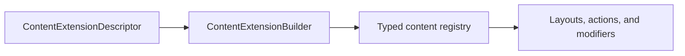

# vyuh_extension_content

Register content and configuration types through ContentExtensionDescriptor and ContentExtensionBuilder. DefaultContentPlugin deserializes registered types, selects layouts, applies modifiers, and builds routes. Actions execute configurations; conditions produce string values for case matching.



[Package source](https://github.com/vyuh-tech/vyuh/tree/main/packages/system/vyuh_extension_content) · [Released API](https://pub.dev/documentation/vyuh_extension_content/latest/)

## Choose a declaration

[Action](#action) · [ActionConfiguration](#actionconfiguration) · [Condition](#condition) · [ConditionConfiguration](#conditionconfiguration) · [ContentBuilder](#contentbuilder) · [ContentDescriptor](#contentdescriptor) · [ContentDescriptorFactory](#contentdescriptorfactory) · [ContentExtensionBuilder](#contentextensionbuilder) · [ContentExtensionDescriptor](#contentextensiondescriptor) · [DIExtension](#diextension) · [DefaultContentPlugin](#defaultcontentplugin) · [DocumentBuilder](#documentbuilder) · [DocumentFutureBuilder](#documentfuturebuilder) · [DocumentStreamBuilder](#documentstreambuilder) · [PreviewContext](#previewcontext) · [RouteBuilder](#routebuilder) · [RouteBuilderProxy](#routebuilderproxy) · [RouteContentWithRefresh](#routecontentwithrefresh) · [ScopedDIWidget](#scopeddiwidget) · [ServiceExtensions](#serviceextensions) · [UnknownActionConfiguration](#unknownactionconfiguration) · [UnknownConditionConfiguration](#unknownconditionconfiguration) · [UnknownContentDetector](#unknowncontentdetector) · [UnknownContentIndicator](#unknowncontentindicator) · [UnknownContentModifierConfiguration](#unknowncontentmodifierconfiguration) · [UnknownLayoutConfiguration](#unknownlayoutconfiguration) · [createUnknownPlaceholder](#createunknownplaceholder) · [initializeUnknownPlaceholderFactory](#initializeunknownplaceholderfactory)

## Action {#action}

[Source](https://github.com/vyuh-tech/vyuh/blob/main/packages/system/vyuh_extension_content/lib/content/action.dart#L9)

A composable action that can be executed in response to user interaction.

```dart
final class Action
```

Directly declared public members:

```dart
final String? title;
```

Optional title for the action.

```dart
final List<ActionConfiguration>? configurations;
```

List of configurations to execute when the action is triggered.

```dart
static List<ActionConfiguration>? configurationList(dynamic json);
```

Converts a JSON array to a list of `ActionConfiguration` instances.

```dart
FutureOr<void> execute(BuildContext context, {Map<String, dynamic>? arguments});
```

Executes all configurations in sequence.

```dart
Action({this.title, this.configurations});
```

Creates a new action with optional title and configurations.

```dart
factory Action.fromJson(Map<String, dynamic> json);
```

Creates an action from a JSON object.

```dart
bool get isEmpty;
```

Returns true if this action has no configurations.

```dart
bool get isNotEmpty;
```

Returns true if this action has at least one configuration.

## ActionConfiguration {#actionconfiguration}

[Source](https://github.com/vyuh-tech/vyuh/blob/main/packages/system/vyuh_extension_content/lib/content/action.dart#L97)

Base class for all action configurations.

```dart
abstract class ActionConfiguration implements SchemaItem
```

Directly declared public members:

```dart
final String schemaType;
```

The schema type of this configuration.

```dart
final String? title;
```

Optional title for this configuration.

```dart
final bool? isAwaited;
```

Whether to await this configuration's execution.

```dart
ActionConfiguration({required this.schemaType, this.title, this.isAwaited});
```

Creates a new action configuration.

```dart
FutureOr<void> execute(BuildContext context, {Map<String, dynamic>? arguments});
```

Executes this configuration.

## Condition {#condition}

[Source](https://github.com/vyuh-tech/vyuh/blob/main/packages/system/vyuh_extension_content/lib/content/condition.dart#L9)

A conditional expression that can be evaluated at runtime.

```dart
final class Condition
```

Directly declared public members:

```dart
final ConditionConfiguration? configuration;
```

The configuration that defines the condition's logic.

```dart
Condition({this.configuration});
```

Creates a new condition with the given configuration.

```dart
Future<String?> execute(BuildContext context);
```

Evaluates the condition in the current context.

```dart
factory Condition.fromJson(Map<String, dynamic> json);
```

Creates a condition from a JSON object.

## ConditionConfiguration {#conditionconfiguration}

[Source](https://github.com/vyuh-tech/vyuh/blob/main/packages/system/vyuh_extension_content/lib/content/condition.dart#L60)

Base class for all condition configurations.

```dart
abstract class ConditionConfiguration implements SchemaItem
```

Directly declared public members:

```dart
final String schemaType;
```

The schema type of this configuration.

```dart
final String? title;
```

Optional title for this configuration.

```dart
ConditionConfiguration({required this.schemaType, this.title});
```

Creates a new condition configuration.

```dart
Future<String?> execute(BuildContext context);
```

Evaluates this condition configuration.

## ContentBuilder {#contentbuilder}

[Source](https://github.com/vyuh-tech/vyuh/blob/main/packages/system/vyuh_extension_content/lib/content/content_builder.dart#L5)

A builder for configuring and managing content types and their layouts.

```dart
class ContentBuilder<T extends ContentItem>
```

Directly declared public members:

```dart
final TypeDescriptor<T> content;
```

The type descriptor for the content type `T`.

```dart
LayoutConfiguration<T> get defaultLayout;
```


```dart
TypeDescriptor<LayoutConfiguration<T>> get defaultLayoutDescriptor;
```


```dart
List<TypeDescriptor<LayoutConfiguration>> get layouts;
```


```dart
String? get sourceFeature;
```


```dart
void setSourceFeature(String? featureName);
```

Updates the source feature for this builder and its layouts.

```dart
ContentBuilder({required this.content, required this._defaultLayout, required this._defaultLayoutDescriptor});
```

Creates a new content builder.

```dart
void init(List<ContentDescriptor> descriptors);
```

Initializes this content builder with the given descriptors.

```dart
void addDescriptors(List<ContentDescriptor> descriptors);
```

Additively registers new descriptors into this builder.

```dart
VoidCallback captureLazyState();
```

Captures mutable builder state for failed lazy-registration rollback. Subclasses with additional state must extend this rollback.

```dart
void registerDescriptors<U>(Iterable<TypeDescriptor<U>> descriptors, {bool checkUnique = false});
```

Registers a list of type descriptors with the content system.

```dart
Widget build(BuildContext context, T content);
```

Builds a widget for the given content item.

```dart
void setDefaultLayout(LayoutConfiguration<T> layout, {required FromJsonConverter<LayoutConfiguration<T>> fromJson, String? sourceFeatureName});
```

Sets the default layout for this content builder.

## ContentDescriptor {#contentdescriptor}

[Source](https://github.com/vyuh-tech/vyuh/blob/main/packages/system/vyuh_extension_content/lib/content/content_descriptor.dart#L6)

Public declaration in this package.

```dart
abstract class ContentDescriptor
```

Directly declared public members:

```dart
final String title;
```


```dart
final String schemaType;
```


```dart
final List<TypeDescriptor<LayoutConfiguration>>? layouts;
```


```dart
String? get sourceFeature;
```

The feature that this content descriptor was registered by.

```dart
ContentDescriptor({required this.schemaType, required this.title, required this.layouts});
```


```dart
static ContentDescriptorFactory createDefault({required String schemaType, required String title});
```

A simplified approach to creating a `ContentDescriptor` that follows the standard conventions. This eliminates the need to create a new `&lt;Item&gt;ContentDescriptor`.

```dart
void setSourceFeature(String? featureName);
```


## ContentDescriptorFactory {#contentdescriptorfactory}

[Source](https://github.com/vyuh-tech/vyuh/blob/main/packages/system/vyuh_extension_content/lib/content/content_descriptor.dart#L3)

Public declaration in this package.

```dart
typedef ContentDescriptorFactory<T extends ContentItem> = ContentDescriptor Function(
```

## ContentExtensionBuilder {#contentextensionbuilder}

[Source](https://github.com/vyuh-tech/vyuh/blob/main/packages/system/vyuh_extension_content/lib/content_extension_builder.dart#L6)

Public declaration in this package.

```dart
final class ContentExtensionBuilder extends ExtensionBuilder
```

Directly declared public members:

```dart
ContentExtensionBuilder();
```


```dart
Map<Type, Map<String, TypeDescriptor>> typeRegistry();
```


```dart
ContentBuilder<ContentItem>? contentBuilder(String schemaType);
```


```dart
List<ContentBuilder> contentBuilders();
```


```dart
Future<void> onInit(List<ExtensionDescriptor> extensions);
```


```dart
Future<void> onDispose();
```


```dart
T? fromJson<T>(String typeName, Map<String, dynamic> json);
```


```dart
void register<T>(TypeDescriptor<T> descriptor);
```


```dart
bool isRegistered<T>(String schemaType);
```


```dart
void registerBuilder(ContentBuilder builder, {List<ContentDescriptor>? descriptors = const []});
```

Register a ContentBuilder directly This allows other plugins to register content builders programmatically

```dart
VoidCallback captureLazyState(ExtensionDescriptor descriptor);
```

Captures converter registries and affected content builders for rollback.

```dart
void registerLazy(ExtensionDescriptor descriptor);
```


## ContentExtensionDescriptor {#contentextensiondescriptor}

[Source](https://github.com/vyuh-tech/vyuh/blob/main/packages/system/vyuh_extension_content/lib/content_extension_descriptor.dart#L4)

Public declaration in this package.

```dart
final class ContentExtensionDescriptor extends ExtensionDescriptor
```

Directly declared public members:

```dart
final List<ContentDescriptor>? contents;
```


```dart
final List<TypeDescriptor<ContentModifierConfiguration>>? contentModifiers;
```


```dart
final List<ContentBuilder>? contentBuilders;
```


```dart
final List<TypeDescriptor<ActionConfiguration>>? actions;
```


```dart
final List<TypeDescriptor<ConditionConfiguration>>? conditions;
```


```dart
final List<TypeDescriptor<RouteTypeConfiguration>>? routeTypes;
```


```dart
ContentExtensionDescriptor({this.contents, this.contentModifiers, this.contentBuilders, this.actions, this.conditions, this.routeTypes});
```


```dart
dynamic onSourceFeatureUpdated();
```


## DIExtension {#diextension}

[Source](https://github.com/vyuh-tech/vyuh/blob/main/packages/system/vyuh_extension_content/lib/ui/scoped_di_widget.dart#L81)

Public declaration in this package.

```dart
extension DIExtension on BuildContext
```

Directly declared public members:

```dart
DIPlugin get di;
```


## DefaultContentPlugin {#defaultcontentplugin}

[Source](https://github.com/vyuh-tech/vyuh/blob/main/packages/system/vyuh_extension_content/lib/plugin/content_plugin.dart#L6)

The default ContentPlugin implementation for the Vyuh framework. This plugin is responsible for fetching content from a CMS and rendering content items. It uses a `ContentExtensionBuilder` to keep track of the various `ContentItem` types.

```dart
final class DefaultContentPlugin extends ContentPlugin
```

Directly declared public members:

```dart
final bool useLiveRoute;
```

Whether to use live route updates via streams. When true, uses RouteStreamBuilder for real-time updates. When false, uses RouteFutureBuilder for one-time loading.

```dart
final bool allowRouteRefresh;
```

Whether to allow manual refreshing of the route.

```dart
DefaultContentPlugin({required super.provider, this.useLiveRoute = false, this.allowRouteRefresh = true});
```


```dart
Map<Type, Map<String, TypeDescriptor>> get typeRegistry;
```


```dart
Widget buildContent<T extends ContentItem>(BuildContext context, T content, {LayoutConfiguration<T>? layout});
```


```dart
Widget buildRoute(BuildContext context, {Uri? url, String? routeId});
```


```dart
T? fromJson<T>(Map<String, dynamic> json);
```


```dart
dynamic register<T>(TypeDescriptor<T> descriptor);
```


```dart
bool isRegistered<T>(String schemaType);
```


```dart
Future<void> dispose();
```


```dart
Future<void> init();
```


```dart
void attach(ExtensionBuilder extBuilder);
```


## DocumentBuilder {#documentbuilder}

[Source](https://github.com/vyuh-tech/vyuh/blob/main/packages/system/vyuh_extension_content/lib/ui/document_builder.dart#L8)

A widget that builds UI based on document data fetched from a content provider.

```dart
final class DocumentBuilder<T> extends StatelessWidget
```

Directly declared public members:

```dart
final Future<T?> Function() fetchDocument;
```

A function that returns a future of the document.

```dart
final Stream<T?>? liveDocument;
```

A stream of document data for live updates.

```dart
final Stream<T?> Function()? liveDocumentFactory;
```

Creates a fresh subscription for live refresh/retry.

```dart
final bool allowRefresh;
```

Whether to allow refreshing the document.

```dart
final bool isLive;
```

Whether to use live document updates.

```dart
final Widget Function(BuildContext context, T document) buildContent;
```

A function that builds the UI for the document.

```dart
final Future<T?> Function(BuildContext context, T document)? initDocument;
```

Optional custom initialization function for the document. This allows for document-specific initialization logic.

```dart
final bool isRoute;
```

Whether this document is a whole route. A route that fails shows a full page with Back and Go home; other content fails inline.

```dart
final Uri? location;
```

The location being shown, included in failure reports.

```dart
const DocumentBuilder({super.key, required this.fetchDocument, this.liveDocument, this.liveDocumentFactory, required this.buildContent, this.allowRefresh = true, this.isLive = false, this.initDocument, this.isRoute = false, this.location});
```

Creates a `DocumentBuilder` with a custom document fetching function.

```dart
static DocumentBuilder<T> fromQuery<T>({Key? key, required String query, Map<String, String>? queryParams, required FromJsonConverter<T> fromJson, required Widget Function(BuildContext, T) buildContent, bool includeDrafts = false, bool allowRefresh = true, bool isLive = false, Future<T?> Function(BuildContext, T?)? initDocument});
```

Creates a `DocumentBuilder` that fetches a document by query.

```dart
static DocumentBuilder<T> fromId<T>({Key? key, required String id, required FromJsonConverter<T> fromJson, required Widget Function(BuildContext, T) buildContent, bool includeDrafts = false, bool allowRefresh = true, bool isLive = false, Future<T?> Function(BuildContext, T?)? initDocument});
```

Creates a `DocumentBuilder` that fetches a document by ID.

```dart
static DocumentBuilder<RouteBase> fromRoute({Key? key, Uri? url, String? routeId, required Widget Function(BuildContext, RouteBase) buildContent, bool includeDrafts = false, bool allowRefresh = true, bool isLive = false});
```

Creates a `DocumentBuilder` that fetches a route by path or ID.

```dart
Widget build(BuildContext context);
```


## DocumentFutureBuilder {#documentfuturebuilder}

[Source](https://github.com/vyuh-tech/vyuh/blob/main/packages/system/vyuh_extension_content/lib/ui/document_future_builder.dart#L11)

A widget that builds UI based on a future of document data.

```dart
class DocumentFutureBuilder<T> extends StatefulWidget
```

Directly declared public members:

```dart
final Future<T?> Function() future;
```

The future that resolves with the document data.

```dart
final Widget Function(BuildContext context, T document) buildContent;
```

A function that builds the UI for the content.

```dart
final bool allowRefresh;
```

Whether to allow refreshing the document, with the overlay Refresh button.

```dart
final bool isRoute;
```

Whether this document is a whole route. A route that fails shows a full page with Back and Go home; other content fails inline.

```dart
final Uri? location;
```

The location being shown, included in failure reports.

```dart
const DocumentFutureBuilder({super.key, required this.future, required this.buildContent, this.allowRefresh = true, this.isRoute = false, this.location});
```

Creates a `DocumentFutureBuilder`.

```dart
State<DocumentFutureBuilder<T>> createState();
```


## DocumentStreamBuilder {#documentstreambuilder}

[Source](https://github.com/vyuh-tech/vyuh/blob/main/packages/system/vyuh_extension_content/lib/ui/document_stream_builder.dart#L9)

Builds document UI from a stream, including errors and completion.

```dart
class DocumentStreamBuilder<T> extends StatefulWidget
```

Directly declared public members:

```dart
final Stream<T?>? stream;
```


```dart
final Stream<T?> Function()? streamFactory;
```


```dart
final Widget Function(BuildContext context, T document) buildContent;
```


```dart
final bool allowRefresh;
```


```dart
final bool isRoute;
```

Whether this document is a whole route. A route that fails shows a full page with Back and Go home; other content fails inline.

```dart
final Uri? location;
```

The location being shown, included in failure reports.

```dart
const DocumentStreamBuilder({super.key, required Stream<T?> this.stream, required this.buildContent, this.allowRefresh = true, this.isRoute = false, this.location});
```


```dart
const DocumentStreamBuilder.refreshable({super.key, required Stream<T?> Function() this.streamFactory, required this.buildContent, this.allowRefresh = true, this.isRoute = false, this.location});
```


```dart
State<DocumentStreamBuilder<T>> createState();
```


## PreviewContext {#previewcontext}

[Source](https://github.com/vyuh-tech/vyuh/blob/main/packages/system/vyuh_extension_content/lib/preview/preview_context.dart#L4)

Public declaration in this package.

```dart
final class PreviewContext extends InheritedWidget
```

Directly declared public members:

```dart
final ContentItem content;
```


```dart
final LayoutConfiguration<ContentItem> layout;
```


```dart
const PreviewContext({super.key, required this.content, required this.layout, required super.child});
```


```dart
static PreviewContext? of(BuildContext context);
```


```dart
bool updateShouldNotify(PreviewContext oldWidget);
```


## RouteBuilder {#routebuilder}

[Source](https://github.com/vyuh-tech/vyuh/blob/main/packages/system/vyuh_extension_content/lib/ui/route_builder.dart#L6)

Public declaration in this package.

```dart
final class RouteBuilder extends StatelessWidget
```

Directly declared public members:

```dart
final Uri? url;
```


```dart
final String? routeId;
```


```dart
final bool includeDrafts;
```


```dart
final bool allowRefresh;
```


```dart
final bool isLive;
```


```dart
const RouteBuilder({super.key, this.url, this.routeId, this.includeDrafts = false, this.allowRefresh = true, this.isLive = false});
```


```dart
Widget build(BuildContext context);
```


## RouteBuilderProxy {#routebuilderproxy}

[Source](https://github.com/vyuh-tech/vyuh/blob/main/packages/system/vyuh_extension_content/lib/ui/route_builder_proxy.dart#L3)

Public declaration in this package.

```dart
class RouteBuilderProxy extends InheritedWidget
```

Directly declared public members:

```dart
const RouteBuilderProxy({super.key, required super.child, required this._onRefresh});
```


```dart
Future<void> refresh();
```


```dart
bool updateShouldNotify(covariant RouteBuilderProxy oldWidget);
```


```dart
static RouteBuilderProxy? of(BuildContext context);
```


## RouteContentWithRefresh {#routecontentwithrefresh}

[Source](https://github.com/vyuh-tech/vyuh/blob/main/packages/system/vyuh_extension_content/lib/ui/route_builder_proxy.dart#L28)

Works in conjunction with the RouteBuilderProxy to trigger refresh on a Route

```dart
final class RouteContentWithRefresh extends StatelessWidget
```

Directly declared public members:

```dart
final Widget child;
```


```dart
const RouteContentWithRefresh({super.key, required this.child});
```


```dart
Widget build(BuildContext context);
```


## ScopedDIWidget {#scopeddiwidget}

[Source](https://github.com/vyuh-tech/vyuh/blob/main/packages/system/vyuh_extension_content/lib/ui/scoped_di_widget.dart#L4)

A widget that wraps its child with a scoped instance of `DIPlugin`.

```dart
final class ScopedDIWidget extends StatefulWidget
```

Directly declared public members:

```dart
const ScopedDIWidget({super.key, required this.child, required this.debugLabel});
```


```dart
final Widget child;
```


```dart
final String debugLabel;
```

The debug label for the `DIPlugin`. It is useful to identify the scope.

```dart
static DIPlugin of(BuildContext context);
```

Get the DIPlugin from the nearest DI scope. If no scope is found, it will fallback to the platform `DIPlugin`.

```dart
State<ScopedDIWidget> createState();
```


## ServiceExtensions {#serviceextensions}

[Source](https://github.com/vyuh-tech/vyuh/blob/main/packages/system/vyuh_extension_content/lib/plugin/extension.dart#L4)

Public declaration in this package.

```dart
extension ServiceExtensions on ContentPlugin
```

Directly declared public members:

```dart
bool setDefaultLayout({required String schemaType, required LayoutConfiguration layout, required FromJsonConverter<LayoutConfiguration> fromJson});
```

Sets the default layout for the `schemaType` of the `ContentItem`. Returns true if the layout was set, false otherwise.

```dart
ContentBuilder? contentBuilder(String schemaType);
```

Returns the `ContentBuilder` for the `schemaType` of the `ContentItem`. Returns null if it does not exist.

```dart
List<ContentBuilder<ContentItem>>? contentBuilders();
```

Returns a map of all content builders, where the key is the schemaType and the value is the ContentBuilder.

## UnknownActionConfiguration {#unknownactionconfiguration}

[Source](https://github.com/vyuh-tech/vyuh/blob/main/packages/system/vyuh_extension_content/lib/plugin/unknown_placeholders.dart#L5)

Unknown placeholder types for handling missing type registrations gracefully. These placeholders allow the system to continue working while providing proper error feedback through the unknown content builder system. Unknown action configuration placeholder.

```dart
final class UnknownActionConfiguration extends ActionConfiguration
```

Directly declared public members:

```dart
static const dynamic schemaName;
```


```dart
final String missingSchemaType;
```


```dart
final Map<String, dynamic> jsonPayload;
```


```dart
UnknownActionConfiguration({required this.missingSchemaType, required this.jsonPayload});
```


```dart
Future<void> execute(BuildContext context, {Map<String, dynamic>? arguments});
```


## UnknownConditionConfiguration {#unknownconditionconfiguration}

[Source](https://github.com/vyuh-tech/vyuh/blob/main/packages/system/vyuh_extension_content/lib/plugin/unknown_placeholders.dart#L33)

Unknown condition configuration placeholder.

```dart
final class UnknownConditionConfiguration extends ConditionConfiguration
```

Directly declared public members:

```dart
static const dynamic schemaName;
```


```dart
final String missingSchemaType;
```


```dart
final Map<String, dynamic> jsonPayload;
```


```dart
UnknownConditionConfiguration({required this.missingSchemaType, required this.jsonPayload});
```


```dart
Future<String?> execute(BuildContext context);
```


## UnknownContentDetector {#unknowncontentdetector}

[Source](https://github.com/vyuh-tech/vyuh/blob/main/packages/system/vyuh_extension_content/lib/ui/unknown_content_indicator.dart#L8)

Utility functions for detecting unknown placeholders in content items.

```dart
class UnknownContentDetector
```

Directly declared public members:

```dart
static bool hasUnknownActions(vyuh_action.Action? action);
```

Checks if an Action contains any unknown action configurations.

```dart
static bool hasUnknownActionsInList(List<vyuh_action.Action?> actions);
```

Checks if a list of actions contains any unknown action configurations.

```dart
static bool hasUnknownConditions(Condition? condition);
```

Checks if a Condition contains any unknown condition configurations.

```dart
static bool hasUnknownModifiers(ContentItem contentItem);
```

Checks if a content item has any unknown modifiers.

```dart
static bool hasUnknownLayout(LayoutConfiguration? layout);
```

Checks if a content item has an unknown layout.

```dart
static bool hasAnyUnknownContent(ContentItem contentItem, {List<vyuh_action.Action?> additionalActions = const [], List<Condition?> additionalConditions = const [], LayoutConfiguration? layout});
```

Comprehensive check for any unknown content in a content item. This can be extended by subclasses to check specific action/condition fields.

## UnknownContentIndicator {#unknowncontentindicator}

[Source](https://github.com/vyuh-tech/vyuh/blob/main/packages/system/vyuh_extension_content/lib/ui/unknown_content_indicator.dart#L61)

A widget that wraps content items to provide visual feedback when they contain unknown actions, conditions, layouts, or modifiers.

```dart
class UnknownContentIndicator extends StatelessWidget
```

Directly declared public members:

```dart
final ContentItem contentItem;
```

The content item being checked for unknown content.

```dart
final List<vyuh_action.Action?> actions;
```

Additional actions to check for unknown configurations.

```dart
final List<Condition?> conditions;
```

Additional conditions to check for unknown configurations.

```dart
final LayoutConfiguration? layout;
```

The layout to check (defaults to contentItem.layout).

```dart
final Widget child;
```

The child widget to wrap with the indicator.

```dart
final bool showDetailOnTap;
```

Whether to show a detailed overlay on tap (debug mode only).

```dart
const UnknownContentIndicator({super.key, required this.contentItem, required this.child, this.actions = const [], this.conditions = const [], this.layout, this.showDetailOnTap = true});
```


```dart
Widget build(BuildContext context);
```


## UnknownContentModifierConfiguration {#unknowncontentmodifierconfiguration}

[Source](https://github.com/vyuh-tech/vyuh/blob/main/packages/system/vyuh_extension_content/lib/plugin/unknown_placeholders.dart#L87)

Unknown content modifier configuration placeholder.

```dart
final class UnknownContentModifierConfiguration extends ContentModifierConfiguration
```

Directly declared public members:

```dart
static const dynamic schemaName;
```


```dart
final String missingSchemaType;
```


```dart
final Map<String, dynamic> jsonPayload;
```


```dart
UnknownContentModifierConfiguration({required this.missingSchemaType, required this.jsonPayload});
```


```dart
Widget build(BuildContext context, Widget child, ContentItem content);
```


## UnknownLayoutConfiguration {#unknownlayoutconfiguration}

[Source](https://github.com/vyuh-tech/vyuh/blob/main/packages/system/vyuh_extension_content/lib/plugin/unknown_placeholders.dart#L55)

Unknown layout configuration placeholder.

```dart
final class UnknownLayoutConfiguration<T extends ContentItem> extends LayoutConfiguration<T>
```

Directly declared public members:

```dart
static const dynamic schemaName;
```


```dart
final String missingSchemaType;
```


```dart
final Map<String, dynamic> jsonPayload;
```


```dart
UnknownLayoutConfiguration({required this.missingSchemaType, required this.jsonPayload});
```


```dart
Widget build(BuildContext context, T content);
```


## createUnknownPlaceholder {#createunknownplaceholder}

[Source](https://github.com/vyuh-tech/vyuh/blob/main/packages/system/vyuh_extension_content/lib/plugin/unknown_placeholder_factory.dart#L4)

Factory function that creates unknown placeholders for different schema item types. This is registered with the serialization system to provide placeholders when type registration fails.

```dart
SchemaItem? createUnknownPlaceholder(Type type, String missingSchemaType, Map<String, dynamic> jsonPayload)
```

## initializeUnknownPlaceholderFactory {#initializeunknownplaceholderfactory}

[Source](https://github.com/vyuh-tech/vyuh/blob/main/packages/system/vyuh_extension_content/lib/plugin/unknown_placeholder_factory.dart#L54)

Initializes the unknown placeholder factory for the serialization system. This should be called during app initialization.

```dart
void initializeUnknownPlaceholderFactory()
```
