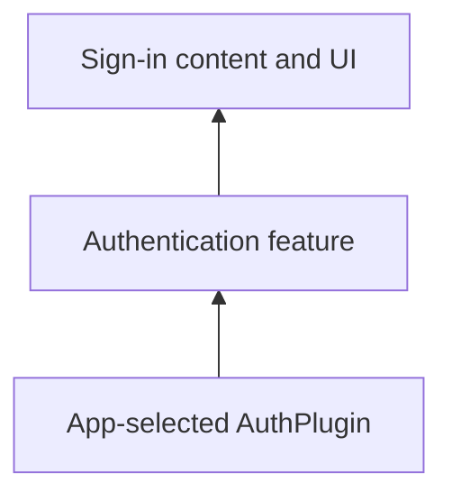

# vyuh_feature_auth

Authentication UI and content configurations consume the AuthPlugin capability. Include the feature and an appropriate auth provider to support the sign-in methods your app exposes.



[Package source](https://github.com/vyuh-tech/vyuh/tree/main/packages/system/vyuh_feature_auth) · [Released API](https://pub.dev/documentation/vyuh_feature_auth/latest/)

## Choose a declaration

[AuthActionButton](#authactionbutton) · [AuthActionType](#authactiontype) · [AuthFlow](#authflow) · [AuthFlowScope](#authflowscope) · [AuthFlowState](#authflowstate) · [AuthFormBuilder](#authformbuilder) · [AuthState](#authstate) · [AuthUserCardLayout](#authusercardlayout) · [DefaultEmailPasswordFormLayout](#defaultemailpasswordformlayout) · [DefaultPhoneOtpFormLayout](#defaultphoneotpformlayout) · [DefaultUsernamePasswordFormLayout](#defaultusernamepasswordformlayout) · [EmailField](#emailfield) · [EmailPasswordForm](#emailpasswordform) · [EmailPasswordFormDescriptor](#emailpasswordformdescriptor) · [EmailPasswordView](#emailpasswordview) · [ErrorBuilder](#errorbuilder) · [ErrorText](#errortext) · [ForgotPasswordForm](#forgotpasswordform) · [ForgotPasswordFormLayout](#forgotpasswordformlayout) · [ForgotPasswordView](#forgotpasswordview) · [HintAction](#hintaction) · [HintActionAlignment](#hintactionalignment) · [HintActionText](#hintactiontext) · [HintActionTextDefaultLayout](#hintactiontextdefaultlayout) · [HintActionTextDescriptor](#hintactiontextdescriptor) · [LoaderButton](#loaderbutton) · [OAuthLayoutType](#oauthlayouttype) · [OAuthSignIn](#oauthsignin) · [OAuthSignInDescriptor](#oauthsignindescriptor) · [OAuthSignInLayout](#oauthsigninlayout) · [OAuthSignInView](#oauthsigninview) · [OtpInputField](#otpinputfield) · [PasswordField](#passwordfield) · [PhoneInputField](#phoneinputfield) · [PhoneOtpForm](#phoneotpform) · [PhoneOtpFormDescriptor](#phoneotpformdescriptor) · [ProfileCard](#profilecard) · [ProfileCardLayout](#profilecardlayout) · [ProfileFormDescriptor](#profileformdescriptor) · [ScopedWidgetBuilder](#scopedwidgetbuilder) · [UsernameField](#usernamefield) · [UsernamePasswordForm](#usernamepasswordform) · [UsernamePasswordFormDescriptor](#usernamepasswordformdescriptor) · [UsernamePasswordView](#usernamepasswordview) · [descriptor](#descriptor) · [emailAuthForm](#emailauthform) · [emailControlName](#emailcontrolname) · [emailPasswordAuthForm](#emailpasswordauthform) · [feature](#feature) · [otpControlName](#otpcontrolname) · [passwordControlName](#passwordcontrolname) · [phoneControlName](#phonecontrolname) · [phoneOtpAuthForm](#phoneotpauthform) · [usernameControlName](#usernamecontrolname) · [usernamePasswordAuthForm](#usernamepasswordauthform)

## AuthActionButton {#authactionbutton}

[Source](https://github.com/vyuh-tech/vyuh/blob/main/packages/system/vyuh_feature_auth/lib/ui/form_fields.dart#L306)

Public declaration in this package.

```dart
final class AuthActionButton extends StatelessWidget
```

Directly declared public members:

```dart
final void Function(BuildContext context) onPressed;
```


```dart
final String? title;
```


```dart
final Icon? icon;
```


```dart
final ButtonStyle? buttonStyle;
```


```dart
final AuthFlowScope scope;
```


```dart
final bool showError;
```


```dart
final Axis direction;
```


```dart
final ErrorBuilder? errorBuilder;
```


```dart
const AuthActionButton({super.key, this.title, required this.onPressed, this.buttonStyle, this.icon, this.direction = Axis.vertical, required this.scope, this.showError = true, this.errorBuilder});
```


```dart
Widget build(BuildContext context);
```


## AuthActionType {#authactiontype}

[Source](https://github.com/vyuh-tech/vyuh/blob/main/packages/system/vyuh_feature_auth/lib/ui/email_password_view.dart#L8)

Public declaration in this package.

```dart
enum AuthActionType { signIn, signUp }
```

Directly declared public members:

```dart
String get title;
```


## AuthFlow {#authflow}

[Source](https://github.com/vyuh-tech/vyuh/blob/main/packages/system/vyuh_feature_auth/lib/ui/auth_state_widget.dart#L9)

Public declaration in this package.

```dart
final class AuthFlow extends StatefulWidget
```

Directly declared public members:

```dart
final ScopedWidgetBuilder builder;
```


```dart
const AuthFlow({super.key, required this.builder});
```


```dart
State<AuthFlow> createState();
```


## AuthFlowScope {#authflowscope}

[Source](https://github.com/vyuh-tech/vyuh/blob/main/packages/system/vyuh_feature_auth/lib/ui/auth_state_widget.dart#L27)

Public declaration in this package.

```dart
final class AuthFlowScope
```

Directly declared public members:

```dart
final AuthState authState;
```


```dart
final dynamic error;
```


```dart
final Function(Future<void> Function() action, {AuthState endState}) runAuthAction;
```


```dart
AuthFlowScope({required this.authState, required this.error, required this.runAuthAction});
```


## AuthFlowState {#authflowstate}

[Source](https://github.com/vyuh-tech/vyuh/blob/main/packages/system/vyuh_feature_auth/lib/ui/auth_state_widget.dart#L40)

Public declaration in this package.

```dart
class AuthFlowState extends State<AuthFlow>
```

Directly declared public members:

```dart
final dynamic authState;
```


```dart
dynamic error;
```


```dart
void initState();
```


```dart
void dispose();
```


```dart
Widget build(BuildContext context);
```


```dart
void runAuthAction(Future<void> Function() action, {AuthState endState = AuthState.signedIn});
```


## AuthFormBuilder {#authformbuilder}

[Source](https://github.com/vyuh-tech/vyuh/blob/main/packages/system/vyuh_feature_auth/lib/ui/auth_form_builder.dart#L6)

Public declaration in this package.

```dart
final class AuthFormBuilder extends StatelessWidget
```

Directly declared public members:

```dart
final FormGroup Function() form;
```


```dart
final Widget Function(BuildContext, AuthFlowScope, VoidCallback submit) child;
```


```dart
final Widget Function(BuildContext, AuthFlowScope)? footer;
```


```dart
final String actionTitle;
```


```dart
final Future<void> Function(FormGroup) authAction;
```


```dart
final AuthState endAuthState;
```


```dart
final bool showError;
```


```dart
final ErrorBuilder? errorBuilder;
```


```dart
const AuthFormBuilder({super.key, required this.form, required this.child, required this.actionTitle, this.footer, required this.authAction, required this.endAuthState, this.showError = true, this.errorBuilder});
```


```dart
Widget build(BuildContext context);
```


## AuthState {#authstate}

[Source](https://github.com/vyuh-tech/vyuh/blob/main/packages/system/vyuh_feature_auth/lib/ui/auth_state_widget.dart#L17)

Public declaration in this package.

```dart
enum AuthState { signedOut, signedIn, passwordResetEmailSent, inProgress, error, cancelled, partial }
```

## AuthUserCardLayout {#authusercardlayout}

[Source](https://github.com/vyuh-tech/vyuh/blob/main/packages/system/vyuh_feature_auth/lib/auth_user_card_layout.dart#L9)

Public declaration in this package.

```dart
final class AuthUserCardLayout extends LayoutConfiguration<vf.Card>
```

Directly declared public members:

```dart
static const dynamic schemaName;
```


```dart
static final dynamic typeDescriptor;
```


```dart
AuthUserCardLayout();
```


```dart
Widget build(BuildContext context, vf.Card content);
```


## DefaultEmailPasswordFormLayout {#defaultemailpasswordformlayout}

[Source](https://github.com/vyuh-tech/vyuh/blob/main/packages/system/vyuh_feature_auth/lib/content/email_password_form_layout.dart#L9)

Public declaration in this package.

```dart
final class DefaultEmailPasswordFormLayout extends LayoutConfiguration<EmailPasswordForm>
```

Directly declared public members:

```dart
static const dynamic schemaName;
```


```dart
static final dynamic typeDescriptor;
```


```dart
DefaultEmailPasswordFormLayout();
```


```dart
factory DefaultEmailPasswordFormLayout.fromJson(Map<String, dynamic> json);
```


```dart
Widget build(BuildContext context, EmailPasswordForm content);
```


## DefaultPhoneOtpFormLayout {#defaultphoneotpformlayout}

[Source](https://github.com/vyuh-tech/vyuh/blob/main/packages/system/vyuh_feature_auth/lib/content/phone_otp_form_layout.dart#L9)

Public declaration in this package.

```dart
final class DefaultPhoneOtpFormLayout extends LayoutConfiguration<PhoneOtpForm>
```

Directly declared public members:

```dart
static const dynamic schemaName;
```


```dart
static final dynamic typeDescriptor;
```


```dart
DefaultPhoneOtpFormLayout();
```


```dart
factory DefaultPhoneOtpFormLayout.fromJson(Map<String, dynamic> json);
```


```dart
Widget build(BuildContext context, PhoneOtpForm content);
```


## DefaultUsernamePasswordFormLayout {#defaultusernamepasswordformlayout}

[Source](https://github.com/vyuh-tech/vyuh/blob/main/packages/system/vyuh_feature_auth/lib/content/username_password_form_layout.dart#L9)

Public declaration in this package.

```dart
final class DefaultUsernamePasswordFormLayout extends LayoutConfiguration<UsernamePasswordForm>
```

Directly declared public members:

```dart
static const dynamic schemaName;
```


```dart
static final dynamic typeDescriptor;
```


```dart
DefaultUsernamePasswordFormLayout();
```


```dart
factory DefaultUsernamePasswordFormLayout.fromJson(Map<String, dynamic> json);
```


```dart
Widget build(BuildContext context, UsernamePasswordForm content);
```


## EmailField {#emailfield}

[Source](https://github.com/vyuh-tech/vyuh/blob/main/packages/system/vyuh_feature_auth/lib/ui/form_fields.dart#L110)

Public declaration in this package.

```dart
class EmailField extends StatelessWidget
```

Directly declared public members:

```dart
final void Function() submit;
```


```dart
const EmailField({super.key, required this.submit});
```


```dart
Widget build(BuildContext context);
```


## EmailPasswordForm {#emailpasswordform}

[Source](https://github.com/vyuh-tech/vyuh/blob/main/packages/system/vyuh_feature_auth/lib/content/email_password_form.dart#L9)

Public declaration in this package.

```dart
final class EmailPasswordForm extends ContentItem
```

Directly declared public members:

```dart
final bool showPasswordVisibilityToggle;
```


```dart
final AuthActionType actionType;
```


```dart
final bool showLoginError;
```


```dart
final Action? action;
```


```dart
final Action? forgotPasswordAction;
```


```dart
final Action? signupAction;
```


```dart
final Action? loginAction;
```


```dart
static const dynamic schemaName;
```


```dart
static final dynamic typeDescriptor;
```


```dart
static final dynamic contentBuilder;
```


```dart
EmailPasswordForm({this.showPasswordVisibilityToggle = false, this.actionType = AuthActionType.signIn, this.showLoginError = true, this.action, this.forgotPasswordAction, this.signupAction, this.loginAction, super.layout, super.modifiers});
```


```dart
factory EmailPasswordForm.fromJson(Map<String, dynamic> json);
```


## EmailPasswordFormDescriptor {#emailpasswordformdescriptor}

[Source](https://github.com/vyuh-tech/vyuh/blob/main/packages/system/vyuh_feature_auth/lib/content/email_password_form.dart#L47)

Public declaration in this package.

```dart
final class EmailPasswordFormDescriptor extends ContentDescriptor
```

Directly declared public members:

```dart
EmailPasswordFormDescriptor({super.layouts});
```


## EmailPasswordView {#emailpasswordview}

[Source](https://github.com/vyuh-tech/vyuh/blob/main/packages/system/vyuh_feature_auth/lib/ui/email_password_view.dart#L22)

Public declaration in this package.

```dart
class EmailPasswordView extends StatelessWidget
```

Directly declared public members:

```dart
final EmailPasswordForm content;
```


```dart
const EmailPasswordView({super.key, required this.content});
```


```dart
Widget build(BuildContext context);
```


## ErrorBuilder {#errorbuilder}

[Source](https://github.com/vyuh-tech/vyuh/blob/main/packages/system/vyuh_feature_auth/lib/ui/form_fields.dart#L304)

Public declaration in this package.

```dart
typedef ErrorBuilder = Widget Function(BuildContext context, Object? error);
```

## ErrorText {#errortext}

[Source](https://github.com/vyuh-tech/vyuh/blob/main/packages/system/vyuh_feature_auth/lib/ui/form_fields.dart#L354)

Public declaration in this package.

```dart
class ErrorText extends StatelessWidget
```

Directly declared public members:

```dart
final dynamic error;
```


```dart
const ErrorText({super.key, this.error});
```


```dart
Widget build(BuildContext context);
```


## ForgotPasswordForm {#forgotpasswordform}

[Source](https://github.com/vyuh-tech/vyuh/blob/main/packages/system/vyuh_feature_auth/lib/content/forgot_password_form.dart#L8)

Public declaration in this package.

```dart
final class ForgotPasswordForm extends ContentItem
```

Directly declared public members:

```dart
static const dynamic schemaName;
```


```dart
static final dynamic typeDescriptor;
```


```dart
static final dynamic contentBuilder;
```


```dart
final bool showLoginError;
```


```dart
final Action? action;
```


```dart
final Action? returnAction;
```


```dart
ForgotPasswordForm({this.action, this.returnAction, this.showLoginError = true, super.layout, super.modifiers});
```


```dart
factory ForgotPasswordForm.fromJson(Map<String, dynamic> json);
```


## ForgotPasswordFormLayout {#forgotpasswordformlayout}

[Source](https://github.com/vyuh-tech/vyuh/blob/main/packages/system/vyuh_feature_auth/lib/content/forgot_password_form_layout.dart#L9)

Public declaration in this package.

```dart
final class ForgotPasswordFormLayout extends LayoutConfiguration<ForgotPasswordForm>
```

Directly declared public members:

```dart
static const dynamic schemaName;
```


```dart
static final dynamic typeDescriptor;
```


```dart
ForgotPasswordFormLayout();
```


```dart
factory ForgotPasswordFormLayout.fromJson(Map<String, dynamic> json);
```


```dart
Widget build(BuildContext context, ForgotPasswordForm content);
```


## ForgotPasswordView {#forgotpasswordview}

[Source](https://github.com/vyuh-tech/vyuh/blob/main/packages/system/vyuh_feature_auth/lib/ui/forgot_password_view.dart#L8)

Public declaration in this package.

```dart
class ForgotPasswordView extends StatelessWidget
```

Directly declared public members:

```dart
final String? email;
```


```dart
final ForgotPasswordForm content;
```


```dart
const ForgotPasswordView({super.key, this.email, required this.content});
```


```dart
Widget build(BuildContext context);
```


## HintAction {#hintaction}

[Source](https://github.com/vyuh-tech/vyuh/blob/main/packages/system/vyuh_feature_auth/lib/ui/form_fields.dart#L256)

Public declaration in this package.

```dart
class HintAction extends StatelessWidget
```

Directly declared public members:

```dart
final Widget hintLabel;
```


```dart
final Widget actionLabel;
```


```dart
final void Function(BuildContext) onTap;
```


```dart
final WrapAlignment alignment;
```


```dart
const HintAction({super.key, required this.hintLabel, required this.actionLabel, required this.onTap, this.alignment = WrapAlignment.center});
```


```dart
static Widget defaultHintLabel(BuildContext context, String label);
```


```dart
static Widget defaultActionLabel(BuildContext context, String label);
```


```dart
Widget build(BuildContext context);
```


## HintActionAlignment {#hintactionalignment}

[Source](https://github.com/vyuh-tech/vyuh/blob/main/packages/system/vyuh_feature_auth/lib/content/hint_action_text.dart#L9)

Public declaration in this package.

```dart
enum HintActionAlignment { start, end, center }
```

Directly declared public members:

```dart
WrapAlignment get wrapAlignment;
```


## HintActionText {#hintactiontext}

[Source](https://github.com/vyuh-tech/vyuh/blob/main/packages/system/vyuh_feature_auth/lib/content/hint_action_text.dart#L26)

Public declaration in this package.

```dart
final class HintActionText extends ContentItem
```

Directly declared public members:

```dart
static const dynamic schemaName;
```


```dart
static final dynamic typeDescriptor;
```


```dart
static final dynamic contentBuilder;
```


```dart
final String hint;
```


```dart
final Action? action;
```


```dart
final HintActionAlignment alignment;
```


```dart
HintActionText({super.layout, required this.hint, this.action, this.alignment = HintActionAlignment.center, super.modifiers});
```


```dart
factory HintActionText.fromJson(Map<String, dynamic> json);
```


## HintActionTextDefaultLayout {#hintactiontextdefaultlayout}

[Source](https://github.com/vyuh-tech/vyuh/blob/main/packages/system/vyuh_feature_auth/lib/content/hint_action_text.dart#L63)

Public declaration in this package.

```dart
final class HintActionTextDefaultLayout extends LayoutConfiguration<HintActionText>
```

Directly declared public members:

```dart
static const dynamic schemaName;
```


```dart
static final dynamic typeDescriptor;
```


```dart
HintActionTextDefaultLayout();
```


```dart
factory HintActionTextDefaultLayout.fromJson(Map<String, dynamic> json);
```


```dart
Widget build(BuildContext context, HintActionText content);
```


## HintActionTextDescriptor {#hintactiontextdescriptor}

[Source](https://github.com/vyuh-tech/vyuh/blob/main/packages/system/vyuh_feature_auth/lib/content/hint_action_text.dart#L58)

Public declaration in this package.

```dart
final class HintActionTextDescriptor extends ContentDescriptor
```

Directly declared public members:

```dart
HintActionTextDescriptor({super.layouts = const []});
```


## LoaderButton {#loaderbutton}

[Source](https://github.com/vyuh-tech/vyuh/blob/main/packages/system/vyuh_feature_auth/lib/ui/form_fields.dart#L71)

Public declaration in this package.

```dart
final class LoaderButton extends StatelessWidget
```

Directly declared public members:

```dart
final String? title;
```


```dart
final void Function() onPressed;
```


```dart
final bool loading;
```


```dart
final Icon? icon;
```


```dart
final ButtonStyle? buttonStyle;
```


```dart
const LoaderButton({super.key, this.title, required this.onPressed, this.loading = false, this.icon, this.buttonStyle});
```


```dart
Widget build(BuildContext context);
```


## OAuthLayoutType {#oauthlayouttype}

[Source](https://github.com/vyuh-tech/vyuh/blob/main/packages/system/vyuh_feature_auth/lib/content/oauth_signin_layout.dart#L9)

Public declaration in this package.

```dart
enum OAuthLayoutType { icon, text, iconText }
```

## OAuthSignIn {#oauthsignin}

[Source](https://github.com/vyuh-tech/vyuh/blob/main/packages/system/vyuh_feature_auth/lib/content/oauth_signin.dart#L8)

Public declaration in this package.

```dart
final class OAuthSignIn extends ContentItem
```

Directly declared public members:

```dart
static const dynamic schemaName;
```


```dart
static final dynamic typeDescriptor;
```


```dart
static final dynamic contentBuilder;
```


```dart
final List<OAuthType> authTypes;
```


```dart
final bool showLoginError;
```


```dart
final Action? action;
```


```dart
OAuthSignIn({this.authTypes = const [], this.showLoginError = true, this.action, super.layout, super.modifiers});
```


```dart
factory OAuthSignIn.fromJson(Map<String, dynamic> json);
```


## OAuthSignInDescriptor {#oauthsignindescriptor}

[Source](https://github.com/vyuh-tech/vyuh/blob/main/packages/system/vyuh_feature_auth/lib/content/oauth_signin.dart#L38)

Public declaration in this package.

```dart
final class OAuthSignInDescriptor extends ContentDescriptor
```

Directly declared public members:

```dart
OAuthSignInDescriptor({super.layouts});
```


## OAuthSignInLayout {#oauthsigninlayout}

[Source](https://github.com/vyuh-tech/vyuh/blob/main/packages/system/vyuh_feature_auth/lib/content/oauth_signin_layout.dart#L11)

Public declaration in this package.

```dart
final class OAuthSignInLayout extends LayoutConfiguration<OAuthSignIn>
```

Directly declared public members:

```dart
static const dynamic schemaName;
```


```dart
static final dynamic typeDescriptor;
```


```dart
final OAuthLayoutType type;
```


```dart
final Axis direction;
```


```dart
OAuthSignInLayout({this.type = OAuthLayoutType.iconText, this.direction = Axis.vertical});
```


```dart
factory OAuthSignInLayout.fromJson(Map<String, dynamic> json);
```


```dart
Widget build(BuildContext context, OAuthSignIn content);
```


## OAuthSignInView {#oauthsigninview}

[Source](https://github.com/vyuh-tech/vyuh/blob/main/packages/system/vyuh_feature_auth/lib/ui/oauth_sign_in_view.dart#L9)

Public declaration in this package.

```dart
class OAuthSignInView extends StatefulWidget
```

Directly declared public members:

```dart
final OAuthSignIn content;
```


```dart
final OAuthSignInLayout layout;
```


```dart
const OAuthSignInView({super.key, required this.content, required this.layout});
```


```dart
State<OAuthSignInView> createState();
```


## OtpInputField {#otpinputfield}

[Source](https://github.com/vyuh-tech/vyuh/blob/main/packages/system/vyuh_feature_auth/lib/ui/form_fields.dart#L184)

Public declaration in this package.

```dart
class OtpInputField extends StatelessWidget
```

Directly declared public members:

```dart
final String labelText;
```


```dart
final void Function(BuildContext) submit;
```


```dart
const OtpInputField({super.key, required this.submit, this.labelText = 'OTP'});
```


```dart
Widget build(BuildContext context);
```


## PasswordField {#passwordfield}

[Source](https://github.com/vyuh-tech/vyuh/blob/main/packages/system/vyuh_feature_auth/lib/ui/form_fields.dart#L212)

Public declaration in this package.

```dart
class PasswordField extends StatefulWidget
```

Directly declared public members:

```dart
final bool showPasswordVisibilityToggle;
```


```dart
final bool autofocus;
```


```dart
final void Function() submit;
```


```dart
const PasswordField({super.key, this.showPasswordVisibilityToggle = false, this.autofocus = false, required this.submit});
```


```dart
State<PasswordField> createState();
```


## PhoneInputField {#phoneinputfield}

[Source](https://github.com/vyuh-tech/vyuh/blob/main/packages/system/vyuh_feature_auth/lib/ui/form_fields.dart#L153)

Public declaration in this package.

```dart
class PhoneInputField extends StatelessWidget
```

Directly declared public members:

```dart
final String labelText;
```


```dart
final void Function(BuildContext) submit;
```


```dart
const PhoneInputField({super.key, required this.submit, this.labelText = 'Phone Number'});
```


```dart
Widget build(BuildContext context);
```


## PhoneOtpForm {#phoneotpform}

[Source](https://github.com/vyuh-tech/vyuh/blob/main/packages/system/vyuh_feature_auth/lib/content/phone_otp_form.dart#L8)

Public declaration in this package.

```dart
final class PhoneOtpForm extends ContentItem
```

Directly declared public members:

```dart
static const dynamic schemaName;
```


```dart
static final dynamic typeDescriptor;
```


```dart
static final dynamic contentBuilder;
```


```dart
final bool showLoginError;
```


```dart
final Action? action;
```


```dart
final Action? getOtpAction;
```


```dart
final Action? signupAction;
```


```dart
PhoneOtpForm({this.action, this.getOtpAction, this.signupAction, this.showLoginError = true, super.layout, super.modifiers});
```


```dart
factory PhoneOtpForm.fromJson(Map<String, dynamic> json);
```


## PhoneOtpFormDescriptor {#phoneotpformdescriptor}

[Source](https://github.com/vyuh-tech/vyuh/blob/main/packages/system/vyuh_feature_auth/lib/content/phone_otp_form.dart#L40)

Public declaration in this package.

```dart
final class PhoneOtpFormDescriptor extends ContentDescriptor
```

Directly declared public members:

```dart
PhoneOtpFormDescriptor({super.layouts});
```


## ProfileCard {#profilecard}

[Source](https://github.com/vyuh-tech/vyuh/blob/main/packages/system/vyuh_feature_auth/lib/content/profile_card.dart#L9)

Public declaration in this package.

```dart
final class ProfileCard extends ContentItem
```

Directly declared public members:

```dart
final Action? logoutAction;
```


```dart
final Action? loginAction;
```


```dart
static const dynamic schemaName;
```


```dart
static final dynamic typeDescriptor;
```


```dart
static final dynamic contentBuilder;
```


```dart
ProfileCard({this.loginAction, this.logoutAction, super.layout, super.modifiers});
```


```dart
factory ProfileCard.fromJson(Map<String, dynamic> json);
```


## ProfileCardLayout {#profilecardlayout}

[Source](https://github.com/vyuh-tech/vyuh/blob/main/packages/system/vyuh_feature_auth/lib/content/profile_form_layout.dart#L15)

Public declaration in this package.

```dart
final class ProfileCardLayout extends LayoutConfiguration<ProfileCard>
```

Directly declared public members:

```dart
static const dynamic schemaName;
```


```dart
static final dynamic typeDescriptor;
```


```dart
ProfileCardLayout();
```


```dart
factory ProfileCardLayout.fromJson(Map<String, dynamic> json);
```


```dart
Widget build(BuildContext context, ProfileCard content);
```


## ProfileFormDescriptor {#profileformdescriptor}

[Source](https://github.com/vyuh-tech/vyuh/blob/main/packages/system/vyuh_feature_auth/lib/content/profile_card.dart#L37)

Public declaration in this package.

```dart
final class ProfileFormDescriptor extends ContentDescriptor
```

Directly declared public members:

```dart
ProfileFormDescriptor({super.layouts});
```


## ScopedWidgetBuilder {#scopedwidgetbuilder}

[Source](https://github.com/vyuh-tech/vyuh/blob/main/packages/system/vyuh_feature_auth/lib/ui/auth_state_widget.dart#L6)

Public declaration in this package.

```dart
typedef ScopedWidgetBuilder = Widget Function(BuildContext context, AuthFlowScope scope);
```

## UsernameField {#usernamefield}

[Source](https://github.com/vyuh-tech/vyuh/blob/main/packages/system/vyuh_feature_auth/lib/ui/form_fields.dart#L131)

Public declaration in this package.

```dart
class UsernameField extends StatelessWidget
```

Directly declared public members:

```dart
final void Function() submit;
```


```dart
const UsernameField({super.key, required this.submit});
```


```dart
Widget build(BuildContext context);
```


## UsernamePasswordForm {#usernamepasswordform}

[Source](https://github.com/vyuh-tech/vyuh/blob/main/packages/system/vyuh_feature_auth/lib/content/username_password_form.dart#L9)

Public declaration in this package.

```dart
final class UsernamePasswordForm extends ContentItem
```

Directly declared public members:

```dart
final bool showPasswordVisibilityToggle;
```


```dart
final AuthActionType actionType;
```


```dart
final bool showLoginError;
```


```dart
final Action? action;
```


```dart
final Action? forgotPasswordAction;
```


```dart
final Action? signupAction;
```


```dart
final Action? loginAction;
```


```dart
static const dynamic schemaName;
```


```dart
static final dynamic typeDescriptor;
```


```dart
static final dynamic contentBuilder;
```


```dart
UsernamePasswordForm({this.showPasswordVisibilityToggle = false, this.actionType = AuthActionType.signIn, this.showLoginError = true, this.action, this.forgotPasswordAction, this.signupAction, this.loginAction, super.layout, super.modifiers});
```


```dart
factory UsernamePasswordForm.fromJson(Map<String, dynamic> json);
```


## UsernamePasswordFormDescriptor {#usernamepasswordformdescriptor}

[Source](https://github.com/vyuh-tech/vyuh/blob/main/packages/system/vyuh_feature_auth/lib/content/username_password_form.dart#L47)

Public declaration in this package.

```dart
final class UsernamePasswordFormDescriptor extends ContentDescriptor
```

Directly declared public members:

```dart
UsernamePasswordFormDescriptor({super.layouts});
```


## UsernamePasswordView {#usernamepasswordview}

[Source](https://github.com/vyuh-tech/vyuh/blob/main/packages/system/vyuh_feature_auth/lib/ui/username_password_view.dart#L9)

Public declaration in this package.

```dart
class UsernamePasswordView extends StatelessWidget
```

Directly declared public members:

```dart
final UsernamePasswordForm content;
```


```dart
const UsernamePasswordView({super.key, required this.content});
```


```dart
Widget build(BuildContext context);
```


## descriptor {#descriptor}

[Source](https://github.com/vyuh-tech/vyuh/blob/main/packages/system/vyuh_feature_auth/lib/feature.dart#L30)

Public declaration in this package.

```dart
final descriptor = ContentExtensionDescriptor( contents: [ CardDescriptor(layouts: [AuthUserCardLayout.typeDescriptor]), ], contentBuilders: [ EmailPasswordForm.contentBuilder, UsernamePasswordForm.contentBuilder, ProfileCard.contentBuilder, ForgotPasswordForm.contentBuilder, OAuthSignIn.contentBuilder, PhoneOtpForm.contentBuilder, HintActionText.contentBuilder, ], );
```

## emailAuthForm {#emailauthform}

[Source](https://github.com/vyuh-tech/vyuh/blob/main/packages/system/vyuh_feature_auth/lib/ui/form_fields.dart#L29)

Public declaration in this package.

```dart
FormGroup emailAuthForm({String? email})
```

## emailControlName {#emailcontrolname}

[Source](https://github.com/vyuh-tech/vyuh/blob/main/packages/system/vyuh_feature_auth/lib/ui/form_fields.dart#L6)

Public declaration in this package.

```dart
const emailControlName = 'email';
```

## emailPasswordAuthForm {#emailpasswordauthform}

[Source](https://github.com/vyuh-tech/vyuh/blob/main/packages/system/vyuh_feature_auth/lib/ui/form_fields.dart#L21)

Public declaration in this package.

```dart
FormGroup emailPasswordAuthForm({String? email})
```

## feature {#feature}

[Source](https://github.com/vyuh-tech/vyuh/blob/main/packages/system/vyuh_feature_auth/lib/feature.dart#L15)

Public declaration in this package.

```dart
FeatureDescriptor feature({List<go.RouteBase> Function()? routes})
```

## otpControlName {#otpcontrolname}

[Source](https://github.com/vyuh-tech/vyuh/blob/main/packages/system/vyuh_feature_auth/lib/ui/form_fields.dart#L9)

Public declaration in this package.

```dart
const otpControlName = 'otp';
```

## passwordControlName {#passwordcontrolname}

[Source](https://github.com/vyuh-tech/vyuh/blob/main/packages/system/vyuh_feature_auth/lib/ui/form_fields.dart#L10)

Public declaration in this package.

```dart
const passwordControlName = 'password';
```

## phoneControlName {#phonecontrolname}

[Source](https://github.com/vyuh-tech/vyuh/blob/main/packages/system/vyuh_feature_auth/lib/ui/form_fields.dart#L8)

Public declaration in this package.

```dart
const phoneControlName = 'phone';
```

## phoneOtpAuthForm {#phoneotpauthform}

[Source](https://github.com/vyuh-tech/vyuh/blob/main/packages/system/vyuh_feature_auth/lib/ui/form_fields.dart#L44)

Public declaration in this package.

```dart
FormGroup phoneOtpAuthForm()
```

## usernameControlName {#usernamecontrolname}

[Source](https://github.com/vyuh-tech/vyuh/blob/main/packages/system/vyuh_feature_auth/lib/ui/form_fields.dart#L7)

Public declaration in this package.

```dart
const usernameControlName = 'username';
```

## usernamePasswordAuthForm {#usernamepasswordauthform}

[Source](https://github.com/vyuh-tech/vyuh/blob/main/packages/system/vyuh_feature_auth/lib/ui/form_fields.dart#L36)

Public declaration in this package.

```dart
FormGroup usernamePasswordAuthForm({String? username})
```
