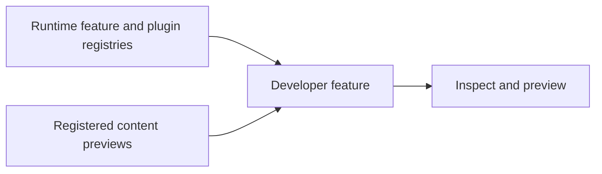

# vyuh_feature_developer

Developer tools inspect registered features, plugins, content types, and previews. Include the feature during development and follow the preview guide when exposing content to the playground.



[Package source](https://github.com/vyuh-tech/vyuh/tree/main/packages/system/vyuh_feature_developer) · [Released API](https://pub.dev/documentation/vyuh_feature_developer/latest/)

## Choose a declaration

[PluginDetailsView](#plugindetailsview) · [feature](#feature) · [routes](#routes)

## PluginDetailsView {#plugindetailsview}

[Source](https://github.com/vyuh-tech/vyuh/blob/main/packages/system/vyuh_feature_developer/lib/routes.dart#L66)

Extension on Plugin to show details view based on the plugin type

```dart
extension PluginDetailsView on Plugin
```

Directly declared public members:

```dart
Widget detailsView(BuildContext context);
```

Returns the details view based on the plugin type

## feature {#feature}

[Source](https://github.com/vyuh-tech/vyuh/blob/main/packages/system/vyuh_feature_developer/lib/vyuh_feature_developer.dart#L8)

Feature descriptor for the developer tools feature.

```dart
final feature = FeatureDescriptor( name: 'developer', title: 'Developer Tools', description: 'See details of all features packaged in your app.', icon: Icons.code_rounded, routes: routes, );
```

## routes {#routes}

[Source](https://github.com/vyuh-tech/vyuh/blob/main/packages/system/vyuh_feature_developer/lib/routes.dart#L15)

routes for the developer feature

```dart
List<GoRoute> routes()
```
