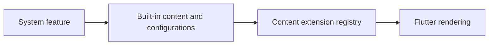

# vyuh_feature_system

The system feature contributes built-in content blocks, route types, layouts, actions, conditions, and responsive/theme services. Include its feature descriptor when your application consumes those types; importing a type alone does not register it.



[Package source](https://github.com/vyuh-tech/vyuh/tree/main/packages/system/vyuh_feature_system) · [Released API](https://pub.dev/documentation/vyuh_feature_system/latest/)

## Choose a declaration

[APIContent](#apicontent) · [APIContentDescriptor](#apicontentdescriptor) · [Accordion](#accordion) · [AccordionDescriptor](#accordiondescriptor) · [AccordionItem](#accordionitem) · [ActionCase](#actioncase) · [ApiConfiguration](#apiconfiguration) · [BlockItemDescriptor](#blockitemdescriptor) · [BooleanCondition](#booleancondition) · [Breakpoint](#breakpoint) · [BreakpointConfiguration](#breakpointconfiguration) · [BreakpointService](#breakpointservice) · [Card](#card) · [CardConditionalLayout](#cardconditionallayout) · [CardDescriptor](#carddescriptor) · [Carousel](#carousel) · [CaseItem](#caseitem) · [CaseRouteItem](#caserouteitem) · [Conditional](#conditional) · [ConditionalAction](#conditionalaction) · [ConditionalDescriptor](#conditionaldescriptor) · [ConditionalLayout](#conditionallayout) · [ConditionalRoute](#conditionalroute) · [ConditionalRouteDescriptor](#conditionalroutedescriptor) · [ContentImage](#contentimage) · [ContentItemsScrollView](#contentitemsscrollview) · [DefaultAccordionLayout](#defaultaccordionlayout) · [DefaultAccordionView](#defaultaccordionview) · [DefaultCardLayout](#defaultcardlayout) · [DefaultConditionalLayout](#defaultconditionallayout) · [DefaultConditionalRouteLayout](#defaultconditionalroutelayout) · [DefaultDividerLayout](#defaultdividerlayout) · [DefaultDocumentViewLayout](#defaultdocumentviewlayout) · [DefaultEmptyLayout](#defaultemptylayout) · [DefaultPageRouteLayout](#defaultpageroutelayout) · [DefaultPortableTextContentLayout](#defaultportabletextcontentlayout) · [DefaultRouteLayout](#defaultroutelayout) · [DialogBehavior](#dialogbehavior) · [DialogPage](#dialogpage) · [DialogRouteType](#dialogroutetype) · [DisplayFieldMap](#displayfieldmap) · [Divider](#divider) · [DividerDescriptor](#dividerdescriptor) · [DocumentItemConfiguration](#documentitemconfiguration) · [DocumentListView](#documentlistview) · [DocumentListViewBuilder](#documentlistviewbuilder) · [DocumentListViewDescriptor](#documentlistviewdescriptor) · [DocumentLoadStrategy](#documentloadstrategy) · [DocumentSectionView](#documentsectionview) · [DocumentSectionViewDescriptor](#documentsectionviewdescriptor) · [DocumentView](#documentview) · [DocumentViewBuilder](#documentviewbuilder) · [DocumentViewBuilderState](#documentviewbuilderstate) · [DocumentViewConditionalLayout](#documentviewconditionallayout) · [DocumentViewDescriptor](#documentviewdescriptor) · [DrawerAction](#draweraction) · [DrawerActionType](#draweractiontype) · [Empty](#empty) · [EmptyDescriptor](#emptydescriptor) · [FeatureFlagCondition](#featureflagcondition) · [FlagDataType](#flagdatatype) · [GridGroupLayout](#gridgrouplayout) · [Group](#group) · [GroupConditionalLayout](#groupconditionallayout) · [GroupDescriptor](#groupdescriptor) · [HideSnackBarAction](#hidesnackbaraction) · [InvokeActionMarkDef](#invokeactionmarkdef) · [JsonPathApiConfiguration](#jsonpathapiconfiguration) · [KnownRegionType](#knownregiontype) · [LayoutCaseItem](#layoutcaseitem) · [LinkType](#linktype) · [LinkedRoute](#linkedroute) · [ListGroupLayout](#listgrouplayout) · [ListItemCardLayout](#listitemcardlayout) · [MenuAction](#menuaction) · [MenuIconType](#menuicontype) · [ModalDialogPage](#modaldialogpage) · [NavigateBack](#navigateback) · [NavigationAction](#navigationaction) · [NavigationType](#navigationtype) · [OpenInDialogAction](#openindialogaction) · [OpenUrlAction](#openurlaction) · [PageBehavior](#pagebehavior) · [PageRouteType](#pageroutetype) · [PortableTextContent](#portabletextcontent) · [PortableTextDescriptor](#portabletextdescriptor) · [PressEffect](#presseffect) · [QueryConfiguration](#queryconfiguration) · [Region](#region) · [RegionItems](#regionitems) · [RestartApplicationAction](#restartapplicationaction) · [Route](#route) · [RouteConditionalLayout](#routeconditionallayout) · [RouteDescriptor](#routedescriptor) · [RouteRefreshAction](#routerefreshaction) · [RouteScaffold](#routescaffold) · [ShowSnackBarAction](#showsnackbaraction) · [SingleItemLayout](#singleitemlayout) · [TabsRouteLayout](#tabsroutelayout) · [ThemeService](#themeservice) · [ToggleThemeAction](#togglethemeaction) · [UnknownConditionalLayout](#unknownconditionallayout) · [UnknownPortableBlock](#unknownportableblock) · [UrlLaunchMode](#urllaunchmode) · [WebView](#webview) · [descriptor](#descriptor) · [empty](#empty-2) · [feature](#feature)

## APIContent {#apicontent}

[Source](https://github.com/vyuh-tech/vyuh/blob/main/packages/system/vyuh_feature_system/lib/content/api_content.dart#L10)

Public declaration in this package.

```dart
final class APIContent extends ContentItem
```

Directly declared public members:

```dart
static const dynamic schemaName;
```


```dart
static final dynamic typeDescriptor;
```


```dart
static final dynamic contentBuilder;
```


```dart
final bool showPending;
```


```dart
final bool showError;
```


```dart
final ApiConfiguration? configuration;
```


```dart
factory APIContent.fromJson(Map<String, dynamic> json);
```


```dart
APIContent({this.showError = kDebugMode, this.showPending = true, this.configuration, super.layout, super.modifiers});
```


## APIContentDescriptor {#apicontentdescriptor}

[Source](https://github.com/vyuh-tech/vyuh/blob/main/packages/system/vyuh_feature_system/lib/content/api_content.dart#L52)

Public declaration in this package.

```dart
class APIContentDescriptor extends ContentDescriptor
```

Directly declared public members:

```dart
final List<TypeDescriptor<ApiConfiguration>>? configurations;
```


```dart
APIContentDescriptor({this.configurations, super.layouts});
```


## Accordion {#accordion}

[Source](https://github.com/vyuh-tech/vyuh/blob/main/packages/system/vyuh_feature_system/lib/content/accordion.dart#L10)

Public declaration in this package.

```dart
final class Accordion extends ContentItem
```

Directly declared public members:

```dart
static const dynamic schemaName;
```


```dart
static final dynamic typeDescriptor;
```


```dart
static final dynamic contentBuilder;
```


```dart
final String? title;
```


```dart
final String? description;
```


```dart
final List<AccordionItem> items;
```


```dart
Accordion({this.title, this.description, required this.items, super.layout, super.modifiers});
```


```dart
factory Accordion.fromJson(Map<String, dynamic> json);
```


## AccordionDescriptor {#accordiondescriptor}

[Source](https://github.com/vyuh-tech/vyuh/blob/main/packages/system/vyuh_feature_system/lib/content/accordion.dart#L80)

Public declaration in this package.

```dart
class AccordionDescriptor extends ContentDescriptor
```

Directly declared public members:

```dart
AccordionDescriptor({super.layouts});
```


## AccordionItem {#accordionitem}

[Source](https://github.com/vyuh-tech/vyuh/blob/main/packages/system/vyuh_feature_system/lib/content/accordion.dart#L60)

Public declaration in this package.

```dart
final class AccordionItem
```

Directly declared public members:

```dart
final String title;
```


```dart
final String? iconIdentifier;
```


```dart
final ContentItem? content;
```


```dart
AccordionItem({required this.title, this.iconIdentifier, required this.content});
```


```dart
factory AccordionItem.fromJson(Map<String, dynamic> json);
```


## ActionCase {#actioncase}

[Source](https://github.com/vyuh-tech/vyuh/blob/main/packages/system/vyuh_feature_system/lib/action/conditional_action.dart#L86)

A case item that pairs a condition value with its corresponding action.

```dart
final class ActionCase
```

Directly declared public members:

```dart
final String? value;
```


```dart
final Action? action;
```


```dart
ActionCase({this.value, this.action});
```


```dart
factory ActionCase.fromJson(Map<String, dynamic> json);
```


## ApiConfiguration {#apiconfiguration}

[Source](https://github.com/vyuh-tech/vyuh/blob/main/packages/system/vyuh_feature_system/lib/content/api_content.dart#L39)

Public declaration in this package.

```dart
abstract class ApiConfiguration<T> implements SchemaItem
```

Directly declared public members:

```dart
final String schemaType;
```


```dart
final String? title;
```


```dart
ApiConfiguration({required this.schemaType, this.title});
```


```dart
Future<T?> invoke(BuildContext context);
```


```dart
Widget build(BuildContext context, T? data);
```


## BlockItemDescriptor {#blockitemdescriptor}

[Source](https://github.com/vyuh-tech/vyuh/blob/main/packages/system/vyuh_feature_system/lib/content/portable_text/portable_text.dart#L140)

Descriptor for configuring block types that can be used within portable text.

```dart
final class BlockItemDescriptor
```

Directly declared public members:

```dart
final TypeDescriptor<PortableBlockItem> type;
```


```dart
final BlockWidgetBuilder builder;
```


```dart
BlockItemDescriptor({required this.type, required this.builder});
```


## BooleanCondition {#booleancondition}

[Source](https://github.com/vyuh-tech/vyuh/blob/main/packages/system/vyuh_feature_system/lib/condition/boolean.dart#L9)

A simple boolean condition configuration with optional evaluation delay.

```dart
final class BooleanCondition extends ConditionConfiguration
```

Directly declared public members:

```dart
static const dynamic schemaName;
```


```dart
static final dynamic typeDescriptor;
```


```dart
final bool value;
```


```dart
final int evaluationDelayInSeconds;
```


```dart
BooleanCondition({this.value = false, this.evaluationDelayInSeconds = 0});
```


```dart
factory BooleanCondition.fromJson(Map<String, dynamic> json);
```


```dart
Future<String?> execute(BuildContext context);
```


## Breakpoint {#breakpoint}

[Source](https://github.com/vyuh-tech/vyuh/blob/main/packages/system/vyuh_feature_system/lib/service/breakpoint_service.dart#L3)

Represents different screen size breakpoints for responsive design.

```dart
enum Breakpoint { small, medium, large, xLarge, xxLarge }
```

## BreakpointConfiguration {#breakpointconfiguration}

[Source](https://github.com/vyuh-tech/vyuh/blob/main/packages/system/vyuh_feature_system/lib/service/breakpoint_service.dart#L12)

Configuration for screen size breakpoints used in responsive design.

```dart
class BreakpointConfiguration
```

Directly declared public members:

```dart
final double small;
```


```dart
final double medium;
```


```dart
final double large;
```


```dart
final double xLarge;
```


```dart
final double xxLarge;
```


```dart
BreakpointConfiguration({required this.small, required this.medium, required this.large, required this.xLarge, required this.xxLarge});
```


## BreakpointService {#breakpointservice}

[Source](https://github.com/vyuh-tech/vyuh/blob/main/packages/system/vyuh_feature_system/lib/service/breakpoint_service.dart#L36)

Service for managing screen size breakpoints and responsive design.

```dart
final class BreakpointService
```

Directly declared public members:

```dart
BreakpointConfiguration get config;
```


```dart
BreakpointService();
```


```dart
static void configure(BreakpointConfiguration config);
```

Configures custom breakpoint thresholds for the application.

```dart
Breakpoint getBreakpoint(BuildContext context);
```

Gets the current `Breakpoint` based on the screen width.

## Card {#card}

[Source](https://github.com/vyuh-tech/vyuh/blob/main/packages/system/vyuh_feature_system/lib/content/card/card.dart#L8)

A card content item that can display various types of content in a card format.

```dart
class Card extends ContentItem implements PortableBlockItem
```

Directly declared public members:

```dart
static const dynamic schemaName;
```


```dart
static final dynamic typeDescriptor;
```


```dart
static final dynamic contentBuilder;
```


```dart
static final dynamic descriptor;
```


```dart
String get blockType;
```


```dart
final String? title;
```


```dart
final String? description;
```


```dart
final ImageReference? image;
```


```dart
final Uri? imageUrl;
```


```dart
final PortableTextContent? content;
```


```dart
final Action? action;
```


```dart
final Action? secondaryAction;
```


```dart
final Action? tertiaryAction;
```


```dart
Card({required this.title, required this.description, this.content, this.image, this.imageUrl, this.action, this.secondaryAction, this.tertiaryAction, super.layout, super.modifiers});
```


```dart
factory Card.fromJson(Map<String, dynamic> json);
```


## CardConditionalLayout {#cardconditionallayout}

[Source](https://github.com/vyuh-tech/vyuh/blob/main/packages/system/vyuh_feature_system/lib/content/card/card.dart#L115)

A conditional layout for cards that adapts based on specified conditions.

```dart
final class CardConditionalLayout extends ConditionalLayout<Card>
```

Directly declared public members:

```dart
static const dynamic schemaName;
```


```dart
static final dynamic typeDescriptor;
```


```dart
CardConditionalLayout({required super.cases, required super.defaultCase, required super.condition});
```


```dart
factory CardConditionalLayout.fromJson(Map<String, dynamic> json);
```


## CardDescriptor {#carddescriptor}

[Source](https://github.com/vyuh-tech/vyuh/blob/main/packages/system/vyuh_feature_system/lib/content/card/card.dart#L95)

Descriptor for configuring card content type in the system.

```dart
class CardDescriptor extends ContentDescriptor
```

Directly declared public members:

```dart
CardDescriptor({super.layouts});
```


## Carousel {#carousel}

[Source](https://github.com/vyuh-tech/vyuh/blob/main/packages/system/vyuh_feature_system/lib/ui/carousel.dart#L7)

Public declaration in this package.

```dart
class Carousel extends StatefulWidget
```

Directly declared public members:

```dart
final Group content;
```


```dart
final double viewportFraction;
```


```dart
const Carousel({super.key, required this.content, this.viewportFraction = 0.75});
```


```dart
State<Carousel> createState();
```


## CaseItem {#caseitem}

[Source](https://github.com/vyuh-tech/vyuh/blob/main/packages/system/vyuh_feature_system/lib/content/conditional.dart#L106)

A case item that pairs a condition value with its corresponding content.

```dart
final class CaseItem<T extends SchemaItem>
```

Directly declared public members:

```dart
final String? value;
```


```dart
final ContentItem? item;
```


```dart
CaseItem({this.value, this.item});
```


```dart
factory CaseItem.fromJson(Map<String, dynamic> json);
```


## CaseRouteItem {#caserouteitem}

[Source](https://github.com/vyuh-tech/vyuh/blob/main/packages/system/vyuh_feature_system/lib/content/conditional_route/conditional_route.dart#L10)

Public declaration in this package.

```dart
final class CaseRouteItem
```

Directly declared public members:

```dart
final String? value;
```


```dart
final ObjectReference? item;
```


```dart
CaseRouteItem({this.value, this.item});
```


```dart
factory CaseRouteItem.fromJson(Map<String, dynamic> json);
```


## Conditional {#conditional}

[Source](https://github.com/vyuh-tech/vyuh/blob/main/packages/system/vyuh_feature_system/lib/content/conditional.dart#L12)

A content item that conditionally renders different content based on a condition.

```dart
class Conditional extends ContentItem
```

Directly declared public members:

```dart
static const dynamic schemaName;
```


```dart
static final dynamic typeDescriptor;
```


```dart
static final dynamic contentBuilder;
```


```dart
final List<CaseItem>? cases;
```


```dart
final String? defaultCase;
```


```dart
final Condition? condition;
```


```dart
final bool showPending;
```


```dart
Conditional({this.cases, this.condition, this.defaultCase, this.showPending = false, super.layout, super.modifiers});
```


```dart
factory Conditional.fromJson(Map<String, dynamic> json);
```


```dart
Future<ContentItem?> execute(BuildContext context);
```


## ConditionalAction {#conditionalaction}

[Source](https://github.com/vyuh-tech/vyuh/blob/main/packages/system/vyuh_feature_system/lib/action/conditional_action.dart#L8)

An action configuration that executes different actions based on a condition.

```dart
class ConditionalAction extends ActionConfiguration
```

Directly declared public members:

```dart
static const dynamic schemaName;
```


```dart
static final dynamic typeDescriptor;
```


```dart
final List<ActionCase>? cases;
```


```dart
final String? defaultCase;
```


```dart
final Condition? condition;
```


```dart
ConditionalAction({this.cases, this.condition, this.defaultCase, super.isAwaited});
```


```dart
factory ConditionalAction.fromJson(Map<String, dynamic> json);
```


```dart
Future<void> execute(flutter.BuildContext context, {Map<String, dynamic>? arguments});
```


## ConditionalDescriptor {#conditionaldescriptor}

[Source](https://github.com/vyuh-tech/vyuh/blob/main/packages/system/vyuh_feature_system/lib/content/conditional.dart#L131)

Descriptor for configuring conditional content type in the system.

```dart
class ConditionalDescriptor extends ContentDescriptor
```

Directly declared public members:

```dart
ConditionalDescriptor({super.layouts});
```


## ConditionalLayout {#conditionallayout}

[Source](https://github.com/vyuh-tech/vyuh/blob/main/packages/system/vyuh_feature_system/lib/ui/conditional_layout.dart#L23)

Public declaration in this package.

```dart
abstract class ConditionalLayout<T extends ContentItem> extends LayoutConfiguration<T>
```

Directly declared public members:

```dart
final List<LayoutCaseItem> cases;
```


```dart
final String defaultCase;
```


```dart
final Condition condition;
```


```dart
ConditionalLayout({required super.schemaType, required this.cases, required this.defaultCase, required this.condition});
```


```dart
factory ConditionalLayout.fromJson(Map<String, dynamic> json);
```


```dart
Widget build(BuildContext context, T content);
```


## ConditionalRoute {#conditionalroute}

[Source](https://github.com/vyuh-tech/vyuh/blob/main/packages/system/vyuh_feature_system/lib/content/conditional_route/conditional_route.dart#L22)

Public declaration in this package.

```dart
final class ConditionalRoute extends RouteBase
```

Directly declared public members:

```dart
static const dynamic schemaName;
```


```dart
static final dynamic typeDescriptor;
```


```dart
static final dynamic contentBuilder;
```


```dart
final List<CaseRouteItem>? cases;
```


```dart
final String? defaultCase;
```


```dart
final Condition? condition;
```


```dart
ConditionalRoute({this.condition, this.cases, this.defaultCase, required super.title, required super.path, required super.createdAt, required super.updatedAt, required super.id, super.layout, super.category, super.modifiers});
```


```dart
factory ConditionalRoute.fromJson(Map<String, dynamic> json);
```


```dart
Future<RouteBase?> init(BuildContext context);
```


```dart
Future<RouteBase?> evaluate(BuildContext context);
```


```dart
Future<void> dispose();
```


## ConditionalRouteDescriptor {#conditionalroutedescriptor}

[Source](https://github.com/vyuh-tech/vyuh/blob/main/packages/system/vyuh_feature_system/lib/content/conditional_route/conditional_route.dart#L95)

Public declaration in this package.

```dart
class ConditionalRouteDescriptor extends ContentDescriptor
```

Directly declared public members:

```dart
ConditionalRouteDescriptor({super.layouts});
```


## ContentImage {#contentimage}

[Source](https://github.com/vyuh-tech/vyuh/blob/main/packages/system/vyuh_feature_system/lib/ui/content_image.dart#L7)

A widget for displaying images from various sources with advanced features.

```dart
class ContentImage extends StatelessWidget
```

Directly declared public members:

```dart
final String? url;
```


```dart
final ImageReference? ref;
```


```dart
final double? width;
```


```dart
final double? height;
```


```dart
final BoxFit fit;
```


```dart
final String? format;
```


```dart
static const int nearestSize;
```

The size multiple to round dimensions to for better caching performance. For example, a width of 123 would be rounded to 120.

```dart
final Color? color;
```


```dart
final BlendMode? colorBlendMode;
```


```dart
final AlignmentGeometry alignment;
```


```dart
const ContentImage({super.key, this.url, this.width, this.height, this.ref, this.fit = BoxFit.cover, this.format, this.color, this.colorBlendMode, this.alignment = Alignment.center});
```


```dart
Widget build(BuildContext context);
```


## ContentItemsScrollView {#contentitemsscrollview}

[Source](https://github.com/vyuh-tech/vyuh/blob/main/packages/system/vyuh_feature_system/lib/ui/content_items_scrollview.dart#L6)

Public declaration in this package.

```dart
class ContentItemsScrollView extends StatelessWidget
```

Directly declared public members:

```dart
const ContentItemsScrollView({super.key, required this.items});
```


```dart
final List<ContentItem> items;
```


```dart
Widget build(BuildContext context);
```


## DefaultAccordionLayout {#defaultaccordionlayout}

[Source](https://github.com/vyuh-tech/vyuh/blob/main/packages/system/vyuh_feature_system/lib/content/accordion.dart#L85)

Public declaration in this package.

```dart
final class DefaultAccordionLayout extends LayoutConfiguration<Accordion>
```

Directly declared public members:

```dart
static const dynamic schemaName;
```


```dart
static final dynamic typeDescriptor;
```


```dart
DefaultAccordionLayout();
```


```dart
factory DefaultAccordionLayout.fromJson(Map<String, dynamic> json);
```


```dart
Widget build(BuildContext context, Accordion content);
```


## DefaultAccordionView {#defaultaccordionview}

[Source](https://github.com/vyuh-tech/vyuh/blob/main/packages/system/vyuh_feature_system/lib/content/accordion.dart#L105)

Public declaration in this package.

```dart
class DefaultAccordionView extends StatefulWidget
```

Directly declared public members:

```dart
final Accordion content;
```


```dart
const DefaultAccordionView({super.key, required this.content});
```


```dart
State<DefaultAccordionView> createState();
```


## DefaultCardLayout {#defaultcardlayout}

[Source](https://github.com/vyuh-tech/vyuh/blob/main/packages/system/vyuh_feature_system/lib/content/card/default_layout.dart#L13)

Public declaration in this package.

```dart
class DefaultCardLayout extends LayoutConfiguration<e.Card>
```

Directly declared public members:

```dart
static const dynamic schemaName;
```


```dart
static final dynamic typeDescriptor;
```


```dart
final String title;
```


```dart
final int maxDescriptionLines;
```


```dart
DefaultCardLayout({required this.title, this.maxDescriptionLines = 2});
```


```dart
factory DefaultCardLayout.fromJson(Map<String, dynamic> json);
```


```dart
Widget build(BuildContext context, e.Card content);
```


## DefaultConditionalLayout {#defaultconditionallayout}

[Source](https://github.com/vyuh-tech/vyuh/blob/main/packages/system/vyuh_feature_system/lib/content/conditional.dart#L150)

Default layout for conditional content.

```dart
final class DefaultConditionalLayout extends LayoutConfiguration<Conditional>
```

Directly declared public members:

```dart
static const dynamic schemaName;
```


```dart
static final dynamic typeDescriptor;
```


```dart
DefaultConditionalLayout();
```


```dart
factory DefaultConditionalLayout.fromJson(Map<String, dynamic> json);
```


```dart
Widget build(BuildContext context, Conditional content);
```


## DefaultConditionalRouteLayout {#defaultconditionalroutelayout}

[Source](https://github.com/vyuh-tech/vyuh/blob/main/packages/system/vyuh_feature_system/lib/content/conditional_route/default_layout.dart#L7)

Public declaration in this package.

```dart
class DefaultConditionalRouteLayout extends LayoutConfiguration<ConditionalRoute>
```

Directly declared public members:

```dart
static const dynamic schemaName;
```


```dart
static final dynamic typeDescriptor;
```


```dart
DefaultConditionalRouteLayout();
```


```dart
factory DefaultConditionalRouteLayout.fromJson(Map<String, dynamic> json);
```


```dart
Widget build(BuildContext context, ConditionalRoute content);
```


## DefaultDividerLayout {#defaultdividerlayout}

[Source](https://github.com/vyuh-tech/vyuh/blob/main/packages/system/vyuh_feature_system/lib/content/divider.dart#L78)

Default layout for divider content.

```dart
final class DefaultDividerLayout extends LayoutConfiguration<Divider>
```

Directly declared public members:

```dart
static const dynamic schemaName;
```


```dart
static final dynamic typeDescriptor;
```


```dart
DefaultDividerLayout();
```


```dart
factory DefaultDividerLayout.fromJson(Map<String, dynamic> json);
```


```dart
Widget build(BuildContext context, Divider content);
```


## DefaultDocumentViewLayout {#defaultdocumentviewlayout}

[Source](https://github.com/vyuh-tech/vyuh/blob/main/packages/system/vyuh_feature_system/lib/content/document_view/document_view.dart#L60)

Public declaration in this package.

```dart
final class DefaultDocumentViewLayout extends LayoutConfiguration<DocumentView>
```

Directly declared public members:

```dart
static const dynamic schemaName;
```


```dart
static final dynamic typeDescriptor;
```


```dart
DefaultDocumentViewLayout();
```


```dart
factory DefaultDocumentViewLayout.fromJson(Map<String, dynamic> json);
```


```dart
Widget build(BuildContext context, DocumentView content);
```


## DefaultEmptyLayout {#defaultemptylayout}

[Source](https://github.com/vyuh-tech/vyuh/blob/main/packages/system/vyuh_feature_system/lib/content/empty.dart#L64)

Default layout for empty content that renders nothing.

```dart
final class DefaultEmptyLayout extends LayoutConfiguration<Empty>
```

Directly declared public members:

```dart
static const dynamic schemaName;
```


```dart
static final dynamic typeDescriptor;
```


```dart
DefaultEmptyLayout();
```


```dart
factory DefaultEmptyLayout.fromJson(Map<String, dynamic> json);
```


```dart
Widget build(BuildContext context, Empty content);
```


## DefaultPageRouteLayout {#defaultpageroutelayout}

[Source](https://github.com/vyuh-tech/vyuh/blob/main/packages/system/vyuh_feature_system/lib/ui/default_page_route_layout.dart#L4)

Public declaration in this package.

```dart
final class DefaultPageRouteLayout extends StatelessWidget
```

Directly declared public members:

```dart
final vf.Route content;
```


```dart
final vf.DefaultRouteLayout layout;
```


```dart
const DefaultPageRouteLayout({super.key, required this.content, required this.layout});
```


```dart
Widget build(BuildContext context);
```


## DefaultPortableTextContentLayout {#defaultportabletextcontentlayout}

[Source](https://github.com/vyuh-tech/vyuh/blob/main/packages/system/vyuh_feature_system/lib/content/portable_text/portable_text.dart#L302)

Default layout for portable text content.

```dart
class DefaultPortableTextContentLayout extends LayoutConfiguration<PortableTextContent>
```

Directly declared public members:

```dart
static const dynamic schemaName;
```


```dart
static final dynamic typeDescriptor;
```


```dart
DefaultPortableTextContentLayout();
```


```dart
factory DefaultPortableTextContentLayout.fromJson(Map<String, dynamic> json);
```


```dart
Widget build(BuildContext context, PortableTextContent content);
```


## DefaultRouteLayout {#defaultroutelayout}

[Source](https://github.com/vyuh-tech/vyuh/blob/main/packages/system/vyuh_feature_system/lib/content/route/default_layout.dart#L37)

Public declaration in this package.

```dart
class DefaultRouteLayout extends LayoutConfiguration<Route>
```

Directly declared public members:

```dart
static const dynamic schemaName;
```


```dart
static final dynamic typeDescriptor;
```


```dart
final bool showAppBar;
```


```dart
final bool useSafeArea;
```


```dart
final List<MenuAction>? actions;
```


```dart
DefaultRouteLayout({this.actions, this.showAppBar = true, this.useSafeArea = true});
```


```dart
factory DefaultRouteLayout.fromJson(Map<String, dynamic> json);
```


```dart
flutter.Widget build(flutter.BuildContext context, Route content);
```


## DialogBehavior {#dialogbehavior}

[Source](https://github.com/vyuh-tech/vyuh/blob/main/packages/system/vyuh_feature_system/lib/content/route/route_type.dart#L12)

Public declaration in this package.

```dart
enum DialogBehavior { modalBottomSheet, fullscreen }
```

## DialogPage {#dialogpage}

[Source](https://github.com/vyuh-tech/vyuh/blob/main/packages/system/vyuh_feature_system/lib/ui/dialog_page.dart#L41)

Public declaration in this package.

```dart
class DialogPage<T> extends Page<T>
```

Directly declared public members:

```dart
final Offset? anchorPoint;
```


```dart
final Color? barrierColor;
```


```dart
final bool barrierDismissible;
```


```dart
final String? barrierLabel;
```


```dart
final bool useSafeArea;
```


```dart
final CapturedThemes? themes;
```


```dart
final WidgetBuilder builder;
```


```dart
const DialogPage({required this.builder, this.anchorPoint, this.barrierColor = Colors.transparent, this.barrierDismissible = true, this.barrierLabel, this.useSafeArea = true, this.themes, super.key, super.name, super.arguments, super.restorationId});
```


```dart
Route<T> createRoute(BuildContext context);
```


## DialogRouteType {#dialogroutetype}

[Source](https://github.com/vyuh-tech/vyuh/blob/main/packages/system/vyuh_feature_system/lib/content/route/route_type.dart#L39)

Public declaration in this package.

```dart
final class DialogRouteType extends RouteTypeConfiguration
```

Directly declared public members:

```dart
static const dynamic schemaName;
```


```dart
static final dynamic typeDescriptor;
```


```dart
final DialogBehavior behavior;
```


```dart
DialogRouteType({this.behavior = DialogBehavior.modalBottomSheet});
```


```dart
factory DialogRouteType.fromJson(Map<String, dynamic> json);
```


```dart
Page<T> create<T>(Widget child, RouteBase route, [LocalKey? pageKey]);
```


## DisplayFieldMap {#displayfieldmap}

[Source](https://github.com/vyuh-tech/vyuh/blob/main/packages/system/vyuh_feature_system/lib/api_handler/json_path_api_configuration.dart#L14)

Maps JSON fields to card display fields using JSON Path expressions.

```dart
final class DisplayFieldMap
```

Directly declared public members:

```dart
final JSONPath? title;
```


```dart
final JSONPath? description;
```


```dart
final JSONPath? imageUrl;
```


```dart
DisplayFieldMap({this.title, this.description, this.imageUrl});
```


```dart
factory DisplayFieldMap.fromJson(Map<String, dynamic> json);
```


## Divider {#divider}

[Source](https://github.com/vyuh-tech/vyuh/blob/main/packages/system/vyuh_feature_system/lib/content/divider.dart#L9)

A content item that renders a horizontal dividing line.

```dart
class Divider extends ContentItem implements PortableBlockItem
```

Directly declared public members:

```dart
static const dynamic schemaName;
```


```dart
static final dynamic typeDescriptor;
```


```dart
static final dynamic contentBuilder;
```


```dart
final double? thickness;
```


```dart
final double? indent;
```


```dart
Divider({this.thickness = 1, this.indent = 8, super.layout, super.modifiers});
```


```dart
factory Divider.fromJson(Map<String, dynamic> json);
```


```dart
String get blockType;
```


## DividerDescriptor {#dividerdescriptor}

[Source](https://github.com/vyuh-tech/vyuh/blob/main/packages/system/vyuh_feature_system/lib/content/divider.dart#L59)

Descriptor for configuring divider content type in the system.

```dart
class DividerDescriptor extends ContentDescriptor
```

Directly declared public members:

```dart
DividerDescriptor({super.layouts});
```


## DocumentItemConfiguration {#documentitemconfiguration}

[Source](https://github.com/vyuh-tech/vyuh/blob/main/packages/system/vyuh_feature_system/lib/content/document_view/document_list.dart#L41)

Public declaration in this package.

```dart
abstract class DocumentItemConfiguration<TDocument extends DocumentItem> implements SchemaItem
```

Directly declared public members:

```dart
final String schemaType;
```


```dart
final String? title;
```


```dart
DocumentItemConfiguration({required this.schemaType, this.title});
```


```dart
factory DocumentItemConfiguration.fromJson(Map<String, dynamic> json);
```


```dart
Widget build(BuildContext context, TDocument document);
```


## DocumentListView {#documentlistview}

[Source](https://github.com/vyuh-tech/vyuh/blob/main/packages/system/vyuh_feature_system/lib/content/document_view/document_list.dart#L9)

Public declaration in this package.

```dart
final class DocumentListView extends ContentItem
```

Directly declared public members:

```dart
static const dynamic schemaName;
```


```dart
final QueryConfiguration? query;
```


```dart
final DocumentItemConfiguration? listItem;
```


```dart
static final dynamic typeDescriptor;
```


```dart
static final dynamic contentBuilder;
```


```dart
DocumentListView({this.listItem, this.query, super.layout, super.modifiers});
```


```dart
factory DocumentListView.fromJson(Map<String, dynamic> json);
```


## DocumentListViewBuilder {#documentlistviewbuilder}

[Source](https://github.com/vyuh-tech/vyuh/blob/main/packages/system/vyuh_feature_system/lib/content/document_view/ui/document_listview_builder.dart#L8)

Public declaration in this package.

```dart
class DocumentListViewBuilder extends StatefulWidget
```

Directly declared public members:

```dart
final DocumentListView list;
```


```dart
final Widget Function(BuildContext context, List<DocumentItem> items) builder;
```


```dart
const DocumentListViewBuilder({super.key, required this.list, required this.builder});
```


```dart
State<DocumentListViewBuilder> createState();
```


## DocumentListViewDescriptor {#documentlistviewdescriptor}

[Source](https://github.com/vyuh-tech/vyuh/blob/main/packages/system/vyuh_feature_system/lib/content/document_view/document_list.dart#L56)

Public declaration in this package.

```dart
class DocumentListViewDescriptor extends ContentDescriptor
```

Directly declared public members:

```dart
final List<TypeDescriptor<DocumentItem>>? documentTypes;
```


```dart
final List<TypeDescriptor<DocumentItemConfiguration>>? listItemConfigurations;
```


```dart
final List<TypeDescriptor<QueryConfiguration>>? queryConfigurations;
```


```dart
DocumentListViewDescriptor({this.documentTypes, this.queryConfigurations, this.listItemConfigurations, super.layouts});
```


## DocumentLoadStrategy {#documentloadstrategy}

[Source](https://github.com/vyuh-tech/vyuh/blob/main/packages/system/vyuh_feature_system/lib/content/document_view/document_view.dart#L8)

Public declaration in this package.

```dart
enum DocumentLoadStrategy { reference, query }
```

## DocumentSectionView {#documentsectionview}

[Source](https://github.com/vyuh-tech/vyuh/blob/main/packages/system/vyuh_feature_system/lib/content/document_view/document_section.dart#L8)

Public declaration in this package.

```dart
final class DocumentSectionView extends ContentItem
```

Directly declared public members:

```dart
static const dynamic schemaName;
```


```dart
final DocumentItemConfiguration? configuration;
```


```dart
static final dynamic typeDescriptor;
```


```dart
static final dynamic contentBuilder;
```


```dart
DocumentSectionView({this.configuration, super.layout, super.modifiers});
```


```dart
factory DocumentSectionView.fromJson(Map<String, dynamic> json);
```


## DocumentSectionViewDescriptor {#documentsectionviewdescriptor}

[Source](https://github.com/vyuh-tech/vyuh/blob/main/packages/system/vyuh_feature_system/lib/content/document_view/document_section.dart#L33)

Public declaration in this package.

```dart
class DocumentSectionViewDescriptor extends ContentDescriptor
```

Directly declared public members:

```dart
final List<TypeDescriptor<DocumentItemConfiguration>>? configurations;
```


```dart
DocumentSectionViewDescriptor({this.configurations, super.layouts});
```


## DocumentView {#documentview}

[Source](https://github.com/vyuh-tech/vyuh/blob/main/packages/system/vyuh_feature_system/lib/content/document_view/document_view.dart#L13)

Public declaration in this package.

```dart
final class DocumentView extends ContentItem
```

Directly declared public members:

```dart
final String? title;
```


```dart
final ObjectReference? reference;
```


```dart
final DocumentLoadStrategy loadStrategy;
```


```dart
final List<ContentItem> items;
```


```dart
final QueryConfiguration? query;
```


```dart
static const dynamic schemaName;
```


```dart
static final dynamic typeDescriptor;
```


```dart
static final dynamic contentBuilder;
```


```dart
DocumentView({this.title, this.reference, this.loadStrategy = DocumentLoadStrategy.reference, this.items = const [], required this.query, super.layout, super.modifiers});
```


```dart
factory DocumentView.fromJson(Map<String, dynamic> json);
```


## DocumentViewBuilder {#documentviewbuilder}

[Source](https://github.com/vyuh-tech/vyuh/blob/main/packages/system/vyuh_feature_system/lib/content/document_view/ui/document_builder.dart#L7)

Public declaration in this package.

```dart
class DocumentViewBuilder extends StatefulWidget
```

Directly declared public members:

```dart
final DocumentView document;
```


```dart
final Widget Function(BuildContext, List<ContentItem>) builder;
```


```dart
const DocumentViewBuilder({super.key, required this.document, required this.builder});
```


```dart
State<DocumentViewBuilder> createState();
```


## DocumentViewBuilderState {#documentviewbuilderstate}

[Source](https://github.com/vyuh-tech/vyuh/blob/main/packages/system/vyuh_feature_system/lib/content/document_view/ui/document_builder.dart#L20)

Public declaration in this package.

```dart
class DocumentViewBuilderState extends State<DocumentViewBuilder>
```

Directly declared public members:

```dart
void initState();
```


```dart
ObservableFuture<T?> document<T extends DocumentItem>();
```


```dart
static DocumentViewBuilderState of(BuildContext context);
```


```dart
Widget build(BuildContext context);
```


## DocumentViewConditionalLayout {#documentviewconditionallayout}

[Source](https://github.com/vyuh-tech/vyuh/blob/main/packages/system/vyuh_feature_system/lib/content/document_view/document_view.dart#L142)

Public declaration in this package.

```dart
final class DocumentViewConditionalLayout extends ConditionalLayout<DocumentView>
```

Directly declared public members:

```dart
static const dynamic schemaName;
```


```dart
static final dynamic typeDescriptor;
```


```dart
DocumentViewConditionalLayout({required super.cases, required super.defaultCase, required super.condition});
```


```dart
factory DocumentViewConditionalLayout.fromJson(Map<String, dynamic> json);
```


## DocumentViewDescriptor {#documentviewdescriptor}

[Source](https://github.com/vyuh-tech/vyuh/blob/main/packages/system/vyuh_feature_system/lib/content/document_view/document_view.dart#L98)

Public declaration in this package.

```dart
class DocumentViewDescriptor extends ContentDescriptor
```

Directly declared public members:

```dart
final List<TypeDescriptor<DocumentItem>>? documentTypes;
```


```dart
final List<TypeDescriptor<QueryConfiguration>>? queries;
```


```dart
DocumentViewDescriptor({this.queries, this.documentTypes, super.layouts});
```


## DrawerAction {#draweraction}

[Source](https://github.com/vyuh-tech/vyuh/blob/main/packages/system/vyuh_feature_system/lib/action/drawer.dart#L12)

Public declaration in this package.

```dart
final class DrawerAction extends ActionConfiguration
```

Directly declared public members:

```dart
static const dynamic schemaName;
```


```dart
static final dynamic typeDescriptor;
```


```dart
final DrawerActionType actionType;
```


```dart
final bool isEndDrawer;
```


```dart
DrawerAction({super.title, this.actionType = DrawerActionType.open, this.isEndDrawer = false, super.isAwaited});
```


```dart
factory DrawerAction.fromJson(Map<String, dynamic> json);
```


```dart
FutureOr<void> execute(BuildContext context, {Map<String, dynamic>? arguments});
```


## DrawerActionType {#draweractiontype}

[Source](https://github.com/vyuh-tech/vyuh/blob/main/packages/system/vyuh_feature_system/lib/action/drawer.dart#L10)

Public declaration in this package.

```dart
enum DrawerActionType { open, close }
```

## Empty {#empty}

[Source](https://github.com/vyuh-tech/vyuh/blob/main/packages/system/vyuh_feature_system/lib/content/empty.dart#L11)

A content item that renders nothing, taking up no space in the layout.

```dart
class Empty extends ContentItem
```

Directly declared public members:

```dart
static const dynamic schemaName;
```


```dart
static final dynamic typeDescriptor;
```


```dart
static final dynamic contentBuilder;
```


```dart
Empty({super.layout, super.modifiers});
```


```dart
factory Empty.fromJson(Map<String, dynamic> json);
```


## EmptyDescriptor {#emptydescriptor}

[Source](https://github.com/vyuh-tech/vyuh/blob/main/packages/system/vyuh_feature_system/lib/content/empty.dart#L50)

Descriptor for configuring empty content type in the system.

```dart
class EmptyDescriptor extends ContentDescriptor
```

Directly declared public members:

```dart
EmptyDescriptor();
```


## FeatureFlagCondition {#featureflagcondition}

[Source](https://github.com/vyuh-tech/vyuh/blob/main/packages/system/vyuh_feature_system/lib/condition/feature_flag.dart#L11)

A condition configuration that evaluates feature flags for dynamic behavior.

```dart
final class FeatureFlagCondition extends ConditionConfiguration
```

Directly declared public members:

```dart
static const dynamic schemaName;
```


```dart
static final dynamic typeDescriptor;
```


```dart
final String flagName;
```


```dart
final FlagDataType dataType;
```


```dart
FeatureFlagCondition({this.flagName = '', this.dataType = FlagDataType.string});
```


```dart
factory FeatureFlagCondition.fromJson(Map<String, dynamic> json);
```


```dart
Future<String?> execute(BuildContext context);
```


## FlagDataType {#flagdatatype}

[Source](https://github.com/vyuh-tech/vyuh/blob/main/packages/system/vyuh_feature_system/lib/condition/feature_flag.dart#L98)

The data type of a feature flag value.

```dart
enum FlagDataType { string, number, boolean, json }
```

## GridGroupLayout {#gridgrouplayout}

[Source](https://github.com/vyuh-tech/vyuh/blob/main/packages/system/vyuh_feature_system/lib/content/group/grid_layout.dart#L10)

Public declaration in this package.

```dart
final class GridGroupLayout extends LayoutConfiguration<Group>
```

Directly declared public members:

```dart
static const dynamic schemaName;
```


```dart
static final dynamic typeDescriptor;
```


```dart
final int columns;
```


```dart
final double aspectRatio;
```


```dart
final bool scrollable;
```


```dart
GridGroupLayout({this.columns = 2, this.aspectRatio = 1.0, this.scrollable = false});
```


```dart
factory GridGroupLayout.fromJson(Map<String, dynamic> json);
```


```dart
Widget build(BuildContext context, Group content);
```


## Group {#group}

[Source](https://github.com/vyuh-tech/vyuh/blob/main/packages/system/vyuh_feature_system/lib/content/group/group.dart#L11)

A group content item that can contain and organize multiple content items.

```dart
class Group extends ContentItem implements PortableBlockItem, ContainerItem
```

Directly declared public members:

```dart
static const dynamic schemaName;
```


```dart
static final dynamic typeDescriptor;
```


```dart
static final dynamic contentBuilder;
```


```dart
String get blockType;
```


```dart
final String? title;
```


```dart
final String? description;
```


```dart
final List<ContentItem> items;
```


```dart
Group({this.title, this.description, required this.items, super.layout, super.modifiers});
```


```dart
factory Group.fromJson(Map<String, dynamic> json);
```


## GroupConditionalLayout {#groupconditionallayout}

[Source](https://github.com/vyuh-tech/vyuh/blob/main/packages/system/vyuh_feature_system/lib/content/group/group.dart#L114)

A conditional layout for groups that adapts based on specified conditions.

```dart
final class GroupConditionalLayout extends ConditionalLayout<Group>
```

Directly declared public members:

```dart
static const dynamic schemaName;
```


```dart
static final dynamic typeDescriptor;
```


```dart
GroupConditionalLayout({required super.cases, required super.defaultCase, required super.condition});
```


```dart
factory GroupConditionalLayout.fromJson(Map<String, dynamic> json);
```


## GroupDescriptor {#groupdescriptor}

[Source](https://github.com/vyuh-tech/vyuh/blob/main/packages/system/vyuh_feature_system/lib/content/group/group.dart#L93)

Descriptor for configuring group content type in the system.

```dart
class GroupDescriptor extends ContentDescriptor
```

Directly declared public members:

```dart
GroupDescriptor({super.layouts});
```


## HideSnackBarAction {#hidesnackbaraction}

[Source](https://github.com/vyuh-tech/vyuh/blob/main/packages/system/vyuh_feature_system/lib/action/snack_bar.dart#L58)

Public declaration in this package.

```dart
final class HideSnackBarAction extends ActionConfiguration
```

Directly declared public members:

```dart
static const dynamic schemaName;
```


```dart
static final dynamic typeDescriptor;
```


```dart
final bool immediately;
```


```dart
HideSnackBarAction({super.title, this.immediately = false, super.isAwaited});
```


```dart
factory HideSnackBarAction.fromJson(Map<String, dynamic> json);
```


```dart
FutureOr<void> execute(BuildContext context, {Map<String, dynamic>? arguments});
```


## InvokeActionMarkDef {#invokeactionmarkdef}

[Source](https://github.com/vyuh-tech/vyuh/blob/main/packages/system/vyuh_feature_system/lib/content/portable_text/invoke_action.dart#L7)

Public declaration in this package.

```dart
final class InvokeActionMarkDef extends MarkDef
```

Directly declared public members:

```dart
final Action action;
```


```dart
InvokeActionMarkDef({required this.action, required super.key, required super.type});
```


```dart
factory InvokeActionMarkDef.fromJson(Map<String, dynamic> json);
```


## JsonPathApiConfiguration {#jsonpathapiconfiguration}

[Source](https://github.com/vyuh-tech/vyuh/blob/main/packages/system/vyuh_feature_system/lib/api_handler/json_path_api_configuration.dart#L52)

Configuration for fetching and transforming API data using JSON Path.

```dart
final class JsonPathApiConfiguration extends ApiConfiguration<List<vf.Card>>
```

Directly declared public members:

```dart
static const dynamic schemaName;
```


```dart
final String url;
```


```dart
final Map<String, String>? headers;
```


```dart
final List<(String name, String value)>? requestBody;
```


```dart
final JSONPath rootField;
```


```dart
final DisplayFieldMap? fieldMap;
```


```dart
static final dynamic typeDescriptor;
```


```dart
JsonPathApiConfiguration({super.title, this.url = '', this.headers, this.requestBody, this.rootField = const JSONPath(r'$'), this.fieldMap});
```


```dart
factory JsonPathApiConfiguration.fromJson(Map<String, dynamic> json);
```


```dart
Future<List<vf.Card>?> invoke(BuildContext context);
```


```dart
Widget build(BuildContext context, List<vf.Card>? data);
```


## KnownRegionType {#knownregiontype}

[Source](https://github.com/vyuh-tech/vyuh/blob/main/packages/system/vyuh_feature_system/lib/ui/route_scaffold.dart#L6)

Public declaration in this package.

```dart
enum KnownRegionType { body, drawer, endDrawer, header, footer }
```

## LayoutCaseItem {#layoutcaseitem}

[Source](https://github.com/vyuh-tech/vyuh/blob/main/packages/system/vyuh_feature_system/lib/ui/conditional_layout.dart#L10)

Public declaration in this package.

```dart
final class LayoutCaseItem
```

Directly declared public members:

```dart
final String value;
```


```dart
final LayoutConfiguration? item;
```


```dart
LayoutCaseItem({this.value = '', required this.item});
```


```dart
factory LayoutCaseItem.fromJson(Map<String, dynamic> json);
```


## LinkType {#linktype}

[Source](https://github.com/vyuh-tech/vyuh/blob/main/packages/system/vyuh_feature_system/lib/action/navigation.dart#L16)

The type of destination to navigate to.

```dart
enum LinkType { url, route }
```

## LinkedRoute {#linkedroute}

[Source](https://github.com/vyuh-tech/vyuh/blob/main/packages/system/vyuh_feature_system/lib/content/route/tabs.dart#L72)

Public declaration in this package.

```dart
final class LinkedRoute
```

Directly declared public members:

```dart
final String? title;
```


```dart
final String? description;
```


```dart
final String identifier;
```


```dart
final ObjectReference route;
```


```dart
LinkedRoute({this.title, String? identifier, required this.route, this.description});
```


```dart
factory LinkedRoute.fromJson(Map<String, dynamic> json);
```


## ListGroupLayout {#listgrouplayout}

[Source](https://github.com/vyuh-tech/vyuh/blob/main/packages/system/vyuh_feature_system/lib/content/group/list_layout.dart#L10)

Public declaration in this package.

```dart
final class ListGroupLayout extends LayoutConfiguration<Group>
```

Directly declared public members:

```dart
static const dynamic schemaName;
```


```dart
static final dynamic typeDescriptor;
```


```dart
final double percentHeight;
```


```dart
ListGroupLayout({this.percentHeight = 0.5});
```


```dart
factory ListGroupLayout.fromJson(Map<String, dynamic> json);
```


```dart
Widget build(BuildContext context, Group content);
```


## ListItemCardLayout {#listitemcardlayout}

[Source](https://github.com/vyuh-tech/vyuh/blob/main/packages/system/vyuh_feature_system/lib/content/card/list_item_layout.dart#L8)

Public declaration in this package.

```dart
class ListItemCardLayout extends LayoutConfiguration<sys.Card>
```

Directly declared public members:

```dart
static const dynamic schemaName;
```


```dart
static final dynamic typeDescriptor;
```


```dart
final String title;
```


```dart
ListItemCardLayout({required this.title});
```


```dart
factory ListItemCardLayout.fromJson(Map<String, dynamic> json);
```


```dart
Widget build(BuildContext context, sys.Card content);
```


## MenuAction {#menuaction}

[Source](https://github.com/vyuh-tech/vyuh/blob/main/packages/system/vyuh_feature_system/lib/content/route/default_layout.dart#L24)

Public declaration in this package.

```dart
class MenuAction
```

Directly declared public members:

```dart
final String title;
```


```dart
final MenuIconType icon;
```


```dart
final Action? action;
```


```dart
MenuAction({this.title = '', this.icon = MenuIconType.home, this.action});
```


```dart
factory MenuAction.fromJson(Map<String, dynamic> json);
```


## MenuIconType {#menuicontype}

[Source](https://github.com/vyuh-tech/vyuh/blob/main/packages/system/vyuh_feature_system/lib/content/route/default_layout.dart#L8)

Public declaration in this package.

```dart
enum MenuIconType { home, settings, category, account, menu }
```

Directly declared public members:

```dart
flutter.IconData get iconData;
```


## ModalDialogPage {#modaldialogpage}

[Source](https://github.com/vyuh-tech/vyuh/blob/main/packages/system/vyuh_feature_system/lib/ui/dialog_page.dart#L3)

Public declaration in this package.

```dart
class ModalDialogPage<T> extends Page<T>
```

Directly declared public members:

```dart
final Offset? anchorPoint;
```


```dart
final Color? barrierColor;
```


```dart
final bool barrierDismissible;
```


```dart
final String? barrierLabel;
```


```dart
final bool useSafeArea;
```


```dart
final CapturedThemes? themes;
```


```dart
final WidgetBuilder builder;
```


```dart
const ModalDialogPage({required this.builder, this.anchorPoint, this.barrierColor = Colors.transparent, this.barrierDismissible = true, this.barrierLabel, this.useSafeArea = true, this.themes, super.key, super.name, super.arguments, super.restorationId});
```


```dart
Route<T> createRoute(BuildContext context);
```


## NavigateBack {#navigateback}

[Source](https://github.com/vyuh-tech/vyuh/blob/main/packages/system/vyuh_feature_system/lib/action/navigate_back.dart#L10)

Public declaration in this package.

```dart
final class NavigateBack extends ActionConfiguration
```

Directly declared public members:

```dart
static const dynamic schemaName;
```


```dart
static final dynamic typeDescriptor;
```


```dart
NavigateBack({super.title, super.isAwaited});
```


```dart
FutureOr<void> execute(BuildContext context, {Map<String, dynamic>? arguments});
```


```dart
factory NavigateBack.fromJson(Map<String, dynamic> json);
```


## NavigationAction {#navigationaction}

[Source](https://github.com/vyuh-tech/vyuh/blob/main/packages/system/vyuh_feature_system/lib/action/navigation.dart#L22)

An action configuration for handling navigation within the application.

```dart
final class NavigationAction extends ActionConfiguration
```

Directly declared public members:

```dart
static const dynamic schemaName;
```


```dart
static final dynamic typeDescriptor;
```


```dart
final LinkType linkType;
```


```dart
final String? url;
```


```dart
final ObjectReference? route;
```


```dart
final NavigationType navigationType;
```


```dart
NavigationAction({this.navigationType = NavigationType.push, this.linkType = LinkType.url, this.route, this.url, super.title, super.isAwaited});
```


```dart
factory NavigationAction.fromJson(Map<String, dynamic> json);
```


```dart
Future<void> execute(BuildContext context, {Map<String, dynamic>? arguments});
```


## NavigationType {#navigationtype}

[Source](https://github.com/vyuh-tech/vyuh/blob/main/packages/system/vyuh_feature_system/lib/action/navigation.dart#L9)

The type of navigation operation to perform.

```dart
enum NavigationType { go, push, replace }
```

## OpenInDialogAction {#openindialogaction}

[Source](https://github.com/vyuh-tech/vyuh/blob/main/packages/system/vyuh_feature_system/lib/action/open_in_dialog.dart#L12)

Public declaration in this package.

```dart
final class OpenInDialogAction extends ActionConfiguration
```

Directly declared public members:

```dart
static const dynamic schemaName;
```


```dart
static final dynamic typeDescriptor;
```


```dart
final DialogBehavior behavior;
```


```dart
final LinkType linkType;
```


```dart
final String? url;
```


```dart
final ObjectReference? route;
```


```dart
OpenInDialogAction({super.title, this.behavior = DialogBehavior.modalBottomSheet, this.linkType = LinkType.url, this.url, this.route, super.isAwaited});
```


```dart
factory OpenInDialogAction.fromJson(Map<String, dynamic> json);
```


```dart
FutureOr<void> execute(BuildContext context, {Map<String, dynamic>? arguments});
```


## OpenUrlAction {#openurlaction}

[Source](https://github.com/vyuh-tech/vyuh/blob/main/packages/system/vyuh_feature_system/lib/action/open_url.dart#L29)

An action configuration for opening URLs in various ways.

```dart
final class OpenUrlAction extends ActionConfiguration
```

Directly declared public members:

```dart
static const dynamic schemaName;
```


```dart
static final dynamic typeDescriptor;
```


```dart
final String? url;
```


```dart
final UrlLaunchMode mode;
```


```dart
OpenUrlAction({super.title, this.url, this.mode = UrlLaunchMode.platformDefault, super.isAwaited});
```


```dart
factory OpenUrlAction.fromJson(Map<String, dynamic> json);
```


```dart
FutureOr<void> execute(BuildContext context, {Map<String, dynamic>? arguments});
```


## PageBehavior {#pagebehavior}

[Source](https://github.com/vyuh-tech/vyuh/blob/main/packages/system/vyuh_feature_system/lib/content/route/route_type.dart#L10)

Public declaration in this package.

```dart
enum PageBehavior { material, cupertino }
```

## PageRouteType {#pageroutetype}

[Source](https://github.com/vyuh-tech/vyuh/blob/main/packages/system/vyuh_feature_system/lib/content/route/route_type.dart#L14)

Public declaration in this package.

```dart
final class PageRouteType extends RouteTypeConfiguration
```

Directly declared public members:

```dart
static const dynamic schemaName;
```


```dart
static final dynamic typeDescriptor;
```


```dart
final PageBehavior behavior;
```


```dart
PageRouteType({this.behavior = PageBehavior.material});
```


```dart
factory PageRouteType.fromJson(Map<String, dynamic> json);
```


```dart
Page<T> create<T>(Widget child, RouteBase route, [LocalKey? pageKey]);
```


## PortableTextContent {#portabletextcontent}

[Source](https://github.com/vyuh-tech/vyuh/blob/main/packages/system/vyuh_feature_system/lib/content/portable_text/portable_text.dart#L11)

A content item that renders rich text content using the Portable Text format.

```dart
class PortableTextContent extends ContentItem
```

Directly declared public members:

```dart
static const dynamic schemaName;
```


```dart
static final dynamic typeDescriptor;
```


```dart
static final dynamic contentBuilder;
```


```dart
final List<PortableBlockItem>? blocks;
```


```dart
PortableTextContent({this.blocks, super.layout, super.modifiers});
```


```dart
factory PortableTextContent.fromJson(Map<String, dynamic> json);
```


```dart
static List<PortableBlockItem>? blockItemsFromJson(dynamic value);
```


## PortableTextDescriptor {#portabletextdescriptor}

[Source](https://github.com/vyuh-tech/vyuh/blob/main/packages/system/vyuh_feature_system/lib/content/portable_text/portable_text.dart#L161)

Descriptor for configuring portable text content type in the system.

```dart
class PortableTextDescriptor extends ContentDescriptor
```

Directly declared public members:

```dart
final List<BlockItemDescriptor>? blocks;
```


```dart
final List<MarkDefDescriptor>? markDefs;
```


```dart
final Map<String, TextStyleBuilder>? textStyleBuilders;
```


```dart
PortableTextDescriptor({this.blocks, this.markDefs, this.textStyleBuilders, super.layouts});
```


## PressEffect {#presseffect}

[Source](https://github.com/vyuh-tech/vyuh/blob/main/packages/system/vyuh_feature_system/lib/ui/press_effect.dart#L4)

Public declaration in this package.

```dart
class PressEffect extends StatefulWidget
```

Directly declared public members:

```dart
final Widget child;
```


```dart
final Function(BuildContext context)? onTap;
```


```dart
final double scale;
```


```dart
const PressEffect({super.key, required this.child, this.onTap, this.scale = 0.95});
```


```dart
State<PressEffect> createState();
```


## QueryConfiguration {#queryconfiguration}

[Source](https://github.com/vyuh-tech/vyuh/blob/main/packages/system/vyuh_feature_system/lib/content/document_view/document_view.dart#L85)

Public declaration in this package.

```dart
abstract class QueryConfiguration implements SchemaItem
```

Directly declared public members:

```dart
final String schemaType;
```


```dart
QueryConfiguration({required this.schemaType});
```


```dart
factory QueryConfiguration.fromJson(Map<String, dynamic> json);
```


```dart
String? buildQuery(BuildContext context);
```


## Region {#region}

[Source](https://github.com/vyuh-tech/vyuh/blob/main/packages/system/vyuh_feature_system/lib/content/route/route.dart#L119)

A section of a route that can contain content items.

```dart
final class Region
```

Directly declared public members:

```dart
final String identifier;
```


```dart
final String title;
```


```dart
final List<ContentItem> items;
```


```dart
Region({required this.identifier, required this.title, required this.items});
```


```dart
factory Region.fromJson(Map<String, dynamic> json);
```


## RegionItems {#regionitems}

[Source](https://github.com/vyuh-tech/vyuh/blob/main/packages/system/vyuh_feature_system/lib/ui/route_scaffold.dart#L88)

Public declaration in this package.

```dart
extension RegionItems on vf.Route
```

Directly declared public members:

```dart
List<ContentItem> regionItems(String regionName);
```


## RestartApplicationAction {#restartapplicationaction}

[Source](https://github.com/vyuh-tech/vyuh/blob/main/packages/system/vyuh_feature_system/lib/action/restart.dart#L10)

Public declaration in this package.

```dart
final class RestartApplicationAction extends ActionConfiguration
```

Directly declared public members:

```dart
static const dynamic schemaName;
```


```dart
static final dynamic typeDescriptor;
```


```dart
RestartApplicationAction({super.isAwaited});
```


```dart
factory RestartApplicationAction.fromJson(Map<String, dynamic> json);
```


```dart
FutureOr<void> execute(BuildContext context, {Map<String, dynamic>? arguments});
```


## Route {#route}

[Source](https://github.com/vyuh-tech/vyuh/blob/main/packages/system/vyuh_feature_system/lib/content/route/route.dart#L9)

A route represents a page or screen in the application with configurable regions and lifecycle handlers.

```dart
final class Route extends RouteBase
```

Directly declared public members:

```dart
static const dynamic schemaName;
```


```dart
static final dynamic typeDescriptor;
```


```dart
static final dynamic contentBuilder;
```


```dart
final List<Region> regions;
```


```dart
Route({required super.title, required super.routeType, required super.path, required this.regions, required super.createdAt, required super.updatedAt, required super.id, super.category, super.layout, super.modifiers, this.lifecycleHandlers});
```


```dart
final List<RouteLifecycleConfiguration>? lifecycleHandlers;
```


```dart
factory Route.fromJson(Map<String, dynamic> json);
```


```dart
static List<RouteLifecycleConfiguration>? lifecycleHandlersFromJson(dynamic json);
```


```dart
Future<RouteBase?> init(BuildContext context);
```


```dart
Future<void> dispose();
```


## RouteConditionalLayout {#routeconditionallayout}

[Source](https://github.com/vyuh-tech/vyuh/blob/main/packages/system/vyuh_feature_system/lib/content/route/route.dart#L217)

A conditional layout for routes that adapts based on specified conditions.

```dart
final class RouteConditionalLayout extends ConditionalLayout<Route>
```

Directly declared public members:

```dart
static const dynamic schemaName;
```


```dart
static final dynamic typeDescriptor;
```


```dart
RouteConditionalLayout({required super.cases, required super.defaultCase, required super.condition});
```


```dart
factory RouteConditionalLayout.fromJson(Map<String, dynamic> json);
```


## RouteDescriptor {#routedescriptor}

[Source](https://github.com/vyuh-tech/vyuh/blob/main/packages/system/vyuh_feature_system/lib/content/route/route.dart#L147)

Descriptor for configuring route content type in the system.

```dart
final class RouteDescriptor extends ContentDescriptor
```

Directly declared public members:

```dart
List<TypeDescriptor<RouteLifecycleConfiguration>>? lifecycleHandlers;
```


```dart
List<TypeDescriptor<RouteTypeConfiguration>>? routeTypes;
```


```dart
RouteDescriptor({this.lifecycleHandlers, this.routeTypes, super.layouts});
```


## RouteRefreshAction {#routerefreshaction}

[Source](https://github.com/vyuh-tech/vyuh/blob/main/packages/system/vyuh_feature_system/lib/action/route_refresh.dart#L7)

Public declaration in this package.

```dart
final class RouteRefreshAction extends ActionConfiguration
```

Directly declared public members:

```dart
static const dynamic schemaName;
```


```dart
static final dynamic typeDescriptor;
```


```dart
RouteRefreshAction({super.title, super.isAwaited});
```


```dart
factory RouteRefreshAction.fromJson(Map<String, dynamic> json);
```


```dart
Future<void> execute(BuildContext context, {Map<String, dynamic>? arguments});
```


## RouteScaffold {#routescaffold}

[Source](https://github.com/vyuh-tech/vyuh/blob/main/packages/system/vyuh_feature_system/lib/ui/route_scaffold.dart#L8)

A `Scaffold` that uses a `CustomScrollView` to display the content of a `vf.Route`. Use this when creating custom layouts for the Route content.

```dart
final class RouteScaffold extends StatelessWidget
```

Directly declared public members:

```dart
final vf.Route content;
```

The `vf.Route` instance to display.

```dart
final AppBar? appBar;
```

The `AppBar` to display at the top of the page.

```dart
final Widget? body;
```

The `AppBar` to display at the top of the page.

```dart
final bool useSafeArea;
```

Whether to use `SafeArea` around the content.

```dart
const RouteScaffold({super.key, required this.content, this.appBar, this.body, this.useSafeArea = true});
```

Creates a new `RouteScaffold` instance.

```dart
Widget build(BuildContext context);
```


## ShowSnackBarAction {#showsnackbaraction}

[Source](https://github.com/vyuh-tech/vyuh/blob/main/packages/system/vyuh_feature_system/lib/action/snack_bar.dart#L10)

Public declaration in this package.

```dart
final class ShowSnackBarAction extends ActionConfiguration
```

Directly declared public members:

```dart
static const dynamic schemaName;
```


```dart
static final dynamic typeDescriptor;
```


```dart
final bool allowClosing;
```


```dart
final int showForSeconds;
```


```dart
final SnackBarBehavior behavior;
```


```dart
ShowSnackBarAction({super.title, this.allowClosing = false, this.showForSeconds = 3, this.behavior = SnackBarBehavior.fixed, super.isAwaited});
```


```dart
factory ShowSnackBarAction.fromJson(Map<String, dynamic> json);
```


```dart
FutureOr<void> execute(BuildContext context, {Map<String, dynamic>? arguments});
```


## SingleItemLayout {#singleitemlayout}

[Source](https://github.com/vyuh-tech/vyuh/blob/main/packages/system/vyuh_feature_system/lib/content/route/single_item_layout.dart#L10)

Public declaration in this package.

```dart
final class SingleItemLayout extends LayoutConfiguration<vf.Route>
```

Directly declared public members:

```dart
static const dynamic schemaName;
```


```dart
static final dynamic typeDescriptor;
```


```dart
final bool showAppBar;
```


```dart
final bool useSafeArea;
```


```dart
final List<MenuAction>? actions;
```


```dart
SingleItemLayout({this.useSafeArea = false, this.showAppBar = false, this.actions});
```


```dart
factory SingleItemLayout.fromJson(Map<String, dynamic> json);
```


```dart
Widget build(BuildContext context, vf.Route content);
```


## TabsRouteLayout {#tabsroutelayout}

[Source](https://github.com/vyuh-tech/vyuh/blob/main/packages/system/vyuh_feature_system/lib/content/route/tabs.dart#L10)

Public declaration in this package.

```dart
final class TabsRouteLayout extends LayoutConfiguration<vt.RouteBase>
```

Directly declared public members:

```dart
static const dynamic schemaName;
```


```dart
static final dynamic typeDescriptor;
```


```dart
final List<LinkedRoute> routes;
```


```dart
TabsRouteLayout({required this.routes});
```


```dart
factory TabsRouteLayout.fromJson(Map<String, dynamic> json);
```


```dart
Widget build(BuildContext context, vt.RouteBase content);
```


## ThemeService {#themeservice}

[Source](https://github.com/vyuh-tech/vyuh/blob/main/packages/system/vyuh_feature_system/lib/service/theme_service.dart#L7)

Service for managing application themes and theme switching.

```dart
final class ThemeService
```

Directly declared public members:

```dart
ThemeService();
```


```dart
factory ThemeService.fromTheme(VyuhTheme theme);
```

Creates a service seeded from the app's `VyuhTheme`, so the themes and starting mode match `PlatformWidgetBuilder.theme`.

```dart
void dispose();
```

Stops listening to platform brightness. Called when the system feature is disposed.

```dart
final Observable<ThemeMode> mode;
```

The user's stated theme intent. Update through `changeTheme` / `toggleTheme`. Defaults to `ThemeMode.system`.

```dart
final Computed<ThemeMode> currentMode;
```

The actively-resolved theme mode. Always either `ThemeMode.light` or `ThemeMode.dark` — never `ThemeMode.system`. Reactive to changes in both `mode` and the OS platform brightness.

```dart
void changeTheme(ThemeMode requestedMode);
```

Updates the user's intent. Pass `ThemeMode.system` to follow the OS theme — `currentMode` then resolves to light / dark based on the platform brightness and re-resolves automatically when the OS theme is toggled.

```dart
void toggleTheme();
```

Flips between light and dark, taking the resolved `currentMode` as the starting point. Always sets `mode` to a concrete `ThemeMode.light` or `ThemeMode.dark` — toggling out of `ThemeMode.system`.

```dart
void setThemes(Map<ThemeMode, ThemeData> themes);
```

Configures theme data for different theme modes.

```dart
ThemeData? theme(ThemeMode mode);
```

Gets the theme data for the specified theme mode. `ThemeMode.system` resolves through `currentMode`. Returns `null` if no theme data is configured. Reactive: reads inside an `Observer` rebuild on change.

```dart
ThemeData? get currentTheme;
```

The theme for `currentMode`.

## ToggleThemeAction {#togglethemeaction}

[Source](https://github.com/vyuh-tech/vyuh/blob/main/packages/system/vyuh_feature_system/lib/action/toggle_theme.dart#L11)

Public declaration in this package.

```dart
final class ToggleThemeAction extends ActionConfiguration
```

Directly declared public members:

```dart
static const dynamic schemaName;
```


```dart
static final dynamic typeDescriptor;
```


```dart
ToggleThemeAction({super.isAwaited});
```


```dart
factory ToggleThemeAction.fromJson(Map<String, dynamic> json);
```


```dart
FutureOr<void> execute(BuildContext context, {Map<String, dynamic>? arguments});
```


## UnknownConditionalLayout {#unknownconditionallayout}

[Source](https://github.com/vyuh-tech/vyuh/blob/main/packages/system/vyuh_feature_system/lib/ui/conditional_layout.dart#L84)

Public declaration in this package.

```dart
final class UnknownConditionalLayout<T extends ContentItem> extends ConditionalLayout<T>
```

Directly declared public members:

```dart
final String missingSchemaType;
```


```dart
UnknownConditionalLayout({required this.missingSchemaType});
```


```dart
Widget build(BuildContext context, T content);
```


## UnknownPortableBlock {#unknownportableblock}

[Source](https://github.com/vyuh-tech/vyuh/blob/main/packages/system/vyuh_feature_system/lib/content/portable_text/portable_text.dart#L289)

Optional Portable Text adapter for an unregistered embedded block. Core unknown-content types do not depend on the Portable Text interface.

```dart
class UnknownPortableBlock extends vc.ContentItem implements PortableBlockItem
```

Directly declared public members:

```dart
final String missingSchemaType;
```


```dart
String get blockType;
```


```dart
final Map<String, dynamic> jsonPayload;
```


```dart
UnknownPortableBlock({required this.missingSchemaType, required this.jsonPayload});
```


## UrlLaunchMode {#urllaunchmode}

[Source](https://github.com/vyuh-tech/vyuh/blob/main/packages/system/vyuh_feature_system/lib/action/open_url.dart#L12)

The mode to use when launching a URL.

```dart
enum UrlLaunchMode { inApp, externalApp, platformDefault }
```

Directly declared public members:

```dart
LaunchMode get launchMode;
```


## WebView {#webview}

[Source](https://github.com/vyuh-tech/vyuh/blob/main/packages/system/vyuh_feature_system/lib/ui/web_view.dart#L6)

Public declaration in this package.

```dart
final class WebView extends StatefulWidget
```

Directly declared public members:

```dart
final Uri uri;
```


```dart
const WebView({super.key, required this.uri});
```


```dart
State<WebView> createState();
```


## descriptor {#descriptor}

[Source](https://github.com/vyuh-tech/vyuh/blob/main/packages/system/vyuh_feature_system/lib/feature.dart#L47)

Public declaration in this package.

```dart
final descriptor = ContentExtensionDescriptor( contents: [ RouteDescriptor( routeTypes: [ PageRouteType.typeDescriptor, DialogRouteType.typeDescriptor, ], layouts: [ DefaultRouteLayout.typeDescriptor, TabsRouteLayout.typeDescriptor, SingleItemLayout.typeDescriptor, RouteConditionalLayout.typeDescriptor, ], ), Card.descriptor( layouts: [ DefaultCardLayout.typeDescriptor, ListItemCardLayout.typeDescriptor, ButtonCardLayout.typeDescriptor, CardConditionalLayout.typeDescriptor, ], ), GroupDescriptor( layouts: [ CarouselGroupLayout.typeDescriptor, GridGroupLayout.typeDescriptor, ListGroupLayout.typeDescriptor, GroupConditionalLayout.typeDescriptor, ], ), ConditionalDescriptor(), ConditionalRouteDescriptor(), EmptyDescriptor(), PortableTextDescriptor( markDefs: [ MarkDefDescriptor( schemaType: 'invokeAction', fromJson: InvokeActionMarkDef.fromJson, styleBuilder: (context, def, style)
```

## empty {#empty-2}

[Source](https://github.com/vyuh-tech/vyuh/blob/main/packages/system/vyuh_feature_system/lib/content/empty.dart#L7)

A reusable empty widget that takes up no space. Used as a default fallback when no content should be rendered.

```dart
const empty = SizedBox.shrink();
```

## feature {#feature}

[Source](https://github.com/vyuh-tech/vyuh/blob/main/packages/system/vyuh_feature_system/lib/feature.dart#L22)

Public declaration in this package.

```dart
final feature = FeatureDescriptor( name: 'system', title: 'System', description: 'The core building blocks of the framework', icon: Icons.hub, init: () async
```
