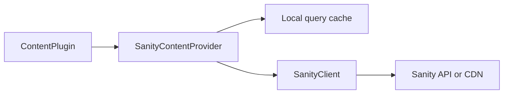

# vyuh_plugin_content_provider_sanity

SanityContentProvider implements ContentProvider with query-response caching, typed conversion, route projections, media URLs, and a LiveContentProvider. useCache: false performs a fresh provider request; it does not invalidate Sanity CDN caches.



[Package source](https://github.com/vyuh-tech/vyuh/tree/main/packages/sanity/vyuh_plugin_content_provider_sanity) · [Released API](https://pub.dev/documentation/vyuh_plugin_content_provider_sanity/latest/)

## Choose a declaration

[InvalidResultTypeException](#invalidresulttypeexception) · [QueryRecord](#queryrecord) · [SanityContentProvider](#sanitycontentprovider) · [fieldMap](#fieldmap) · [identity](#identity)

## InvalidResultTypeException {#invalidresulttypeexception}

[Source](https://github.com/vyuh-tech/vyuh/blob/main/packages/sanity/vyuh_plugin_content_provider_sanity/lib/exception.dart#L3)

Public declaration in this package.

```dart
final class InvalidResultTypeException extends SanityException
```

Directly declared public members:

```dart
final Type expectedType;
```


```dart
final Type actualType;
```


```dart
InvalidResultTypeException({required this.expectedType, required this.actualType});
```


```dart
String toString();
```


## QueryRecord {#queryrecord}

[Source](https://github.com/vyuh-tech/vyuh/blob/main/packages/sanity/vyuh_plugin_content_provider_sanity/lib/processor.dart#L3)

Public declaration in this package.

```dart
typedef QueryRecord = (
```

## SanityContentProvider {#sanitycontentprovider}

[Source](https://github.com/vyuh-tech/vyuh/blob/main/packages/sanity/vyuh_plugin_content_provider_sanity/lib/vyuh_plugin_content_provider_sanity.dart#L25)

Public declaration in this package.

```dart
final class SanityContentProvider extends ContentProvider
```

Directly declared public members:

```dart
final Duration cacheDuration;
```


```dart
SanityContentProvider(SanityClient client, {this.cacheDuration = const Duration(minutes: 5)});
```


```dart
factory SanityContentProvider.withConfig({required SanityConfig config, required Duration cacheDuration});
```


```dart
String fieldValue(String key, Map<String, dynamic> json);
```


```dart
String schemaType(Map<String, dynamic> json);
```


```dart
Future<void> init();
```


```dart
Future<void> dispose();
```


```dart
Future<T?> fetchById<T>(String id, {required FromJsonConverter<T> fromJson, bool useCache = true});
```


```dart
Future<T?> fetchSingle<T>(String query, {required FromJsonConverter<T> fromJson, Map<String, String>? queryParams, bool useCache = true});
```


```dart
Future<List<T>?> fetchMultiple<T>(String query, {required FromJsonConverter<T> fromJson, Map<String, String>? queryParams, bool useCache = true});
```


```dart
Future<RouteBase?> fetchRoute({String? path, String? routeId, bool useCache = true});
```


```dart
ImageProvider? image(ImageReference imageRef, {int? width, int? height, int? devicePixelRatio, int? quality, String? format});
```


```dart
Uri? fileUrl(FileReference fileRef);
```


## fieldMap {#fieldmap}

[Source](https://github.com/vyuh-tech/vyuh/blob/main/packages/sanity/vyuh_plugin_content_provider_sanity/lib/vyuh_plugin_content_provider_sanity.dart#L16)

Public declaration in this package.

```dart
final Map<String, String> fieldMap =
```

## identity {#identity}

[Source](https://github.com/vyuh-tech/vyuh/blob/main/packages/sanity/vyuh_plugin_content_provider_sanity/lib/vyuh_plugin_content_provider_sanity.dart#L14)

Public declaration in this package.

```dart
Map<String, dynamic> identity(Map<String, dynamic> json)
```
