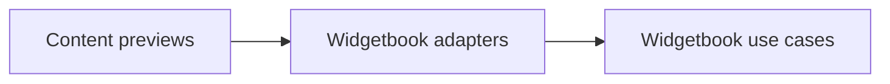

# vyuh_widgetbook

Adapters expose content previews as Widgetbook use cases. This package is developer tooling; the production content registry remains owned by the framework.



[Package source](https://github.com/vyuh-tech/vyuh/tree/main/packages/system/vyuh_widgetbook) · [Released API](https://pub.dev/documentation/vyuh_widgetbook/latest/)

## Choose a declaration

[WidgetBookShell](#widgetbookshell) · [runWidgetBook](#runwidgetbook)

## WidgetBookShell {#widgetbookshell}

[Source](https://github.com/vyuh-tech/vyuh/blob/main/packages/system/vyuh_widgetbook/lib/shell.dart#L7)

Public declaration in this package.

```dart
final class WidgetBookShell extends StatelessWidget
```

Directly declared public members:

```dart
final List<FeatureDescriptor> features;
```


```dart
final ThemeData? lightTheme;
```


```dart
final ThemeData? darkTheme;
```


```dart
const WidgetBookShell({super.key, required this.features, this.lightTheme, this.darkTheme});
```


```dart
Widget build(BuildContext context);
```


## runWidgetBook {#runwidgetbook}

[Source](https://github.com/vyuh-tech/vyuh/blob/main/packages/system/vyuh_widgetbook/lib/vyuh_widgetbook.dart#L9)

Runs the Widgetbook application for previewing Vyuh content and components.

```dart
void runWidgetBook({required FeaturesBuilder features, ThemeData? lightTheme, ThemeData? darkTheme})
```
