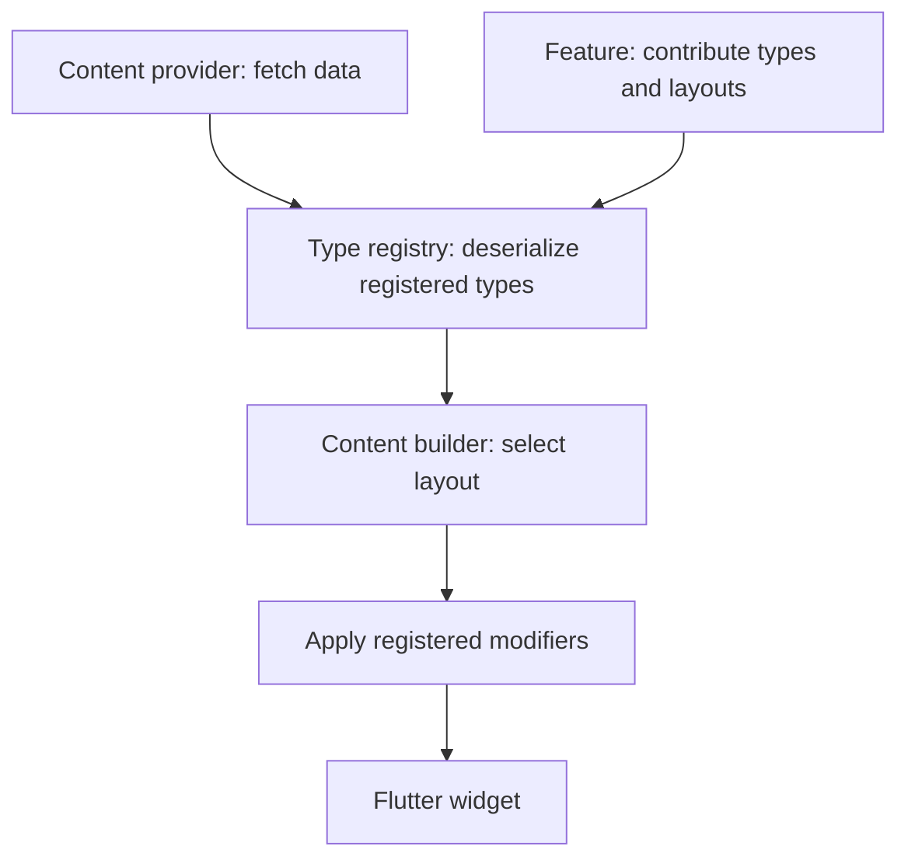

# Content pipeline

Content is one capability that features can use. A normal Flutter feature can expose hard-coded routes without a CMS. When your product needs managed content, the content plugin connects provider data to the types and layouts registered by features.

## Register before rendering

A feature contributes a `ContentExtensionDescriptor`. The app supplies a `ContentExtensionBuilder` to aggregate those contributions. Content descriptors identify the type, deserializer, and default layout. Importing a Dart class does not register it with the runtime.

Use the built-in system feature for its route types, blocks, actions, and conditions. Add your feature’s types through the same registry so providers, preview tooling, and rendering use one contract.

## Provider and plugin responsibilities

A `ContentProvider` owns fetching and media URLs. The content plugin owns conversion and rendering. This lets a feature keep its content contracts while an app chooses a provider implementation.

The Sanity provider runs GROQ queries through `SanityClient`. Its query cache stores responses; `useCache: false` bypasses that local cache. Sanity’s CDN is a separate caching layer controlled by `SanityConfig`.

## Layouts, actions, and conditions

A layout turns typed content into a widget. An action executes a configured behavior. A condition evaluates to a string used to select a matching case; it is not an error-message validator.

Prefer a small custom type with a clear contract over multiple nearly identical types. Keep the CMS schema, Dart deserializer, registered type name, and layout in agreement.

## Debug the boundary that failed

1. Confirm the provider returned the expected document and type name.
2. Confirm the feature and extension builder were included by the app.
3. Confirm the deserializer accepts the payload.
4. Confirm the requested layout is registered for that type.
5. Check action and condition cases against their supported values.

Continue with [content types](/cms/guides/content-types), [layouts](/cms/guides/layouts), and the [content API](/cms/api/vyuh-extension-content).
