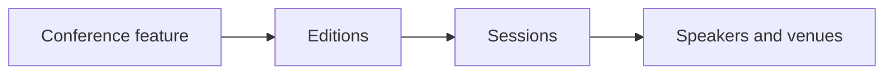

# Conference

The Conference example demonstrates how to build a full-featured conference management application using Vyuh and Sanity.io. It showcases schema design, content modeling, flexible layouts, and navigation patterns.



## Schema Design

The conference schema is built around several key content types that model a typical tech conference. Each content type is defined using Sanity.io's schema definition language and has corresponding Dart models in the Flutter application.

### Core Content Types

- **Conference** -- The root content type representing a conference brand, with a title, description, and list of editions
- **Edition** -- Represents a specific occurrence of a conference, with dates, venue, tracks, and sponsors
- **Track** -- Conference track containing related sessions
- **Session** -- Individual talk or workshop with speakers and room assignments
- **Speaker** -- Presenter information with bio and social links
- **Venue** -- Physical location with rooms
- **Sponsor** -- Conference sponsor or partner

### Content Relationships

The schema establishes relationships between content types:

1. **Conference to Editions** -- One-to-many; each conference can have multiple editions
2. **Edition to Venue** -- One-to-one; each edition is held at a specific venue
3. **Edition to Tracks** -- One-to-many; each edition can have multiple parallel tracks
4. **Track to Sessions** -- One-to-many; each track contains multiple sessions
5. **Session to Speakers** -- Many-to-many; sessions can have multiple speakers, and speakers can present multiple sessions
6. **Venue to Rooms** -- One-to-many; each venue contains multiple rooms
7. **Edition to Sponsors** -- Many-to-many; with edition-specific sponsorship details

## Layout System

The conference example demonstrates Vyuh's flexible layout system by providing multiple ways to display the same content.

### Edition Layouts

- **Default Layout** -- Full conference schedule view with all tracks and sessions
- **Card Layout** -- Compact view for edition listings showing key information
- **Hero Layout** -- Landing page style with prominent imagery and highlights

### Session Layouts

- **Schedule Layout** -- Compact view for schedule grid with time, title, speakers
- **Detail Layout** -- Full session information with speaker bios and room details

### Speaker Layouts

- **Card Layout** -- Grid view with photo, name, and role
- **Profile Layout** -- Detailed speaker profile with bio, sessions, and social links

## Navigation Structure

The conference example implements a hierarchical navigation structure:

```
/conference
  /{conferenceId}
    /editions
      /{editionId}
        /schedule
        /speakers
        /sponsors
        /venue
    /speakers
      /{speakerId}
    /sessions
      /{sessionId}
    /venues
      /{venueId}
```

### Navigation Features

- Nested Navigation
- Deep linking
- Responsive layouts
- Persistent navigation state
- URL-based routing

## Feature Modularity

The conference feature is designed as a self-contained module that can be easily integrated into any Vyuh application:

```dart
final feature = FeatureDescriptor(
  name: 'conference',
  title: 'Conference Feature',
  description: 'Conference management and scheduling system',
  init: () async {
    vyuh.di.register(ConferenceApi(vyuh.content.provider));
  },
  extensions: [
    ContentExtensionDescriptor(
      contentBuilders: [
        Conference.contentBuilder,
        Edition.contentBuilder,
        Session.contentBuilder,
        Speaker.contentBuilder,
        Venue.contentBuilder,
        Track.contentBuilder,
        Room.contentBuilder,
        Sponsor.contentBuilder,
      ],
    ),
  ],
  routes: routes,
);
```

### Integration

Any Vyuh application can integrate the conference feature by:

1. Including the feature package dependency
2. Adding the feature to the application's feature list
3. Configuring the content provider with conference schemas

The feature automatically registers its content types, sets up its routes, and initializes required services.

::: tip Read the Code
View the complete implementation in the
[conference example source code](https://github.com/vyuh-tech/vyuh/tree/main/examples/conference).
:::
