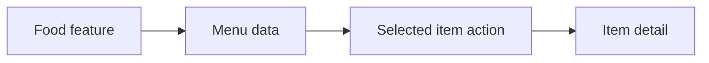

# Food

The Food example demonstrates how to build a restaurant menu application as a
self-contained Vyuh feature. It covers the essentials of defining custom content
types, wiring up CMS-driven routes, and letting content editors manage the menu
without requiring an app release.



## What This Demonstrates

This example walks through several foundational concepts of the Vyuh Framework:

- **Custom content types** -- Defining a `FoodMenuItem` that maps a CMS schema
  to a Dart class, complete with typed fields for title, description, price,
  image, and category.
- **CMS-driven routes with `CMSRoute`** -- Declaring routes whose content is
  fetched from the CMS at runtime rather than hardcoded in the app.
- **API content for fetching data** -- Retrieving structured menu data from
  Sanity and deserializing it into strongly-typed Dart objects.
- **Feature composition with `ContentExtensionDescriptor`** -- Registering
  content builders so the framework knows how to construct and render each
  content type.

## The Feature

Every Vyuh feature starts with a `FeatureDescriptor`. This is the entry point
that declares the feature's routes, content types, and any initialization logic.

```dart
final feature = FeatureDescriptor(
  name: 'food',
  title: 'Food',
  description: 'A restaurant menu feature',
  icon: Icons.restaurant,
  routes: () async => [
    CMSRoute(
      path: '/food',
      routes: [CMSRoute(path: ':path(.*)')],
    ),
  ],
  extensions: [
    ContentExtensionDescriptor(
      contentBuilders: [
        FoodMenuItem.contentBuilder,
      ],
    ),
  ],
);
```

A few things to note:

- **`CMSRoute`** tells the framework that the content for this route is managed
  in the CMS. When a user navigates to `/food`, the framework fetches the
  corresponding page document from Sanity and renders it.
- The **wildcard sub-route** `:path(.*)` handles any nested CMS paths beneath
  `/food`. This means content editors can create arbitrarily deep page
  hierarchies in the CMS and the app will serve them without code changes.
- **`ContentExtensionDescriptor`** registers the `FoodMenuItem` content builder
  so the framework can match incoming JSON to the correct Dart type and select an
  appropriate layout.

## Custom Content Type

The `FoodMenuItem` class is the Dart counterpart of the CMS schema. It extends
`ContentItem`, which gives it a schema type identifier and optional layout
configuration.

```dart
@JsonSerializable(createToJson: false)
final class FoodMenuItem extends ContentItem {
  static const schemaName = 'food.menuItem';
  static final typeDescriptor = TypeDescriptor(
    schemaType: schemaName,
    title: 'Food Menu Item',
    fromJson: FoodMenuItem.fromJson,
  );

  final String title;
  final String? description;
  final double price;
  final ImageReference? image;
  final String category;

  FoodMenuItem({
    required this.title,
    this.description,
    required this.price,
    this.image,
    required this.category,
    super.layout,
  }) : super(schemaType: schemaName);

  factory FoodMenuItem.fromJson(Map<String, dynamic> json) =>
      _$FoodMenuItemFromJson(json);
}
```

Key details:

- **`schemaName`** (`food.menuItem`) must match the `_type` field in the CMS
  schema exactly. This is how the framework links JSON documents to the correct
  Dart class.
- **`TypeDescriptor`** bundles the schema type, a human-readable title, and the
  `fromJson` factory together. The framework uses this descriptor when it
  encounters a JSON object with a matching `_type`.
- **`@JsonSerializable(createToJson: false)`** uses `json_serializable` for
  deserialization only, since content flows one way -- from the CMS to the app.
- Fields like `image` use `ImageReference`, a Vyuh type that handles
  CMS-managed image assets.

## CMS to Flutter Flow

Understanding how content travels from the CMS to a rendered widget is central
to working with Vyuh. Here is the pipeline for the Food example:

1. **Schema definition** -- Content types such as `food.menuItem` are defined as
   schemas in Sanity. These schemas describe the fields, validation rules, and
   relationships that editors work with.

2. **Content creation** -- Editors use the Sanity Studio to create and manage
   menu items. They fill in titles, descriptions, prices, images, and categories
   using a structured editing experience.

3. **JSON fetching and deserialization** -- When a user navigates to a food
   route, the framework fetches the page document from Sanity. Each content block
   in the response carries a `_type` field. The framework matches this type to
   the registered `TypeDescriptor` and calls `FoodMenuItem.fromJson` to produce a
   typed Dart object.

4. **Layout selection and rendering** -- The `ContentBuilder` for
   `FoodMenuItem` inspects the `layout` property (which can also be set from the
   CMS) and selects the appropriate widget to render. This means the same content
   type can be presented in different visual styles without changing the
   underlying data.

## Key Takeaways

- **Custom content types map CMS schemas to Dart classes.** The `schemaName`
  acts as the bridge between a JSON document in Sanity and a typed object in
  Flutter.
- **`CMSRoute` enables server-driven navigation.** Routes and their content are
  defined in the CMS, so the app's page structure can evolve without code
  changes.
- **Content editors can update the menu without app releases.** New items,
  price changes, or seasonal specials can all be published from the CMS Studio
  and reflected in the app immediately.
- **The same content type can have multiple visual layouts.** By assigning
  different layouts in the CMS, editors control how a menu item appears -- as a
  card, a list tile, a detail page -- without developer involvement.

::: tip Read the Code
See the code for the example on GitHub:
[Food](https://github.com/vyuh-tech/vyuh/tree/main/examples/food)
:::
