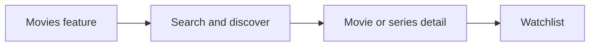

# TMDB Movies

The Movies App is a much more sophisticated example of applying the Vyuh Framework. It has a host of features that covers the breadth and depth of the framework including:

1. **Navigating** using a combination of template routes from the CMS and Application routes defined with GoRouter
2. **Page content** rendered from the CMS
3. Custom **routing** configuration
4. Controlling **bottom tabs** from the CMS
5. Pages and Dialogs
6. **Custom content blocks** for rendering a Movie or TV Series
7. **Configurable sections** for Movie/Series
8. **Custom layouts** for pages
9. **Custom actions** such as "Add to Watchlist"
10. **API driven content** using the TMDB API
11. Using custom packages from **pub.dev**
12. Building custom packages such as the **tmdb_client**

## App Experience

The Movies feature covers a wide range of capabilities across Movies and TV Series:

- **Trending**, popular, upcoming movies and series
- **Searching** by title, genres and other attributes
- **Trailers** with inline and full screen video player
- Adding movies/series to **watchlist**
- **Nested navigation** into Cast and Crew, Biographies, Reviews, Similar Movies/Series, Backdrops and Posters
- Custom **Design System**
- **Onboarding pages** that introduce the feature

::: tip Read the Code
See the code for the example on GitHub:
[TMDB Movies](https://github.com/vyuh-tech/vyuh/tree/main/examples/tmdb)
:::
