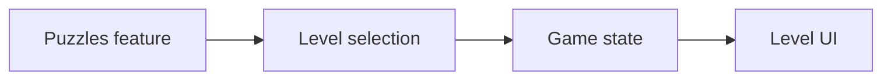

# Puzzle

A fun example where we create a puzzle game with the levels controlled from the
CMS. This demonstrates how Vyuh can power interactive experiences like games,
where the content (puzzle levels, difficulty settings) is managed externally
while the game logic stays entirely in Flutter.



## What This Demonstrates

This example highlights several important capabilities of the Vyuh Framework:

1. **CMS-driven game content** -- Puzzle levels, including grid size, target
   images, and difficulty, are defined as structured content in the CMS. New
   levels can be added or reordered without touching any code.
2. **Complex state management with MobX** -- The game tracks moves, timing,
   completion status, and player progress using MobX observables, providing
   reactive UI updates as the game state changes.
3. **Custom content types for game data** -- The puzzle level is modeled as a
   custom `ContentItem`, showing how Vyuh content types extend beyond typical
   text and media into structured game data.
4. **Feature with both CMS routes and client-side logic** -- The feature
   combines CMS-managed routes for level selection with rich client-side game
   logic for the puzzle interactions, animations, and scoring.

## The Feature

The Puzzle feature is set up with a `FeatureDescriptor` that registers the CMS
routes for browsing and selecting levels, along with a content extension for the
custom `LevelSection` content type.

```dart
final feature = FeatureDescriptor(
  name: 'puzzles',
  title: 'Puzzles',
  description: 'A puzzle game with CMS-driven levels',
  icon: Icons.extension,
  routes: () async => [
    CMSRoute(
      path: '/puzzles',
      routes: [CMSRoute(path: ':path(.*)')],
    ),
  ],
  extensions: [
    ContentExtensionDescriptor(
      contentBuilders: [
        LevelSection.contentBuilder,
      ],
    ),
  ],
);
```

The route structure uses a wildcard pattern (`:path(.*)`) so that any nested
path under `/puzzles` is resolved from the CMS. This lets content editors define
the full navigation hierarchy for the puzzle experience, including category
pages, level listings, and individual level details.

## Game Content from CMS

Puzzle levels are defined as structured content in the CMS. Each level specifies
properties like the grid size, target image, and difficulty. Content editors can
add new levels, reorder them, or adjust difficulty settings at any time --
without requiring a code change or app update.

A simplified version of the `LevelSection` content type looks like this:

```dart
@JsonSerializable(createToJson: false)
final class LevelSection extends ContentItem {
  static const schemaName = 'puzzles.levelSection';

  final String title;
  final int gridSize;
  final ImageReference? image;
  final String difficulty;

  // ...constructor and fromJson...
}
```

The `LevelSection` extends `ContentItem`, making it a first-class content type
in Vyuh. When the CMS delivers this content, Vyuh automatically deserializes it
and hands it off to the registered content builder, which renders the puzzle grid
and game UI.

This means that the game's level catalog is entirely CMS-managed. A content
editor could, for example, create a seasonal set of holiday-themed puzzles, set
them to go live on a specific date, and remove them afterwards -- all without
involving a developer.

## State Management

The puzzle game state -- current level, number of moves, timer, and completion
status -- is managed using MobX observables. This gives the game UI reactive
updates: as tiles move, the move counter increments instantly; when the puzzle is
solved, the completion state triggers the success animation.

MobX is a natural fit here because game state changes frequently and from
multiple sources (user gestures, timer ticks, level resets). Observables ensure
that only the parts of the UI affected by a particular state change are rebuilt,
keeping the game performant even with complex animations and transitions.

The game store tracks player progress across levels, allowing the UI to show
which puzzles have been completed and what scores were achieved.

## Key Takeaways

- **Game content (levels, configurations) can live in the CMS.** This separates
  the creative work of designing levels from the engineering work of building the
  game engine.
- **Complex client-side logic (game engine, animations) stays in Flutter.** The
  CMS provides the data; Flutter provides the interactive experience.
- **Content editors can create new puzzle levels without developer involvement.**
  Adding a new level is as simple as filling out a form in the CMS.
- **MobX handles reactive game state elegantly.** Observables and reactions make
  it straightforward to keep the game UI in sync with rapidly changing state.

::: tip Read the Code
See the code for the example on GitHub:
[Puzzle](https://github.com/vyuh-tech/vyuh/tree/main/examples/puzzles)
:::
