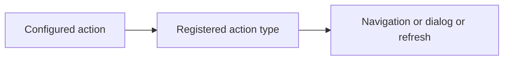
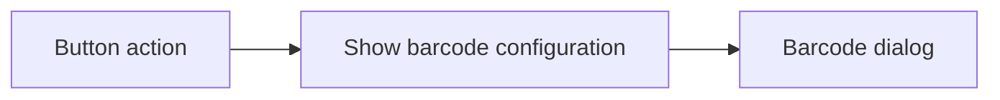

# Actions

Actions are a great way to build interactivity within your applications (see the
[Glossary](/concepts/glossary) for a formal definition). Vyuh has several
built-in actions that you can start with. However, you will eventually want to
create your own and have something more relevant for your application. In this
guide, we will focus on creating a custom action from scratch.

## Built-in Actions

Before creating your own action, check the ones already available out of the box
in Vyuh:



- Navigation
- Navigate Back
- Open in Dialog
- Open URL
- Toggle Theme
- Show / Hide Snack Bar
- Open / Close Drawer
- Show Alert
- Delay
- Refresh Route
- Restart Application

::: info Conditional Action
An interesting one is the **Conditional Action** that allows you to branch
between two or more actions based on some runtime condition. See the
[Conditions guide](/cms/guides/conditions) for details on defining and using conditions.
:::

## A Custom "Show Barcode" Action

Let us create a custom action that shows a barcode to the user. This could be
useful in a store app where you use the barcode for scanning and retrieving
useful information such as availability, offers, and prices.

## Schema for the Barcode Action

Barcodes encode text, making it easier for barcode scanners to quickly read
information. Barcodes can be encoded in multiple formats. We need **`data`** and
**`barcodeType`** as our two primary parameters.

Here is the Sanity schema:

```typescript
import { defineField, defineType } from 'sanity'
import { FaBarcode as Icon } from 'react-icons/fa6'

export const showBarcode = defineType({
  name: 'misc.action.showBarcode',
  title: 'Show Barcode',
  type: 'object',
  icon: Icon,
  fields: [
    defineField({
      name: 'data',
      title: 'Data',
      type: 'string',
      initialValue: 'Vyuh Framework',
      validation: (Rule) => Rule.required(),
    }),
    defineField({
      name: 'barcodeType',
      title: 'Barcode Type',
      type: 'string',
      validation: (Rule) => Rule.required(),
      initialValue: 'Code128',
      options: {
        list: [
          { title: 'Code128', value: 'Code128' },
          { title: 'QR Code', value: 'QrCode' },
          { title: 'DataMatrix', value: 'DataMatrix' },
        ],
        layout: 'radio',
      },
    }),
  ],
  preview: {
    select: {
      barcodeType: 'barcodeType',
      data: 'data',
    },
    prepare({ barcodeType, data }) {
      return {
        title: 'Show Barcode',
        subtitle: `Data: ${data ?? '---'} | Barcode Type: ${barcodeType}`,
      }
    },
  },
})
```

It is a good practice to namespace your actions within your feature to avoid
name collisions with other features.

### Include in the CMS Feature

Add this action to the **`FeatureDescriptor`**:

```typescript
import { FeatureDescriptor } from '@vyuh/sanity-schema-core'
import { showBarcode } from './action/show-barcode.ts'

export const misc = new FeatureDescriptor({
  name: 'misc',
  title: 'Miscellaneous',
  actions: [showBarcode],
  // ... rest of the definitions ...
})
```

### Configuring the Action inside Sanity Studio

Now, its time to configure it inside the Studio. We will create a built-in Card
which will invoke the action when tapped.



## Flutter Counterpart for the Action

The executable version of an action needs to extend the
**`ActionConfiguration`** class. Since we have set up the schema on the CMS,
this counterpart will be a Dart class that maps the parameters accordingly:

```dart
import 'dart:async';

import 'package:barcode_widget/barcode_widget.dart';
import 'package:material_ui/material_ui.dart';
import 'package:json_annotation/json_annotation.dart';
import 'package:vyuh_core/vyuh_core.dart';
import 'package:vyuh_extension_content/vyuh_extension_content.dart';

part 'show_barcode.g.dart';

@JsonSerializable()
final class ShowBarcodeAction extends ActionConfiguration {
  static const schemaName = 'misc.action.showBarcode';

  static final typeDescriptor = TypeDescriptor(
    schemaType: schemaName,
    title: 'Show Barcode',
    fromJson: ShowBarcodeAction.fromJson,
  );

  final BarcodeType barcodeType;
  final String data;

  ShowBarcodeAction({
    super.isAwaited,
    this.barcodeType = BarcodeType.Code128,
    this.data = 'Vyuh Framework',
  }) : super(schemaType: schemaName, title: 'Show Bar Code');

  factory ShowBarcodeAction.fromJson(Map<String, dynamic> json) =>
      _$ShowBarcodeActionFromJson(json);

  @override
  FutureOr<void> execute(
    BuildContext context, {
    Map<String, dynamic>? arguments,
  }) {
    return showDialog(
      context: context,
      builder: (context) => AlertDialog(
        icon: const Icon(Icons.barcode_reader),
        title: Text('Barcode: ${barcodeType.name}'),
        content: BarcodeWidget(
          barcode: Barcode.fromType(barcodeType),
          data: data,
          height: 100,
        ),
      ),
    );
  }
}
```

::: info Code Generation
The `show_barcode.g.dart` file is generated by `json_serializable`. Run the following command in your feature package whenever you add or change a `@JsonSerializable` class:

```shell
dart run build_runner build
```
:::

The **`barcodeType`** and the **`data`** fields map exactly to the ones in the
CMS schema.

### Including in the Flutter FeatureDescriptor

```dart
final feature = FeatureDescriptor(
  name: 'misc',
  title: 'Misc',
  icon: Icons.miscellaneous_services_outlined,
  routes: () async {
    return [
      CMSRoute(
        path: '/misc',
        routes: [
          CMSRoute(path: ':path(.*)'),
        ],
      ),
    ];
  },
  extensions: [
    ContentExtensionDescriptor(
      actions: [
        ShowBarcodeAction.typeDescriptor,
      ],
    ),
  ],
);
```

### Ensure Feature is Included with the App

Make sure the feature is included in your app's `runApp()` call, otherwise it
would fail at runtime to recognize the action from the CMS payload:

```dart
import 'package:feature_misc/feature_misc.dart' as misc;
import 'package:vyuh_core/vyuh_core.dart' as vc;

void main() async {
  vc.runApp(
    initialLocation: '/demo',
    features: () => [
      system.feature,
      misc.feature,
    ],
    plugins: plugins,
  );
}
```

## Summary

In this guide we have seen how to create a custom action where we create the
schema, its Flutter counterpart, and register it with the `FeatureDescriptor`.

Custom actions can also be used to work directly with your internal client
state, make network calls, and do other useful things that are relevant to your
app. They are a powerful way of configuring actions directly from the CMS.

## Related

- [Glossary](/concepts/glossary) -- definitions of Action and other framework terms
- [Conditions](/cms/guides/conditions) -- define conditions used by Conditional Actions
