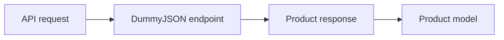
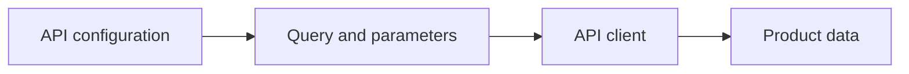
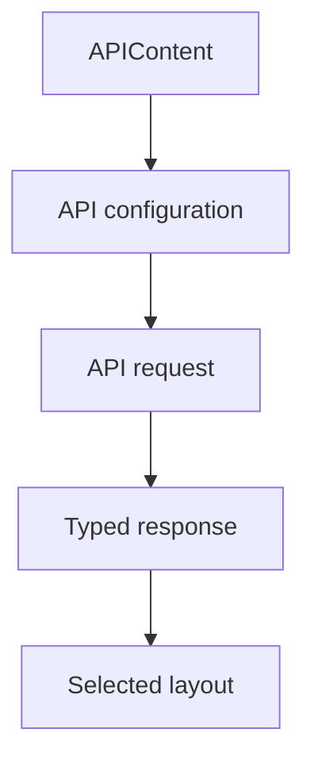
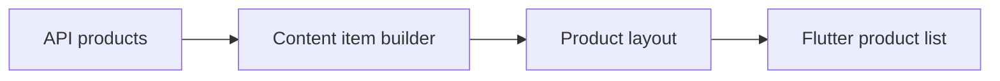

# API Content

Rendering content from an API remains one of the most popular use cases of the
Vyuh Framework. This is expected as most real-world apps fetch data from an API
and render it as per the brand guidelines.

In this guide, we will see how to integrate a third-party API and render it as
per our needs.

## 1. Identifying a Third-Party API

For this example we will use the [DummyJSON](https://dummyjson.com/) API, which
provides a variety of endpoints for products, carts, recipes, todos, and more.



We will use two endpoints for products:

1. **Products list** (`https://dummyjson.com/products`): shows a list of
   products with query parameters to control the `limit` and `skip`.
2. **Products search** (`https://dummyjson.com/products/search?q=<text>`):
   allows searching for products with search terms. It also supports the
   `limit` and `skip` query parameters.

## 2. API Configuration Schema for the CMS

Based on the parameters above, here is a schema that can be configured from the
CMS. It allows changing the `limit`, `skip`, and `searchText` parameters:

```typescript
import { defineField, defineType } from 'sanity'

export const dummyJsonApi = defineType({
  name: 'misc.apiContent.dummyJson',
  type: 'object',
  title: 'Dummy JSON API',
  fieldsets: [
    {
      title: 'Query Parameters',
      name: 'queryParameters',
      options: { columns: 2 },
    },
  ],
  fields: [
    defineField({
      name: 'type',
      title: 'API Type',
      type: 'string',
      validation: (Rule) => Rule.required(),
      initialValue: 'products',
      options: {
        list: [
          { title: 'Products', value: 'products' },
          { title: 'Search', value: 'search' },
        ],
      },
    }),
    defineField({
      name: 'searchText',
      title: 'Search Text',
      type: 'string',
      fieldset: 'queryParameters',
    }),
    defineField({
      name: 'limit',
      title: 'Limit',
      type: 'number',
      validation: (Rule) => Rule.min(1).max(50),
      initialValue: 10,
      fieldset: 'queryParameters',
    }),
    defineField({
      name: 'skip',
      title: 'Skip',
      type: 'number',
      validation: (Rule) => Rule.min(0),
      initialValue: 0,
      fieldset: 'queryParameters',
    }),
  ],
})
```

Export it in the `FeatureDescriptor`:

```typescript
import { FeatureDescriptor } from '@vyuh/sanity-schema-core'
import { APIContentDescriptor } from '@vyuh/sanity-schema-system'
import { dummyJsonApi } from './content/dummy-json-api.ts'

export const misc = new FeatureDescriptor({
  name: 'misc',
  title: 'Miscellaneous',
  contents: [
    new APIContentDescriptor({
      configurations: [dummyJsonApi],
    }),
  ],
})
```

Now our API configuration shows up on the CMS and we can configure it as needed.



## 3. API Configuration on the Flutter Side

On the Flutter side, extend the **`ApiConfiguration<T>`** abstract class. You
need to override two methods:

- **`invoke(BuildContext context)`**: Invokes the API and fetches the content.
- **`build(BuildContext context, T? data)`**: Renders the data as per the design
  system.

```dart
@JsonSerializable()
final class DummyJsonApiConfiguration
    extends ApiConfiguration<ProductList> {
  static const schemaName = 'misc.apiContent.dummyJson';
  static final typeDescriptor = TypeDescriptor(
    schemaType: schemaName,
    fromJson: DummyJsonApiConfiguration.fromJson,
    title: 'DummyJSON API',
  );

  final DummyJsonProductApiType type;
  final String? searchText;
  final int limit;
  final int skip;

  DummyJsonApiConfiguration({
    required this.type,
    this.searchText,
    required this.limit,
    required this.skip,
  }) : super(schemaType: schemaName, title: 'DummyJSON API');

  factory DummyJsonApiConfiguration.fromJson(Map<String, dynamic> json) =>
      _$DummyJsonApiConfigurationFromJson(json);

  @override
  Widget build(BuildContext context, ProductList? data) {
    if (data == null) {
      return empty;
    }

    return ListView.builder(
      itemBuilder: (_, index) {
        final item = data.products[index];
        return ProductTile(item: item);
      },
      itemCount: data.products.length,
    );
  }

  @override
  Future<ProductList> invoke(BuildContext context) async {
    final parameters = {
      if (type == DummyJsonProductApiType.search)
        'q': searchText,
      'limit': limit,
      'skip': skip,
    }.entries.map((x) => '${x.key}=${x.value}').join('&');

    final basePath = switch (type) {
      DummyJsonProductApiType.products =>
        'https://dummyjson.com/products',
      DummyJsonProductApiType.search =>
        'https://dummyjson.com/products/search',
    };

    final response =
        await vyuh.network.get(Uri.parse('$basePath?$parameters'));
    final list =
        ProductList.fromJson(jsonDecode(response.body));

    return list;
  }
}
```

Notice the use of **`vyuh.network`** for invoking the API. This is the
recommended way of invoking APIs in Vyuh.

Include it in the Flutter `FeatureDescriptor`:

```dart
final feature = FeatureDescriptor(
  name: 'misc',
  title: 'Misc',
  extensions: [
    ContentExtensionDescriptor(
      contents: [
        APIContentDescriptor(configurations: [
          DummyJsonApiConfiguration.typeDescriptor,
        ]),
      ],
    ),
  ],
);
```

## 4. API Content in Action

You can now include the API Content block on the CMS and configure it with the
DummyJSON API.



On the Flutter side, after loading the page which has this content block, you
will see the products rendered with custom styling.



## Summary

Vyuh has rich provision to integrate custom API endpoints and render their
responses. To configure it on the CMS, define a custom schema with the
`APIContentDescriptor`.

There is a similar task on the Flutter side, where you take care of the
implementation details of invoking the API and rendering it. Together you have a
powerful, configurable _API Content block_ that can be changed dynamically from
the CMS.
