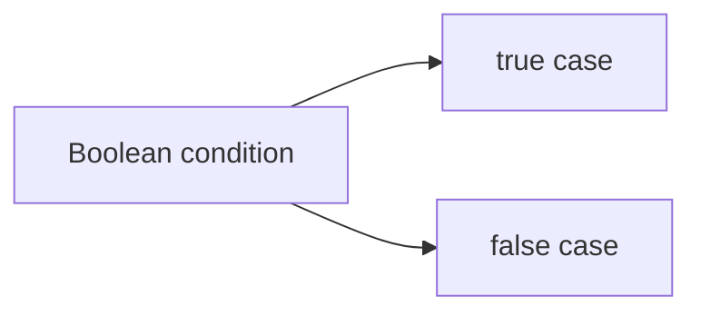
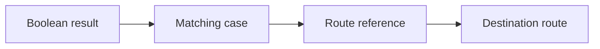

# Conditional Routes

In the Vyuh Framework, routes are a great way to set up a single screen of
content. But sometimes, you do not want to always go to the same screen for
every user or for every situation in your app. That is where conditional routing
comes into play.

A conditional route leverages a **Condition** to branch between two or more
routes. Having a conditional route means you can do things like showing a
different screen for different types of subscribers. You could show a plain
screen for the basic user, a more premium looking screen for the premium user,
and a more luxurious one for the luxury user. These things can be done using a
singular condition that reports the subscription status and using that to drive
the conditional route.

The good part about a **Conditional Route** is that all of the configuration is
done from the CMS, so you do not have to write any code to make it work.

## Choosing a Condition

Let us pick a simple condition for this example. A **Boolean** condition works
very well; it is already built into the system. We can use this condition to
drive the two branches of the conditional route.

Create a new route called `Conditional Home` with a path of `/misc` and select
the **Simple Boolean** condition, which is built into the system.

## Deciding the Various Branches

The next step is to set up the two branches of this particular condition. Since
it is a Boolean condition, we create a **`true`** route and a **`false`** route.
The `true` route points to the _Miscellaneous Home_, and the `false` route
points to an Empty page.

::: info A Route for Each Case
Conditions return a string value which could be used as an enumeration for
deciding the different routes. In the case of the Boolean condition, there are
only two possible values (`true` and `false`). Hence, we only set up two routes.

For a different condition (such as subscription-status or current-platform), the
values can be more than two, in which case you would need to set up a route for
all the possible values.
:::

## Testing it in the App

When testing in the app, make sure you are linking to this particular route
**through a URL** and NOT by a Route reference. The framework uses the URL to
decide whether there is a conditional route existing against the same path. If
so, it will evaluate the conditional route and pick the final route to render.

Since we have already set up the `/misc` route, load it up inside the app and
observe how it behaves when the condition switches between `true` and `false`.

## Summary

As you can tell from this guide, there is no need to write any code to set up a
Conditional Route. It is all done in the CMS with a simple configuration. You
select the condition and set up the routes for its various cases. At runtime,
depending on the value of the condition, the correct route will be rendered.

::: tip Nested Conditional Routes
A fun fact to note here is that you could have a Conditional Route itself as a
case. This means you can have a tree of Conditional Routes that can be used for
more complex scenarios.
:::
