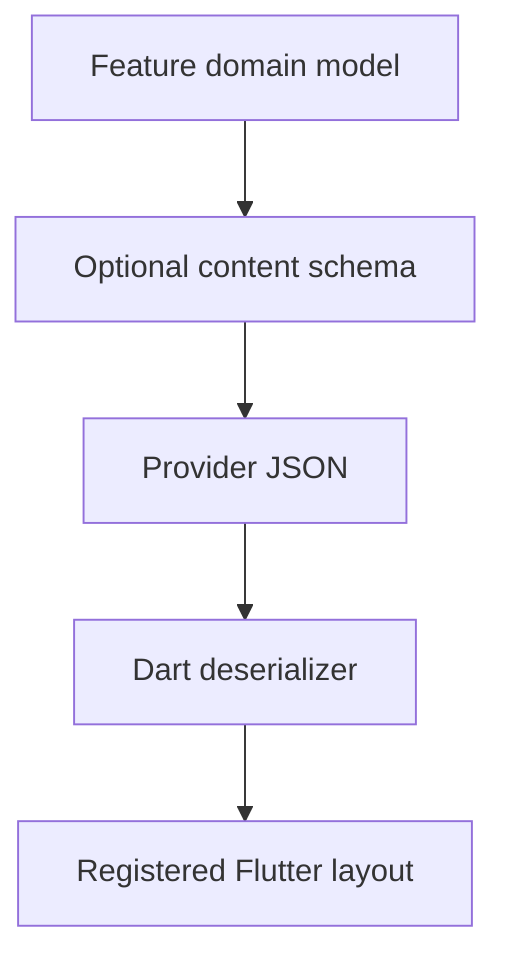

# Designing Content Schemas

Use this guide when your feature needs managed content. A schema defines the data that a content provider returns; Dart models and registered layouts turn that data into Flutter UI. Regular Flutter routes do not require schemas or a CMS.

Keep the feature’s domain model separate from presentation choices. Add content configuration where editors need control, while retaining app behavior in the feature and shared capabilities in plugins.

## Growing Set of Principles

After having built a variety of features (aka mini-apps) across a wide range of
verticals such as Fashion, Finance, Retail, Healthcare, Real Estate, Flights,
Hotels, Delivery, and many others, we have observed a few principles that help
in effective development. These are listed below, in no particular order.

1. Naming is crucial. **DO** take your time to pick the right name that conveys
   the most meaning and intent. This applies to fields, objects, documents,
   classes, methods, packages, and even apps.
2. **DO** use the jargon from the business domain.
3. **DO NOT** introduce presentation attributes into a content schema. For
   example, a `Card with Image` is a better way to imply the final rendering
   without mentioning details of the border-radius, shadows, colors, fonts, etc.
   Strive to keep the content pristine without muddying it with presentation
   attributes.
4. **DO** emphasize correct spellings of field names. For example, use
   **subtitle** and not _subTitle_ or _SubTitle_.
5. **DO** find existing content items and rely on them before defining newer
   content items. A classic example is creating a `Button` content block instead
   of using the **`Card`** with a custom Button Layout.
6. When the content item is a fundamental part of the jargon, **DO** have a
   separate content item instead of reusing existing ones. For example, if you
   are showing movie details on a card, it is better to create a custom
   `Movie Card` item instead of reusing the default `Card`. Stay true to the
   semantics and business jargon used in the domain.
7. **DO** use the CMS purely for configuration and hide implementation details
   from it. The typical person using a CMS studio is a content author who wants
   to focus on the content rather than its presentation.
8. **DO NOT** generalize schemas unless you have seen two to three instances of
   similarity. Refactoring into a common schema too soon has its perils and
   results in too many conditional branches in code later on.

## Presentation Principles with Flutter

The principles listed below are applicable for all Flutter apps. However, in the
context of Vyuh, they make even more sense as they give greater flexibility with
the configuration coming from a CMS.

1. **DO** start with a _Design System_ when building your mini-apps. A DS will
   help you be more consistent with your UI across all the screens.
2. **DO** divide the content type that has lots of fields into a set of _related
   sections_. Then allow rendering the content by sections. This gives
   configurability on the CMS to reorder sections, add/remove sections, and
   style them differently using different layouts.
3. **DO** reuse the _default content types_ like Card, Group, PortableText,
   Accordion with possibly different layouts to get going faster.
4. **DO** use the _layout configuration_ as an opportunity to provide a
   different design variant for the content type. A content type can have one of
   many layouts and can be changed for different screens.
5. **DO** keep your _widget trees shallow_. Break up large widgets into smaller,
   more semantic widgets for easier maintainability.
6. **DO** keep the _naming of widgets_ in sync with the business domain.

::: info Keeps Evolving
The above principles are what we have applied so far. This will keep evolving as
we tackle more varieties of use cases in the future.
:::

## Summary

Designing content schemas is foundational to building effective features in
Vyuh. By following these principles, you can create schemas that are clean,
maintainable, and aligned with the business domain. The separation of content
from presentation allows for maximum flexibility when configuring experiences
from the CMS.
