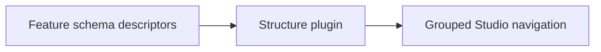

# Sanity Structure Plugin

The Vyuh structure plugin (`@vyuh/sanity-plugin-structure`) is a powerful tool
that helps you organize and combine Sanity schemas from multiple features into a
unified master schema. This guide explains how to use the plugin effectively.

## Overview

When building a Vyuh application, each feature defines its schemas and exports
them using the `FeatureDescriptor` class from `@vyuh/sanity-schema-core`. This
approach ensures:

1. Consistent schema organization across features
2. Type-safe schema definitions
3. Automatic schema registration and combination
4. Automatic categorization of schemas by feature in the Desk Structure

The Vyuh structure plugin reads the `FeatureDescriptor` instances and assembles
them into a single schema that can be used in your Sanity Studio, with automatic
grouping of schemas by feature.



## Installation

Install the plugin package in your Sanity Studio project:

```bash
cd my-sanity-studio
pnpm add @vyuh/sanity-plugin-structure
```

Install the core schema package in your features:

```bash
cd features/my-feature
pnpm add @vyuh/sanity-schema-core
```

These packages provide:

- `@vyuh/sanity-schema-core`: Core utilities for defining and organizing Sanity
  schemas, including the `FeatureDescriptor` class
- `@vyuh/sanity-plugin-structure`: The Vyuh structure plugin that combines and
  organizes your feature schemas

::: tip Using pnpm Workspaces
Consider using pnpm workspaces to better organize your Sanity Studio and feature
packages:

```yaml
# pnpm-workspace.yaml
packages:
  - 'studio'
  - 'features/*'
```

This setup allows you to keep all feature packages and studio in one repository,
share dependencies across packages, use consistent versioning, and run commands
across all packages.
:::

## Using FeatureDescriptor

### Basic Structure

Each feature exports its schemas using a `FeatureDescriptor` instance:

```typescript
import {
  BuiltContentSchemaBuilder,
  FeatureDescriptor,
} from '@vyuh/sanity-schema-core'
import { conference } from './documents/conference'
import { session } from './documents/session'
import { speaker } from './documents/speaker'

export const conf = new FeatureDescriptor({
  name: 'conf',
  title: 'Conference Feature',
  description: 'Conference management feature',
  contentSchemaBuilders: [
    new BuiltContentSchemaBuilder(conference),
    new BuiltContentSchemaBuilder(session),
    new BuiltContentSchemaBuilder(speaker),
  ],
})
```

### Feature Descriptor Properties

The `FeatureDescriptor` accepts these key properties:

- `name`: Unique identifier for the feature
- `title`: Display name for the feature
- `description`: Optional description
- `contents`: Array of content descriptors that extend content items with
  additional capabilities (layouts, validations, etc.)
- `contentSchemaBuilders`: Array of schema builders that define the actual
  schema types and their structure

::: tip Additional Properties
`FeatureDescriptor` also supports the following advanced properties:

- `contentModifiers`: Schema type definitions that modify content schemas
- `contentSchemaModifiers`: Functions that can modify content schemas
- `actions`: Schema definitions for feature-specific actions
- `conditions`: Schema definitions for feature-specific conditions
- `analyticsContexts`: Schema definitions for analytics contexts
:::

### Customizing Content Descriptors

To add custom layouts to a content type:

```typescript
import { ContentDescriptor } from '@vyuh/sanity-schema-core'
import { conferenceLayout } from './layouts/conference'

class ConferenceDescriptor extends ContentDescriptor {
  constructor(props: Partial<ConferenceDescriptor>) {
    super('conf.conference', props)
  }
}

export const conf = new FeatureDescriptor({
  name: 'conf',
  title: 'Conference Feature',
  contents: [
    new ConferenceDescriptor({
      layouts: [conferenceLayout],
    }),
  ],
  contentSchemaBuilders: [
    new BuiltContentSchemaBuilder(conference),
  ],
})
```

### Schema Registration

In your Sanity configuration, register your features using the `vyuh` plugin:

```typescript
import { defineConfig } from 'sanity'
import { vyuh } from '@vyuh/sanity-plugin-structure'
import { conf } from './features/conference'
import { blog } from './features/blog'

export default defineConfig([
  {
    name: 'default',
    title: 'My Vyuh Studio',
    basePath: '/',
    projectId: 'your-project-id',
    dataset: 'production',

    plugins: [
      vyuh({
        features: [conf, blog],
      }),
    ],
  },
])
```

::: info
The `vision` and `media` plugins are also included with the vyuh plugin.
:::

## Best Practices

1. **Feature Namespacing**: Prefix schema types with the feature name (e.g.,
   `conf.session`)
2. **Type Safety**: Use TypeScript for schema definitions using the core types
   from Sanity such as `defineType`, `defineField`, etc.
3. **Modular Organization**: Keep related schemas together in feature packages
4. **Documentation**: Include descriptions for fields and types

## Summary

The Vyuh Structure Plugin automates the assembly and organization of Sanity
schemas from multiple features into a unified studio. By using
`FeatureDescriptor` instances and the `vyuh()` plugin, you get consistent schema
organization, automatic categorization in the desk structure, and a scalable
approach to managing schemas across your application.
