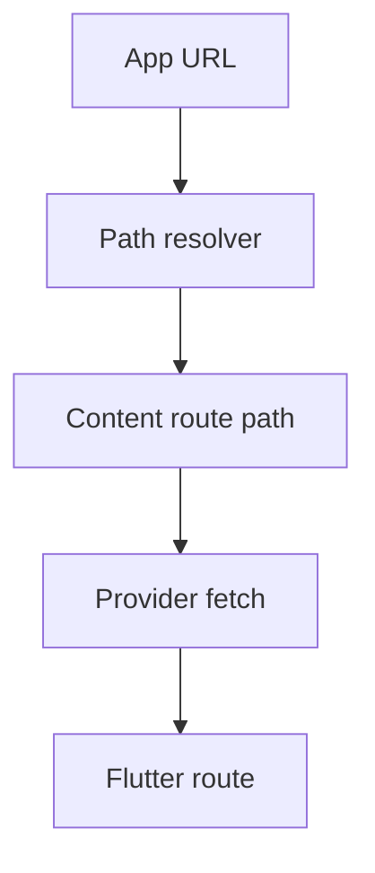

# Template Routes

Routes in the Vyuh Framework allow you to define the structure of a page or a
dialog. The structure of a route is put together by assembling a set of content
items from the framework. These routes also have an equivalent on the Flutter
side, where they are rendered using `GoRouter`. Thus an application route like
`/home` can have a CMS route with the same path that defines the structure of
the page.



## TL;DR

Template routes are set up using the custom **`CMSRoute`** with a
**`cmsPathResolver`** parameter. This resolver function takes in an application
route path and maps it to a CMS path.

```dart
CMSRoute(
  path: '/wonderous/wonder/:wonder([^/]+)',
  redirect: (_, state) {
    if (state.topRoute?.path == null) {
      return '${state.matchedLocation}/details';
    }
    return '${state.matchedLocation}/${state.topRoute!.path}';
  },
  routes: [
    StatefulShellRoute.indexedStack(
      branches: [
        StatefulShellBranch(
          routes: [
            CMSRoute(path: 'details',
                cmsPathResolver: wonderPathResolver),
          ],
        ),
        StatefulShellBranch(
          routes: [
            CMSRoute(path: 'events',
                cmsPathResolver: wonderPathResolver),
          ],
        ),
        StatefulShellBranch(
          routes: [
            CMSRoute(path: 'photos',
                cmsPathResolver: wonderPathResolver),
          ],
        ),
      ],
      builder: (context, __, shell) {
        // ... construct the Scaffold with bottom navigation ...
      },
    ),
  ],
)

// Resolver
String wonderPathResolver(String path) {
  return switch (path) {
    (String x) when x.contains(RegExp(r'/wonder/[^/]+/details')) =>
      '/wonderous/wonder/details',
    (String x) when x.contains(RegExp(r'/wonder/[^/]+/events')) =>
      '/wonderous/wonder/events',
    (String x) when x.contains(RegExp(r'/wonder/[^/]+/photos')) =>
      '/wonderous/wonder/photos',
    _ => path
  };
}
```

## Why Do We Need This?

When you start out, you will most likely create a 1:1 mapping between an
application route and a CMS route. But over time, there will be more complex
scenarios where multiple application routes can map to the same CMS route and
provide the same structure. For example, you could have multiple restaurant
detail pages where the ID of the restaurant determines the data, but the
structure of the detail page is exactly the same across all restaurants.

This style of mapping multiple application routes to a single CMS route is
referred to as a **Template Route**.

::: info Template?
The **template** here refers to the route structure which remains the same
across all these application routes.
:::

By leveraging template routes, you reduce the number of CMS routes you have to
create. Reusability is far better than duplication, and template routes allow you
to achieve that elegantly.

## Template Routes in Practice

Consider an app that shows different "wonders of the world." The structure of
every wonder page is the same. Instead of creating separate pages for each
wonder, create a single structural page that acts as the CMS route for all
wonders.

### CMS Routes

Since the structure of the details page, photos page, and events page is the
same, create separate routes on the CMS with paths ending in `/wonder/details`,
`/wonder/events`, and `/wonder/photos`. These are CMS template routes.

::: info
If you were duplicating this across wonders, you would have to include the
wonder identifier in the path itself (e.g.,
`/wonderous/wonder/taj-mahal/details`). Doing this for every wonder would be
cumbersome and unnecessary duplication.
:::

### Application Routes

Each wonder has a specific **identifier** that helps identify it on the CMS. The
application route includes this identifier in the path and maps to the CMS
template route.

The mapping from the application route to the CMS route happens in the
**`CMSRoute`** with a custom **`cmsPathResolver`**:

```dart
Future<List<RouteBase>> routes() async {
  return [
    CMSRoute(path: '/wonderous'),
    CMSRoute(
      path: '/wonderous/wonder/:wonder([^/]+)',
      redirect: (_, state) {
        if (state.topRoute?.path == null) {
          return '${state.matchedLocation}/details';
        }
        return '${state.matchedLocation}/${state.topRoute!.path}';
      },
      routes: [
        StatefulShellRoute.indexedStack(
          branches: [
            StatefulShellBranch(
              routes: [
                CMSRoute(path: 'details',
                    cmsPathResolver: wonderPathResolver),
              ],
            ),
            StatefulShellBranch(
              routes: [
                CMSRoute(path: 'events',
                    cmsPathResolver: wonderPathResolver),
              ],
            ),
            StatefulShellBranch(
              routes: [
                CMSRoute(path: 'photos',
                    cmsPathResolver: wonderPathResolver),
              ],
            ),
          ],
          builder: (context, __, shell) {
            // ... construct the Scaffold with bottom navigation ...
          },
        ),
      ],
    ),
  ];
}

String wonderPathResolver(String path) {
  return switch (path) {
    (String x) when x.contains(RegExp(r'/wonder/[^/]+/details')) =>
      '/wonderous/wonder/details',
    (String x) when x.contains(RegExp(r'/wonder/[^/]+/events')) =>
      '/wonderous/wonder/events',
    (String x) when x.contains(RegExp(r'/wonder/[^/]+/photos')) =>
      '/wonderous/wonder/photos',
    _ => path
  };
}
```

The Regular Expression (RegExp) checks that an identifier exists in the
application route path and then maps to the corresponding CMS path.

| Application Route Path                | CMS Route Path                |
| ------------------------------------- | ----------------------------- |
| /wonderous/wonder/taj-mahal/details   | /wonderous/wonder/details     |
| /wonderous/wonder/great-wall/events   | /wonderous/wonder/events      |
| /wonderous/wonder/machu-picchu/photos | /wonderous/wonder/photos      |

## Summary

Template routes are a great way to simplify the management of common application
routes that all have the same visual structure.

By assigning all of them to the same CMS route, you can ensure there is no
duplication. It is however necessary that you do this mapping by using the
**`CMSRoute`** with a custom **`cmsPathResolver`**. Doing so gives you
flexibility in managing the routes in your application.

Ask this question if you need a **Template Route**: same visual structure across
various parameterized application routes? If yes, create a `CMSRoute` with a
`cmsPathResolver` and you are good to go.
