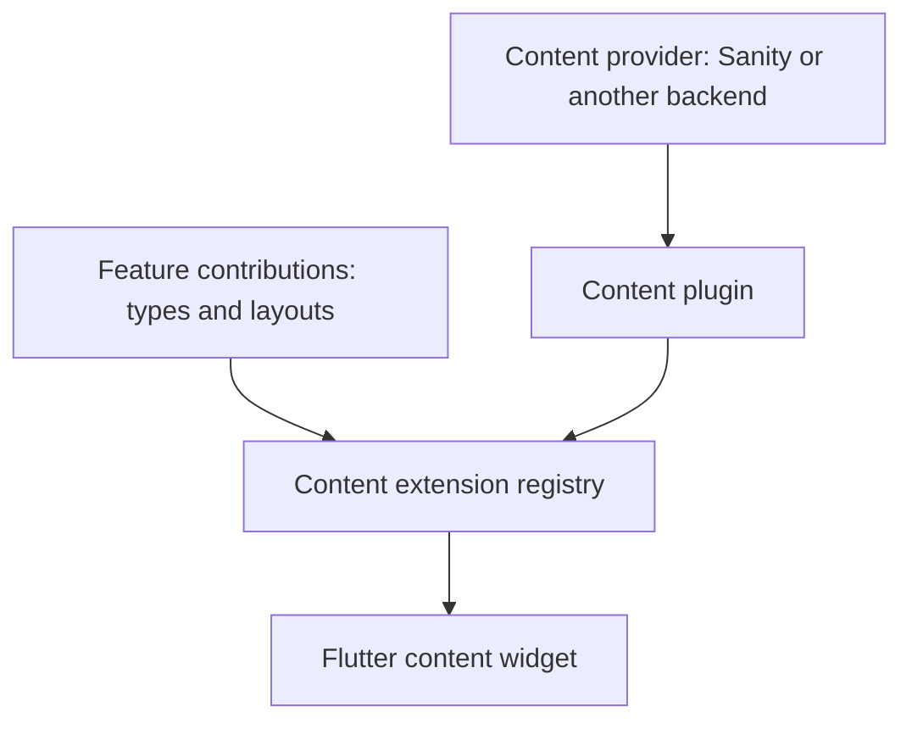

# CMS Integration

Add this capability when editors need to manage content, configured layouts, or content-backed routes. Your app still composes features and plugins; the content system supplies an optional path from structured data to registered Flutter UI.

## Understand the content system

Start with [the content pipeline](/cms/content-pipeline), then implement [content types](/cms/guides/content-types), [layouts](/cms/guides/layouts), [actions](/cms/guides/actions), [conditions](/cms/guides/conditions), and [modifiers](/cms/guides/modifiers). [API content](/cms/guides/api-content) connects configured content to external data.

[Integration scaffolding](scaffolding) covers the CLI’s managed project and schema templates. [Content feature flags](feature-flags) and [document scopes](scoped-di) cover configured behavior.

## Set up authoring

Use [Sanity setup](/cms/guides/setting-up-sanity) and [schema design](/cms/guides/designing-content-schemas) to keep authoring contracts aligned with your Dart models. [Previews](/cms/guides/content-previews), [live editing](/cms/guides/live-content-editing), and [Studio structure](/cms/guides/sanity-structure-plugin) cover the editing experience.

## Choose the packages

The [content API catalog](api) groups the extension, system content feature, provider, client, embedded content, and schema contracts. Each package overview links to its complete declarations and members.

## Explore content routing and examples last

[Conditional routes](/cms/guides/conditional-routes) select a route from a condition result. [Template routes](/cms/guides/template-routes) reuse a managed layout for different data. Study [Food](/cms/examples/food), [Puzzles](/cms/examples/puzzles), [Conference](/cms/examples/conference), [Movies](/cms/examples/movies), and [Wonderous](/cms/examples/wonderous) for complete integrations.
