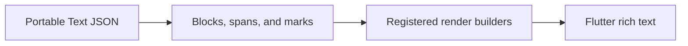

# Flutter Sanity Portable Text

Deserialize Portable Text blocks and spans, then render with registered block and mark builders. Configuration determines styling and the supported inline or embedded content.



[Browse every public declaration and member](/cms/api/flutter-sanity-portable-text).


<PubBadge package="flutter_sanity_portable_text" />

The `flutter_sanity_portable_text` package provides a Flutter renderer for the [Portable Text](https://github.com/portabletext/portabletext) format used by Sanity.io. It supports standard and custom blocks, spans, annotations, and styles.

## Overview

Portable Text is an open specification for rich text content, designed to be a universal standard for structured rich text. This package renders Portable Text content as native Flutter widgets, giving you full control over the presentation of rich text from your CMS.

## Key Features

- **Standard block rendering** -- Headings, paragraphs, lists, and block quotes
- **Custom blocks** -- Register custom block types with their own renderers
- **Span decorators** -- Bold, italic, underline, strikethrough, and custom decorators
- **Annotations** -- Links, references, and custom annotation types
- **Custom styles** -- Override default text styles for any block or span type
- **Extensible** -- Add your own block types, span types, and annotation handlers

## Usage

```dart
import 'package:flutter_sanity_portable_text/flutter_sanity_portable_text.dart';

final blocks = <PortableBlockItem>[
  TextBlockItem(
    style: 'normal',
    children: [Span(text: 'A paragraph rendered in Flutter.')],
  ),
];

// Widget fragment: include this in your build method.
PortableText(blocks: blocks)
```

## Supported Block Types

- **Normal text** -- Standard paragraphs
- **Headings** -- H1 through H6
- **Block quotes** -- Quoted content
- **Lists** -- Bulleted and numbered lists
- **Custom blocks** -- Any custom block type you define in your CMS schema

## Integration with Vyuh

Configure styles, custom blocks, containers, and marks through `PortableTextConfig.shared`. The `PortableText` widget accepts `blocks` and an optional `listBuilder`; it does not take `blockRenderers` or `annotationHandlers`.

The current `vyuh_core` package depends on this renderer library. That dependency does not select a CMS backend or activate the content system. The optional `vyuh_feature_system` package contributes a content item that uses it to render managed rich text.

## Links

- [pub.dev](https://pub.dev/packages/flutter_sanity_portable_text)
- [GitHub Source](https://github.com/vyuh-tech/vyuh/tree/main/packages/sanity/flutter_sanity_portable_text)
- [Portable Text Specification](https://github.com/portabletext/portabletext)
