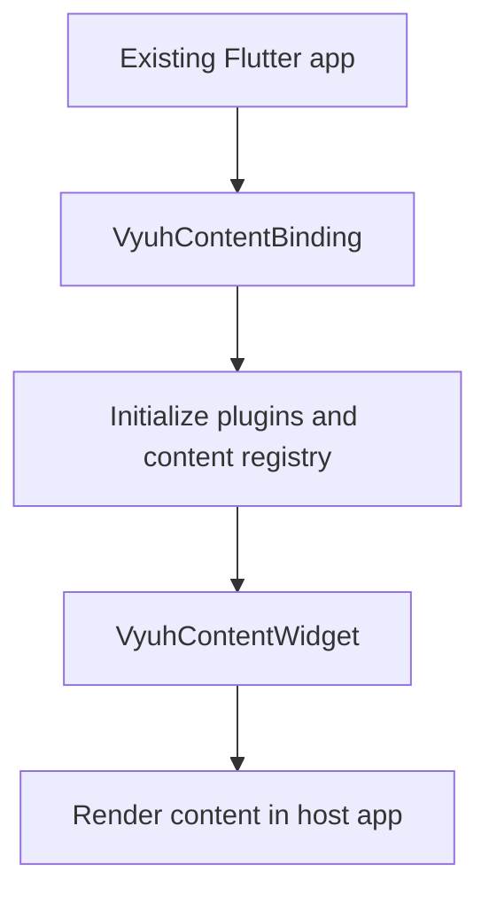

# Vyuh Content Widget

Embed framework content in an existing Flutter app using VyuhContentBinding and VyuhContentWidget. Initialize the binding before Flutter runApp, await widgetReady for service access, and use your host app for navigation ownership.



[Browse every public declaration and member](/cms/api/vyuh-content-widget).


<PubBadge package="vyuh_content_widget" />

The `vyuh_content_widget` package provides a lightweight widget that can render content from a CMS, relying on the Vyuh ecosystem to provide the content. This is ideal for teams that want to embed CMS-driven content into an existing Flutter app without adopting the full Vyuh Framework.

## Overview

Not every app needs the full Vyuh Framework with its feature system, routing, and plugin architecture. Sometimes you just want to drop a CMS-powered widget into your existing Flutter application. That is exactly what `vyuh_content_widget` provides.

## Key Features

- **Lightweight integration** -- Add CMS-driven content without restructuring your app
- **Content rendering** -- Render structured content items from a CMS
- **Type-safe** -- Full type safety for content deserialization
- **Customizable** -- Provide your own layouts and content builders

## Dependencies

- `vyuh_core` -- Core types and runtime
- `vyuh_extension_content` -- Content type system

## Usage

```dart
import 'package:vyuh_content_widget/vyuh_content_widget.dart';

// Use the VyuhContentWidget to render CMS content
// in any part of your existing Flutter app
class MyExistingApp extends StatelessWidget {
  @override
  Widget build(BuildContext context) {
    return MaterialApp(
      home: Scaffold(
        body: VyuhContentWidget(
          query: '*[_type == "myContent"][0]',
        ),
      ),
    );
  }
}
```

## When to Use

Use `vyuh_content_widget` when you:

- Have an existing Flutter app and want to add CMS-driven content
- Need a lightweight solution without the full framework
- Want to gradually adopt the Vyuh ecosystem
- Need to embed dynamic content in specific parts of your app

Use [core app composition](/intro/compose-features) when Vyuh should own feature assembly and routing. Use this binding when an existing app retains those responsibilities and embeds only the optional content capability.

## Links

- [pub.dev](https://pub.dev/packages/vyuh_content_widget)
- [GitHub Source](https://github.com/vyuh-tech/vyuh/tree/main/packages/system/vyuh_content_widget)
