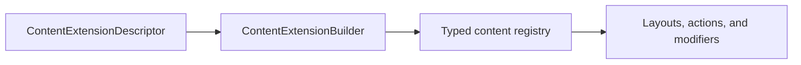

# Vyuh Extension Content

Register content and configuration types through ContentExtensionDescriptor and ContentExtensionBuilder. DefaultContentPlugin deserializes registered types, selects layouts, applies modifiers, and builds routes. Actions execute configurations; conditions produce string values for case matching.



[Browse every public declaration and member](/cms/api/vyuh-extension-content).


<PubBadge package="vyuh_extension_content" />

This package provides the core types for integrating with a headless CMS, which includes the Content plugin, the CMS building blocks, and the UI for rendering a route from a CMS.

`vyuh_core` has no CMS types. Everything about content lives here: `ContentItem`, `LayoutConfiguration`, `ContentModifierConfiguration`, `TypeDescriptor`, `ContentPlugin`, `ContentProvider`, the `ObjectReference`/`ImageReference`/`FileReference` types, `RouteBase`, `ContentFailure`, `CMSRoute` and `defaultRoutePageBuilder`.

## Adding the CMS to an app

The content plugin is an ordinary plugin. Register it in `others`, and add the system feature, which brings the CMS routes:

```dart
import 'package:vyuh_core/vyuh_core.dart' as vc;
import 'package:vyuh_extension_content/vyuh_extension_content.dart';
import 'package:vyuh_feature_system/vyuh_feature_system.dart' as system;

void main() {
  vc.runApp(
    plugins: vc.PluginDescriptor(
      others: [DefaultContentPlugin(provider: myContentProvider)],
    ),
    features: () => [system.feature, myFeature],
  );
}
```

- **`vyuh.content`** and **`VyuhBinding.instance.content`** are extensions from this package. Import it wherever you use them. When no content plugin is registered they return a `NoOpContentPlugin`, which shows an error view that explains how to configure one.
- **Unmatched URLs.** `cmsFallbackRoute` is a catch-all route (`NavigationPlugin.catchAllPath`) that asks the CMS for any location no other route matches. The system feature contributes it. The router always places a catch-all route last. Without it, unmatched locations show the framework's not-found page.
- **Missing types.** When a content type, layout, modifier, action or condition isn't registered, the plugin shows `UnknownContentView`. Replace it with `DefaultContentPlugin(unknown: (context, failure) => ...)`.

## Content Plugin

This is the default implementation for the `ContentPlugin`, and it works with a `ContentProvider` to do most of the heavy lifting. The `ContentPlugin` maintains the type registry of all the content items that will be fetched from the CMS, whereas the `ContentProvider` takes care of fetching a single route or fetching specific documents from the headless CMS.

## Descriptor and Builder

This includes the `ContentDescriptor` and the `ContentBuilder` pair that knows how to assemble a content-item once fetched from the CMS. The builder takes care of building a type-registry by assembling the various content-descriptors across the features, allowing the builder to supply a visual representation for the content item at the time of rendering.

Additionally, this package also includes the `ContentExtensionDescriptor` and the `ContentExtensionBuilder` that allows you to manage the content extensions for your App. Every feature that needs to get its content items fetched from a CMS will use a `ContentExtensionDescriptor` to supply all the details of the content items.

## Core Types

Expands the set of core types for Content driven apps by adding `Action` and `Condition` types.

## Key APIs

### ContentExtensionDescriptor

Used within a `FeatureDescriptor` to register content builders for your feature:

```dart
final feature = FeatureDescriptor(
  name: 'my_feature',
  title: 'My Feature',
  routes: routes,
  extensions: [
    ContentExtensionDescriptor(
      contentBuilders: [
        MyCustomContent.contentBuilder,
      ],
    ),
  ],
);
```

### ContentBuilder

Defines how a content type is built and rendered:

```dart
ContentBuilder<MyContent>(
  content: MyContent.typeDescriptor,
  defaultLayout: MyContentDefaultLayout(),
  defaultLayoutDescriptor: MyContentDefaultLayout.typeDescriptor,
)
```

### ContentItem

The base class for all content items fetched from the CMS. Custom content types extend this class and provide JSON deserialization.

## Links

- [pub.dev](https://pub.dev/packages/vyuh_extension_content)
- [GitHub Source](https://github.com/vyuh-tech/vyuh/tree/main/packages/system/vyuh_extension_content)

## Document request lifecycle

`DocumentFutureBuilder` fetches again when its callback changes; an older completion cannot replace the current request. Synchronous callback failures appear in the error view.

`DocumentStreamBuilder(stream: ...)` subscribes to a supplied stream once and renders stream errors. Use `DocumentStreamBuilder.refreshable(streamFactory: ...)` for refresh and retry, with a factory that returns a fresh stream. `DocumentBuilder` similarly accepts `liveDocumentFactory`; its query, ID, and route constructors use fresh live subscriptions for retries. A directly supplied `liveDocument` remains subscribed across unrelated parent rebuilds.
