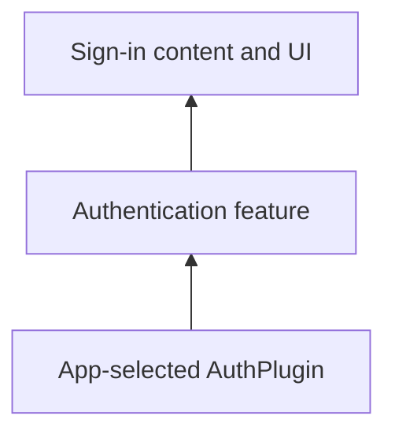

# Vyuh Feature Auth

Authentication UI and content configurations consume the AuthPlugin capability. Include the feature and an appropriate auth provider to support the sign-in methods your app exposes.



[Browse every public declaration and member](/cms/api/vyuh-feature-auth).


<PubBadge package="vyuh_feature_auth" />

The `vyuh_feature_auth` package provides the Auth feature for your Vyuh project. It includes pre-built authentication UI components and flows that integrate with Vyuh's authentication plugin system, giving you ready-to-use login, registration, and account management screens.

## Overview

This feature provides a complete authentication experience out of the box, including:

- **Login flows** -- Email/password, phone OTP, and OAuth-based sign-in
- **Registration** -- User sign-up with form validation
- **Password management** -- Forgot password and reset flows
- **OAuth integration** -- Support for third-party providers (Google, Apple, GitHub, etc.)
- **CMS-configurable UI** -- Authentication screens and flows can be configured from your CMS

## Key Dependencies

The feature builds on top of several Vyuh packages:

- `vyuh_core` -- For the plugin system and authentication plugin interface
- `vyuh_feature_system` -- For standard content items and layouts
- `vyuh_extension_content` -- For CMS integration of auth content types
- `flutter_form_builder` -- For form handling and validation
- `font_awesome_flutter` -- For OAuth provider icons

## Usage

Add the auth feature to your app's feature list:

```dart
import 'package:vyuh_feature_auth/vyuh_feature_auth.dart' as auth;

void main() {
  vyuh.runApp(
    features: () => [
      system.feature,
      auth.feature(),
      // ... other features
    ],
  );
}
```

The feature automatically registers its routes and content types. Authentication screens are accessible via the standard Vyuh navigation system.

## CMS Integration

The auth feature includes Sanity schema types that allow you to configure authentication flows from the CMS. This includes:

- Choosing which OAuth providers to display
- Customizing the login/registration page content
- Setting up conditional routing based on authentication state

## Links

- [pub.dev](https://pub.dev/packages/vyuh_feature_auth)
- [GitHub Source](https://github.com/vyuh-tech/vyuh/tree/main/packages/system/vyuh_feature_auth)
