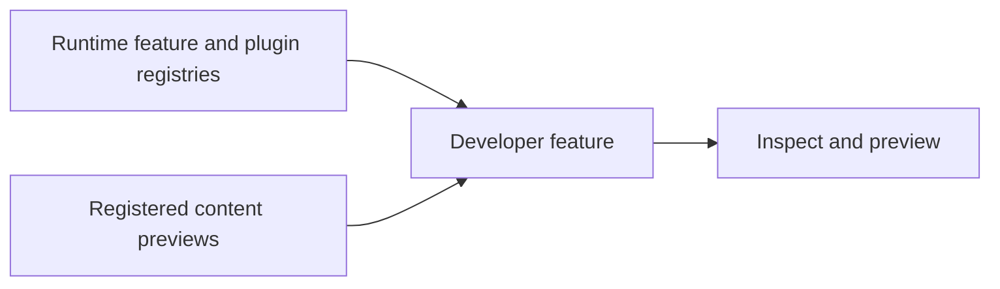

# Vyuh Feature Developer

Developer tools inspect registered features, plugins, content types, and previews. Include the feature during development and follow the preview guide when exposing content to the playground.



[Browse every public declaration and member](/cms/api/vyuh-feature-developer).


<PubBadge package="vyuh_feature_developer" />

Once you start building larger apps, it is useful to see how the App was put together and explore its details. This is the purpose of the _Developer Tools_ feature, which gives you this breakdown, organized by features and plugins.

## Overview

The Developer Tools feature shows you all the features and goes into details about the various elements exposed by each feature. This is a great way to verify that the right configurations have been exposed.

When you describe your Feature with the `FeatureDescriptor`, make sure to add proper `title`, `icon` and `description`. This will be used when rendering it inside the Developer Tool. For example, this is how the System feature has been declared:

```dart
final feature = FeatureDescriptor(
  name: 'system',
  title: 'System',
  description: 'The core building blocks of the framework',
  icon: Icons.hub,
  // ... rest of the fields ...
);
```

## Features

- **Feature Explorer** -- Browse all registered features and their metadata
- **Plugin Inspector** -- Drill down into plugins and see their contained elements, especially useful for the Content and Analytics plugins
- **Extension Viewer** -- View extension descriptors and content builders registered by each feature
- **Route Inspector** -- Inspect the route configurations across features

::: tip
In future versions, the Developer Tools will be made more extensible, allowing every feature and plugin to provide its own information views in addition to the standard details.
:::

## Usage

Add the developer feature to your app:

```dart
import 'package:vyuh_feature_developer/vyuh_feature_developer.dart' as developer;

void main() {
  vyuh.runApp(
    features: () => [
      system.feature,
      developer.feature,
      // ... other features
    ],
  );
}
```

## Links

- [pub.dev](https://pub.dev/packages/vyuh_feature_developer)
- [GitHub Source](https://github.com/vyuh-tech/vyuh/tree/main/packages/system/vyuh_feature_developer)
