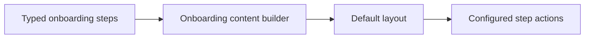

# Vyuh Feature Onboarding

The onboarding feature supplies a content type, step data, and a default layout. It composes text, imagery, and actions using the normal content extension pipeline.



[Browse every public declaration and member](/cms/api/vyuh-feature-onboarding).


<PubBadge package="vyuh_feature_onboarding" />

The `vyuh_feature_onboarding` package provides an onboarding experience feature for Vyuh apps. It enables you to create multi-step onboarding flows that can be configured and managed from the CMS.

## Overview

Onboarding is one of the first experiences a user has with your app. This feature provides:

- **CMS-driven onboarding pages** -- Define and update onboarding content from the CMS without app updates
- **Multi-step flows** -- Create multi-page onboarding sequences with progress indicators
- **Rich content support** -- Each onboarding step supports Portable Text, images, and other content items
- **Navigation control** -- Skip, next, and complete actions for user-driven progression

## Key Dependencies

- `vyuh_core` -- Core framework types and runtime
- `vyuh_feature_system` -- Standard content items and layouts
- `vyuh_extension_content` -- CMS content integration
- `flutter_sanity_portable_text` -- Rich text rendering for onboarding content

## Usage

Add the onboarding feature to your app's feature list:

```dart
import 'package:vyuh_feature_onboarding/vyuh_feature_onboarding.dart' as onboarding;

void main() {
  vyuh.runApp(
    features: () => [
      system.feature,
      onboarding.feature,
      // ... other features
    ],
  );
}
```

## CMS Configuration

Onboarding steps are configured as structured content in the CMS. Each step can include:

- Title and description text
- Rich content using Portable Text
- Images and media
- Navigation actions (next, skip, complete)

This allows Business teams to update the onboarding experience without requiring a new app release.

## Links

- [pub.dev](https://pub.dev/packages/vyuh_feature_onboarding)
- [GitHub Source](https://github.com/vyuh-tech/vyuh/tree/main/packages/system/vyuh_feature_onboarding)
