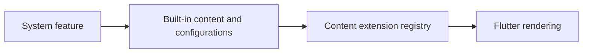

# Vyuh Feature System

The system feature contributes built-in content blocks, route types, layouts, actions, conditions, and responsive/theme services. Include its feature descriptor when your application consumes those types; importing a type alone does not register it.

[Browse every public declaration and member](/cms/api/vyuh-feature-system).

<PubBadge package="vyuh_feature_system" />

This is a system level feature that is needed for all Vyuh Apps. It includes the fundamental blocks for rendering **Content Items** and **Routes**, handling **Actions**, branching based on **Conditions** and switching between different **Layouts** for content items.

## Content Items

Content Items, also known as _Structured Content Blocks_, represent the visual and information blocks used in an Application. These blocks can be configured on the CMS and have a visual equivalent rendered with Flutter. The default layouts are provided, but they are completely customizable with custom layouts.

The System feature includes core elements such as:

### Card

One of the most versatile content blocks in Vyuh. A card has a `title`, `description` and `image` as its primary properties. It also includes a primary `action` that is triggered on a tap or click, along with secondary and tertiary actions for advanced use cases.

### Group

Represents a collection of items such as a list, carousel or other kinds of related items that are shown together visually. It includes a `title`, `description` and the `items` field which can include an arbitrary combination of content-items.

### API Content

Allows you to render content from a third-party API with rich customizations on the display. It relies on a specific `configuration` that represents the type of API that will be invoked along with any custom display properties.

### Conditional

Allows you to use a Condition at runtime to decide the type of Content Item to show. You can define multiple `cases` for the condition and their corresponding content items.

### Portable Text

Renders text using the [Portable Text](https://github.com/portabletext/portabletext) specification. It allows the use of custom blocks, styles and annotations for a highly customized rich text display.

### Divider

Represents a logical divider between content items. It renders as a line by default and allows separating sections of content in your page.

### Accordion

A group of `items` that each have their own title and set of content items. It renders as a set of collapsible items that can be expanded to show content.

### Video Player

A video-player that plays a video from a Network URL with an optional `title`. You can control aspects such as autoplay, looping and muting the volume.

### Empty

Useful when you don't want to show anything. Generally used in the context of a Conditional as a content-item for the false value.

### Unknown

A special type of content used only by the system to represent exceptional situations, especially when there is a missing type registration for an item. It is not meant to be used directly.

## Routes

Routes represent individual pages or screens of content. When creating a user journey, you would create several routes and link them together. The system feature includes two kinds of routes:

- **Page** -- A full screen of content
- **Dialog** -- A modal overlay of content

### Conditional Routes

A special type of Route that allows branching between two or more routes based on a condition. Conditions are configured on the CMS and evaluated at runtime.

## Layouts

Layouts represent different ways of rendering a Content Item. Every content item can have one or more layouts along with a default layout:

- **Card** -- Default, Button, List Item
- **Group** -- Default, Carousel, Grid, Vertical List
- **Portable Text** -- Default
- **Accordion** -- Default
- **Divider** -- Default
- **Empty** -- Default
- **Unknown** -- Default
- **API Content** -- Default
- **Route** -- Default, Tabs, Single Item
- **Conditional Route** -- Default

::: tip API Configurations
**API Content** supports custom _API Configurations_ to work with any 3rd Party API. By default it includes a JSONPath-based configuration for quick testing of APIs with the ability to set endpoint URLs, request-headers and do a JSONPath-based mapping to render as a single Card or a list of Cards. Custom API Configurations can choose to talk to a specific API with more complex setup and rendering.
:::

## Actions

Actions allow you to invoke specific operations based on certain user or system events:

- Navigate to a URL or a Route
- Navigate Back
- Show Alert
- Delay
- Open/Close Drawer
- Open/Close End-Drawer
- Open a route in a Dialog
- Open URL in a platform-specific App
- Refresh a Route
- Restart the Vyuh Application
- Show/Hide a SnackBar
- Toggle Light/Dark Themes

## Conditions

Conditions are evaluated at runtime and result in one of many values:

- Simple Boolean
- Current Platform
- Current Theme
- Feature Flag
- Current Screen Size
- User Authenticated

## Links

- [pub.dev](https://pub.dev/packages/vyuh_feature_system)
- [GitHub Source](https://github.com/vyuh-tech/vyuh/tree/main/packages/system/vyuh_feature_system)
