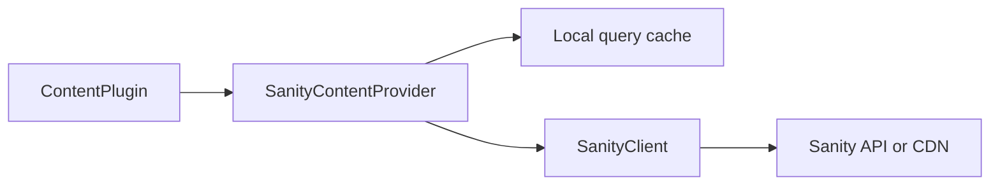

# Vyuh Plugin Content Provider Sanity

SanityContentProvider implements ContentProvider with query-response caching, typed conversion, route projections, media URLs, and a LiveContentProvider. useCache: false performs a fresh provider request; it does not invalidate Sanity CDN caches.



[Browse every public declaration and member](/cms/api/vyuh-plugin-content-provider-sanity).


<PubBadge package="vyuh_plugin_content_provider_sanity" />

This optional provider connects the content system to [Sanity.io](https://sanity.io). It fetches documents with GROQ and exposes them through the content-provider contract. The app explicitly selects this provider; core app composition does not require it.

## Overview

This package bridges the Vyuh content plugin system with Sanity.io. It implements the `ContentProvider` interface, handling all communication with the Sanity backend including document fetching, route resolution, and content caching.

Internally, the provider uses the <PubBadge package="sanity_client" /> for its configuration and makes connections to the Sanity CDN.

## Key Features

- **Route fetching** -- Resolves CMS routes to structured content for rendering
- **Document queries** -- Execute GROQ queries and deserialize results to Dart types
- **Built-in caching** -- Leverages `vyuh_cache` to reduce network calls
- **Image handling** -- Optimized image URL generation via Sanity's image pipeline
- **Live preview** -- Support for draft content and preview perspectives

## Configuration

```dart
import 'package:vyuh_plugin_content_provider_sanity/vyuh_plugin_content_provider_sanity.dart';

final contentProvider = SanityContentProvider.withConfig(
  config: SanityConfig(
    projectId: 'your-project-id',
    dataset: 'production',
    perspective: Perspective.previewDrafts,
    useCdn: false,
    token: 'your-token',
  ),
  cacheDuration: const Duration(seconds: 5),
);
```

## Usage with Vyuh

Register the Sanity content provider as part of the plugin configuration:

```dart
void main() {
  vyuh.runApp(
    plugins: PluginDescriptor(
      others: [DefaultContentPlugin(
        provider: SanityContentProvider.withConfig(
          config: SanityConfig(
            projectId: 'your-project-id',
            dataset: 'production',
          ),
        ),
      )],
    ),
    features: () => [
      system.feature,
      // ... other features
    ],
  );
}
```

## Dependencies

- `sanity_client` -- Low-level Sanity API client
- `vyuh_core` -- Core framework types
- `vyuh_extension_content` -- The `ContentProvider` contract it implements
- `vyuh_cache` -- Caching layer for content responses
- `cached_network_image` -- Efficient image loading and caching

## Links

- [pub.dev](https://pub.dev/packages/vyuh_plugin_content_provider_sanity)
- [GitHub Source](https://github.com/vyuh-tech/vyuh/tree/main/packages/sanity/vyuh_plugin_content_provider_sanity)
- [Sanity.io](https://sanity.io)
