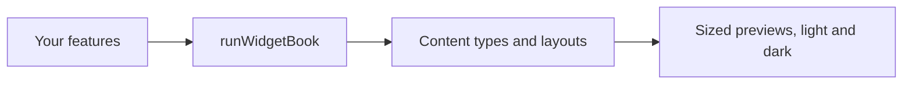

# Vyuh Widgetbook

`vyuh_widgetbook` previews your features' content types in
[Widgetbook](https://pub.dev/packages/widgetbook): each type, each of its
layouts, at different sizes, in light and dark themes, without a CMS.



[Browse every public declaration and member](/cms/api/vyuh-widgetbook).

<PubBadge package="vyuh_widgetbook" />

## Usage

Create a small Flutter app next to your features and start the book with the
same feature descriptors your app uses:

```dart
import 'package:vyuh_widgetbook/vyuh_widgetbook.dart';
import 'package:vyuh_feature_system/vyuh_feature_system.dart' as system;
import 'package:feature_catalog/feature_catalog.dart' as catalog;

void main() {
  runWidgetBook(
    features: () => [system.feature, catalog.feature],
    lightTheme: MyDesign.light,
    darkTheme: MyDesign.dark,
  );
}
```

A content type appears with sample data when its `TypeDescriptor` provides a
`preview`. See [content previews](/cms/guides/content-previews).

This is development tooling: the content registry your app uses at runtime
still comes from its features.
