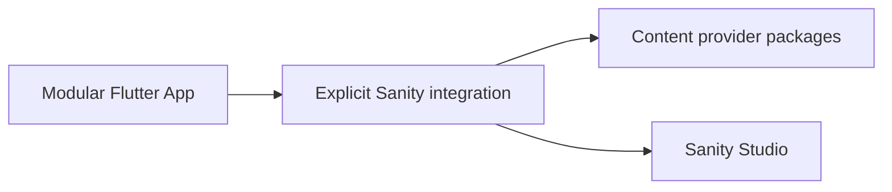

# CMS scaffolding

CMS integration is optional. The CLI’s default App, feature, and plugin scaffolds do not install a CMS. Begin with the [core CLI guide](/intro/cli) for those commands.

## Create an App with Sanity

```bash
vyuh create project shop --cms=sanity --org-name=com.acme
```

This explicit choice adds the Sanity client and content integration packages, then creates a Studio. It requires Flutter/Dart, Node/pnpm, and access to a Sanity account. Studio creation may prompt for account setup; review the selected project and dataset. After generation, configure the provider and authored content using [Sanity setup](guides/setting-up-sanity).



## Create authoring packages

```bash
vyuh create schema catalog --cms=sanity -o schemas
vyuh create item product --feature=feature_catalog
```

The schema command supports Sanity. The item command creates a ContentItem in the selected feature; it is a CMS-specific contribution, rather than a general feature or plugin scaffold. Install/configure the content extension before using those contributions.

## Check integration tooling

```bash
vyuh doctor --cms=sanity
vyuh create schema --help
vyuh create item --help
```

Plain `vyuh doctor` checks Flutter/Dart. Node/pnpm checks are added when Sanity is selected. Project scaffolding uses workspace-local Melos tooling; global Melos or a globally installed Sanity CLI are not required.
