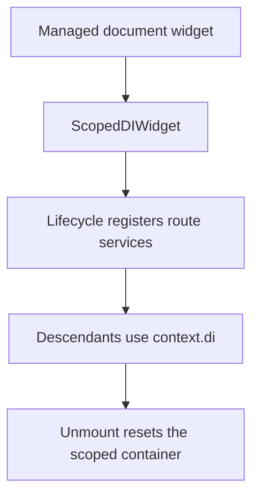

# Content route dependency scopes

The optional content extension provides `ScopedDIWidget` and the `BuildContext.di` extension. Document rendering creates a scope for route-local registrations and lifecycle configurations.

`context.di` selects the nearest scope. When there is no scoped widget ancestor it returns the platform’s DI container. A missing registration inside an existing scope does not fall back to global DI; it throws through that scope’s `get` operation.

Scope reset is scheduled when the widget disposes. Keep resource cleanup explicit in the lifecycle that owns those resources. See [ScopedDIWidget APIs](/cms/api/vyuh-extension-content#scopeddiwidget), [content routing](/cms/guides/conditional-routes), and [core DI](/guides/scoped-di).
