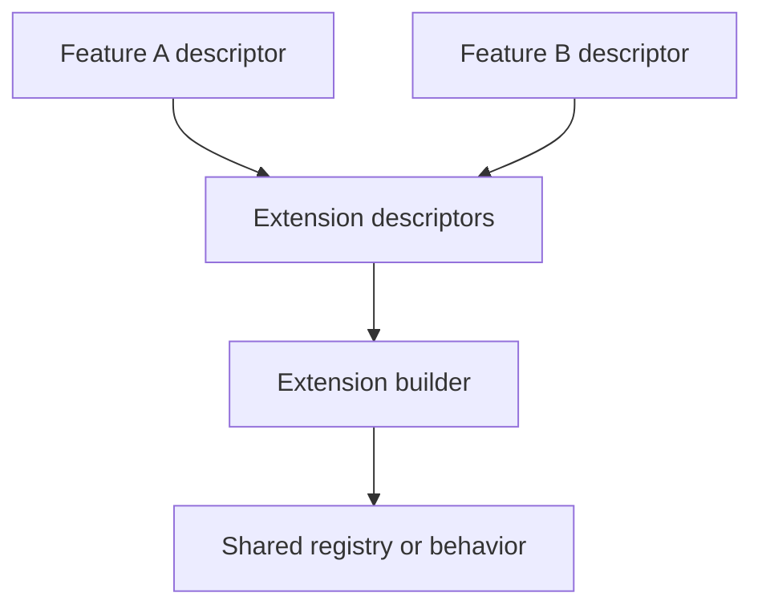

# Descriptors and builders

Descriptors declare what a feature contributes. Builders collect compatible contributions and turn them into a shared runtime system. This keeps each feature independent of the other contributing features.

## Descriptor responsibilities

A `FeatureDescriptor` declares metadata, dependencies, lifecycle hooks, routes, and extension contributions. An `ExtensionDescriptor` describes a contribution to a particular extension system. Its source feature is associated during registration so the runtime can identify ownership.

## Builder responsibilities

An `ExtensionBuilder` declares the extension type it handles. It receives the contributed descriptors during initialization, aggregates them, and owns its resulting behavior or registry. An app includes the builders needed by its features.

## Keep one owner

A feature owns its contribution. The builder owns aggregation. The app owns the selected composition. Avoid a second app-local registry that duplicates what a shared extension system already manages.

## Lifecycle

Initialize the shared capability before consuming its contributions. Dispose feature-owned state before disposing the builders and plugins it uses. For lazy features, a builder must support incremental registration if that extension system is expected to accept new contributions after startup.

See [extension APIs](/api/vyuh-core#extensionbuilder), [feature descriptors](/guides/feature-descriptors), and [startup and lifecycle](runtime-lifecycle).
