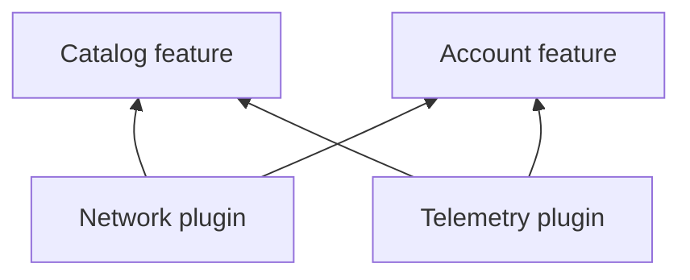
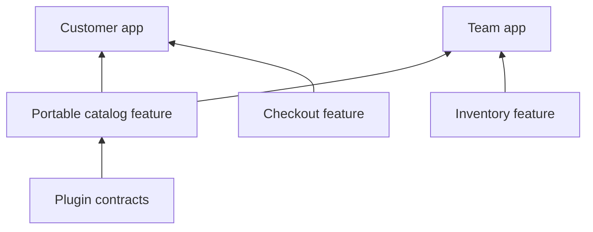

# Features and plugins

Vyuh separates shared capabilities from product behavior and app composition. Those boundaries let a product grow without requiring every team to work inside one application module.

<FrameworkLayers />

## Plugins: the capability layer

A plugin provides a service contract used by one or more features: logging, telemetry, network, authentication, storage, navigation, events, or dependency injection. The app chooses the concrete implementations through `PluginDescriptor`.

Features consume these contracts through the framework binding. They should not each create their own logger, HTTP client, auth session, or storage implementation when a shared capability already owns that behavior.



Multiple providers can contribute to capabilities such as telemetry and analytics. The top-level plugin remains the app’s shared contract; a provider supplies a specific backend within it.

## Features: a useful slice of your product

A feature groups routes, state, UI, initialization, dependencies, and extension contributions. Keep it in a Flutter package with a narrow public entry point. `FeatureDescriptor` describes what the package adds to the runtime.

A catalog feature can own browsing, item detail, catalog state, and domain models. Checkout can be a separate feature even when users navigate to it from catalog. Organize by coherent ownership, rather than copying an entire journey into every app.

```dart
// Descriptor fragment: the app supplies this alongside other features.
final catalog = FeatureDescriptor(
  name: 'catalog',
  title: 'Catalog',
  routes: catalogRoutes,
  init: initializeCatalog,
  dispose: disposeCatalog,
);
```

The fragment assumes your package defines its route builder and lifecycle hooks. The [quick start](/intro/get-started) contains a complete runnable example.

## Apps: compose a vertical solution

An app chooses a collection of feature descriptors and the plugin implementations supporting them. Keep app-specific routing, branding, and service configuration with that composition.



Reusing a feature means reusing the package and its declared public contributions. Moving an arbitrary private widget is not the same as moving a complete feature. If a smaller part needs independent reuse, expose a supported component or split that responsibility into its own package.

## Make portability deliberate

- Declare feature dependencies by their descriptor names, and include them in the app.
- Consume shared services through plugin contracts.
- Keep configuration and app-only assumptions outside the reusable package.
- Use stable public routes and contributions instead of another feature’s private implementation.
- Dispose feature-owned state and subscriptions in its lifecycle hook.

Continue with [descriptors and builders](descriptors-and-builders), [designing features](/guides/designing-features), [using plugins](/plugins/), and the [core API](/api/vyuh-core).
