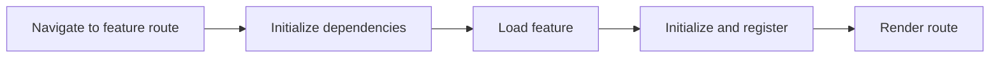

# Lazy features

## Why load a feature on demand?

A growing App may contain large areas a user never opens in a session. Lazy features defer initialization and extension registration until navigation needs them. On web, a loader using Dart deferred imports can also defer downloading that library. Simply wrapping a feature in a loader does not guarantee a smaller initial bundle.



## Declare the boundary

This fragment assumes a feature package exporting a descriptor named `feature`. Its descriptor name must match `catalog`. Supply the lazy descriptor through the App’s `lazyFeatures` configuration.

```dart
import 'package:vyuh_core/vyuh_core.dart';
import 'package:feature_catalog/feature_catalog.dart' deferred as catalog;

final lazyCatalog = LazyFeatureDescriptor(
  name: 'catalog',
  title: 'Catalog',
  routePrefixes: ['/catalog'],
  loader: () async {
    await catalog.loadLibrary();
    return catalog.feature;
  },
);
```

## Dependencies and concurrent navigation

Declare feature names in `dependencies` when another feature must be ready first. Missing dependencies and cycles are startup errors. Concurrent requests for the same lazy feature share its loading operation. Navigation preserves the requested URI, including query and fragment information.

## Failure and disposal

Failed activation restores route and extension registration state so a later attempt can retry. Custom extension builders must implement `captureLazyState` to participate in rollback. A feature’s disposal hook must clean up resources created during initialization; arbitrary external side effects cannot be automatically undone.

Disposal invalidates pending loaders and waits for activation already inside initialization to finish cleanup before releasing shared services. A late loader cannot activate a feature on a disposed platform.

## When to keep a feature eager

Keep common startup dependencies and frequently used first screens eager when deferring them would add latency without a useful benefit. Measure startup and first navigation separately before claiming a performance improvement.

See [LazyFeatureDescriptor API](/api/vyuh-core#lazyfeaturedescriptor) and [feature lifecycle](/concepts/runtime-lifecycle).
