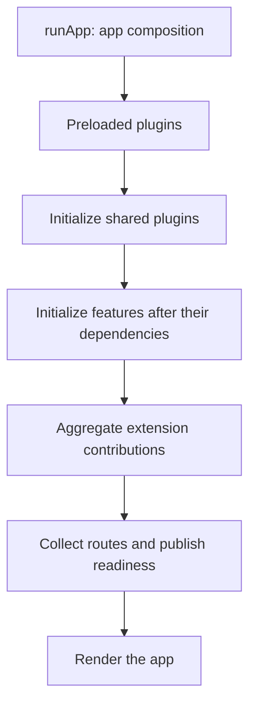
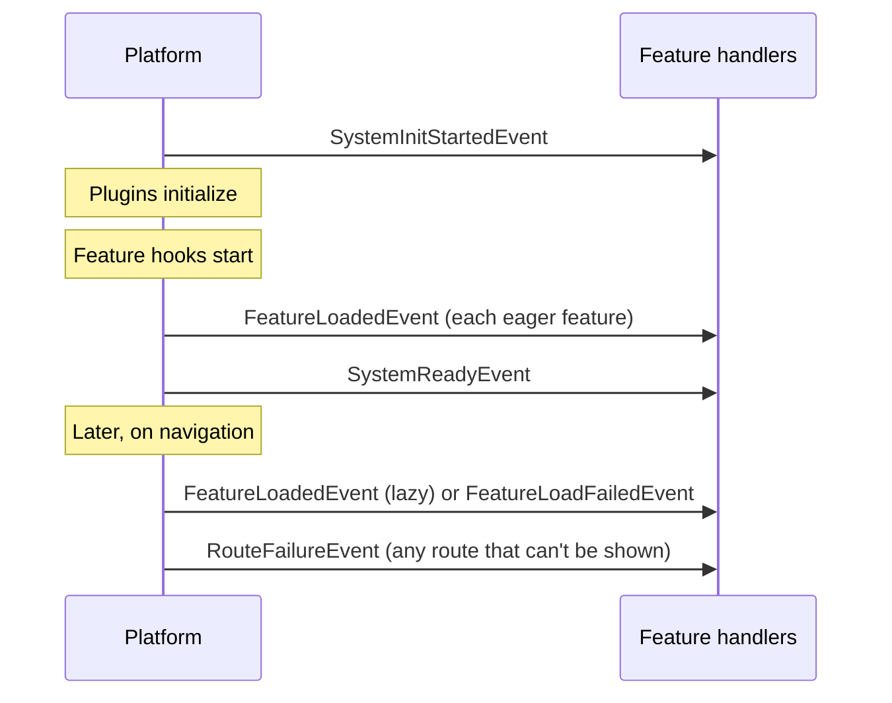

# Startup and lifecycle

Vyuh brings the shared capabilities online before initializing features. A feature can then use those plugins in its initialization hook, contribute extensions, and expose routes.

## When features hear about it

A feature's [event handlers](/guides/events) and
[redirects](/guides/routes-and-navigation#feature-redirects) start before any
feature's `init` runs, and stop when the feature is disposed. The platform
emits these events as it goes:

If startup fails, the platform emits `SystemInitFailedEvent` and shows the
startup failure screen in the app's theme.

## Feature dependencies

`FeatureDescriptor.dependencies` lists other feature names. The platform orders the graph and waits for each declared dependency before running a dependent feature’s initialization. Independent features can initialize concurrently. Missing dependencies and cycles produce startup errors; adding a dependency should describe a real initialization requirement, rather than an incidental UI relationship.

A dependency name must match the descriptor’s `name`. The framework does not discover or download packages from these names: the app supplies the descriptors.

## Lazy features

A `LazyFeatureDescriptor` supplies a loader and route prefixes. The loader imports or constructs the feature when requested. Concurrent requests for the same feature share the load. A failed loader can be retried. A lazy feature has the same app-level behaviour as an eager one: its event handlers and redirects start when it activates and roll back with everything else if activation fails. Keep the returned descriptor’s name aligned with the lazy descriptor, and declare any feature dependencies.

Deferred Dart imports can reduce initial code loading on targets that support them. A lazy descriptor by itself does not guarantee a smaller binary or faster startup: measure the release artifact and the first navigation into the feature.

## Cleanup

On dispose, feature event handlers and redirects are removed first. Then feature disposal hooks run, before extension builders and plugins are disposed, so cleanup can still use the services the feature depends on. A restart works the same way: the previous features stop first, while their plugins and DI registrations still exist, and then the plugins reset. A feature's `dispose` can always use the services it registered. Feature hooks run in reverse dependency order. Dispose subscriptions, controllers, and feature-owned state in the feature that created them.

Plugins own their own connections and storage handles. Consult the concrete plugin’s contract for platform setup and persistence behavior.

## Observe readiness

Use the platform’s readiness APIs before accessing a feature that may still be loading. In tests, await readiness or the error state and dispose the platform between independently initialized cases.

See the [core API reference](/api/vyuh-core), [feature descriptors guide](/guides/feature-descriptors), and [test helpers](/api/vyuh-test).
