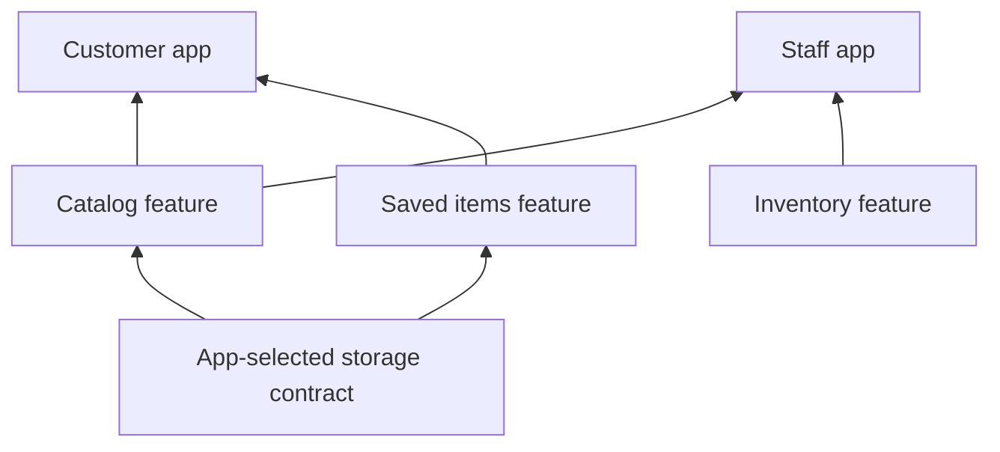

# Build around the parts of your product

A growing Flutter app collects more than screens. Catalog owns product browsing, account owns identity settings, and checkout owns a purchase journey. Each needs routes, state, services, setup, and cleanup. When those responsibilities are scattered across an app, a small change can require knowledge of the whole codebase.

Vyuh gives each product capability a public entry point: a `FeatureDescriptor`. The app selects descriptors and shared plugin implementations. The runtime brings their contributions together and manages startup around those declarations.

<FrameworkLayers />

## A feature is a boundary for ownership

Package the code that changes together: UI, routes, domain state, and feature-owned services. Export the descriptor and the contracts consumers need. Keep implementation details inside the package.

For example, a catalog team can change search results without editing checkout's screens. The consuming app still decides whether catalog is included, which capabilities it receives, and how its public routes fit the product.

This is a code and lifecycle boundary. It does not isolate features into separate processes or independently deployed binaries. A normal Flutter build still compiles the selected packages together.

## Plugins keep infrastructure choices with the app

Multiple features often need the same authentication session, storage, network client, or telemetry destination. A plugin provides a contract for that capability. The app selects its implementation once; features consume the contract.

Two apps can reuse the same feature while configuring different storage or telemetry adapters. A test can supply a deterministic implementation. A custom capability can extend `Plugin` and be configured through `PluginDescriptor.others`.

The useful separation is between **what the feature needs** and **how the app supplies it**. Putting a vendor client behind a contract only helps if the feature stops depending on vendor-specific assumptions.

## Composition stays visible

The app entry point is the composition root. It shows the selected features, plugin implementations, and initial route. Each feature declares its routes and lifecycle hooks; extension descriptors declare contributions to a shared builder.

A feature dependency names a prerequisite that must finish initialization first. Declare it when one feature reads another feature's initialized service. Features that only share an app-configured plugin do not need to depend on each other.

## Reuse a coherent slice

Move a feature package into a second app by importing its descriptor and supplying its required capabilities. Keep route expectations, configuration, and public dependencies explicit. This makes reuse reviewable rather than relying on copied source files and hidden app globals.

If only part of a feature should travel, give that slice its own package and descriptor. Arbitrarily copying a screen can leave its service and lifecycle dependencies behind. Portability follows the boundary you designed; it is not automatic.

## Own resource lifetimes

Feature hooks initialize and release feature-owned resources. Plugins own their shared resources. Widgets own controllers and subscriptions whose lifetime follows the screen. Close resources in the layer that created them.

This gives teams a place to discuss correctness: which prerequisite is ready, who owns a registration, and what remains valid during shutdown. See [startup and lifecycle](runtime-lifecycle) for the runtime sequence and current lazy-loading limits.

## Choose the structure when it earns its cost

Vyuh is useful when a product has several capabilities, multiple contributing teams, shared infrastructure, or features reused across apps. The descriptors and contracts make those boundaries explicit.

A small, short-lived app with a few tightly related screens may need only Flutter packages and ordinary routing. Vyuh adds conventions and lifecycle coordination; it also asks you to maintain meaningful boundaries. Avoid splitting every widget into a feature or wrapping every local helper in a plugin.

State management remains your choice. Features can use Flutter state, MobX, Riverpod, or Bloc. Backend selection also belongs to the app. Vyuh's contribution is the composition and lifecycle around those choices.

## See the boundaries working

Follow [Compose features](/intro/compose-features) for a complete app where Bookmarks and Insights share one plugin. Then use [Designing features](/guides/designing-features) to choose boundaries for your own product.
