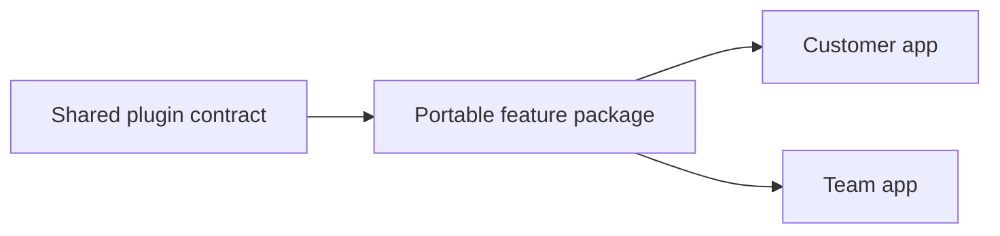

<script setup>
import FirstApp from './.vitepress/theme/components/FirstApp.md';
</script>

# Design system

The Vyuh website uses the same components across the homepage and documentation. This page renders those components directly, so the examples stay aligned with the site.

## Color

White gives the content room to breathe. The Vyuh logo’s indigo, **#5856D6**, marks links, borders, and emphasis. Primary actions use dark ink. Flutter and Dart keep their blue identities.

<div class="design-swatches"><div style="--swatch:#ffffff"><span></span><strong>White</strong><code>#FFFFFF</code></div><div style="--swatch:#5856d6"><span></span><strong>Vyuh indigo</strong><code>#5856D6</code></div><div style="--swatch:#202139"><span></span><strong>Ink</strong><code>#202139</code></div><div style="--swatch:#1684D8"><span></span><strong>Flutter blue</strong><code>#1684D8</code></div><div style="--swatch:#1684D8"><span></span><strong>Dart blue</strong><code>#1684D8</code></div></div>

Dark mode uses the same hierarchy with lighter text and indigo accents. Use the navigation’s appearance control to preview it.

## Typography

| Role | Typeface | Treatment |
| --- | --- | --- |
| Headings | DM Sans | Medium or semibold; bold for Flutter in the hero |
| Body | DM Sans | 18px default, relaxed line height |
| Captions and controls | DM Sans | Smaller, with sufficient contrast |
| Hero emphasis | Lora | Italic, used sparingly |
| Diagram annotations | Kalam | Handwritten labels |
| Code | JetBrains Mono | Used only for code and file names |

## Actions

Dark buttons carry primary actions. Text links carry secondary actions. Arrows move toward the destination on hover and keyboard focus, using a 180ms transition. Reduced-motion preferences keep the arrows stationary.

<div class="design-actions"><ActionLink href="/intro/get-started" variant="primary">Build your first feature</ActionLink><ActionLink href="/concepts/">Explore the concepts</ActionLink><ActionLink href="https://vyuh.tech" external>Vyuh Technologies</ActionLink></div>

```vue
<ActionLink href="/intro/get-started" variant="primary">
  Build your first feature
</ActionLink>
<ActionLink href="/concepts/">Explore the concepts</ActionLink>
<ActionLink href="https://vyuh.tech" external>Vyuh Technologies</ActionLink>
```

## Architecture blocks

The foundational capabilities sit at the bottom. Features use those capabilities. Apps compose the features. Each layer includes concrete examples and its role in the product.

<FrameworkLayers />

## Sketch diagrams

Documentation diagrams use one renderer, with handwritten labels, sketch borders, the site palette, and accessible labels. Diagrams load when near the viewport and update with the selected theme.



Write a fenced `mermaid` block to use this renderer. Edit the diagram source directly in the page’s Markdown. The page renders only the SVG diagram.

## Code blocks

Dart examples use the documentation’s syntax highlighter, including the homepage. This is the same first-app example used there.

<FirstApp />

## Footer and brand

The shared footer below appears on the homepage and documentation. It includes the tagline, copyright, website, design system link, GitHub, and Twitter / X. The small brand mark uses the existing Vyuh Rive asset, with a static logo fallback. Playback pauses offscreen and when the page is hidden; reduced-motion users see the static logo.
