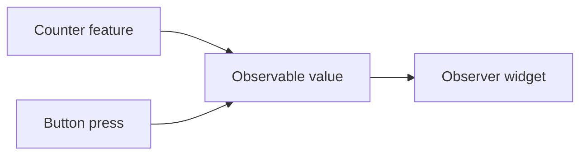

# Counter

This shows the most fundamental aspect of the Vyuh Framework -- _creating features_. In this example we create a simple feature and expose it on the `/counter` route. It is the classic Flutter counter example wrapped up as a self-contained Vyuh feature.



## What You'll Learn

- Creating a `FeatureDescriptor` to define a feature with metadata and routes
- Setting up routes with `GoRoute` from the `go_router` package
- Using MobX for reactive state management with `.obs()` observables
- Using the `Observer` widget for reactive UI that rebuilds automatically

## The Feature Descriptor

Every Vyuh feature starts with a `FeatureDescriptor`. This is the entry point that tells the framework everything it needs to know about the feature: what it is, what it looks like, and how to navigate into it.

```dart
final feature = FeatureDescriptor(
  name: 'counter',
  title: 'The classic Flutter counter',
  description: 'A simple counter that tracks the number of button presses',
  icon: Icons.add_circle_outlined,
  routes: () async {
    return [
      GoRoute(
        path: '/counter',
        builder: (context, state) => const _Counter(),
      ),
    ];
  },
);
```

Let's break this down:

- **`name`**, **`title`**, **`description`**, and **`icon`** are metadata fields that identify the feature. These show up in the Vyuh Developer Tools and help your team understand what the feature contains.
- **`routes`** is an async function that returns a list of `GoRoute` objects. Since Vyuh uses `go_router` under the hood, everything you already know about `go_router` applies here. The counter feature exposes a single route at `/counter` that renders the `_Counter` widget.

::: tip Metadata Matters
Take a moment to set meaningful metadata on your features. It pays off when you are debugging with the Developer Tools or when a teammate is browsing through the available features in the app.
:::

## Reactive State with MobX

The counter widget uses MobX for state management. MobX provides a simple reactive model: you mark data as observable, and any widget wrapped in an `Observer` rebuilds automatically when that data changes.

```dart
class _Counter extends StatefulWidget {
  const _Counter();

  @override
  State<_Counter> createState() => _CounterState();
}

class _CounterState extends State<_Counter> {
  final counter = 0.obs(); // MobX observable

  @override
  Widget build(BuildContext context) {
    return Scaffold(
      appBar: AppBar(title: const Text('Counter')),
      body: Column(
        mainAxisAlignment: MainAxisAlignment.center,
        crossAxisAlignment: CrossAxisAlignment.stretch,
        children: [
          const Text(
            'Number of Button presses',
            textAlign: TextAlign.center,
          ),
          Observer(
            builder: (_) => Text(
              '${counter.value}',
              style: Theme.of(context)
                  .textTheme
                  .displayLarge
                  ?.apply(fontFamily: 'Courier New', fontWeightDelta: 2),
              textAlign: TextAlign.center,
            ),
          ),
        ],
      ),
      floatingActionButton: IconButton.filled(
        icon: const Icon(Icons.add),
        onPressed: () => runInAction(() => counter.value++),
      ),
    );
  }
}
```

Three MobX concepts are at play here:

1. **`.obs()`** -- Creates an `Observable` from a plain value. Here, `0.obs()` wraps the integer `0` in a reactive container so MobX can track reads and writes.
2. **`Observer`** -- A widget that automatically rebuilds whenever the observables it reads inside its `builder` change. Only the `Text` widget displaying the count rebuilds when the counter changes, not the entire widget tree.
3. **`runInAction()`** -- Batches mutations to observables. When the floating action button is pressed, `runInAction(() => counter.value++)` increments the counter and notifies all observers in a single pass.

::: info MobX is optional
MobX is used here for convenience, but it is not a requirement. You are free to use any state management approach you prefer, such as `setState`, Riverpod, Bloc, or anything else.
:::

## Running with Vyuh

With the feature defined, wiring it into the app is straightforward. Replace your `main.dart` with the following:

```dart
import 'package:material_ui/material_ui.dart';
import 'package:vyuh_core/vyuh_core.dart' as vc;
import 'feature.dart';

void main() async {
  WidgetsFlutterBinding.ensureInitialized();

  vc.runApp(
    initialLocation: '/counter',
    platformWidgetBuilder: vc.PlatformWidgetBuilder.system.copyWith(
      appBuilder: (_, platform) => MaterialApp.router(
        routerConfig: platform.router.instance,
      ),
    ),
    features: () => [feature],
  );
}
```

The `vc.runApp` call bootstraps the Vyuh framework with your list of features and sets `/counter` as the initial route. That single route from the feature descriptor is all the framework needs to render the counter screen on launch.

Run the app with:

```shell
flutter run
```

## Key Takeaways

- **Features are self-contained units** with their own routes, widgets, and state. The counter feature is a single Dart file that packages everything together.
- **State belongs to the feature** -- the route mounts a counter widget with its own observable value and rendering lifecycle.
- **MobX provides simple reactive state management** through observables and observers, keeping UI updates efficient and the code concise.
- **The same feature can be dropped into any Vyuh app.** Because features are independent descriptors, you can reuse the counter feature across projects by simply adding it to the `features` list in `runApp`.

::: info Full Walkthrough
For a step-by-step guide that covers project setup, package installation, and building this example from scratch, see the [Quick Start](/intro/get-started) guide.
:::

::: tip Read the Code
See the code for the example on GitHub:
[Counter](https://github.com/vyuh-tech/vyuh/blob/main/examples/feature_counter)
:::
