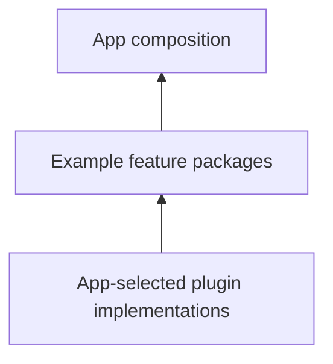

# Examples

Each example is a feature package that an app can compose alongside other features. Study its descriptor, routes, state, and shared capability calls together.

| Example | What to study |
| --- | --- |
| [Shared plugin](shared-plugin) | Two feature descriptors consuming one app-selected capability |
| [Counter](counter) | A route, observable state, and a small Flutter screen |
| [Unsplash](unsplash) | Feature-owned state and external API integration |

## Run the examples

The [framework repository](https://github.com/vyuh-tech/vyuh/tree/main/examples) contains the source packages. Read each example’s setup instructions: external APIs need their own configuration.

Begin with the [quick start](/intro/get-started), then [compose two features](/intro/compose-features) with a shared in-memory capability.
