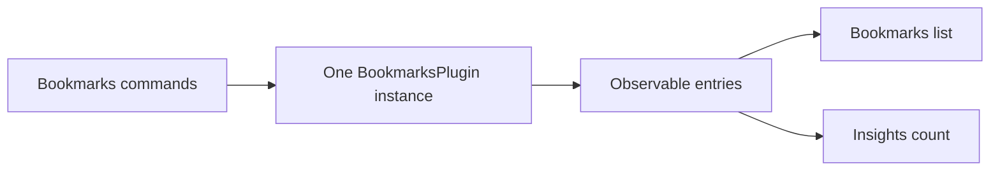

# Share a capability between features

Bookmarks and Insights demonstrate the three-layer model with ordinary Flutter widgets. The app chooses a memory plugin. Both feature descriptors contribute their own routes, and their screens consume the shared contract.

The [complete walkthrough](/intro/compose-features) includes setup, runnable code, ownership, and package extraction. The checked-out example lives in `vyuh_core/example/composed_app.dart` and is synchronized into the documentation from source.

Use this example to see:

- App-owned selection through `PluginDescriptor.others`.
- Feature-owned routes through `FeatureDescriptor`.
- Contract lookup with `getPlugin<BookmarksPlugin>()` after initialization.
- Shared data observed with Flutter's `ValueListenableBuilder`.
- Cleanup owned by the plugin and widget layers that created the resources.

The memory adapter retains entries for one platform lifecycle. A persistence adapter needs an explicit loading/error contract if its operations are asynchronous. Companion links are app-supplied, so Insights can also run in an app that omits the Bookmarks feature.
