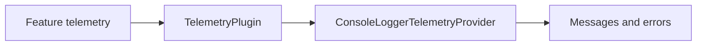

# Console telemetry

`ConsoleLoggerTelemetryProvider` sends messages and errors to the console through the logger package. Configure it as a provider inside the core `TelemetryPlugin`, then let features use the shared telemetry capability.



## Configure the provider

This configuration fragment goes in your app's `vc.runApp` call:

```dart
import 'package:vyuh_core/vyuh_core.dart' as vc;
import 'package:vyuh_plugin_telemetry_provider_console/vyuh_plugin_telemetry_provider_console.dart';

final plugins = vc.PluginDescriptor(
  telemetry: vc.TelemetryPlugin(
    providers: [ConsoleLoggerTelemetryProvider()],
  ),
);
```

After platform initialization:

```dart
await vc.vyuh.telemetry.reportMessage(
  'Catalog loaded',
  level: vc.LogLevel.info,
);
await vc.vyuh.telemetry.reportError(
  StateError('Catalog request failed'),
  stackTrace: StackTrace.current,
);
```

The current implementation formats console output with colors disabled. It does not render the `params` map. Its `startTrace` returns `NoOpTrace`, so it does not record trace timings or metrics. Choose another provider when you need those capabilities or delivery to an external service.

[API reference](/api/vyuh-plugin-telemetry-provider-console) · [Package source](https://github.com/vyuh-tech/vyuh/tree/main/packages/plugins/vyuh_plugin_telemetry_provider_console)
